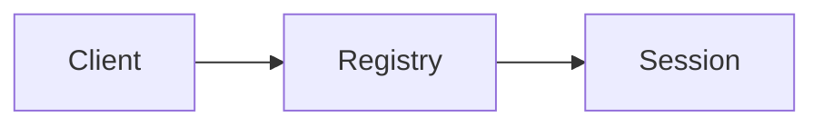
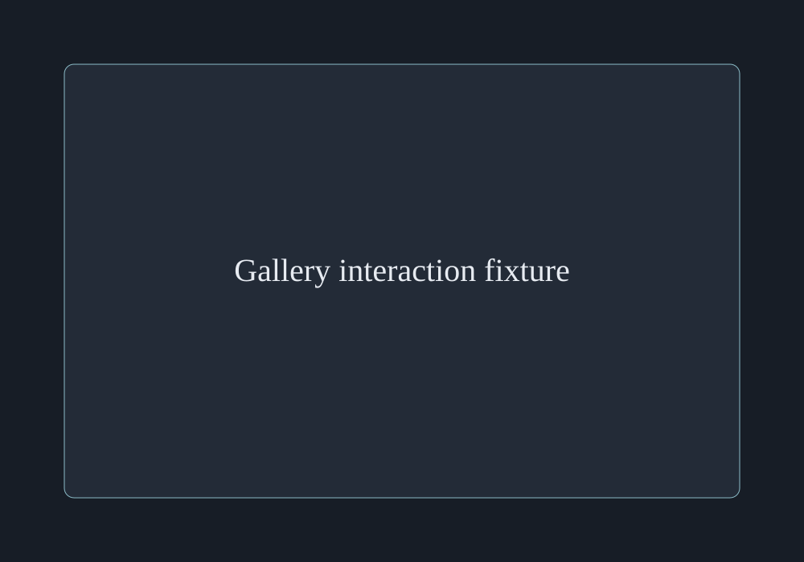

# Session reconnection

A session survives a transport disconnect. **Registry ownership** and *transport lifetime* are separate.

## Required behavior

- Retain the running session.
- Reconnect using the known session id.
  - Reject an expired session.

1. Look up the session.
2. Check expiry.
3. Attach the new transport.

- [x] Define ownership.
- [ ] Verify recovery after reconnect.

- [x] Parent checklist with a loose paragraph.

  The explanatory paragraph stays below its label.

  - [ ] Nested checklist item that retains its checkbox and wraps beneath the label on a narrow view.

> A disconnect is a transport event, not a command to destroy the session.

## Ownership table

| Owner | Responsibility | Evidence |
| --- | --- | --- |
| Registry | Session lookup | Stable session id |
| Transport | Message delivery | Current connection |

## Literal code

```typescript
const result = count < 3 ? "<registry>" : "</script>";
return session;
```

Inline `Map<SessionId, Session>` stays code. ~~The socket owns lifetime.~~

## Mermaid from the same Markdown file



## Recovery

Reconnect finds the existing session. [Return to the ownership table](#ownership-table).

## Capture


