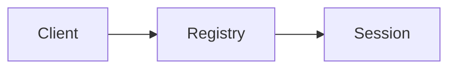

# Session ownership

This Markdown file is the one source for the rendered page and its source panel.

## Ownership

A session belongs to the registry. The transport only carries messages.

The literal `<registry>` stays prose. [Read the recovery rule](#recovery).

## Recovery

Reconnect to the same session after a transport interruption.

| Event | Reader-visible outcome |
| --- | --- |
| Transport closes | Session remains available |
| Transport reconnects | Registry finds the existing session |

