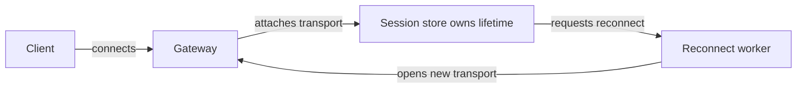

# Session reconnection

Synthetic design example — not a claim about any product

Today, closing a transport also destroys the logical session. Move session lifetime into the session store so a new transport can attach to the same session.

## Current architecture

## Proposed architecture

<Callout type="decision">
	The session store owns session lifetime; the reconnect worker owns reconnection attempts.
</Callout>

<Compare>
## Reconnect inside transport
- pro: Fewer components to introduce
- con: Session lifetime remains coupled to a connection

## Reconnect owned by session

- pro: One session survives replacement transports
- con: Attachment and cleanup rules need explicit ownership

</Compare>

<Phase title="Define attachment ownership" status="planned">
	Specify one active transport per session and refusal of stale attachments.
</Phase>

<Phase title="Move lifetime into the store" status="planned">
	Add a reconnect worker and replace the transport-local socket cache.
</Phase>

<Phase title="Exercise disconnect and reconnect" status="planned">
	Verify that the same session survives and a second attachment is refused.
</Phase>

<Callout type="risk">
	Two transports may race to attach. The session store must accept one active transport per session
	and refuse the stale attachment.
</Callout>
