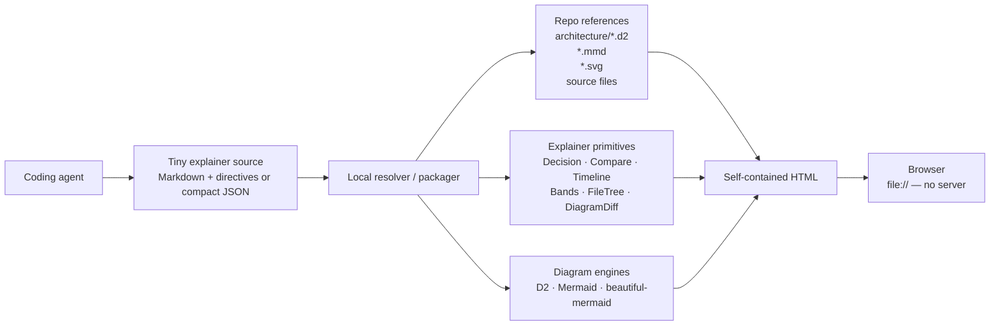
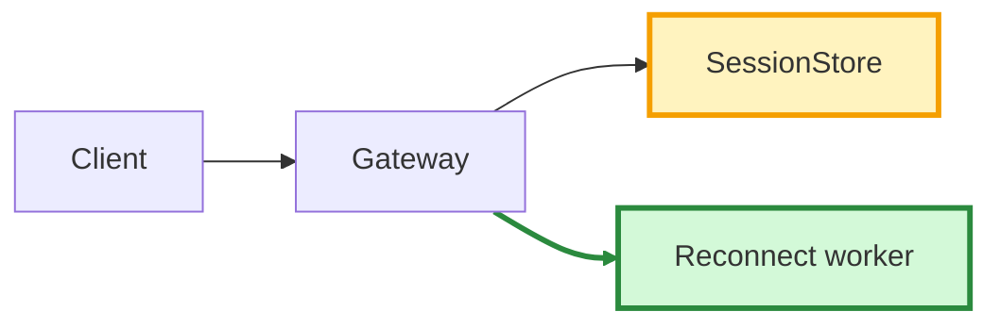
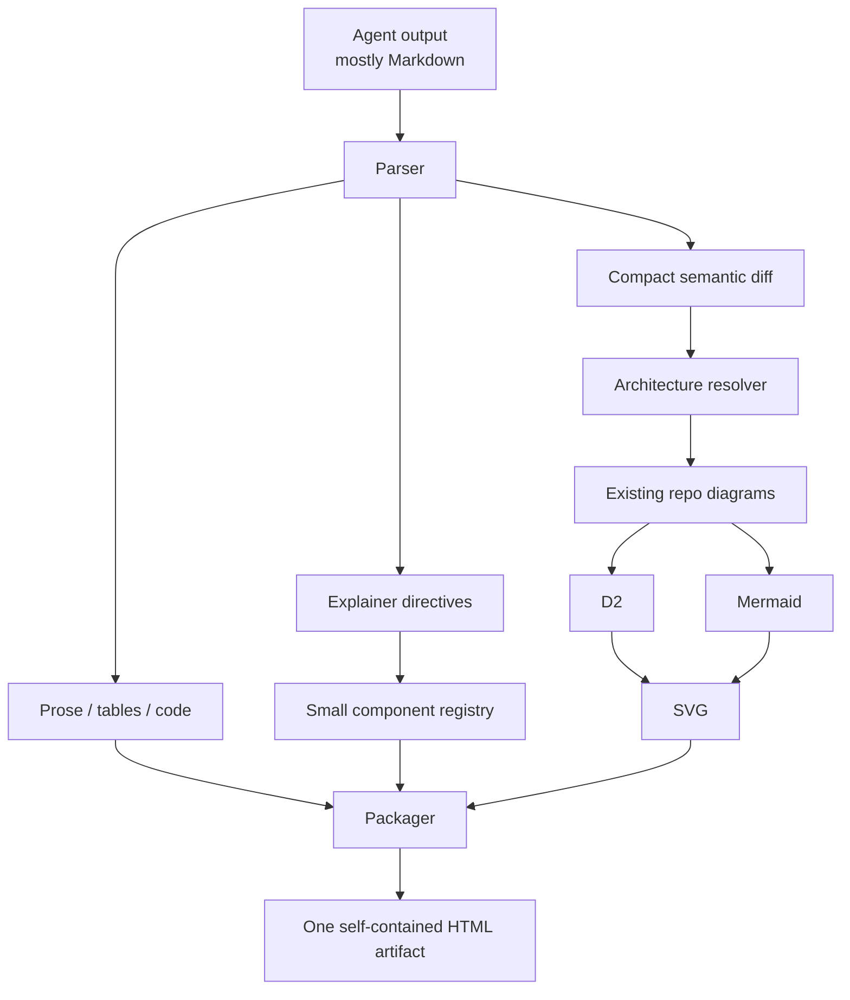

# Lightweight Visual Explainers for Agent-Written Architecture and Spec Plans

## Executive summary

The strongest design is **not “HTML vs. MDX vs. JSON.”** The important boundary is **what the agent has to generate versus what a deterministic renderer already knows how to do**.

For your use case, I would converge on this architecture:



The **agent emits only content, intent, references, and semantic changes**. It does not emit CSS, layout code, React code, diagram-viewer plumbing, or JavaScript. A local deterministic packager resolves repo files, renders diagrams, applies your design system, and emits one self-contained `.html` file. That preserves the thing you like about Claude artifacts—the final output is a beautiful browser document—without making the model rebuild a website on every turn.

My judgment after looking across the ecosystem is:

| Conclusion | Judgment |
|---|---|
| **Best immediate off-the-shelf experiment** | [Visual Plan](https://github.com/brandonburrus/visualplan) and [visual-explainer](https://github.com/nicobailon/visual-explainer) Quick Mode |
| **Best long-term authoring format** | Markdown + a very small directive vocabulary, with compact JSON only for highly structured things such as graph diffs |
| **Best canonical architecture language** | **D2** when reuse/imports matter |
| **Best ad-hoc agent diagram language** | **Mermaid** |
| **Best very-light browser component layer** | Semantic HTML + Web Components, or plain DOM rendering; React is optional rather than foundational |
| **Best delivery artifact** | One self-contained HTML file that opens directly in a browser |
| **Best diff model** | Stable graph IDs + a semantic change set; do not make the model duplicate the entire “after” diagram |
| **What I would not start with** | Tambo, A2UI, or a full React generative-UI framework. They solve larger problems than yours. |

Two existing projects get surprisingly close. **Visual Plan** has agents write MDX using a fixed plan-oriented component vocabulary and compiles that into a single self-contained HTML page. citeturn17search1 **visual-explainer** has both a flexible HTML-generation mode and a “Quick Mode” where the agent emits a compact JSON spec which a bundled local renderer turns into HTML—the exact “move boilerplate out of model output” pattern you are looking for. citeturn18search1turn18search13

The gap I did **not** find solved cleanly by one project is your more interesting requirement:

> `architecture/session.d2` already exists. Show it, then explain a proposal by referencing it and declaring only what changes. Give me current, proposed, and diff views without reproducing the graph.

D2 gets closest at the diagram-language level because its official language has regular and spread imports, partial imports, and reusable classes; classes can apply to objects and connections and propagate into generated SVG class attributes. citeturn20view0turn21view0turn20view1turn21view2 But a higher-level **explainer diff primitive** is still worth adding.

A format like this is therefore more attractive to me than either raw HTML or arbitrary JSX:

```md
# Session reconnection

The transport should no longer own session lifetime.

:::diagram engine=d2 src="architecture/session.d2" title="Current architecture"
:::

:::diagram-diff base="architecture/session.d2" view=split
+ reconnect_worker
~ session_store
- transport_session_cache
:::

:::decision status=proposed
Decouple session lifetime from transport lifetime.
:::

:::timeline
1. Introduce reconnect worker
2. Move session ownership
3. Remove transport-local cache
:::
```

That is approximately the semantic density you want: **almost every generated token communicates the plan**.

## What the architecture should optimize for

A useful way to frame the problem is that there are actually four artifacts, and they should not all be the same thing:

| Layer | What it should optimize for | Recommendation |
|---|---|---|
| **Agent authoring representation** | Few tokens, easy generation, easy edits | Markdown + directives, optionally compact JSON |
| **Repository architecture representation** | Reuse, stable IDs, source control | D2 / Mermaid / SVG, preferably D2 when composition matters |
| **Rendering system** | Visual quality, consistency, interactivity | Deterministic component library |
| **Delivery artifact** | Zero-friction viewing | Self-contained HTML |

This is why **MDX's viewer problem is real but not fatal**. Browsers do not natively understand MDX; MDX is Markdown plus JSX that is compiled to JavaScript before execution. MDX itself does not require a runtime, but compilation is part of the model. citeturn4view3 Visual Plan demonstrates the right way to hide that complexity: the author writes MDX, the tool compiles it, and the user receives a single self-contained HTML document. citeturn17search1

Likewise, “client-only” does not need to mean “all transformation happens in the browser.” For your workflow, I think that would be a mistake. **A local CLI can do build-time work without creating a server architecture.** D2 rendering, repo-file resolution, syntax highlighting, SVG inlining, and MDX compilation can all happen once; the resulting artifact can contain no network dependency and no server requirement.

That gives you a particularly clean pipeline:

```text
agent writes 2 KB plan.explain.md
              │
              ▼
      explain build plan.explain.md
              │
        ┌─────┴──────────────┐
        │                    │
  read repo files       render diagrams
  resolve code refs     inline SVG
  calculate diff        apply component CSS
        │                    │
        └─────┬──────────────┘
              ▼
       plan.explainer.html
              │
              ▼
          open browser
```

The **source document can remain disposable** if desired. The renderer/runtime is the thing worth checking into a tool repository; individual generated explainers need not become application code.

There is also an important token-cost nuance: **JSON is not automatically the cheapest representation.** JSON is excellent for a shallow typed component tree, but prose-heavy documents repeatedly pay for property names, quotes, arrays, and nesting. Markdown is extremely token-efficient for prose, tables, code, and headings. That makes a hybrid especially compelling:

```md
Ordinary prose stays ordinary Markdown.

:::decision status=accepted
Sessions outlive transport connections.
:::

:::diagram-diff src="architecture/sessions.d2"
{"add":["reconnect_worker"],"change":["session_store"],"remove":["socket_cache"]}
:::
```

The JSON appears only where the structure itself carries meaning.

The primitives I would keep in the first version are deliberately small: `Band`/`Layer`, `Decision`, `Callout`, `Compare`, `Timeline`/`Phase`, `FileTree`/`FileChange`, `Diagram`, `DiagramDiff`/`BeforeAfter`, `Legend`, `Chip`, `Code`/`CodeDiff`, and perhaps `Metric`/`Table`. Ten or twelve good primitives are more useful than fifty generic UI components because they give the agent a vocabulary for **software-design explanation**, rather than a vocabulary for building arbitrary applications.

Interactivity should follow the same rule. The renderer should own a small set of useful behaviors—source/diagram toggle, before/after/split/overlay, pan/zoom, collapsible detail, hover-to-correlate diagram nodes with prose, and perhaps step-through flows. The model should **declare** those interactions, never generate their JavaScript.

## Comparing the full option spectrum

The token ratings below are **qualitative estimates of agent-authored output**, assuming the theme/component implementation already exists. They are not measured benchmark results; I give a benchmark design later.

| Approach | Agent emits | Agent token cost | Viewer/runtime | Build step | Visual ceiling |
|---|---|---:|---|---|---|
| **Semantic HTML + reusable CSS** | HTML elements/classes | Low–medium | Browser-native + CSS | None for simple content; useful pack step for diagrams/assets | High |
| **HTML + Web Components** | Custom semantic elements | **Low** | Tiny prebuilt JS + CSS | None after runtime is built; pack recommended | **High** |
| **Markdown + extensions** | Markdown + fenced diagrams/directives | **Very low** | Markdown parser + component hooks | Either browser parse or local compile | High |
| **MDX + components** | Markdown + JSX components | Low | Compiled component runtime or static HTML | **Yes** | **Very high** |
| **JSON / declarative DSL** | Typed blocks/tree | Low for structured content; medium for prose | Tiny custom renderer or registry | Optional | High |
| **React component registry** | JSX or, preferably, JSON spec | Low–medium | React + registry | Viewer build once | **Very high** |

The capabilities that matter specifically to your workflow differ more sharply:

| Approach | Mermaid / D2 / SVG | Refer existing diagram file | Before/after semantics | Client-only | Easy final viewer | Main weakness |
|---|---|---|---|---|---|---|
| Semantic HTML + CSS | Good with adapters | Easy for SVG; D2 needs resolver | Easy CSS statuses; graph semantics custom | ★★★★★ | ★★★★★ | Agent still writes structural markup |
| Web Components | **Excellent adapter point** | **Excellent via `src=` + packager** | **Excellent custom element** | ★★★★★ | ★★★★★ | You own ~10 components |
| Markdown + extensions | Excellent fenced syntax | **Excellent with custom directive** | Excellent with `diagram-diff` extension | ★★★★★ after packaging | ★★★★★ after packaging | You create a tiny Markdown dialect |
| MDX + components | **Excellent** | **Excellent** | **Excellent** | ★★★★★ final artifact | ★★★ raw / ★★★★★ compiled | Mandatory compiler |
| JSON DSL | **Excellent** | **Excellent** | **Excellent and strongly typed** | ★★★★★ | ★★★★★ | JSON gets verbose for prose |
| React registry | Excellent | Excellent | **Excellent** | ★★★★☆ | ★★★★☆ | More runtime/build than problem requires |

My weighted decision matrix for your priorities is:

| Option | Low tokens | No server | Fast load | Diagram reuse | Diff/highlight | Easy viewer | Overall fit |
|---|---:|---:|---:|---:|---:|---:|---:|
| Semantic HTML + CSS | 3.5 | 5 | **5** | 3 | 4 | **5** | 4.2 |
| Web Components | 4.5 | **5** | **5** | 4.5 | **5** | **5** | **4.8** |
| Markdown + extensions | **5** | **5*** | 4.5 | 4.5 | 4.5 | **5*** | **4.8** |
| MDX + components | 4.5 | **5*** | 4.5 | **5** | **5** | 4* | **4.7** |
| JSON + tiny DOM renderer | 4 | **5** | **5** | **5** | **5** | **5** | **4.8** |
| React registry | 4 | 5 | 3.5 | **5** | **5** | 4 | 4.4 |

`*` means “after a one-command static packaging step.” That qualification matters. Raw Markdown and raw MDX are not themselves the polished viewer.

The conclusion is less contradictory than the scores make it look: **Markdown, Web Components, and JSON are complementary layers**, not competing final architectures.

A very good implementation would be:

```text
Markdown + directives          ← primary agent language
        │
        ├── compact JSON       ← structured diff payloads
        │
        ▼
Web Component / DOM registry   ← renderer implementation
        │
        ▼
self-contained HTML            ← delivery
```

That design takes the strongest property from each option.

Here is what the agent-facing syntax looks like across the spectrum.

**Semantic HTML + reusable CSS**

```html
<section class="band" data-status="changed">
  <h2>Session ownership</h2>
  <p>Move ownership from the transport to SessionStore.</p>
</section>

<figure class="diagram" data-src="architecture/session.svg">
  <figcaption>Current architecture</figcaption>
</figure>

<aside class="decision" data-status="proposed">
  Sessions outlive transport connections.
</aside>
```

The viewer can be nothing more than:

```html
<link rel="stylesheet" href="explainer.css">
<script defer src="explainer.js"></script>
```

The final packager can inline those two files, leaving a standalone HTML artifact.

**Web Components**

```html
<x-diagram
  engine="d2"
  src="architecture/session.d2">
</x-diagram>

<x-diagram-diff
  base="architecture/session.d2"
  changes="reconnect-v2"
  mode="split">
</x-diagram-diff>

<x-decision status="proposed">
  Sessions outlive transports.
</x-decision>
```

Viewer:

```html
<script src="explainer-elements.min.js"></script>
```

This is particularly attractive because the HTML remains readable even to the model and to a human inspecting the source. The `x-diagram-diff` implementation can do all of the expensive work.

I would still resolve `src=` references at packaging time rather than depending on runtime reads from `file://`. That also means the final artifact remains portable if the architecture folder moves or the file is sent to another person.

**Markdown + extensions**

```md
# Session reconnect

Transport lifetime and session lifetime are currently coupled.

:::diagram engine=d2 src="architecture/session.d2"
:::

:::diagram-diff base="architecture/session.d2" mode=overlay
+ reconnect_worker
~ session_store
- socket_cache
:::

:::decision status=proposed
Persist the session independently of its active transport.
:::
```

The browser artifact can internally contain:

```html
<script id="explainer-source" type="text/markdown">
  <!-- source inserted here by packager -->
</script>
<script src="explainer-viewer.min.js"></script>
```

or, more efficiently, the packager can turn the Markdown into finished semantic HTML and ship almost no parsing runtime at all.

**MDX + predefined components**

```mdx
# Session reconnect

<Diagram engine="d2" src="architecture/session.d2" />

<DiagramDiff
  base="architecture/session.d2"
  added={["reconnect_worker"]}
  changed={["session_store"]}
  removed={["socket_cache"]}
/>

<Decision status="proposed">
  Persist sessions independently of transports.
</Decision>
```

That is very pleasant authoring syntax. The cost is compilation. Visual Plan is a concrete implementation of this architecture: agent-oriented MDX in, fixed components, self-contained HTML out. citeturn17search1 In other words, **MDX itself is not the problem; exposing MDX compilation to the user is the problem.**

**Declarative JSON**

```json
{
  "v": 1,
  "title": "Session reconnect",
  "blocks": [
    {
      "t": "diagram",
      "engine": "d2",
      "src": "architecture/session.d2"
    },
    {
      "t": "diagramDiff",
      "src": "architecture/session.d2",
      "add": ["reconnect_worker"],
      "change": ["session_store"],
      "remove": ["socket_cache"]
    },
    {
      "t": "decision",
      "status": "proposed",
      "text": "Persist sessions independently of transports."
    }
  ]
}
```

Viewer:

```html
<script id="spec" type="application/json">
  { "...": "spec is embedded here" }
</script>
<script src="explainer-runtime.min.js"></script>
```

That is close to visual-explainer Quick Mode and to the catalog/spec idea in json-render. visual-explainer explicitly provides a compact JSON Quick Mode rendered by bundled local code, while json-render separates a typed component catalog from a JSON element tree and maps those declared component types to renderer implementations. citeturn18search1turn16search8turn16search14

A deliberately small JSON Schema could be:

```json
{
  "$schema": "https://json-schema.org/draft/2020-12/schema",
  "type": "object",
  "required": ["v", "title", "blocks"],
  "properties": {
    "v": { "const": 1 },
    "title": { "type": "string" },
    "blocks": {
      "type": "array",
      "items": {
        "type": "object",
        "required": ["t"],
        "properties": {
          "t": {
            "enum": [
              "band",
              "decision",
              "diagram",
              "diagramDiff",
              "compare",
              "timeline",
              "fileTree",
              "callout"
            ]
          },
          "src": { "type": "string" },
          "engine": { "enum": ["d2", "mermaid", "svg"] },
          "status": {
            "enum": ["neutral", "added", "changed", "removed", "proposed"]
          },
          "text": { "type": "string" }
        }
      }
    }
  }
}
```

I would probably make the production schema a discriminated union so each primitive has precisely validated properties, but I would resist turning it into an entire general-purpose UI language.

**React component registry**

The agent should still produce data, not React:

```json
{
  "type": "BeforeAfter",
  "props": {
    "src": "architecture/session.d2",
    "added": ["reconnect_worker"],
    "changed": ["session_store"]
  }
}
```

Then the one-time viewer contains the code:

```tsx
const registry = {
  Diagram,
  BeforeAfter,
  Decision,
  Timeline,
  FileTree,
};

createRoot(document.getElementById("root")!).render(
  <ExplainerRenderer spec={spec} registry={registry} />
);
```

This is essentially the pattern generalized by json-render: a catalog defines allowed components and typed props, and a renderer maps JSON elements to implementations. json-render now supports multiple renderer ecosystems, while its React integration exposes a renderer and provider structure. citeturn16search2turn16search5turn16search26 Its repository is Apache-2.0 licensed. fileciteturn13file0L1-L5

React therefore **does not imply a server**. You can prebuild a 100% static client once and inject different specs forever. My objection is narrower: unless the explainer needs sophisticated stateful interaction, React solves little that a 20–40 KB purpose-built Web Component/DOM runtime cannot solve.

## Diagram engines, reuse, and architecture diffing

This is where I think the choice becomes much clearer.

**Mermaid and D2 are not interchangeable for your use case.**

Mermaid has a superb property for agents: a useful graph takes very few tokens, and browser rendering is straightforward. Its official integration can render definitions in `.mermaid` elements from an ES module, and multiple diagrams can live on one page. Mermaid also now provides a smaller “Tiny” distribution for cases where some diagram families and features can be omitted. citeturn21view7

A minimal client-side integration is:

```html
<pre class="mermaid">
flowchart LR
  Client --> Gateway --> SessionStore
</pre>

<script type="module">
  import mermaid from "./vendor/mermaid.esm.min.mjs";

  mermaid.initialize({
    startOnLoad: true,
    securityLevel: "strict"
  });
</script>
```

The official documentation shows the same browser pattern using Mermaid's ESM package via a CDN; vendoring or bundling that module instead makes the explainer completely offline. citeturn21view7

And yes: **Mermaid can color changed nodes and edges.** Flowcharts support `classDef`, assigning classes to named nodes, and `linkStyle` for links. citeturn21view4turn21view6 For example:



That is enough for a generated one-off diff.

There is one important weakness: traditional Mermaid `linkStyle` addressing is tied to link declaration order, so relying on edge indexes as the persistent identity of architecture edges is fragile. The current flowchart syntax has added explicit edge IDs for some edge-level controls, but the official documentation still illustrates styling links by their order in the graph. citeturn21view6 For long-lived architecture plans, I therefore would **not use Mermaid source itself as your semantic diff database**.

D2 is better at architectural source reuse. Its official language supports importing entire D2 files, spreading imported contents into another map, partial imports, and paths relative to the importing source. citeturn20view0turn21view0 That enables a structure such as:

```text
architecture/
  system.d2
  auth.d2
  storage.d2
  session.d2

plans/
  reconnect/
    proposal.d2
```

Conceptually:

```d2
# proposal.d2
...@../../architecture/session

# proposal-specific additions / overrides follow
reconnect_worker: Reconnect Worker
session_store.style.stroke-width: 3
session_store -> reconnect_worker
```

The exact proposal rules are yours, but the important thing is that **the base graph is imported instead of copied**.

D2 classes are also reusable style bundles and can apply to both objects and connections. D2 writes applied class names into the resulting SVG as `class` attributes, explicitly enabling downstream CSS or JavaScript targeting. citeturn20view1turn21view2 That opens up a useful implementation:

```text
D2 semantic class        final explainer meaning
---------------------------------------------------
added                     green + “added” badge
changed                   amber + “changed” badge
removed                   red/dashed/low-opacity
focus                     highlighted on prose hover
```

For **true before/after semantics**, however, I would go one layer above either diagram DSL.

Maintain a change set:

```json
{
  "base": "architecture/session.d2",
  "changes": {
    "nodes": {
      "reconnect_worker": "added",
      "session_store": "changed",
      "socket_cache": "removed"
    },
    "edges": {
      "gateway->reconnect_worker": "added",
      "gateway->socket_cache": "removed"
    }
  }
}
```

Then let the renderer generate three views:

```text
Current
    canonical diagram

Diff
    old topology + additions + modifications + removals
    with explicit legend

Proposed
    resulting topology without removed elements
```

This avoids a very common bad representation:

```text
before.mmd   80 lines
after.mmd    83 almost-identical lines
```

The agent should instead communicate:

```text
+ reconnect_worker
~ session_store
- socket_cache
+ gateway -> reconnect_worker
- gateway -> socket_cache
```

That is the **biggest token-saving opportunity after removing generated CSS**.

For Mermaid files that already exist in a repository, your resolver can read the `.mmd` source and append node `class` assignments or generated styling before rendering. Mermaid's official flowchart documentation provides node and edge styling but, unlike D2's documented import mechanism, it does not provide the same repo-file composition model; file composition therefore belongs naturally in your explainer resolver. citeturn21view4turn21view6turn21view0

For D2, I would normally **render to SVG at packaging time and inline the SVG**. The final document then pays no D2 engine startup cost and works on `file://`; it can still retain SVG IDs/classes for interactions.

For Mermaid there are two reasonable modes:

```text
small / static explainer
    Mermaid -> SVG at pack time -> inline SVG

frequently edited / interactive explainer
    embed Mermaid source -> lazy-load browser renderer
```

The T3 Code work is useful empirical evidence here. One PR integrated regular Mermaid into the shared Markdown renderer via dynamic import, caching rendered output by source and theme and preserving a source toggle; it thereby avoids making ordinary Markdown views pay the diagram dependency upfront. [T3 Code PR #15067](https://github.com/pingdotgg/t3code/pull/15067) is a particularly relevant implementation reference. The T3 Code repository itself is MIT-licensed. fileciteturn14file0L1-L5

Another T3 Code experiment, [PR #14721](https://github.com/pingdotgg/t3code/pull/14721), tested **beautiful-mermaid** for static previews. The PR reports a substantially faster rendering path in its Chromium benchmark—about 10.9 ms versus 52.2 ms median first-source render and 4.05 ms versus 22.2 ms warm for beautiful-mermaid 1.1.3 versus Mermaid 12.0.0—but also documents a deliberately narrower syntax subset and a roughly 461 KB gzip lazy engine chunk in that implementation. Those figures are specific to that PR's versions and benchmark, not universal current-package numbers.

That matches beautiful-mermaid's intended tradeoff. The project exposes synchronous Mermaid-to-SVG rendering, has no DOM dependency, supports themes, and currently focuses on a subset of diagram types rather than full Mermaid compatibility. citeturn15search0turn15search5 I would consider it for your **ad-hoc agent diagrams**, but not make it the only renderer if agents need Mermaid directives, custom styles, subgraphs, or arbitrary Mermaid features.

Markmap sits elsewhere. Its browser autoloader can turn embedded Markdown into interactive mind maps client-side, making it excellent for a plan decomposition, dependency hierarchy, conceptual map, or repo taxonomy. citeturn4view2 It is not a substitute for D2/Mermaid architecture graphs or semantic graph diffing.

So my diagram stack would be:

| Need | Engine |
|---|---|
| Existing canonical architecture, composition, reusable repo files | **D2** |
| Agent invents a small sequence/flow/state diagram inline | **Mermaid** |
| Very fast/polished supported Mermaid subset | **beautiful-mermaid** |
| Plan hierarchy / conceptual breakdown | **Markmap** |
| Very custom one-off visual | Inline SVG escape hatch |
| Before/after | **Explainer-level graph diff primitive**, not a diagram language feature |

## Open-source projects worth borrowing from

The field is useful, but the projects fall into three quite different categories: **actual explainers**, **diagram primitives**, and **general generative-UI systems**. Treating them all as competitors obscures the answer.

| Project | What is useful here | Main limitation for your use case | License | Source |
|---|---|---|---|---|
| **Visual Plan** | Agent-friendly MDX vocabulary; polished engineering plans; compiles to one self-contained HTML artifact | MDX compile step; architecture-file diff/reuse is not the central abstraction | MIT | [GitHub](https://github.com/brandonburrus/visualplan) citeturn17search1 |
| **visual-explainer** | Rich visual-first pages plus **Quick Mode JSON → deterministic local HTML**; very close to your desired split | Quick vocabulary is generic; repo diagram references/diffs would need extension | MIT | [GitHub](https://github.com/nicobailon/visual-explainer) citeturn18search1turn18search13 |
| **beautiful-mermaid** | Fast synchronous SVG renderer, themes, no DOM dependency, good-looking diagrams | Subset rather than full Mermaid; less suitable for arbitrary Mermaid styling | MIT | [GitHub](https://github.com/lukilabs/beautiful-mermaid) citeturn15search0 |
| **D2** | File imports, modularity, reusable classes, excellent architecture-as-code base | Best as build-time renderer for this workflow; diff semantics still yours | MPL-2.0 | [D2](https://d2lang.com/) and [imports](https://d2lang.com/tour/imports/) citeturn20view0turn21view2 |
| **Markmap** | Tiny Markdown-to-mind-map primitive; great for hierarchies and planning trees | Specialized, not general architecture/diff rendering | MIT | [Project](https://markmap.js.org/) citeturn4view2 |
| **Tambo** | Good example of registering typed React components and letting an agent populate them | Primarily a React generative-UI/agent stack; too much machinery for a static explainer | MIT | [GitHub](https://github.com/tambo-ai/tambo) citeturn10search0turn10search4 fileciteturn15file0L1-L5 |
| **json-render** | Catalog + JSON tree + renderer architecture is an excellent design reference | General UI schema is broader than an explainer needs; React path adds runtime weight | Apache-2.0 | [GitHub](https://github.com/vercel-labs/json-render), [docs](https://json-render.dev/) citeturn16search2turn16search8 fileciteturn13file0L1-L5 |
| **A2UI** | Strong reference for declarative, component-mapped, streamable agent UI without arbitrary generated code | Protocol envelopes/data model are overkill for a one-shot local design document | Apache-2.0 | [A2UI](https://a2ui.org/), [GitHub](https://github.com/a2ui-project/a2ui) citeturn11search3turn11search11turn11search32 |
| **T3 Code Mermaid work** | Real-world pattern: Markdown fence → lazy diagram renderer → cache → source toggle → safe fallback | Application-specific implementation rather than standalone library | MIT | [PR #15067](https://github.com/pingdotgg/t3code/pull/15067), [PR #14721](https://github.com/pingdotgg/t3code/pull/14721) fileciteturn14file0L1-L5 |
| **Glyphic** | — | I could not verify a primary-source open-source project named *Glyphic* that matches this visual-explainer/generative-UI category; I would rather leave it unscored than attach the wrong project or license | Unverified | No reliable matching OSS source found |

There is also a project-name ambiguity worth making explicit. Builder.io has a separate **`/visual-plan` skill** in its agent tooling. It creates rich MDX plans with architecture diagrams, file maps, annotated code, wireframes, and related visual elements, viewed through the Agent Native plan experience. Its “local files” workflow still involves a local bridge/viewer arrangement rather than simply producing a browser-native standalone file, so it is useful inspiration but less aligned with your strict “easy local file, no server” direction than Brandon Burrus's Visual Plan. citeturn4view4turn5view2

The most consequential project observations are:

**Visual Plan proves MDX can have a good viewer story.** The problem is not that MDX inherently forces you to run a docs website; the tool can hide compilation and produce one HTML artifact. citeturn17search1

**visual-explainer Quick Mode is arguably the closest proof of your token hypothesis.** Instead of asking the model to repeatedly manufacture the entire visual layer, the agent emits a compact schema and a local renderer owns the design. Its full mode remains available as an escape hatch when the schema is insufficient. citeturn18search1turn18search13

**json-render/A2UI are useful architectural references more than direct dependencies.** Both demonstrate the central generative-UI idea of constraining model output to declared component types rather than arbitrary executable UI code. json-render formalizes this with catalogs and registries; A2UI formalizes it as a declarative JSON protocol that clients map onto native components. citeturn16search8turn11search32 For a local plan renderer, you can steal that idea while discarding most of their generality.

**Tambo is even further up-stack.** Its repository describes itself as a generative UI SDK for React, and its normal workflow includes the broader machinery of agent conversations and component registration. citeturn10search0turn10search4 It demonstrates that typed component registries work well with models; it is not the thing I would put between a coding agent and a static architecture explanation.

## Recommended architecture and authoring model

I would build the target system as a **small explainer compiler**, not as another application framework.

The source tree might be:

```text
tools/explainer/
  schema/
    explainer.schema.json

  runtime/
    explainer.css
    interactions.ts

  components/
    band.ts
    decision.ts
    compare.ts
    timeline.ts
    file-tree.ts
    diagram.ts
    diagram-diff.ts
    legend.ts
    code-diff.ts

  adapters/
    d2.ts
    mermaid.ts
    svg.ts
    markmap.ts

  cli/
    build.ts
    open.ts
```

The project repository keeps ordinary architecture sources separately:

```text
architecture/
  overview.d2
  sessions.d2
  auth.d2

plans/
  session-reconnect.explain.md
```

And the model's instruction becomes tiny:

```text
For design work, produce an explainer before implementation.

Use normal Markdown for prose.
Use only these directives:
diagram, diagram-diff, decision, compare, timeline,
file-tree, code-diff, callout.

Reference existing architecture files instead of restating them.
For changes, identify stable nodes/edges and emit only the change set.
Do not generate CSS, JavaScript, SVG, or layout HTML.
```

That is dramatically easier for a model to follow than a 500-line style guide.

I would make the component semantics slightly more opinionated than ordinary design-system components:

```text
<Decision>
    title
    recommendation
    rationale
    status
    consequences

<Compare>
    alternatives
    dimensions
    winner?
    notes

<Diagram>
    src | inline source
    engine
    title
    focus[]
    annotations[]

<DiagramDiff>
    base src
    added nodes/edges
    changed nodes/edges
    removed nodes/edges
    mode = current | proposed | split | overlay

<FileTree>
    changed paths
    added / modified / deleted
    annotations

<Timeline>
    phases
    dependency
    status

<Band>
    label
    status
    content
```

That vocabulary carries meaning that generic `<Card>`, `<Stack>`, `<Grid>`, and `<Badge>` do not. **The agent should communicate design concepts, not layout implementation.**

I would also deliberately support a controlled escape hatch:

```md
:::raw-svg
...
:::
```

or:

```md
:::custom-html
...
:::
```

but make it opt-in and uncommon. Claude's hand-authored artifacts are good partly because the model can occasionally invent a visual metaphor that a component system did not anticipate. You do not want your design system to turn every explanation into the same dashboard. visual-explainer's distinction between a constrained Quick Mode and a richer full mode is therefore conceptually sound. citeturn18search1turn18search13

The final output should look something like:

```html
<!doctype html>
<html>
<head>
  <!-- bundled reset + design tokens + component CSS -->
  <style>...</style>
</head>

<body>
  <!-- fully rendered semantic explainer -->
  <main>...</main>

  <!-- inlined D2/Mermaid SVG -->
  <!-- no repo-file dependency remains -->

  <!-- only generic interactions:
       theme, compare toggle, zoom, collapse -->
  <script>...</script>
</body>
</html>
```

There are then **zero imports, zero Node requirements, zero server requirements, and zero repo paths required to read the artifact**.

You can even have two output modes:

```text
explain build proposal.explain.md

    proposal.html
    self-contained
    portable
    ideal for review/share

explain open proposal.explain.md

    rebuild on file change
    opens same artifact in browser
    development convenience only
```

The second can use a file watcher without becoming part of the deployed architecture.

One especially useful capability would be **bidirectional correlation between prose and architecture**. Because D2 classes survive into SVG and because your explainer owns the wrapper, a declaration such as:

```md
:::decision focus=session_store,reconnect_worker
Session ownership moves here.
:::
```

can make those nodes glow when the reader hovers the decision. D2 explicitly preserves applied class names in SVG for downstream styling/scripting, which makes this kind of deterministic interaction practical. citeturn21view2

That interaction carries a lot more explanatory value than a general-purpose “agent generated UI” button.

## Prototype and benchmark plan

I would run four prototypes, in this order. The effort estimates are **my engineering estimates for a staff-level TypeScript developer building a proof of concept**, not estimates published by the projects.

| Priority | Prototype | Work | Estimated effort | What it answers |
|---|---|---|---:|---|
| **First** | **Visual Plan as-is + one real architecture plan** | Install, give agent skill, generate several plans, inspect HTML/token output | 0.5 day | Is an existing MDX vocabulary already 80% sufficient? |
| **Second** | **visual-explainer Quick Mode** | Run same examples through compact JSON; inspect schema/output | 0.5–1 day | How much do you gain by moving layout completely out of model output? |
| **Third** | **Explainer Markdown + D2 resolver** | 6–8 directives, D2/Mermaid adapters, standalone HTML packager | 2–4 days | Does the purpose-built format beat both existing tools on reuse/tokens? |
| **Fourth** | **Semantic graph-diff primitive** | Stable node IDs, change-set schema, current/diff/proposed render modes | 2–3 additional days | Does the architecture-folder workflow become genuinely better than duplicated diagrams? |
| Optional | React/json-render renderer | Port same schema to registry + React | 1–2 days once schema exists | Does React buy enough interaction to justify itself? |

I would **not implement the React experiment first**. Because the explainer schema should be renderer-independent, you can build the DOM/Web Component version and later render the exact same spec using React. That isolates the real architectural decision from framework preference.

The benchmark should use exactly the same semantic tasks across all six approaches. I would create a fixed corpus such as:

| Fixture | Required content |
|---|---|
| Small architecture | 6 nodes, 8 edges, 2 layers, explanation |
| Architecture change | Same graph + 2 additions, 1 modification, 1 removal |
| Implementation plan | 5 phases, dependencies, 12 file changes |
| Design choice | 3 alternatives × 5 criteria, recommendation and consequences |
| Full explainer | Architecture + diff + code snippet + timeline + decision + open questions |

Then measure **agent cost and rendering cost separately**.

For agent cost:

```text
output tokens
output characters
tokens that express semantic content
tokens that are renderer/layout boilerplate
first-pass schema/parse success
repair attempts
repair tokens
tokens required for a one-node follow-up change
```

That last measure is particularly important. A system that takes 800 tokens to generate initially but only 30 tokens to say “change SessionStore and add ReconnectWorker” may be much better for your workflow than one that initially takes 500 but regenerates 400 tokens every revision.

For reuse:

```text
duplicated source lines
number of repo files referenced rather than reproduced
changed lines when the canonical architecture changes
whether one architecture edit propagates into existing explainers
whether node/edge IDs survive across revisions
```

For runtime:

```text
cold render latency
warm render latency
p50 / p95
time to first meaningful explainer
diagram layout time
DOM construction time
JS bundle raw / gzip / Brotli
CSS size
final standalone HTML size
number of lazy chunks
network requests when opened offline
```

The T3 Code Mermaid experiments are useful calibration points here precisely because they measured lazy-loading and rendering behavior rather than assuming diagram rendering was cheap. [PR #14721](https://github.com/pingdotgg/t3code/pull/14721) is worth reproducing against your actual diagram corpus rather than taking its beautiful-mermaid/Mermaid timings as universally applicable.

For quality, I would use a boring deterministic checklist rather than an LLM aesthetic judge:

```text
correct nodes and edges
correct changed/added/removed state
all labels visible
no horizontal page overflow
mobile-width readable
light and dark themes
code is selectable
diagram can expand/zoom
source can be inspected
before/after state obvious without relying only on color
no external requests
works from generated standalone file
```

Finally, measure **human comprehension**, because token savings are irrelevant if the resulting plans stop doing what you liked about Claude's HTML artifacts. Give yourself the same unfamiliar design in Markdown-only and visual-explainer form and measure time to answer concrete questions such as:

```text
What owns the session after this change?
Which existing edge disappears?
Which files implement phase two?
What is the rejected alternative and why?
What can fail during migration?
```

My expectation is that the winner will not be pure JSON, MDX, or Web Components. It will be the **hybrid compiler architecture**:



The corresponding agent output stays extremely close to the design itself:

```md
# Reconnection architecture

Today, transport destruction also destroys the logical session.

:::diagram src="architecture/session.d2"
:::

:::diagram-diff src="architecture/session.d2"
+ reconnect_worker
~ session_store
- socket_cache
:::

:::decision
Session lifetime is independent of transport lifetime.
:::

:::compare
A: reconnect inside transport
B: reconnect owned by session
winner: B
:::

:::timeline
1. Add reconnect worker
2. Move ownership
3. Migrate callers
4. Delete transport cache
:::
```

That is the point on the spectrum I would optimize around: **Markdown-level token cost, D2-level architecture reuse, component-level visual polish, HTML-level readability, and a browser as the only viewer the developer ever has to think about.**