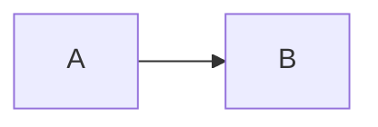

# sunstack

Lint repository documents with a marked rulebook, ast-grep evidence and explicit
decision steps. Use `sunstack exec` for the native JSON protocol.

## Repository lint

Create a complete local-only check with `sunstack lint --init` in a fresh directory.
It writes `sunstack.lint.json` plus the rulebook, rule entry, ast-grep project and
sample under `sunstack-starter/`. Existing config or starter paths are refused
without overwriting them. Run:

```sh
sunstack lint --init
sunstack lint --root . --check
sunstack lint --root . --all
```

The sample has one passing paragraph, zero model requests and exit 0. Add `TODO`
to its paragraph to see a warning; add `--max-warnings 0` to fail on that warning.
An empty sample produces no selected pieces and exits 0. Keep `--root .` when
trying a nested example inside a Git repository.

`decision_model` is required because it names the model for asking rules and
selections. A model name alone sends no request. The starter and the complete
examples below are mechanical-only: they need no key and send zero model requests.
The [picture check](#mechanical-example-a-picture-before-each-choice) and
[requirement-ID check](#mechanical-example-requirement-ids-on-another-page)
include every file and their expected results.

A configuration has the following parts:

```json
{
	"rulebook": [{ "markdown": "rulebook.md", "rules": "rulebook.rules.json" }],
	"marker_prefix": "K",
	"check": { "files": ["docs/**/*.md"], "ignore": ["docs/archive/**"] },
	"evidence": {
		"ast_grep": "evidence/sgconfig.yml",
		"kinds": {
			"piece": {
				"rule": "your-rule-id",
				"fields": { "body": { "from": "remainder" } }
			}
		}
	},
	"decision_model": { "model": "jev-latest" }
}
```

Replace `your-rule-id` with a rule in your ast-grep project. An end-of-line marker
such as `<!-- K001 -->` binds a Markdown standard to its `K001` JSON entry.
Several entries can check the same standard by putting their markers in one
trailing run, for example `One visual per point.<!-- K001 --><!-- K002 -->`.
Spaces and tabs may separate markers; only whitespace may follow the last one.
Each marker keeps the exact syntax shown and its own source coordinates. All
markers in the run bind the same full paragraph, list item or heading section,
with comments omitted from the standard text. Heading adjacency is checked
before the first marker; the whole run must touch the heading text directly.
Escaped markers and markers inside code remain literal; each configured-prefix
ID must be unique in the source, including within one run. A malformed comment
or ordinary text interrupts a run. Existing single-marker bindings are unchanged.
Each entry names an evidence kind and a decision graph. Steps can check fields
mechanically, ask authored questions, combine answers and route to pass or a
finding. Questions reach the model as authored, with one piece's bounded field
view. The binary embeds six generic Markdown utilities; rulebooks, questions and
domain-specific evidence rules belong to the caller.

### Complete keyless example

Create these five definition files and one checked file in an empty directory.
The root config schema covers `sunstack.lint.json`; it does not validate the
separate marker-keyed rule-entry document. `--check` admits all definitions
through the engine.

`sunstack.lint.json`:

```json
{
	"rulebook": [{ "markdown": "rulebook.md", "rules": "rulebook.rules.json" }],
	"marker_prefix": "K",
	"check": { "files": ["docs/*.md"] },
	"evidence": {
		"ast_grep": "evidence/sgconfig.yml",
		"kinds": {
			"skill": {
				"rule": "skill",
				"fields": { "description": { "from": "yaml", "key": "description" } }
			}
		}
	},
	"decision_model": { "model": "jev-latest" }
}
```

`rulebook.md`:

```markdown
Description must begin with Use when. <!-- K001 -->
```

`rulebook.rules.json` (the whole entry, keyed by that exact marker):

```json
{
	"K001": {
		"name": "description",
		"evidence": "skill",
		"severity": "error",
		"decision": {
			"start": "starts",
			"steps": {
				"starts": {
					"mechanical_check": {
						"tool": "regex",
						"field": "description",
						"pattern": "^Use when"
					},
					"yes": "pass",
					"no": { "finding": "Description must begin with Use when.", "at": "description" }
				}
			}
		}
	}
}
```

`evidence/sgconfig.yml`:

```yaml
ruleDirs: [rules]
```

`evidence/rules/skill.yml`:

```yaml
id: skill
language: Markdown
rule: { matches: frontmatter }
```

`docs/one.md`:

```markdown
---
description: Use when checking a complete example.
---

# One
```

Run from that directory with the installed `sunstack` executable:

```sh
sunstack lint --check
sunstack lint --all --evidence skill
sunstack lint --all --format json
sunstack lint --all --prepare prepared.json
```

The check prints the admitted rule; evidence prints the picked frontmatter,
`pieces[].where.span` (including source identity) and file counts. Evidence does
not evaluate rules: its clean status means listing completion, never absence of
violations. Ordinary lint evaluates K001 and reports clean for this input; changing
its description to `Wrong opening` produces a finding and exit 1. This mechanical
example uses no credential or model request. Preparation saves evidence and requests
without dispatch and exits 6 when successfully prepared. Ordinary `--report FILE`
saves the full rule report for `lint show`; it is different from evidence listing.

Evidence fields can use `next` or `previous` to collect full matching sibling
texts and source spans. They name an ast-grep `rule`; `count` defaults to 1 and
accepts 1 through 5. For example, a kind's `fields` can include:

```json
{
	"following": { "from": "next", "rule": "list", "count": 1 },
	"preceding": { "from": "previous", "rule": "list_item", "count": 2 }
}
```

The walk stays within the match's direct parent and stops at the first
nonmatching sibling. Blank-line and indentation continuation nodes do not stop
or count toward the walk. Values stay in source order, including `previous`
values. These sources accept only rule references and leave `remainder` intact.

Every ask or combine step must declare its `uncertain` route: use `"uncertain"`
as the ending, or name another step such as `"verdict"`. The walk follows it for
an in-band answer or a choice below `min_probability`, using answers from the
same request. A missing route is refused when the rulebook loads.
Both the `uncertain` and `results` views report the step that ended the walk.

Filters declare `per`, `reads: {file, kind, fields: [names]}`, `labels`,
`questions` and `decision`, with optional `reference`. They use the same steps
as rules and end in `{ "label": "declared-name" }` or `"unsure"`. Question
option names are not filter endings. All of a folder's questions go in one
request; a gate uses the resulting label. The old `question`, `reads.field` and
filter-level `min_probability` shape is refused. Declared reads accept scalar
text and lists of text, including `same_file` matches; lists keep their shape
in request state, raw input hashes and saved evidence.

Each question names the fields or reference paths it reads with `check`,
`against` or `context` in its instructions. Fixed `reference` material reaches
`state.reference` unchanged and counts toward the request-size limit. The names
`standard`, `where`, `cut-fields`, `unavailable-fields` and `reference` are
reserved. Rules send `where` only when a question names it; filters send no
folder location. A question requiring an unavailable field ends incomplete
before any model call. `mechanical_check: {tool: "complete", field: "targets"}`
returns yes only for an uncut available field whose loaded targets resolved and
have uncut openings. A resolved skill-name load now has an opening too.

Rulebook and ast-grep project paths resolve relative to the configuration file.
By default, checked-file globs resolve from the config's Git workdir, or from
its directory outside Git. Without `--config`, lint searches the current directory
and its parents for `sunstack.lint.json`.

Use `--root DIR` with ordinary lint to check a project using a config stored
elsewhere. The checked root controls `check.files` and `check.ignore` globs,
reported paths, and containment for `target` and `document` fields. Config-relative
rulebook and evidence paths still resolve from the config file. For example:

```sh
sunstack lint --config /path/to/rulebook/sunstack.lint.json --root /path/to/project --all
```

A named path outside the checked root is invalid (exit 2); the diagnostic names
the path and root. Named paths inside the root that select no files produce an
incomplete result (exit 3). With no named paths, an empty selection retains the
`nothing_selected` status. `--root` is refused with `lint cases`, which uses its
own historical snapshot root. With `--since`, the checked root must be the Git
workdir; change scope with an explicit subdirectory root is invalid. Use `--all`
for that subdirectory instead.

```sh
sunstack lint --config sunstack.lint.json --check
sunstack lint --config sunstack.lint.json --all --evidence
sunstack lint --config sunstack.lint.json --all --evidence piece
sunstack lint --config sunstack.lint.json --all --format json
```

`--check` validates configuration, the rulebook and evidence project, then lists
the assembled rules and selected/contained kinds as JSON. It reads no checked
files, sends no model requests and needs no credential. `--evidence [KIND]` prints
picked pieces, selection outcomes and file counts as JSON. It runs evidence
selection when configured, requiring a credential, but sends no rule questions.
Without selected kinds, the evidence listing remains credential-free.

An ordinary lint run uses changed evidence by default and requires Git for that
default scope. Use `--all` for every configured target, `--since REV` for changes
since a revision including worktree edits, or name files or directories for full
scope within those paths. Findings retain their rule, marker and source
location. Available output formats are `default`, `json`, `github` and `sarif`.
Change-scope refusals include `diagnostics[].path` when a source is known.
Human and SARIF locations use that path. Limit stops name their setting and
configured value, retaining incomplete status.
Discovery acquires only changed sources; raw hashing still uses the byte budget.
Unchanged files are read when lint needs them, rather than frozen for context.
The JSON report includes `results`, one entry per evaluated rule/piece pair in
logical report order. Each entry has the rule's `name` and marker, the piece's
file and first and last line, its outcome (`pass`, `finding`, `not_applicable`,
`uncertain` or `incomplete`) and its ending `step` (null before any step ran).

Default output prints findings as short numbered lines and groups unsure results
into one count per rule, with a `lint show` example using that rule's first unsure
id. The full list, ending steps, sent state and answers remain in JSON and saved
reports. To inspect a result later, save the full report and request one id:

```sh
sunstack lint --all --report run.json
sunstack lint show run.json 3
sunstack lint --report cases-report.json cases cases.json --set development
```

A saved report contains each request's exact state and questions, every returned
answer, requested and resolved models, and the contents and hashes of its config
and rule files. It retains raw piece evidence for mechanical steps. `lint show`
needs only that saved file; an excluded rule is marked as never asked and cannot
be re-walked. For completed cases reports, selectors consider exact case IDs and numeric results
across nested revisions together. A case and its own result count once. Ambiguous IDs
name each revision, case ID and result ID. Unknown IDs and malformed files name
the report kind when known and the reason.

`lint --report FILE cases ...` saves the complete case report, including nested
revision reports and cases that were stale, unselected or not judged. Successful
saving preserves stdout and the case result exit code. A save failure exits 3.

### Prepare requests without sending

```sh
sunstack lint --all --prepare prepared.json
sunstack lint show prepared.json 3
sunstack lint cases cases.json --set development --prepare prepared-cases.json
sunstack lint show prepared-cases.json 1
sunstack lint --all --prepare continued.json --selections-from run.json
```

`--prepare FILE` uses ordinary target selection, evidence, cuts, mechanical checks,
request builders and budgets, then saves the requests without resolving a
credential or sending to the provider. It conflicts with `--report`, `--check`,
`--rules`, `--evidence` and `--init`. The report adds `mode: "prepare"`; each
unanswered request has `status: "prepared"`, its exact `request.state` and
`request.questions`, raw evidence, and the config and rule file contents/hashes.
There are no invented answers or judged outcomes. Filter-gated rule requests are
offered for every mechanically possible folder with their `gate` condition.
Decision-tree routes use one request containing all piece questions, so an
unanswered route does not block preparation.

A selected kind's unanswered selection prevents its dependent pieces from being
built. `needs_answer` lists each affected kind/file and the selection request id
it waits on; independent evidence still builds. Composed `same_file`, `inside`
and `enclosing` fields remain selection-pending, including remainder subtraction.
If any field in the model view is selection-pending, the whole model request
waits, including questions that read only another field. No size estimate is
used. Requests whose model view has no pending field continue normally.
Ordinary `--report` and JSON
output now retain selection requests, answers, requested/resolved models, input
hashes and raw selection evidence, alongside their existing rule/filter entries.

Use `--selections-from` only with `--prepare` to continue from those recorded
answers. It accepts a lint report or a case report. Replay requires the identical
state and questions, a valid recorded answer, and **decision_model.model equal to the
recorded resolved model name exactly**. Pin the resolved version in the config;
an alias such as `jev-latest`, a different version, an unanswered entry or changed
input stays `needs_answer`. No provider-prefix inference or revision restriction
is applied. Applied entries have `status: "from_report"` and
`source_request_id`; a case-report source also records `source_revision`.
Agreeing duplicate answers retain the first source's provenance; conflicting
answers stay unresolved. Replayed selectors check and consume the same logical
request allowance as ordinary selection, so downstream requests keep the same
limit. Neither preparing nor replaying sends inference or consumes model usage.

Prepared case reports keep the ordinary exact-range/hash matching and accounting,
adding the `prepared` disposition. Stale, unmatched, ambiguous, mechanically
excluded and unavailable cases retain explicit reasons. `lint show` on a prepared
case report selects the **1-based ordinal in its cases array**, and returns that
case plus its linked revision/request evidence; stale and unmatched cases are
reason-only. Readback needs only the saved file.
Exact case IDs also work; valid numeric prepared ordinals take precedence.

A clean prepare-only run exits **6**, including runs waiting for selection answers.
Mechanical findings or case gaps (including stale/unmatched cases) exit **1**;
invalid input exits **2**, incomplete processing **3**, and cancellation **4**.
Invalid, cancelled and incomplete processing take precedence over case gaps.
Unassessed case bars alone do not fail a prepare-only run.

A case file contains `cases` and `bars`, plus an optional local `repository`
path (relative to the case file). Each case has a unique `id`, `revision`, `set`
and `label_from` (`owner-fix`, `owner-ruling` or `blind-agents`).
`owner-fix` names a real text fix; `owner-ruling` names an explicit owner label
decision, whose ruling is kept beside the cases. Rule cases add `kind: "rule"`,
`rule`, `file`, `lines: [first, last]`, `text_sha256`, and `expected: "warn" |
"pass"`. Filter cases add `kind: "filter"`, `filter`, `folder`, `reads_sha256`
and `expected_label`. Line hashes retain line endings. Filter hashes cover
compact JSON of the declared unprojected field values in lexical key order,
without reference, cut metadata or folder location; normal filter results expose
the hash. Each recorded bar names `{for, step, bound, value, set_from: [case ids]}`,
where `bound` is `yes_at_or_above`, `no_at_or_below` or `min_probability`.

Case runs archive the whole repository at each revision, initialize Git metadata
inside each disposable copy so nested configs retain the repository root, overlay
today's config and rule inputs, and invoke ordinary lint on selected case paths.
The ast-grep project's declared rule directories are replaced with today's
contents, so obsolete historical rules are not loaded. Other inputs keep their
individual file overlay. A rule directory that covers the repository root or
checked source refuses the case overlay with an explicit revision error; it
never deletes that historical source or falls back to a partial directory.
A selected file or folder that is or traverses a historical symlink is listed as
`not_judged` with reason `selected path is a symlink`, no result link and no crossed
bars. It never selects the link's target. Context loads retain their usual behavior.
Rule cases match the exact first and last lines of one piece after checking the
case's own archived line hash. Partial or spanning ranges do not match; nested
sections remain distinct. The same exact-range rule applies to filter skips.
Every selected case is counted or listed, with per-rule and per-filter counts,
result links and crossed bars. A changed or unrecorded bar is unassessed. The
command writes no adoption state and changes no ordinary lint inputs.

The decision model is always configured and enabled for asking rules; there is
no model-off switch. Ordinary runs with asking rules require an OpenRouter
credential before checked-file acquisition, even if a later mechanical branch
would avoid an ask. A selected evidence kind also requires a credential, including
for `--evidence`, even when the rules are mechanical. With neither selected kinds
nor asking rules, no key is needed. Credential lookup and
saving are described below under the native protocol.

Lint exits 0 for clean or nothing selected, 1 for error findings or warnings over
`--max-warnings`, 2 for invalid input, 3 for incomplete work, 4 for cancellation,
and 5 for uncertain decisions. Uncertainty retains the decision step, sent state
and answers for the caller to inspect. Cancellation takes precedence over
incomplete work, then findings, then uncertainty. A warning alone does not fail
unless it exceeds `--max-warnings`. A successful human run with warnings explains
its exit-0 policy. Without a warning limit it says `Completed with N warnings;
exit 0 because no --max-warnings was set`; an explicit limit is named instead.
JSON retains status `clean` and the warning count.

A failed provider request carries its class and, when received, its HTTP status
in the incomplete reason:

```json
{ "kind": "provider_failure", "failure_class": "rate_limit", "http_status": 429 }
```

When no HTTP response arrived, `http_status` is omitted. The default output
prints `provider failure (rate_limit, HTTP 429)` or
`provider failure (connection)`. A request refused by the engine is
`invalid_request`; an answer that fails admission is `invalid_response`.
Incomplete selection candidates use these reason shapes too.

See the checked-in [worked configuration](tests/fixtures/rulebook-lint/skill-rules.config.json)
and its [rulebook entries](tests/fixtures/rulebook-lint/rulebook/steering.rules.json)
for a complete test example. Copy the fixture directory to an isolated root to
try it; its checked-file globs are relative to that root. The example's
skill-specific rules are test content.

### Mechanical example: a picture before each choice

From an empty working directory with `sunstack` on PATH, paste the complete block.
It checks structural picture presence in the nearest heading section, before
that choice. It accepts the configured HTML picture tags or a parsed Mermaid
fence inside the configured Markdown wrapper. A picture after the choice or
under an earlier heading does not qualify. It does not judge picture quality.

<!-- runnable-example: choice-pictures -->
````sh
mkdir -p choice-example/evidence/rules choice-example/pages
cat > choice-example/sunstack.lint.json <<'JSON'
{
  "rulebook": [{"markdown": "rulebook.md", "rules": "rules.json"}],
  "marker_prefix": "K",
  "decision_model": {"model": "jev-latest"},
  "check": {"files": ["pages/*.html"]},
  "evidence": {
    "ast_grep": "evidence/sgconfig.yml",
    "html": {"embedded_markdown": [{"tag": "script", "attributes": {"type": "text/markdown"}}]},
    "kinds": {
      "outline": {"html_units": {"mode": "unit", "units": ["section"]}, "fields": {}},
      "html_picture": {"rule": "html-picture", "fields": {}},
      "markdown_wrapper": {"rule": "markdown-wrapper", "fields": {}},
      "markdown_picture": {"rule": "mermaid-picture", "within": ["markdown_wrapper"], "fields": {}},
      "choice": {"rule": "choice", "fields": {
        "html_pictures": {"from": "inside", "kind": "html_picture", "scope": {"section_prefix": "outline"}},
        "markdown_pictures": {"from": "inside", "kind": "markdown_picture", "scope": {"section_prefix": "outline"}}
      }}
    }
  }
}
JSON
cat > choice-example/rulebook.md <<'MD'
A choice has a picture in its own heading section before the choice.<!-- K001 -->
MD
cat > choice-example/rules.json <<'JSON'
{
  "K001": {
    "name": "picture_before_choice", "evidence": "choice", "severity": "warn",
    "decision": {"start": "html_picture", "steps": {
      "html_picture": {
        "mechanical_check": {"tool": "regex", "field": "html_pictures", "pattern": "(?s).*"},
        "yes": "pass", "no": "markdown_picture"
      },
      "markdown_picture": {
        "mechanical_check": {"tool": "regex", "field": "markdown_pictures", "pattern": "(?s).*"},
        "yes": "pass", "no": {"finding": "Add a picture before this choice in its own section."}
      }
    }}
  }
}
JSON
cat > choice-example/evidence/sgconfig.yml <<'YAML'
ruleDirs: [rules]
YAML
cat > choice-example/evidence/rules/pictures.yml <<'YAML'
id: choice
language: Html
rule: {kind: element, regex: '^<choice-panel\b'}
---
id: html-picture
language: Html
rule:
  any: [{kind: element}, {kind: self_closing_tag}]
  regex: '^<(diagram-block|svg|img|figure)\b'
---
id: markdown-wrapper
language: Html
rule: {kind: element, regex: '^<markdown-island\b'}
---
id: mermaid-picture
language: Markdown
rule: {kind: fenced_code_block, regex: '^```mermaid\b'}
YAML
cat > choice-example/pages/choices.html <<'HTML'
<h2>HTML picture</h2>

<choice-panel id="html">Choose an option.</choice-panel>
<h2>Markdown picture</h2>
<markdown-island><script type="text/markdown">

</script></markdown-island>
<choice-panel id="markdown">Choose an option.</choice-panel>
<h2>Earlier picture belongs to another heading</h2>
<choice-panel id="missing">Choose an option.</choice-panel>
<h2>Later picture</h2>
<choice-panel id="later">Choose an option.</choice-panel>

HTML
sunstack lint --config choice-example/sunstack.lint.json --root choice-example --check > choice-example/check.json
sunstack lint --config choice-example/sunstack.lint.json --root choice-example --all --format json > choice-example/report.json
sunstack lint --config choice-example/sunstack.lint.json --root choice-example --all
````

All three commands exit 0. The check lists one mechanical rule. `report.json`
has four results: `html` and `markdown` pass; `missing` and `later` warn. It has
`counts: {"error": 0, "warn": 2}`, `status: {"kind": "clean"}`, and
`usage.model_requests: 0`. Human output ends with:

```text
Completed with 2 warnings; exit 0 because no --max-warnings was set
```

These tags are document syntax used by this example; the engine takes them from
the config. Referenced image files need not exist for this structural check.
The wrapper containment excludes unrelated scripts. An empty picture list fails
the `regex` check because there is no item to match. `complete` establishes
availability rather than picture presence. Add `--max-warnings 0` to the final
command to make its two warnings exit 1.

### Mechanical example: substantial sections need pictures

This rule nudges a section with at least 100 prose words and no picture. The
caller defines prose and picture kinds; HTML paragraphs and parsed Markdown
paragraphs contribute to one sum. Both HTML pictures and Mermaid fences in the
configured Markdown islands qualify. `section_own` names a nonempty list of
distinct outline kinds, including both languages here. It measures presence,
not picture quality.

<!-- runnable-example: section-pictures -->
````sh
mkdir -p section-example/evidence/rules section-example/pages
cat > section-example/sunstack.lint.json <<'JSON'
{
  "rulebook": [{"markdown": "rulebook.md", "rules": "rules.json"}],
  "marker_prefix": "K",
  "decision_model": {"model": "jev-latest"},
  "check": {"files": ["pages/*.html"]},
  "evidence": {
    "ast_grep": "evidence/sgconfig.yml",
    "html": {"embedded_markdown": [{"tag": "script", "attributes": {"type": "text/markdown"}}]},
    "kinds": {
      "outline": {"html_units": {"mode": "unit", "units": ["section"]}, "fields": {}},
      "markdown_outline": {"markdown_units": {"mode": "unit", "units": ["section"]}, "fields": {}},
      "html_prose": {"rule": "html-prose", "fields": {}},
      "markdown_prose": {"rule": "markdown-prose", "fields": {}},
      "html_picture": {"rule": "html-picture", "fields": {}},
      "markdown_picture": {"rule": "markdown-picture", "fields": {}},
      "section": {"html_units": {"mode": "unit", "units": ["section"]}, "max_chars": 200000, "fields": {
        "html_prose": {"from": "inside", "kind": "html_prose", "scope": {"section_own": ["outline", "markdown_outline"]}},
        "markdown_prose": {"from": "inside", "kind": "markdown_prose", "scope": {"section_own": ["outline", "markdown_outline"]}},
        "html_pictures": {"from": "inside", "kind": "html_picture", "scope": {"section_own": ["outline", "markdown_outline"]}},
        "markdown_pictures": {"from": "inside", "kind": "markdown_picture", "scope": {"section_own": ["outline", "markdown_outline"]}}
      }},
      "markdown_section": {"markdown_units": {"mode": "unit", "units": ["section"]}, "max_chars": 200000, "fields": {
        "html_prose": {"from": "inside", "kind": "html_prose", "scope": {"section_own": ["outline", "markdown_outline"]}},
        "markdown_prose": {"from": "inside", "kind": "markdown_prose", "scope": {"section_own": ["outline", "markdown_outline"]}},
        "html_pictures": {"from": "inside", "kind": "html_picture", "scope": {"section_own": ["outline", "markdown_outline"]}},
        "markdown_pictures": {"from": "inside", "kind": "markdown_picture", "scope": {"section_own": ["outline", "markdown_outline"]}}
      }}
    }
  }
}
JSON
cat > section-example/rulebook.md <<'MD'
A section with at least 100 prose words contains a picture.<!-- K001 -->
A Markdown heading section with at least 100 prose words contains a picture.<!-- K002 -->
MD
cat > section-example/rules.json <<'JSON'
{
  "K001": {
    "name": "section_picture", "evidence": "section", "severity": "warn",
    "decision": {"start": "substantial", "steps": {
      "substantial": {
        "mechanical_check": {"tool": "word_count", "field": ["html_prose", "markdown_prose"], "bound": {"at_least": 100}},
        "yes": "picture", "no": "pass"
      },
      "picture": {
        "mechanical_check": {"tool": "piece_count", "field": ["html_pictures", "markdown_pictures"], "bound": {"greater_than": 0}},
        "yes": "pass", "no": {"finding": "{{word_count:html_prose,markdown_prose}} words, no picture. Add a picture explaining this section."}
      }
    }}
  },
  "K002": {
    "name": "markdown_section_picture", "evidence": "markdown_section", "severity": "warn",
    "decision": {"start": "substantial", "steps": {
      "substantial": {
        "mechanical_check": {"tool": "word_count", "field": ["html_prose", "markdown_prose"], "bound": {"at_least": 100}},
        "yes": "picture", "no": "pass"
      },
      "picture": {
        "mechanical_check": {"tool": "piece_count", "field": ["html_pictures", "markdown_pictures"], "bound": {"greater_than": 0}},
        "yes": "pass", "no": {"finding": "{{word_count:html_prose,markdown_prose}} words, no picture. Add a picture explaining this section."}
      }
    }}
  }
}
JSON
cat > section-example/evidence/sgconfig.yml <<'YAML'
ruleDirs: [rules]
YAML
cat > section-example/evidence/rules/content.yml <<'YAML'
id: html-prose
language: Html
rule: {kind: element, regex: '^<p\b'}
---
id: markdown-prose
language: Markdown
rule: {kind: paragraph}
---
id: html-picture
language: Html
rule:
  any: [{kind: element}, {kind: self_closing_tag}]
  regex: '^<(svg|img|figure)\b'
---
id: markdown-picture
language: Markdown
rule: {kind: fenced_code_block, regex: '^```mermaid\b'}
YAML
prose='One two three four five six seven eight nine ten. One two three four five six seven eight nine ten. One two three four five six seven eight nine ten. One two three four five six seven eight nine ten. One two three four five six seven eight nine ten. One two three four five six seven eight nine ten. One two three four five six seven eight nine ten. One two three four five six seven eight nine ten. One two three four five six seven eight nine ten. One two three four five six seven eight nine ten.'
cat > section-example/pages/sections.html <<HTML
<h2>HTML without a picture</h2>
<p>$prose</p>
<h3>Only the child has a picture</h3>
<svg aria-label="A child picture"></svg>
<h2>HTML with a picture</h2>
<p>$prose</p><svg aria-label="A connects to B"></svg>
<h2>Markdown without a picture</h2>
<script type="text/markdown">
$prose
</script>
<h2>Markdown with a picture</h2>
<script type="text/markdown">
### A heading inside Markdown

$prose
\`\`\`mermaid
graph LR
  A --> B
\`\`\`
</script>
<h2>A small section</h2>
<p>Brief text needs no picture under this rule.</p>
HTML
sunstack lint --config section-example/sunstack.lint.json --root section-example --check > section-example/check.json
sunstack lint --config section-example/sunstack.lint.json --root section-example --all --format json > section-example/report.json
sunstack lint --config section-example/sunstack.lint.json --root section-example --all
````

All three commands exit 0: seven section results, five passes, two warnings,
zero model requests, no incomplete results. Each warning begins `100 words, no
picture.` The own section ends at the next configured HTML or Markdown heading, of any
level, so a parent cannot borrow a child section's picture. The two rule entries
use the same check on HTML and embedded Markdown heading subjects. Use the
existing scalar `scope: {"section":"outline"}` for a whole hierarchical section,
or `scope: {"section_prefix":"outline"}` for earlier pieces.
The library does not infer which kinds count as prose or pictures.

`word_count` accepts a text field or list of text values; `piece_count` accepts
a list field and counts its entries, including entries with empty text. For a
table, collect rows in one `inside` field and header cells in another; use
`piece_count` with `bound: {"greater_than": 20}` or `{"greater_than": 7}`.
The three bounds are `at_least`, `at_most` and `greater_than`, each with one
nonnegative integer. Exactly one bound is required. `field` accepts one name or
a nonempty list of distinct names, summed without deduplicating overlapping
pieces. Select nonoverlapping kinds when measuring prose.

Words are whitespace-separated text-content tokens, summed per value. Markdown
links contribute labels, code contributes its text, and tags, attributes used
only as markup, URLs used only as destinations, and formatting delimiters do not
contribute words. Existing HTML asking-text attributes still contribute their
projected text, including attributes on inline Markdown HTML tags. Raw evidence
and original spans stay unchanged. Counts read the complete captured field,
independently of asking-text cuts or pending sibling fields. An unavailable or
selection-pending measured field stays incomplete; an available empty list
measures zero. Acquisition and match limits still apply. Missing documents stay
incomplete until routed around with `complete`.

Findings can include `{{word_count:field}}` or `{{piece_count:field}}`; comma-separated
field names sum the same fields as a measurement check. Undefined or incompatible
fields are refused during `--check`; an unavailable value at runtime makes the
finding incomplete. Other finding text remains literal.

### Mechanical example: requirement IDs on another page

This independent block defines requirements as Markdown paragraphs beginning
`U<number>:`. It checks whether each captured ID occurs as a whole token anywhere
in `Specification.md`. It checks mention, not semantic fulfillment. Only the
Requirements page is selected for evaluation; the Specification is read as
context. `U20` and `XU3` deliberately do not cover `U2` and `U3`.

<!-- runnable-example: requirement-coverage -->
````sh
mkdir -p requirement-example/evidence/rules requirement-example/pages
cat > requirement-example/sunstack.lint.json <<'JSON'
{
  "rulebook": [{"markdown": "rulebook.md", "rules": "rules.json"}],
  "marker_prefix": "K",
  "decision_model": {"model": "jev-latest"},
  "check": {"files": ["pages/Requirements.md"]},
  "evidence": {
    "ast_grep": "evidence/sgconfig.yml",
    "kinds": {
      "requirement": {"rule": "requirement", "fields": {
        "identifier": {"from": "capture", "regex": "^(U[0-9]+):"},
        "specification": {"from": "document", "path": ["Specification.md", "specification.md"], "rule": "markdown-document"}
      }}
    }
  }
}
JSON
cat > requirement-example/rulebook.md <<'MD'
Every requirement ID appears in the specification.<!-- K001 -->
MD
cat > requirement-example/rules.json <<'JSON'
{
  "K001": {
    "name": "requirement_in_specification", "evidence": "requirement", "severity": "warn",
    "decision": {"start": "available", "steps": {
      "available": {
        "mechanical_check": {"tool": "complete", "field": "specification"},
        "yes": "covered", "no": "not_applicable"
      },
      "covered": {
        "mechanical_check": {"tool": "contains_field", "field": "specification", "needle": "identifier"},
        "yes": "pass", "no": {"finding": "This requirement ID never appears in Specification.md."}
      }
    }}
  }
}
JSON
cat > requirement-example/evidence/sgconfig.yml <<'YAML'
ruleDirs: [rules]
YAML
cat > requirement-example/evidence/rules/requirements.yml <<'YAML'
id: requirement
language: Markdown
rule: {kind: paragraph, regex: '^U[0-9]+:'}
---
id: markdown-document
language: Markdown
rule: {kind: document}
YAML
cat > requirement-example/pages/Requirements.md <<'MD'
U1: The page has a title.

U2: The page has an author.

U3: The page has a date.
MD
cat > requirement-example/pages/Specification.md <<'MD'
The title implements U1. Other tokens are U20 and XU3.
MD
sunstack lint --config requirement-example/sunstack.lint.json --root requirement-example --check > requirement-example/check.json
sunstack lint --config requirement-example/sunstack.lint.json --root requirement-example --all --format json > requirement-example/report.json
sunstack lint --config requirement-example/sunstack.lint.json --root requirement-example --all
````

All three commands exit 0. The check lists one mechanical rule. `report.json`
contains three results: `U1` passes, `U2` and `U3` warn. Expected counts are
`{"error": 0, "warn": 2}`, status is `{"kind": "clean"}`, and
`usage.model_requests` is zero. Human output ends with the same two-warning
summary above; adding `--max-warnings 0` makes the evaluation exit 1. A missing
Specification file makes the `complete` step take its `not_applicable` route.
The ordered path list chooses the first existing name, recorded with the field's
`path`, values and spans. A present but unreadable or scan-limited file stays
incomplete; it does not silently fall back to another name.

### Collect rows linked to the subject

Use `containing` on `document` or `same_file` to keep only matches that mention
a subject field's value. For example, add these fields to a kind that already
captures `identifier` as `U4` and collects `requirement_ids` as a list of plain
IDs such as `["U4", "U7"]`:

<!-- example: containing-fields -->
```json
{
  "obligations": {"from": "document", "path": ["specification.html", "Specification.html"], "rule": "obligation-row", "containing": "identifier"},
  "verification": {"from": "document", "path": "verification.html", "rule": "verification-row", "containing": "requirement_ids"},
  "trace": {"from": "same_file", "rule": "trace-row", "text": "full", "containing": "identifier"}
}
```

The named rules select rows, rather than whole pages. `obligations` and `trace`
keep only rows mentioning `U4`. `verification` keeps a row when **any** listed ID
matches, so `U4 (R1–R3, R5, R7)` qualifies; `U40` alone does not. The rule names
and ID-producing fields belong to the caller. A list of link markup is not a
list of plain IDs.

Matching uses the full raw match text before `same_file`'s `first_line` or `full`
projection. It shares `contains_field`'s literal, case-sensitive token rule:
neither adjacent character may be a Unicode letter, digit or `_`. Every matching
row appears once in source order with its original span. HTML, Markdown and
configured Markdown islands use the same rule. An empty ID list or no matching
rows returns an available empty list. An absent, empty scalar, unavailable or
missing-document subject field makes the filtered field unavailable. `containing`
must name a defined text or text-list field; dependency cycles are refused.
Document candidate selection and missing-document routing are unchanged.

Document fields and fields depending on them are unavailable to selection
questions. Subject-dependent `same_file` fields cannot be shared across
selection candidates. Without `containing`, existing collection is unchanged.

## HTML evidence

For the `requirement-row` and `whole-document` HTML ast-grep rules in the
[HTML evidence guide](../sunstack-evidence/docs/html-evidence.md), add this kind
to `evidence.kinds`:

```json
{
	"requirement": {
		"rule": "requirement-row",
		"fields": {
			"identifier": { "from": "capture", "regex": "id=\"(R[0-9]+)\"" },
			"body": { "from": "remainder" },
			"links": { "from": "target", "regex": "href=\"([^\"]+)\"", "resolve": "path" },
			"verification": {
				"from": "document",
				"path": "verification-design.html",
				"rule": "whole-document"
			}
		}
	}
}
```

The example regex requires a nonempty link. To catch `href=""`, use `*` in
place of `+` in its capture group. An empty captured target is unavailable
(`empty_target`) and makes the rule incomplete.

In rulebook decision steps, check the row's links forward and its identifier
against the verification document in reverse:

```json
{
	"mechanical_check": { "tool": "anchor_exists", "field": "links" },
	"yes": "pass",
	"no": { "finding": "The link target or fragment is missing." }
}
```

```json
{
	"mechanical_check": { "tool": "contains_field", "field": "verification", "needle": "identifier" },
	"yes": "pass",
	"no": { "finding": "The requirement has no verification coverage." }
}
```

The guide explains path resolution, whole-token matching, parse policy, and
limits of HTML anchor and model-text handling.

Use `{"from":"section_prefix","kind":"outline"}` to expose the nearest
containing piece of a configured kind up to this subject's source start. The
caller chooses that kind; it can select broader governing sections. Raw fields
retain exact bytes and source spans, while asking views use ordinary projection
and cuts. The full section can coexist in an `enclosing` field. See
[section prefixes](../sunstack-evidence/docs/html-evidence.md#section-prefixes)
for empty/unavailable behavior and AST composition limits.

To make the governing kind select only h1/h2 sections, use this selection under
either `html_units` or `markdown_units`:

<!-- example: governing-section-levels -->
```json
{"mode":"unit","units":["section"],"levels":[1,2]}
```

For example, a `governing_section` kind with this selection lets
`{"from":"section_prefix","kind":"governing_section"}` and scoped `inside`
reach a drawing under a sibling h3 of the same h2. `levels` is an optional,
nonempty list of distinct integers from 1 through 6, valid only for unit mode
with `units: ["section"]`. It intersects `starts_with` or `pattern` before the
match budget is counted. Markdown includes ATX/setext headings and configured
islands. Omission selects every level. Original section and child boundaries
remain unchanged; selecting only h1/h2 does not flatten their content.

To collect pieces from that section rather than its raw text, use
`{"from":"inside","kind":"picture","scope":{"section_prefix":"outline"}}`.
Use `scope: {"section":"outline"}` for the whole containing section. Both names
are configured kinds; matching uses original spans and can cross from HTML to
Markdown islands. The field is a source-ordered list of full piece texts and
spans. A mechanical `regex` check with `pattern: "(?s).*"` tests whether it is
nonempty. See [section-scoped containment](../sunstack-evidence/docs/html-evidence.md#section-scoped-containment).

HTML outline exclusions and extra text attributes are project settings under
`evidence.html`. They default to empty; standard `alt`, `aria-label` and
`<template>` outline handling remain built in. Markdown heading fragments require
an explicit `evidence.markdown.heading_anchors: "github"` scheme. Without it,
unresolved heading fragments are `unsupported` with reason
`heading_scheme_not_configured`; explicit HTML ids inside Markdown still resolve.
See the guide's [language and model views](../sunstack-evidence/docs/html-evidence.md#language-and-model-views)
for the config shape and low-level API boundary.

To select Markdown blocks embedded in HTML, declare the elements whose inner
source contains Markdown under `evidence.html.embedded_markdown`:

```json
{
  "embedded_markdown": [
    {"tag": "script", "attributes": {"type": "text/markdown"}}
  ]
}
```

Markdown ast-grep rules and `markdown_units` then match inside those elements,
with spans pointing into the original HTML file. The element names and exact
attribute values belong to the caller's configuration. See
[embedded Markdown](../sunstack-evidence/docs/html-evidence.md#embedded-markdown)
for selection, ordering and source-byte semantics.

An island piece can also read its surrounding HTML with `enclosing`, naming an
HTML rule or kind and using `first_line` or `full`, or a native HTML section kind
with `text: "heading"`. `section_prefix` can name that HTML outline kind too.
For example, `{"from":"enclosing","rule":"closed-details","text":"first_line"}`
can expose the opening `<details>` around an island table, when `closed-details`
selects that element. HTML context remains raw in a Markdown piece's asking view;
heading fields retain their existing derived heading text. Containment uses the
original HTML spans, without joining the two syntax trees. This cross-language
direction requires configured embedded Markdown; JSON and other ordinary
cross-language references remain refused.

For a path target with `as_kind` and a resolved fragment, the loaded fields come
from the narrowest piece of that kind containing the anchored element or
Markdown heading. If none exists, or the fragment cannot resolve, the target
field is unavailable with reason `target_kind_missing`. A target without a
fragment still uses the first piece. `opening` remains the **file's opening**,
bounded by `opening_chars`; it is independent of anchor-relative `as_kind` fields.

## Selected and contained evidence

Add `select` to an evidence kind to ask one noul question about each mechanical
candidate. Add `within` to keep a kind's matches only inside or equal to a final
piece of any listed kind in the same file. `within` is a nonempty list without
repeated kinds, written as `["workflow_section"]` for one kind. A match inside
several listed kinds produces one piece. This fragment belongs in `evidence.kinds`;
the rule IDs must exist in the caller's ast-grep project:

```json
{
	"workflow_section": {
		"rule": "workflow-candidate",
		"fields": {
			"heading": { "from": "first_line" },
			"body": { "from": "remainder", "exclude": { "rule": "section" } },
			"outline": { "from": "same_file", "rule": "section" }
		},
		"select": {
			"question": {
				"type": "noul",
				"instructions": {
					"check": "body",
					"against": "heading",
					"context": ["outline"],
					"task": "Is this section an ordered workflow?"
				}
			},
			"yes_at_or_above": 0.7,
			"no_at_or_below": 0.3,
			"shared": ["outline"]
		}
	},
	"step": {
		"rule": "step",
		"within": ["workflow_section"],
		"fields": { "body": { "from": "remainder" } }
	},
	"load": {
		"rule": "load",
		"fields": { "step": { "from": "enclosing", "kind": "step" } }
	}
}
```

Answers at or above 0.7 select the candidate; at or below 0.3 reject it; values
between them are uncertain. Only selected candidates become pieces. A failed
selection remains incomplete; it never falls back to selecting the candidate.
Kinds build in dependency order before any rules run. Cycles, undefined kinds,
invalid thresholds, non-noul selection questions and target-field references in
selection questions are refused by `--check`.

`inside`, `enclosing` and `same_file` accept exactly one of `rule` or `kind`.
A rule source reads raw matches; a kind source reads final pieces after selection
and containment. `remainder.exclude` removes only strictly contained ranges,
including child sections; an equal range never erases the piece itself. A target's
`as_kind` must remain target-free and independent of selection.

The model receives consecutive candidates of one file and kind, with one question
per candidate. Fields in `shared` must come from `same_file`; their view is bounded
once and sent once per request. Each candidate has its own bounded view without
shared or target fields. Questions cannot refer to target fields, and selection
requests carry no target opening or target-file fields. Requests split to satisfy
encoded character, byte, question-count and input-token limits. Selection and rule
requests share the run's request count, concurrency and usage accounting.

Under a change scope, selection considers all candidates of each file with a
changed hunk or a changed load target. Other files retain their candidate counts
with `asked: 0`. Final pieces are still picked by their own changed ranges or
changed targets; changing only a parent heading does not pick every child step.

JSON reports and evidence listings add `selections` and `file_counts`. Each asked
candidate reports its kind, source location, first line and outcome, with a yes
probability or an incomplete reason. Counts cover every built file and configured
kind, including zero-candidate files: matches, pieces, picked and scan-limited,
plus candidate/asked/outcome counts for selected kinds. The default format prints
selection totals and files with candidates but none selected. Selection uncertainty
uses exit 5 unless a higher-priority status applies; any incomplete candidate
makes the run incomplete with `selection_incomplete`. GitHub and SARIF formatting
is unchanged.

The generic numbered-heading and Step-heading utilities recognize levels H2
through H6; H1 titles are excluded. Existing configurations otherwise preserve
0.2.0 behavior, apart from these extra heading matches and evidence, fields and
results derived from their sections. See the complete
[selection fixture](tests/fixtures/rulebook-lint/selection/skill-rules.config.json)
for working configuration inputs; its domain-specific question is test content.

## Native JSON protocol

Run `sunstack exec` (or `cargo run -p sunstack -- exec` from the repository root).
One process consumes one JSON request on stdin and writes one JSON response on
stdout. Relative input paths resolve from the process working directory. Run
from the repository root when using the reviewed examples.

```json
{ "protocol_version": 1, "operation": "evaluate_rules", "input": {} }
```

Replace `input` with the native operation input. Supported operations are
`prepare_evidence`, `run_judgments`, `check_rules`, `prepare_rules` and `evaluate_rules`.
The response is either `protocol_error` with diagnostics, or `operation_result`
whose `result` contains the operation and its unchanged native outcome.
The raw stdin limit is 8,388,608 bytes. Bind large evidence by path.

The `EvidencePlanInput` used by `sunstack exec` uses standard document defaults.
Project HTML conventions and Markdown heading-anchor schemes are available through
repository lint and the evidence library's direct project/select APIs.

Exit 0 means the operation completed, including an unfavorable rule verdict.
Exit 2 means invalid input or protocol refusal; 3 means failed or incomplete
execution; 4 means caller cancellation. SIGINT and SIGTERM cancel owned work
and await its settlement before publishing the terminal response. The static
`sunstack: ready` stderr line witnesses signal registration, and
`sunstack: cancellation observed` witnesses signal consumption.

Change-scoped work retains the same protocol version. Native inputs
accept non-Full `change_scope` values (dirty layers, revision ranges, commit lists,
time windows and unions), bounded discovery, ChangeSet sources and explicit
package bindings. A relative repository root resolves from this process's CWD.
For example, select current unstaged changes on a repository binding with:

```json
{ "change_scope": { "kind": "uncommitted", "layers": ["unstaged"] } }
```

This is a binding fragment, not a complete invocation. ChangeSet selectors need
`discovery.kind = "bounded"` with native discovery limits. A package binding's
empty `target_path_prefix` maps to the target repository root. Use the reviewed
[invocation schema](../../docs/specs/2026-10-12-rust-rule-engine/schemas/rule-invocation.schema.json)
for complete inputs.

Preparation and reports expose native `change_selections`; Full-only work has
an empty list. Rule occurrences retain selection reasons such as
`target_changed` or `full_scope`, pending comparisons, and outside-scope results.
Preparing rules sends no model request. A waiting gate leaves target comparison
pending; evaluation resolves it only when the native gate permits the work.
The CLI forwards these native outcomes and uses the same exit meanings above.

The binary uses a non-empty `OPENROUTER_API_KEY` first, otherwise the OS credential
store (`sunstack` / `openrouter-api-key`): macOS login Keychain or Linux Secret
Service. When the environment key is present, a run never reads or writes the store.
Runs never save credentials automatically. Use `sunstack credentials save` to save
the current environment key explicitly; it is listed in `sunstack --help`.
The command reports its destination without printing the key and refuses a missing
or empty variable. Set
`SUNSTACK_CREDENTIAL_STORE=off` to disable both lookup and saving (for CI or a one-off
key). Library callers pass the key as a value to `sunstack_lint::run`.
Without a terminal on stdin, macOS access that needs Keychain approval is treated
as unavailable immediately. Run once from a terminal to approve a changed build,
or supply the environment key. Interactive terminal runs may show the Keychain dialog.
On Linux, a locked Secret Service collection may prompt during fallback lookup or explicit saving;
use `SUNSTACK_CREDENTIAL_STORE=off` for unattended runs.

Credentials never come from stdin. Rule preparation uses the selected backend for encoding and accounting
when model work is reachable; it sends no provider request. Local-only rule
preparation and evaluation construct no backend and need no credential. A
model-based judgment, applicability gate or Router still requires valid backend
configuration when it becomes reachable. Evidence preparation needs no credential.

`check_rules` assembles every requested RuleSet and validates its rules without
constructing a backend, reading reviewed documents or sending model requests.
Its input contains `definition_root`, `definitions`, `repositories`,
`payload_schemas`, `limits`, optional `discovery` and `output` (`diagnostics` or `assembled_rules`).
Discovery defaults to `none`, as in runtime input. Connected rules need bounded
discovery settings for admission; check never executes discovery or acquisition.
Repository-root metadata and declared payload schemas are still validated.
It accepts no backend, attempt or request-budget settings. A clean check exits 0;
refusals exit 2 with definition file, line and column. Printed rules are returned
only after a clean check and include each native definition and its source.

Native RuleSets load `rule_paths` JSONL files, with paths relative to the RuleSet
file. Use the repository lint route above for marked Markdown rulebooks. Native
preparation and evaluation retain their coverage, rule evaluations, skipped rules
and counters. JSONL, RuleSet-header and invocation errors remain strict refusals.

Document targets can select Markdown units independently:

```json
{
	"kind": "markdown_units",
	"mode": "call_site",
	"units": ["paragraph", "list_item"],
	"pattern": "\\bMUST\\s+load\\b"
}
```

`mode: unit` produces one occurrence per requested section, paragraph or list
item, with an optional `starts_with` or `pattern` filter. Requested unit kinds
can overlap. `mode: call_site` requires exactly one nonempty filter and produces
one occurrence per match, owned by the innermost requested unit; list items own
their contained paragraphs. Regexes that can match empty text are refused.
Filters use visible text with inline code excluded; fenced content remains.

Occurrence keys include source identity, raw unit ranges, and call-site raw and
visible match ranges. Raw spans use original document bytes and character
coordinates. Several visible matches may share a raw entity span; generated-only
matches use zero-width raw boundary anchors. Question owners carry the full key,
so budget splitting preserves each target's evidence and answer references.

Preparation exposes `rule_evaluations`, including `waiting_for_expansion` behind
a staged different-input gate. No child keys or target selections are invented
while it waits. Evaluation reports `expanded`, `zero_matches`, stopped, failed
or cancelled work explicitly. Zero matches is complete when other work completes;
it is never a passed verdict. Same-input speculative carriers remain permitted.
Existing change-scope repository snapshots may already hold the reviewed bytes;
canonical target selection and expansion still wait for their gate frontier.

The evidence library also supports `frontmatter_field` with a literal top-level
`field`. An initial YAML `---` block yields a decoded JSON value or an absent
field. Missing or malformed blocks yield explicit unavailable data without an
invented span. Noul and composite rules reject this mechanical-only target.

A rules entry can use a native mechanical verdict. Put the check under
`verdict.check` and select the checked field in the evidence declaration:

```json
{
	"rule_id": "skill.description",
	"evidence": [
		{
			"id": "description",
			"input": "subject",
			"requirement": "required",
			"select": { "kind": "frontmatter_field", "field": "description" }
		}
	],
	"target": "description",
	"applicability": [],
	"questions": {},
	"verdict": {
		"kind": "mechanical",
		"explanation": "Description names when to use the skill.",
		"check": { "kind": "expect", "expect": { "starts_with": "Use when" } }
	},
	"severity": "error"
}
```

Save each native definition as one JSONL line in a RuleSet's `rule_paths`, and
declare its `subject` input as a document in the RuleSet header. Bind that input
to the document when calling `check_rules` or `evaluate_rules`.

`verdict.check.expect` accepts exactly one of `matches`, `not_matches`, `starts_with` or
`present: true`. Text predicates use the unit's rendered-visible text, excluding
inline code. A frontmatter string uses its decoded text; other values use
canonical JSON text. Null is present. Every predicate fails on an absent field;
a missing or malformed header is unresolved.

For an AST check, use `verdict.check: {"kind":"ast_grep","ast_grep":{...}}`.
`ast_grep` accepts a native rule object validated by ast-grep-config 0.51.0.
It sees the full original Markdown syntax tree, including ancestors outside
the unit. A match fully contained in the target unit is a failure; sibling
matches outside it are excluded. Frontmatter fields use `expect`; runtime unit
kinds do not select the metadata block. Local checks send no model request.

Reports use `checked` occurrences with `completed` pass/fail, `unresolved` or
`cancelled` local outcomes. A failed check retains its declared severity and
can complete with exit 0. Unresolved checks make the report incomplete. Local
checks create no model answers, references, receipts or confidence and consume
no model question/request budget. Applicability and routing still govern them.

Rust callers supply `RuleBackendFactory` in `RuleExecutionContext`. Selection
is credential-free; the invocation calls `prepare` once when its first model
request reaches encoding and caches the result. Concrete built backends already
implement the factory trait and can still be passed with `Arc::new(backend)`.

The backend-free
[unit-target check request](../../docs/specs/2026-10-12-rust-rule-engine/examples/unit-targets.check.request.json)
checks a rule that selects every paragraph of the existing example document.
Like other checks, it validates the rule without reading that document.

Build with the pinned root toolchain and the SDK environment described in the
project verification skill. For a local development invocation, pass a request
file to `scripts/cargo-debug-signing-runner.sh target/debug/sunstack exec`.
The reviewed skill-lint input lives in
`docs/specs/2026-10-12-rust-rule-engine/examples/skill-lint.invocation.json`.
The handoff example contains illustrative transcript/schema paths; the permanent
journey fixture supplies the accepted generated schema and a documented Codex
transcript composition.

Run `cargo nextest run -p sunstack` for local process checks.
The explicitly ignored `journey_measurements` test runs the fixed 40-process
controlled workload. The two ignored `hosted_journeys` cases make four genuine
provider invocations and require a command-local credential. They are deliberate
paid observations; preserve failures and obtain a new campaign decision rather
than repeating until favorable. The ignored `hosted_request_diagnosis` is an
offline encoder observation for a preserved failed invocation, with no dispatch.

See [milestone 2 proof](tests/MILESTONE2-PROOF.md) for change-scoped and connected
process coverage and its proof limits. See [phase 2 proof](tests/PHASE2-PROOF.md) for the observed gates, measurements,
fixture provenance, failed campaign and proof limits. [Phase 1 proof](tests/PHASE1-PROOF.md)
is a historical account of the earlier two-operation target.
