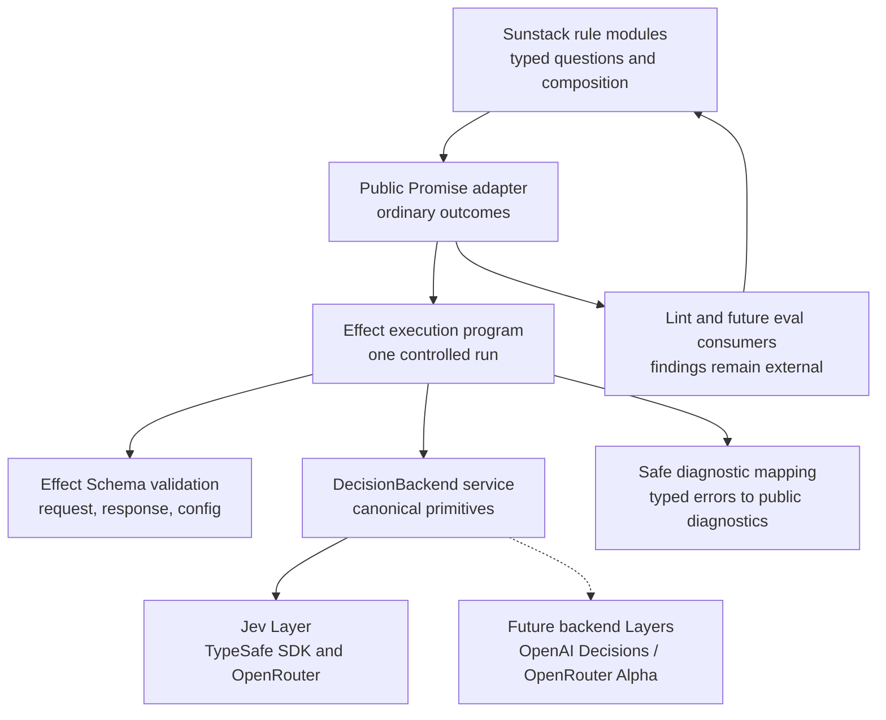
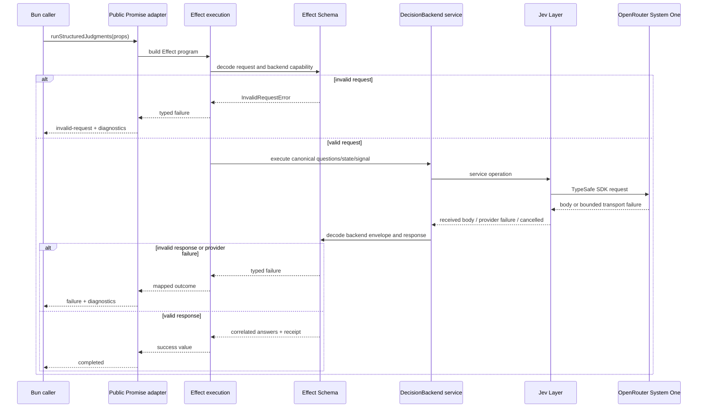

# Effect v4 execution alternative

This is a comparison-only Program Design alternative for the rule-runner. It does not replace the canonical Zod 4 design in [program-design.md](program-design.md), and it is not implementation authorization.

The owner-confirmed outcomes remain fixed:

- public typed `noul`, `choice` and `score` contracts;
- structured advanced TypeSafe instructions and criteria;
- safe actionable diagnostics forwarded to callers and agents;
- provider internals hidden;
- execution failures separate from findings;
- v1 supports Jev through OpenRouter;
- future backend substitution remains possible.

This alternative changes only the internal validation and execution model: Effect v4 and Effect Schema replace hand-built Promise/error orchestration and Zod-owned runtime validation. The consumer API remains ordinary TypeScript promises and discriminated outcomes.

## Public boundary

Consumers call the same shape as the canonical design:

```ts
const outcome = await runStructuredJudgments({
  questions,
  state,
  backend,
});
```

The public package exports ordinary TypeScript types:

```ts
type StructuredRunOutcome<TQuestions> =
  | {
      readonly kind: "completed";
      readonly answers: JudgmentAnswers<TQuestions>;
      readonly receipt: ExecutionReceipt;
    }
  | {
      readonly kind: "invalid-request" | "invalid-response";
      readonly diagnostics: readonly SafeDiagnostic[];
    }
  | {
      readonly kind: "provider-failure";
      readonly reason: ProviderFailureReason;
      readonly diagnostics: readonly SafeDiagnostic[];
      readonly retryable?: boolean;
      readonly statusCode?: number;
    }
  | {
      readonly kind: "cancelled";
      readonly diagnostics: readonly SafeDiagnostic[];
    };
```

Effect types, `Layer`, fibers, Effect causes, SDK classes and provider errors do not cross this boundary.

Internally, the execution program has the Effect shape:

```ts
Effect<
  CompletedJudgments<TQuestions>,
  InvalidRequestError
    | InvalidResponseError
    | ProviderFailureError
    | CancelledError,
  DecisionBackendService
>
```

The exact Effect API spelling and adapter composition remain a spike concern. The semantic boundary is fixed: the internal error channel is converted into the public outcome union once at the package boundary.

## Components and ownership



| Responsibility | Canonical owner | Effect alternative |
| --- | --- | --- |
| Native question/answer contracts | `rule-contracts` | unchanged public mapped types; Effect Schema definitions are internal validation implementations |
| Structured advanced values | `judgment-validation` | recursive JSON Schema values preserve object/array instructions and criteria |
| Backend abstraction | `rule-contracts` | `DecisionBackend` becomes an Effect service tag internally |
| Jev transport | `decision-backends` | Jev Layer constructs the SDK client and exposes the canonical service |
| Execution | `rule-execution` | Effect program owns sequencing, cancellation, retry policy and error recovery |
| Diagnostics | `rule-contracts` | typed error data maps once to bounded public diagnostics |
| Findings | Sunstack consumers | unchanged; Effect never creates or owns findings |

The service interface is dependency-free at the operation level. Configuration and SDK construction are supplied by a Layer so the public caller does not receive an Effect environment requirement.

## Validation and structured advanced values

Effect Schema validates unknown request, response and configuration data. Its schema contract can represent:

- JSON-compatible strings, numbers, booleans, nulls, arrays and objects;
- native `noul`, `choice` and `score` discriminants;
- structured `instructions`;
- structured Choice option descriptions;
- structured Score level descriptions;
- structured Noul `criteria.true` and `criteria.false`;
- request-relative answer names, choice labels, rubric indices and score bounds.

The public mapped type layer remains responsible for literal question-name and choice-label inference. Effect Schema alone is not accepted as proof of that relationship. A type-contract fixture must prove that the public `runStructuredJudgments` declaration preserves those keys and rejects invalid access.

The schema decoder returns typed validation data to the Effect error channel. It does not expose raw parser trees to consumers. The diagnostic mapper selects safe paths, closed codes and bounded repair messages.

## Typed failures and useful diagnostics

The internal failure classes are typed data, not thrown SDK objects:

| Internal failure | Public result | Diagnostic purpose |
| --- | --- | --- |
| `InvalidRequestError` | `invalid-request` | identify missing/invalid request field and repair |
| `InvalidResponseError` | `invalid-response` | identify missing answer, wrong kind, label, rubric or receipt issue |
| `ProviderFailureError` | `provider-failure` | identify authentication, rate limit, timeout, connection or HTTP class; expose bounded status/retryability |
| `CancelledError` | `cancelled` | identify caller abort without treating it as a judgment |

Every diagnostic is mapped to:

```ts
interface SafeDiagnostic {
  readonly path: readonly (string | number)[];
  readonly code:
    | "missing-field"
    | "invalid-value"
    | "invalid-json-value"
    | "unsupported-primitive"
    | "unexpected-answer"
    | "wrong-answer-kind"
    | "invalid-choice"
    | "invalid-number"
    | "invalid-rubric"
    | "invalid-receipt"
    | "model-rejected-request"
    | "model-invalid-answer"
    | "provider-authentication"
    | "provider-rate-limit"
    | "provider-timeout"
    | "provider-connection"
    | "provider-http-error"
    | "unexpected-provider-error"
    | "caller-aborted";
  readonly message: string;
  readonly retryable?: boolean;
  readonly statusCode?: number;
}
```

The adapter never forwards raw Effect causes, SDK exceptions, provider bodies, credentials or unbounded provider messages. Agents can use the diagnostic path, code, message and retryability to repair a request or choose a bounded retry.

## Representative execution path



Effect's cancellation and retry combinators would operate inside the execution program. The Jev SDK remains the owner of its request attempts; the alternative must prove that Effect does not introduce a second retry controller or detach the original SDK promise.

## Backend extensibility

The canonical backend contract remains the semantic center. Future adapters map their wire contracts into it:

| Future candidate | Native difference | Adapter responsibility | v1 status |
| --- | --- | --- | --- |
| OpenAI Decisions | `predicate` rather than `noul`; named answers returned as an array; `POST /v1/decisions` | map predicate probability to canonical noul, map answer array by name, normalize usage/errors | future candidate |
| OpenRouter Alpha Decisions | Jev Decisions envelope with named question map and typed noul/choice/score answers | map Alpha Decisions request/response and diagnostics into canonical service | future candidate |
| Jev System One | TypeSafe native noul/choice/score map and OpenRouter System One transport | implement current adapter and validation | v1 |

No future adapter is implemented, and no generic text model is treated as semantically equivalent to a decision backend.

## Tradeoffs against the canonical Zod design

| Question | Canonical Zod design | Effect alternative |
| --- | --- | --- |
| Public consumer coupling | Zod is an implementation dependency unless exported | Effect remains hidden; consumers see the same Promise/outcome API |
| Validation | Zod schemas plus explicit execution control | Effect Schema plus typed Effect error channel |
| Cancellation/retry | Explicit Promise/AbortSignal and one SDK controller | Effect control flow plus one SDK controller; must prove no duplicate retry |
| Service replacement | Passed backend object | Internal service tag and Layer |
| Diagnostic mapping | Explicit bounded result reconstruction | Typed internal errors mapped once at the public boundary |
| Runtime and learning cost | Smaller conceptual surface | Larger internal model and dependency |
| Main proof risk | Hand-built control/error flow defects | Bun compatibility, Schema inference, Layer/runtime behavior |
| Escape hatch | None | Do not expose `Effect`, `Layer`, fibers or causes publicly |

The alternative earns its complexity only if the spike demonstrates that Effect materially reduces control-flow and diagnostic defects without harming Bun startup, bundle/runtime cost, type inference or test ergonomics.

## Spike acceptance boundary

The spike is not a production implementation or a public-contract migration. It must prove only:

1. structured advanced noul, choice and score definitions;
2. nested JSON instructions and criteria;
3. exact public named-answer and choice-label inference;
4. malformed request diagnostics;
5. malformed provider response diagnostics;
6. provider failure and cancellation;
7. one bounded retry policy without a second SDK retry controller;
8. Bun execution through the public Promise API;
9. no Effect, Layer, fiber, cause, SDK class or raw provider body in public outcomes.

A failed spike does not invalidate the canonical domain model. It selects the Zod implementation and records the Effect alternative as rejected on evidence. A passing spike still requires a separate owner decision before replacing the canonical implementation model.

## Current status

This alternative is intentionally not reviewed as the canonical design. The canonical design is committed and pushed at `d5e45a0`. The alternative requires an independent focused review and the spike evidence before it can replace the implementation model. No implementation or dependency installation is admitted by this artifact.

