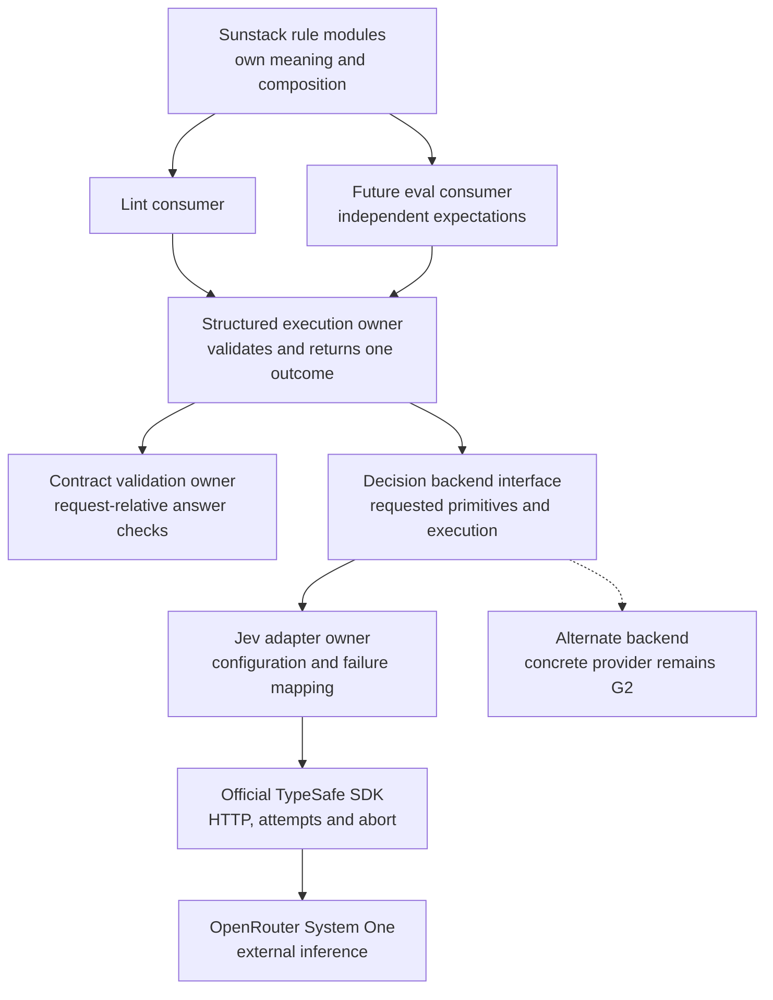
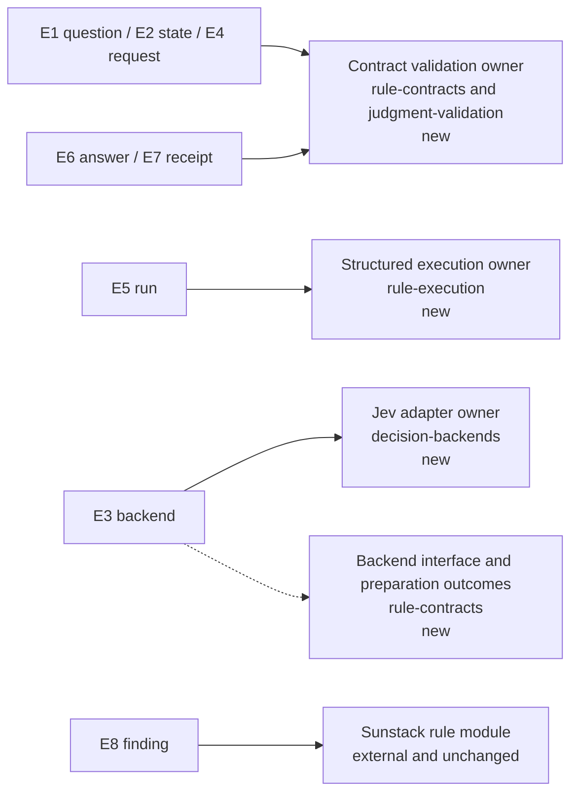
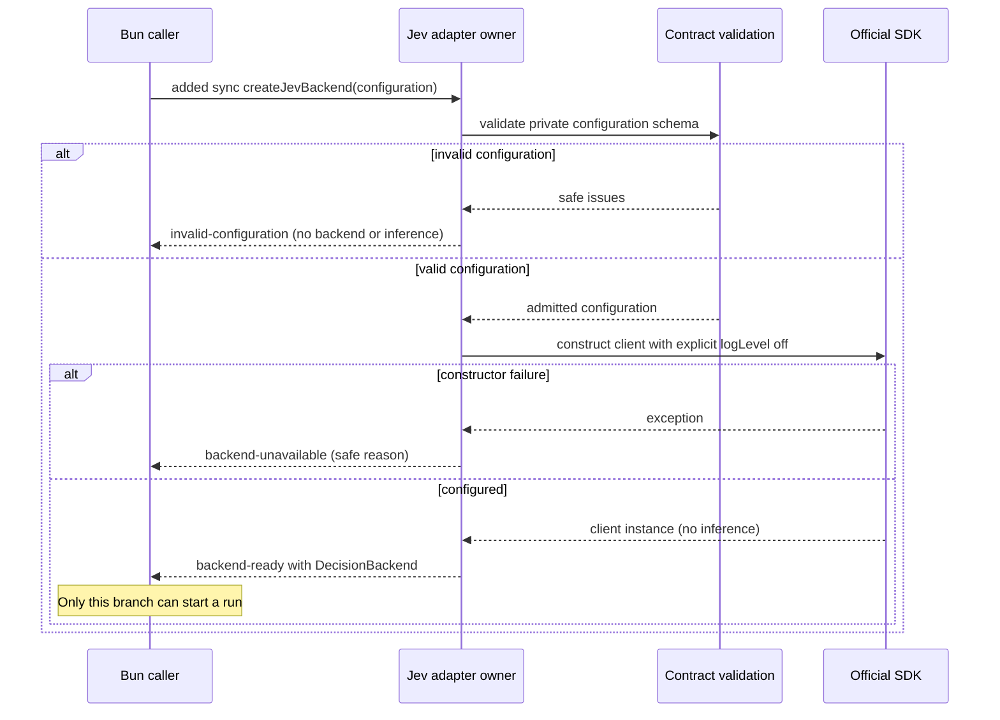
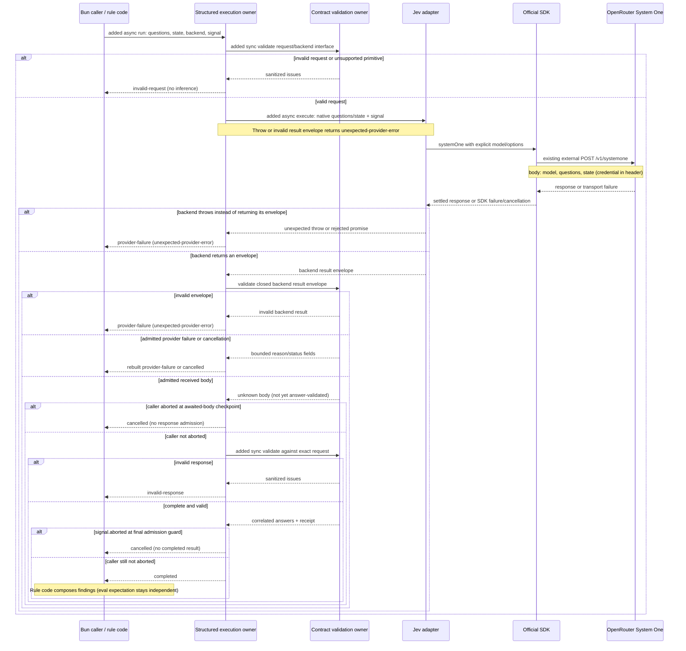

# Rule-runner structural proposal

This proposal realizes the [Specification](specification.md) against the [Requirements](requirements.md). The owner confirmed public typed `noul`/`choice`/`score` contracts, adapter isolation of SDK/provider internals, and forwarding of safe structured diagnostics. G2–G4 remain evidence gaps; the structural realization below remains subject to owner confirmation before planning.

## Owners and consumers

The runner does not import Sunstack's skill inventory or eval corpus. A consumer imports the same rule module for its question definitions and deterministic composition. Contract validation and the backend seam earn their boundaries because external data and model connections vary; there is no service, registry, plugin framework or persistent run store.

## Current foundation and structural choice

The target repository is greenfield for this library: at commit `4e55750644b66de7ca76cd9d25d43877e581e25b`, only LICENSE and .gitignore exist. There is no predecessor call path to migrate. All runner entry, validation, backend and return edges below are **added**. Existing Sunstack production consumers, hooks and infrastructure are intentionally outside the change.

The external SDK's current `systemOne` path validates a subset of questions, invokes `POST /v1/systemone`, parses the body and casts it to the generic result without question-relative runtime validation ([client source](https://github.com/typesafe-ai/typesafe-sdk-js/blob/main/src/client.ts#L311)). Its mapped types preserve named answers, choice labels and fractional scores ([type source](https://github.com/typesafe-ai/typesafe-sdk-js/blob/main/src/types.ts#L73)). Those observations justify local response validation; they are not runtime proof or a pinned-artifact receipt.

| Choice | Shape | Gain | Cost and payer | Revisit signal |
| --- | --- | --- | --- | --- |
| Expose the official SDK directly | Consumers call SDK types and then a response validator | Minimal local type machinery; native inference | Consumers learn SDK configuration/errors; model substitution can change their imports and policy code | Appropriate only if the owner narrows U12 to SDK-compatible hosting routes |
| Proposed: library contracts with a backend seam | Consumers call one library interface; adapters own SDK/wire translation | One consumer-facing execution boundary and isolated transport changes | Tools maintains schema/protocol alignment and mapped inference; adapter conformance needs proof | A real alternate backend cannot preserve the required primitives or receipts without changing the public contract |

The proposed seam is one passed backend implementation, not dynamic provider discovery. The first real adapter is Jev over the existing System One protocol. OpenRouter is a hosting route; changing a base URL does not make an arbitrary model implement that protocol. The canonical public `noul` meaning is a yes/no probability; a future OpenAI Decisions adapter would translate its `predicate` wire type into that canonical meaning, while a future OpenRouter Alpha Decisions adapter would translate its Decisions request/response envelope into the same contract. Provider-specific arrays, IDs, errors, usage fields and request envelopes remain adapter-owned. Those future adapters are extensibility targets, not v1 implementations or proof of conformance.

## Where the entities live

All new homes are modules within `packages/rule-runner`; they are responsibilities, not a planning file list. The found conventions are the supplied AGENTS instructions and the fully read TS rules: Zod 4 owns runtime schemas, `z.infer` owns their primitive types, interfaces express object contracts, discriminated unions express outcomes, and descriptive generics preserve request-dependent types. Generic mapped relationships refine names/labels without duplicating primitive runtime shapes.

| Entity | Semantic owner | Package/module home | Schema/type home | Boundary shape | Lifetime | Convention |
| --- | --- | --- | --- | --- | --- | --- |
| E1 Named question | Contract validation | rule-contracts (new) | judgment-validation (new) | Native `type: noul / choice / score`; instructions, Choice option descriptions, Score level descriptions and Noul true/false criteria preserve JSON-compatible strings, objects, arrays or null; name supplied by E4 map | Derived, invocation-local; no persistence | Zod-derived primitive union plus descriptive mapped generics |
| E2 Shared state | Caller supplies; execution owner preserves | rule-contracts (new) | rule-contracts (new) | Native text / JSON-compatible object or array / null | Borrowed invocation input; no store/cache | Validated JSON-compatible union |
| E3 Decision backend | Jev adapter owns preparation/execution; execution owner selects one prepared connection per run | decision-backends (new) | Public interface/preparation outcome in rule-contracts; private Jev configuration schema in decision-backends (new) | Capability set and async execute interface; closed preparation outcome; explicit model, credential, base URL and finite attempt settings | Configured in-process value; credential held in execution memory | Interface for backend; schema-derived preparation errors/configuration |
| E4 Structured request | Contract validation | rule-contracts (new) | rule-contracts (new) | `state`, nonempty named `questions`; selected backend and abort signal passed as execution props | Derived per invocation | Schema-derived shape; generic named question relation |
| E5 Run | Structured execution | rule-execution (new) | rule-contracts run outcome (new) | Closed `kind` union below; non-completed variants carry safe diagnostics | Invocation-local terminal outcome | Zod-derived result variants with mapped completed-answer relation |
| E6 Answer | Contract validation | judgment-validation (new) | judgment-validation (new) | Native primitive fields, correlated to exact requested names/criteria | Derived validated output | Primitive schemas; request-relative validation narrows unknown data |
| E7 Execution receipt | Adapter reports; validation owner admits | judgment-validation / decision-backends (new) | judgment-validation receipt (new) | Resolved nonempty `model` and native `usage: { input_tokens, output_tokens, cost?: number }` for System One; supplied cost is USD, absence is unavailable | Derived output retained by caller, not stored by Tools | Zod-derived receipt; G2 for a different native usage contract |
| E8 Rule finding | Sunstack rule module | External rule modules (existing ownership; implementation not migrated) | Consumer-owned finding contract, outside Tools | Consumer-defined result of applicability/threshold/composition; not part of provider response | Consumer-owned | No new Tools schema; independent eval expectation |

The backend has no access to rule composition. The execution owner has no filesystem reader or semantic threshold. The adapter may use official SDK types internally; the proposed package-level execution contracts do not expose SDK client/error classes.

## Interface shapes and responsibility

The proposed programmatic entry is `runStructuredJudgments`: it executes questions, while rule code composes findings. Calling that entry a rule evaluator would obscure where policy lives. The public declaration surface also exports schema-derived `NamedQuestions`, the mapped `JudgmentAnswers<TQuestions>` and `StructuredRunOutcome<TQuestions>`, and the `DecisionBackend`/`BackendPreparationOutcome` contracts from rule-contracts. Jev preparation is exposed by `createJevBackend` from decision-backends; its result contains no SDK class or raw error.

Reusable rule modules declare native-shaped objects with `satisfies NamedQuestions`, without annotating the value as a widened record. `runStructuredJudgments` uses a `const TQuestions extends NamedQuestions` parameter so imported declarations retain question-name and choice-label keys. The example/consumer fixture must demonstrate declarations outside the call site; V2 covers both inline and imported declarations. No new builder language or mandatory identity helper is needed.

Its props contain typed `questions`, validated `state`, a backend implementation and an optional `AbortSignal`. More than three independent arguments are avoided by the adjacent props interface. The operation is async, has no startup side effects, and never starts another request based on its answers.

| Interface | Owner / consumer | Inputs and effects | Result or failure |
| --- | --- | --- | --- |
| Structured execution | Execution owner / lint and eval callers | Typed question map, shared state, backend and optional abort signal; one logical structured execution; no storage | Closed run outcome |
| Backend preparation | Jev adapter / callers | Unknown configuration, synchronous schema validation, then SDK client construction with explicit options; no inference | Closed preparation outcome; only its ready branch contains a runnable backend |
| Request validation | Contract validation / execution owner | Unknown request data and supplied backend interface shape; synchronous, no inference | Validated request or sanitized validation issues; no access to private credentials/configuration |
| Backend execution | Adapter / execution owner | Validated shared state/questions and abort signal; async external inference, adapter-owned attempts | Untrusted provider body, provider failure or cancellation; body still needs core validation |
| Answer validation | Contract validation / execution owner | Unknown successful body plus the exact validated request | Complete request-correlated answers/receipt or invalid response |
| Rule composition | Sunstack rule module / both consumers | Validated answers and consumer-owned evidence/applicability | Consumer-owned findings; no transport failure fabricated as a judgment |

The backend interface has one declaration home: rule-contracts. It exposes `supportedPrimitives: readonly ("noul" | "choice" | "score")[]` and an async `execute` operation. Its props are the validated native `questions`, `state` and optional `signal`. Its closed result is `{ kind: "received", body: unknown }`, the bounded `provider-failure` variant below, or the bounded `cancelled` variant below. `unknown` belongs only to this untrusted provider-body boundary and is narrowed by request-relative parsing. It is not a public successful-result escape hatch. Jev configuration uses required nonempty `apiKey` and `model`, an explicit validated `baseURL`, and finite `attemptTimeoutMs`/`maxRetries`; it exposes no SDK client or error object.

`createJevBackend` validates configuration before constructing the SDK client and returns one `BackendPreparationOutcome`:

| Preparation kind | Fields | Behavior |
| --- | --- | --- |
| `backend-ready` | Required `backend: DecisionBackend` | Configuration and client construction succeeded; caller can pass this backend to the runner |
| `invalid-configuration` | Required safe `issues`, each with path and bounded reason: `missing-credential`, `invalid-model`, `invalid-endpoint`, `invalid-timeout`, `invalid-retry-setting` | No SDK construction or inference; no backend value exists |
| `backend-unavailable` | Required `reason: initialization-failed` | SDK construction failed after configuration validation; exception is contained without raw error/body/credential exposure; no backend or inference |

The caller exhaustively handles preparation failure before invoking the runner. A preparation failure is not an E5 run, so configuration errors are not fabricated as a run's `invalid-request` outcome. The runner checks the supplied interface/capability shape and request data; it cannot introspect opaque adapter credentials. External backend implementations obey the same interface/preparation precondition. HTTP authentication rejection after successful preparation remains a run's `provider-failure`.

The execution owner admits the entire `execute` result through the closed backend-result schema in rule-contracts before branching on its `kind`. Treat the result envelope as untrusted across an injected backend boundary: validate the discriminant, bounded reason, optional finite integer status, bounded retryability and safe diagnostic list, and permitted fields. An invalid envelope, unexpected throw or rejected promise becomes `provider-failure` with `reason: unexpected-provider-error` and a bounded diagnostic; no raw envelope or thrown object is returned, and no additional retry occurs. Rebuild failure/cancellation outcomes from admitted bounded fields instead of returning backend objects directly. The received body's `unknown` value then crosses its separate request-relative validation boundary once. V9 includes wrong kinds/reasons, extra raw-error fields, unsafe diagnostics and rejection controls; V7 verifies useful safe diagnostics survive while raw data does not. This realizes the closed-outcome, actionable-feedback and no-raw-error guarantees without trusting TypeScript annotations from another implementation.

Proposed caller-visible outcomes, discriminated by `kind`:

| Variant | Fields and nullability | Bounded reasons |
| --- | --- | --- |
| `completed` | Required `answers`, required `receipt`; answer names/kinds/choice labels derived from the request | none: contains judgments, not failure reasons |
| `invalid-request` | Required sanitized diagnostic list; no completed answers | `empty-questions`, `invalid-question`, `invalid-state`, `invalid-backend`, `unsupported-primitive` |
| `provider-failure` | Required `reason`; optional integer HTTP `statusCode`, retryability and bounded diagnostic list; no completed answers or raw SDK error | `authentication`, `rate-limit`, `timeout`, `connection`, `http-error`, `unexpected-provider-error` |
| `invalid-response` | Required sanitized diagnostic list; no completed answers | `invalid-body`, `missing-answer`, `unexpected-answer`, `wrong-answer-kind`, `invalid-choice`, `invalid-number`, `invalid-rubric`, `invalid-receipt` |
| `cancelled` | Required `reason`; optional bounded diagnostic list; no completed answers | `caller-aborted` |

Each diagnostic contains a required safe path of string/number segments, a bounded code and a bounded actionable message; provider failures may additionally carry a boolean retryability and admitted status code. It does not include an input value, state/request body, provider body, credential, raw SDK error or arbitrary metadata. Diagnostics are forwarded to callers and agents as repair context, never as judgments or findings. Identifiers and model/base URL fields are validated at the adapter boundary; credentials do not appear in outcomes.

The public diagnostic code set is closed: `missing-field`, `invalid-value`, `invalid-json-value`, `unsupported-primitive`, `unexpected-answer`, `wrong-answer-kind`, `invalid-choice`, `invalid-number`, `invalid-rubric`, `invalid-receipt`, `model-rejected-request`, `model-invalid-answer`, `provider-authentication`, `provider-rate-limit`, `provider-timeout`, `provider-connection`, `provider-http-error`, `unexpected-provider-error` and `caller-aborted`. Messages are bounded repair guidance, not provider text. A model or agent may use `path`, `code`, `message`, `retryable` and `statusCode` to choose a correction or bounded retry; it cannot use diagnostics as an answer or finding.

The System One completed-body shape retains native `answers`, `model` and `usage` semantics. Primitive fields are `noul`; `choice`, `confidence`, `probabilities`; and `score`, `confidence`, `legend`, `probabilities`. Structured instructions and criteria are preserved as JSON-compatible values without flattening or interpretation. The receipt schema admits a nonempty model identifier, finite nonnegative integer `input_tokens`/`output_tokens`, and optional finite numeric `cost` in USD. Preserve supplied cost exactly; leave the field absent when unavailable, with no zero default or price calculation. Supplied null, nonnumeric or nonfinite cost yields `invalid-response` with `invalid-receipt`. The [OpenRouter System One schema](https://openrouter.ai/docs/api/api-reference/systemone/submit-a-system-one-request) includes optional `usage.cost`, although the inspected TypeSafe SDK declarations name only token counts. The SDK parses the body without projecting away its fields, so the request-relative body schema admits cost directly rather than depending on the narrower SDK annotation. The completed-body and nested usage schemas strip unknown provider receipt/metadata fields; additive metadata alone neither invalidates a run nor escapes in the public result. V3 includes unknown receipt fields, structured question definitions and safe diagnostic cases. This stripping policy does not relax exact answer-name, choice/probability-key, rubric-index or closed backend-envelope validation. The public completed outcome groups admitted model/usage into `receipt` without inventing numbers or dropping these supported native System One usage fields; arbitrary metadata remains excluded. Different native receipt shapes are G2, not an untyped metadata escape hatch.

Request-relative parsing has one narrowing owner in judgment-validation. First, the schema-derived base response parser admits/clones the unknown body into `ParsedJudgmentBody`, validating primitive shapes, finite ranges and receipt fields. Next, a private request-relative type predicate, `answersMatchQuestions<TQuestions>`, checks the entire parsed value against the validated request snapshot: exact answer names, matching discriminants, every allowed choice/probability key, every rubric/legend index, and rubric-compatible score bounds. Only success narrows the parsed value to the intersection with `CorrelatedJudgmentBody<TQuestions>`. Failure returns safe issues; it never narrows or casts.

The public result has an explicit `StructuredRunOutcome<TQuestions>` return type and exposes only `JudgmentAnswers<TQuestions>`, not the base parser's broad answer-name record/index signature. Primitive fields remain Zod-derived; mapped relationships narrow question names and choice labels. Imported score criteria may have a wide array type, so score legend/probability maps remain numeric-indexed, with potentially absent lookups, rather than promising literal rubric-index inference. Actual rubric index sets and score bounds are checked at runtime. Legend values remain schema-validated descriptions rather than unproved literal echoes of input text. The predicate is the single request-correlation narrowing at the untrusted body boundary. It is a check, not an unchecked assertion: V2 proves the required name/choice-label types, and V3 challenges mismatched names, labels, kinds, index sets and ranges against independently specified cases. No `as` cast or widened public answer-name record substitutes for that joint proof.

## Added execution and return paths

The external POST is an existing platform edge, preserved inside the new adapter path, not an assertion that this repository has run it. Its request/response shapes are in the binding and interface tables. Structured instruction/criteria values cross this edge unchanged as JSON-compatible values. No local state writes occur; the only production side effect is external inference. Provider receipt accuracy and real endpoint support require V5.

## Failure, cancellation and overlapping runs

| Execution-owner state | Transition and guard | Terminal observation / illegal path |
| --- | --- | --- |
| Validating | Request schema, backend interface and requested capability checks pass; configuration was admitted during preparation | Invalid request/interface terminates as invalid request; valid pre-aborted input terminates as cancelled; neither reaches inference |
| Executing | One admitted request is awaited through adapter/SDK; returned envelope is schema-admitted before branching | Valid failure/cancellation is rebuilt from bounded fields; malformed envelope or throw becomes unexpected-provider-error; none reaches composition |
| Validating response | After the awaited body settles, check abort, validate against the same request, and check `signal.aborted` again immediately before completed admission | Observed abort terminates as cancelled; missing/wrong/invalid values terminate as invalid response; no partial completion |
| Terminal | Exactly one closed outcome returned | No background follow-up execution or later mutation of the returned result |

The Jev adapter delegates attempt scheduling, per-attempt timeout and abort to the official SDK. Preparation validates finite positive attempt timeout and finite nonnegative integer retry count, supplies explicit model selection, and always passes `logLevel: "off"` to SDK construction. The SDK's environment log-level setting cannot turn body logging back on; V7 explicitly challenges that configuration with `TYPESAFE_LOG_LEVEL=debug` and safe sentinel data. Structured execution owns safe returned issues/reasons, while the adapter owns suppressing SDK diagnostics. The proposed adapter defaults are `attemptTimeoutMs: 10000` and `maxRetries: 2`, matching the inspected SDK 0.6.0 declarations. The pinned SDK's bounded backoff and maximum Retry-After defaults remain authoritative; the adapter does not add another retry controller or total-deadline race. Supplied overrides must remain finite, and no unknown infinite retry allowance is permitted.

Cancellation is forwarded and the original SDK promise is awaited to settlement before classification; the runner does not detach a losing request. Provider processing or billing already accepted remotely may remain irreversible. Timeout/connection ambiguity is visible as execution failure, not a claim that no remote work occurred. Retrying inference may cost additional usage; no duplicate-charge prevention or inference idempotency guarantee is introduced.

Two concurrent runs share neither mutable answer maps nor per-run abort state. Each validator uses its own request, and each invocation settles independently. Caller code controls capacity and dependent ordering; no queue, lock, scheduler or shared limiter is needed by the authorized scope. No persistence, restart recovery, migration or dual runtime path is introduced.

## Package consumption and selected tooling

For Bun-only consumers, the proposed initial package exports TypeScript source through one package export boundary. Strict checking follows those actual exports and dependencies. A local declared `file:` dependency supports sibling-repository development without a cross-repository workspace or global link registry ([pnpm comparison](https://pnpm.io/cli/link)). The cost is live-source rather than immutable-version consumption; consumer/dependency changes must be tested together. The consumer's install also installs the linked package's dependencies, overriding its local dependency installation, so independently prepared library node_modules cannot be treated as the consumer's resolution authority. This route is local development only.

No build is introduced merely to populate the tree. If an actual distribution/consumer requirement later needs compiled JavaScript/declarations, tsdown is the selected conditional candidate, with a complete exports cutover and real Bun proof of consuming its output. The build tool can use its supported runtime. Source/build parallel compatibility paths are not part of v1. Publication destination and immutable delivery are G3.

Current registry candidates checked on 2026-10-11 are Oxlint 1.87.0, Oxfmt 0.72.0, Vitest 5.0.3, Vite 8.3.4, TypeScript 7.0.2, Zod 4.6.6 and TypeSafe SDK 0.6.0; conditional tsdown is 0.23.1. Exact pins and a lockfile belong to implementation, after compatible combinations are established. pnpm installs; Bun runs. No cache-to-types adapter is needed under the corrected local-module policy.

Vitest's native-loader mode has documented Bun limitations for specific transformation features ([primary documentation](https://github.com/vitest-dev/vitest/blob/main/docs/config/experimental.md#known-limitations)). tsdown labels running its tool under Bun experimental ([primary documentation](https://github.com/rolldown/tsdown/blob/main/docs/guide/getting-started.md)). Those tool-runtime facts do not impose an extra all-tools-on-Bun gate. The selected check/build orchestrator can run in its supported runtime; V1/V4/V5 must observe actual library execution under Bun. G4 concerns the functioning toolchain and consumed library, not forcing every worker onto Bun.

The V6 harness belongs to the proof-harness/consumer-fixtures module inside packages/rule-runner, with one reusable fixture rule declaration/composer and two caller harnesses. A scripted conforming backend supplies known positive/negative judgments and an invalid-response control through the real execution/validation owners. Independent literal expected findings prove shared code composition and refusal behavior. No Sunstack source, production linter or eval runner is imported/migrated; the harness is not a semantic eval or a production policy module. V4 separately proves real SDK wiring, and V5 proves the hosted path.

## How each obligation is realized and observed

All rows preserve the Specification's U/R/E meanings. `gap` cells intentionally prevent an implementation-ready claim.

| U | R and scenario | E | Owner | Interface | Shape and home | State | Failure | Proof seam |
| --- | --- | --- | --- | --- | --- | --- | --- | --- |
| U1, U8 | R1 public Bun call | E4, E5 | Structured execution | Public execution | Request/outcome, rule-contracts | Validate → terminal | Closed outcome | V1 real Bun caller/public export |
| U3, U4, U10 | R2 named/choice inference | E1, E6 | Contract validation | Declaration export + correlated predicate | NamedQuestions/mapped public result, rule-contracts; parsed body/predicate, judgment-validation | Unknown → admitted | No cast-based admission or broad public index signature | V2 inline/imported positive/negative contracts plus V3 correlation cases |
| U3, U10 | R3 invalid input makes no request | E1, E2, E3, E4, E5 | Contract validation and Jev preparation, each at its input boundary | Request checks + closed backend preparation | Request schema, rule-contracts; private config schema, decision-backends | Preparation or request validation → refuse | Preparation failure is separate from invalid-request | V3 invalid request/configuration with construction/inference observed |
| U4, U5 | R4 mixed shared-state batch | E1, E2, E4, E5 | Structured execution | Backend execute | Native request, rule-contracts | Executing | No implicit partition/truncate | V4 real SDK controlled transport observes full body |
| U3, U4 | R5 fractional/distribution answers | E1, E6 | Contract validation | Answer validation | Primitive schemas, judgment-validation | Response → admitted | No boolean flattening | V3 fractional score/distribution observation |
| U3, U4, U10 | R6 malformed provider body | E1, E5, E6, E7 | Contract validation | Request-relative parsing | Answer/receipt schemas, judgment-validation | Response → refuse | invalid-response with safe diagnostics | V3 mismatched name/kind/label/range/rubric cases and diagnostic usefulness |
| U3, U7, U14 | R7 failure versus judgment | E5, E6, E8 | Structured execution | Backend-result admission + run outcome | Closed backend/run variants plus bounded diagnostics, rule-contracts | One terminal result | Malformed envelope/throw contained; no completed partial map; repair context retained safely | V3/V4 failures and negative judgments; V7 safe diagnostics; V9 wrong-envelope controls |
| U6 | R8 native usage/model/cost | E5, E7 | Contract validation | Receipt validation | System One receipt with optional USD cost, judgment-validation | Complete; absent cost remains unavailable | invalid-receipt | V3 present/absent/malformed cost; V4 SDK receipt preservation plus V5 real provider |
| U5, U7, U9 | R9 external policy | E1, E2, E4, E8 | Sunstack rule module; fixture policy remains proof-only | Consumer composition | External finding shape; Tools request, rule-contracts; fixture composer, proof-harness/consumer-fixtures | Caller chooses next run | Failure never invokes success composition | V6 two local caller harnesses share one fixture rule/composer |
| U2, U10 | R10 secret/body exposure | E2, E3, E7 | Jev adapter for SDK logs; structured execution for safe outcomes | Explicit SDK logging override + sanitized outcome mapping | Config schema, decision-backends; safe outcomes, rule-contracts | Memory-only | SDK logLevel off; no raw errors/values | V7 diagnostics with sentinel data and debug environment override |
| U1, U3 | R11 cancellation/attempt bounds | E3, E5 | Jev adapter | SDK execution | Attempt config, decision-backends; cancelled outcome, rule-contracts | Executing → settled | Abort forwarded; no detached request | V4 controlled request/retry with original join observed |
| U7, U9 | R12 lint/eval reuse | E4, E8 | Consumer fixture owner for proof; Sunstack rule module for production policy | Shared definitions/composition | Fixture rule and two callers, proof-harness/consumer-fixtures; public entry, rule-contracts | Consumer evaluation | Independent expected code-composition outcomes | V6 scripted-backend/code-reuse controls, not semantic accuracy |
| U8, U10, U13 | R13 tooling/runtime | none: platform constraint | Repository tooling owner | Checks and package exports | Strict checker/Oxc/Vitest config; source export | Development run | gap: functioning toolchain and actual Bun library execution | V1/V2/V8 actual public call and supported checks; V4/V5 use Bun |
| U3, U4, U12 | R14 supported backend substitution | E1, E3, E4, E6 | Structured execution selects/checks; Jev adapter implements execution | Capability check + DecisionBackend.execute | Single public interface home, rule-contracts; implementation, decision-backends | Refuse or execute | unsupported-primitive; gap: concrete alternate contract/receipt | V9 conformance controls; real alternative remains G2 |
| U4, U10, U14 | R15 advanced structure and actionable diagnostics | E1, E5 | Contract validation and structured execution | JSON-compatible primitive schema + diagnostic forwarding | Structured question values, safe diagnostic union, rule-contracts/judgment-validation | Request/response refuse or forward bounded context | No flattening; no raw error/body/secret escape | V3/V4/V7 structured values and safe repair feedback |

All E1–E8 bindings are in the entity table. Native noul/choice/score variants and completed/failure/cancelled outcomes are in the interface tables. V1–V9 observations retain the Specification's proof limits; no stand-in proves V5 or a real alternate provider. Tooling compatibility and G1–G3 remain explicit gaps.

Illegal states are either unrepresentable in the closed outcome union (failure with completed answers, wrong discriminant) or rejected by the trusted entry (empty/malformed request, unsupported primitive, malformed answers/receipt). Request-name/choice-label mistakes are compile-time contract errors when literal input is typed and runtime validation errors for untrusted data. Safe diagnostics are forwarded as bounded repair context; raw errors, provider bodies and credentials are rejected at the boundary. Schema validation never substitutes for semantic eval evidence.

## Decisions requiring owner confirmation

The owner confirmed public library-owned schemas/mapped inference, typed native primitives, safe diagnostic forwarding, and provider internals isolated inside adapters. The structural proposal is an injected backend interface, with the Jev SDK internal to its adapter, source exports for Bun-only local consumers, consumer-owned rule composition, and one SDK retry/cancellation controller. V1 implements only the Jev adapter with Zod 4 validation; OpenAI Decisions and OpenRouter Alpha Decisions remain future adapters against this same seam.

G2 needs an actual alternate provider before its receipt/protocol conformance can be claimed. OpenAI Decisions and OpenRouter Alpha Decisions are documented future candidates, not v1 implementations. G3 needs a delivery destination before immutable distribution is designed. G4 requires actual tooling/runtime behavior before compatibility is claimed. None authorizes a provider-probability fabrication, Node fallback, publication, infrastructure migration or weakened proof.
