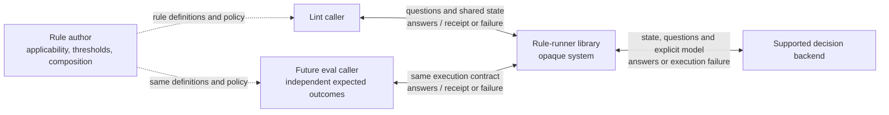
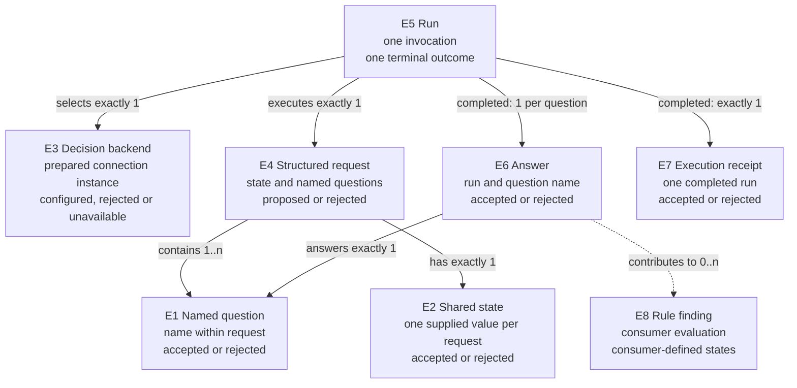

# Rule-runner observable contract proposal

The [Requirements](requirements.md) owns authorized needs and limits. This document defines the proposed observable behavior over those needs; [Program Design](program-design.md) binds it to components and shapes. The additional meaning of “don't pass through” remains an explicit gap rather than an inferred obligation.

## What consumers can observe

The library has no CLI, persistent workflow store, document-discovery surface or acceptance authority. Existing production hooks and the future eval runner are outside its implementation boundary.

## The nouns the contract uses

| ID and term | Identity and relationships | Invariant and observable states | Basis |
| --- | --- | --- | --- |
| E1 Named question | A question occurrence is its name within one E4 request; the same name in a later request is another occurrence. Each request contains 1..n questions | One of noul, choice or score, with JSON-compatible string, object, array or null instructions and criteria; accepted or rejected as request data | U3, U4, U5 |
| E2 Shared state | The evidence value associated with one E4 request. Exactly one state is associated with that request; several questions read it | All questions in that request receive the same supplied value; the runner does not retrieve or silently truncate it. Supplied, accepted or rejected | U5 |
| E3 Decision backend | One prepared provider/model connection instance; a separately prepared connection is distinct even with equivalent settings. A configured connection can be selected by several E5 runs | A supported backend preserves the semantics of requested primitives. Preparation yields configured, configuration rejected, or unavailable; execution state belongs to E5. A resolved model is recorded separately from requested selection | U2, U3, U12 |
| E4 Structured request | One supplied shared state plus a nonempty named-question set. Reusing its contents does not make two invocations the same E5 run | Independent questions share evidence. A question depending on an earlier answer belongs in a later request. Proposed or rejected | U3, U4, U5 |
| E5 Run | One execution invocation with a proposed E4 request and selected E3 connection; validation can refuse the supplied inputs before admitting them. Retry attempts within that invocation remain part of that run | Exactly one caller-visible terminal outcome: completed, invalid request, provider failure, invalid response or cancelled. Non-completed outcomes carry bounded structured diagnostics when available. Execution requires a valid request and configured backend; a completed run has all requested answers | U1, U3, U5, U12, U14 |
| E6 Answer | The answer to one E1 question in one completed E5 run; identified by that run and the requested name | Its primitive and allowed labels match that question. A fractional score or probability is retained. Untrusted, accepted or rejected | U3, U4 |
| E7 Execution receipt | Metadata for one completed E5 run, including resolved model and native usage | Available native billing cost is retained; absent cost is unavailable rather than zero. The receipt describes execution, not policy acceptance or semantic correctness. Untrusted, accepted or rejected | U6 |
| E8 Rule finding | One consumer-produced evaluation of rule policy against evidence and E6 answers. A run may contribute to 0..n findings | The consumer owns identity, applicability, thresholds and composition; Tools does not assign persistent finding IDs or decide a universal pass threshold. States are consumer-defined | U7 |

These definitions do not create persisted identities, a workflow language or automatic orchestration.

## Obligations and their observable difference

The clauses below are the proposed contract to inspect; the public API realization and model capability policy must receive design confirmation before implementation.

| ID | Proposed obligation and failure case | Need → problem → outcome | Entities / contract / proof |
| --- | --- | --- | --- |
| R1 | A Bun developer MUST be able to call the exported programmatic library without startup inference or hidden process/service initialization | U1, U8 → P1 no reusable runner here → O1 import and execute from Bun | E4/E5; C1; V1 |
| R2 | The API MUST preserve literal question names and choice labels in completed-answer types. Incorrect names or labels MUST be rejected by strict checking | U3, U4, U10 → P2 type widening can hide mistakes → O2 precise caller types | E1/E6; C1; V2 |
| R3 | Invalid request data MUST be rejected before provider execution. Empty questions and invalid primitive data MUST not cause inference. Invalid backend configuration MUST be rejected during preparation without creating a runnable connection, and the refusal MUST carry bounded diagnostics identifying the repairable path and issue | U3, U10, U14 → P3 external data is untrusted → O3 invalid input is refused with useful repair context | E1/E2/E3/E4/E5; C1/C3; V3 |
| R4 | One valid structured execution MUST supply all named independent questions and the same supplied state together; it MUST not silently drop questions or truncate evidence | U4, U5 → P4 per-question divergence defeats shared-state execution → O4 one explicit batch | E1/E2/E4/E5; C1/C2; V4 |
| R5 | Completed answers MUST retain noul probability, choice selection/distribution and score distribution/fractional expected score as supplied and validated. They MUST not be flattened to booleans | U3, U4 → P5 flattened answers lose meaning → O5 primitive semantics retained | E1/E6; C2; V3/V4 |
| R6 | A provider body MUST remain untrusted until question-relative validation succeeds. Missing answers, wrong kinds, unknown choice labels, nonfinite/out-of-range numeric values or scores outside the supplied rubric MUST produce invalid response with bounded diagnostics identifying the safe path and issue | U3, U4, U10, U14 → P3 → O3 validated completed results with repair context | E1/E5/E6/E7; C2/C3; V3 |
| R7 | Each run MUST return one closed outcome distinguishing completed, invalid request, provider failure, invalid response and cancelled. Every non-completed outcome MUST carry bounded structured diagnostics when available. A negative judgment remains a completed answer; a missing answer or execution failure MUST not become a policy pass or fabricated score | U3, U7, U14 → P6 failure can be confused with judgment or become unactionable → O6 failures remain distinct and repairable | E5/E6/E8; C3; V3/V4 |
| R8 | A completed run MUST retain the resolved model and native usage receipt, including provider-reported billing cost when supplied. Absent cost MUST remain unavailable rather than an invented zero. The library MUST make no unmeasured batching-savings guarantee | U6 → P7 request count alone does not prove billing → O7 measurable receipts | E5/E7; C2; V3/V4/V5 |
| R9 | Rule authors and consumers MUST retain ownership of evidence selection, applicability, thresholds, composition and answer-dependent follow-up requests. The runner MUST not supply a universal semantic pass threshold | U5, U7, U9 → P8 duplicated or misplaced policy → O8 shared consumer-owned rules | E1/E2/E4/E8; C1/C4; V6 |
| R10 | Credentials MUST enter at the execution configuration boundary and MUST not appear in rule definitions, default logs, returned reports or fixtures. State/request bodies MUST not be logged by default | U2, U10 → P9 secrets/documents can escape through diagnostics → O9 bounded credential and data exposure | E2/E3/E7; C3; V7 |
| R11 | Cancellation MUST remain cancellation and stop further attempts for that run. Provider timeout/failure MUST remain an execution outcome rather than a judgment; bounded transport behavior MUST be explicit | U1, U3 → P6 → O6 cancellation/failure preserved | E3/E5; C3; V4 |
| R12 | Lint and future eval consumers MUST be able to execute the same rule definitions/composition. Eval expected outcomes MUST remain independent of the runner | U7, U9 → P8 → O8 reuse without circular expectations | E4/E8; C4; V6 |
| R13 | The development checks MUST use the selected current Oxc, Vitest/Vite and strict TS stack. The library's execution paths MUST work under Bun. A build is conditional; if introduced, the tsdown-produced library MUST retain Bun compatibility | U8, U10, U13 → P10 tooling can silently change runtime or weaken typing → O10 selected tooling and real Bun proof | none: platform constraint; C5; V1/V2/V8 |
| R14 | The execution interface MUST allow selection of a supported decision backend independently of rule meaning. Unsupported requested primitive semantics MUST remain an explicit execution/configuration refusal; they MUST not be synthesized as equivalent probabilities | U3, U4, U12 → P11 provider connection can leak into rule meaning → O11 backend substitution preserves requested semantics | E1/E3/E4/E6; C1/C2/C3; V4/V9 |
| R15 | Native question instructions and criteria MUST preserve structured JSON objects and arrays through request validation and backend transport. Diagnostics MUST preserve safe paths, bounded codes and actionable messages without forwarding credentials, raw SDK errors, provider bodies or arbitrary metadata | U4, U10, U14 → P12 flattening loses model context and opaque failures cannot guide repair → O12 structured advanced questions and useful safe failure feedback | E1/E5; C1/C3; C6; V3/V4/V7 |

P1–P11 identify the problem described in each row; O1–O11 identify the resulting observation. They are not additional requirements or storage entities.

## C1 — Calling a structured run

The caller prepares an E3 connection with explicit configuration, then supplies one E4 request and the configured connection for execution. Preparation returns a closed outcome: configured connection, invalid configuration, or unavailable backend. Configuration failure or initialization failure performs no inference and produces no run; the caller must handle it before execution. Typed native noul/choice/score objects are sufficient, including reusable declarations that preserve names and choice labels outside the call site. No mandatory file loader, JSON authoring format or discovery mechanism is introduced. Noul criteria describe true/false outcomes optionally; choice criteria provide a nonempty label map; score criteria provide at least two ordered rubric entries. Shared state follows the native JSON-compatible/text contract. Credentials and cancellation are execution configuration, not rule policy.

Question names identify returned answers within that run. A question that needs another answer is sent in a subsequent invocation chosen by consumer code. Batching is explicit; independently phrased questions are not promised statistically independent errors. Input validation does not establish the truth or adequacy of supplied evidence.

Valid example: a shared document is judged by a noul question for a condition, a choice question for a category and a score question for an ordered rubric. Each question may carry structured object or array instructions and criteria. Invalid example: an empty question map. Dependent example: a second request chooses its questions after reading the first result; the runner does not create that second request itself.

## C2 — Completed answers and receipts

Completion requires exactly the requested answer names, question-relative validation and a valid execution receipt. Noul is a finite yes probability in `[0, 1]`. Choice preserves a permitted selected label, finite confidence/probabilities in `[0, 1]` and a probability entry for exactly each requested label. Score preserves a finite expected score between zero and the last rubric index, legend/probability entries for exactly each rubric index, and finite confidence/probabilities in `[0, 1]`. A score may lie between rubric levels. Missing or unexpected keys cannot silently become a complete response.

The contract does not invent undocumented exact floating-point probability-sum equality or legend-text normalization. Validation follows the selected native protocol; provider-specific additional constraints require primary evidence before adoption. A fabricated distribution inferred from a categorical answer does not meet this contract.

The native confidence range is defined by the primary [TypeSafe Choice documentation](https://docs.typesafe.ai/primitives/choice) and [Score documentation](https://docs.typesafe.ai/primitives/score): “A number from 0 to 1 computed from how probabilities is spread.” This is distribution concentration, not a guarantee that the answer is correct.

Native usage and resolved-model metadata are retained without asserting that shared input is billed only once. Native billing cost is retained when supplied; its absence remains unavailable, and a supplied nonnumeric or nonfinite cost is an invalid receipt. The [OpenRouter System One response schema](https://openrouter.ai/docs/api/api-reference/systemone/submit-a-system-one-request) documents optional billing cost alongside token counts, and the [Jev documentation](https://openrouter.ai/docs/guides/community/jev) defines its unit as USD. These are reported execution facts, not locally estimated prices. A valid negative/low answer is completion, not an execution failure. Neither completion nor a receipt decides whether a feature works or a PR can merge.

## C3 — Failure, cancellation and privacy

The closed run outcomes are completed, invalid request, provider failure, invalid response and cancelled. Backend preparation has its separate closed outcomes in C1; a rejected preparation is not a run and cannot provide a connection to execute. Exact serialized field names and bounded reason members belong to Program Design. A failed run does not expose a partial answer map as completion. No success-shaped defaults, automatic zero/one judgments or silent fallback models are permitted.

The caller receives sanitized failure information plus bounded diagnostics when available. Request validation precedes execution. A valid request whose signal is already aborted returns cancelled without inference; an invalid request returns invalid request. Before successful response admission, an observed caller abort returns cancelled. Once a terminal outcome has been returned, later abort cannot alter it. Cancellation propagates through the configured transport and prevents new attempts. No claim is made that cancellation reverses an already accepted external inference or charge. Attempt limits/timeouts and cancellation observation must be explicit; no parallel retry controller is assumed.

There is no persistent run store, cross-run cache or duplicate-call idempotency guarantee. Concurrent invocations are separate runs; the caller controls ordering and capacity. SDK debug logging is not enabled by default because it may emit request/response bodies.

## C4 — Policy reuse

The library returns validated judgments and execution outcomes. Rule code produces E8 findings. Mechanical evidence and model judgments retain distinct attribution in a consumer's combined report. A future eval consumer compares those same rule findings against an independent expectation; this package does not author that expectation or the eval runner.

## C5 — Tooling and package consumption

Bun is the runtime. pnpm installation and repo-local dependency modules are allowed for local package development. Strict checking must resolve actual package exports/types; transpilation alone, ambient escape stubs, blanket suppressions and casts that hide failed validation or inference do not count.

Cross-repository development uses a declared package boundary. Build and distribution mechanisms are structural choices; publication is excluded. A local live dependency is not proof of immutable distribution. Development tools may use their supported runtimes; the Bun requirement applies to the library's execution and evidence counted as Bun runtime proof. A tool orchestrator running on another runtime is not itself proof that library execution works on Bun.

## C6 — Structured advanced questions and actionable diagnostics

Question instructions and criteria use the native JSON-compatible value contract. A noul may provide structured `criteria.true` and `criteria.false`; a choice may provide structured option descriptions; a score may provide structured level descriptions; and any primitive's `instructions` may be a structured object or array. The runner preserves these values without flattening or interpreting their keys, validates them as JSON-compatible values, and sends them through the selected backend. This follows the [TypeSafe advanced primitives documentation](https://docs.typesafe.ai/primitives/advanced), which shows field objects, arrays, structured Choice options, structured Score levels and structured Noul criteria.

Diagnostics are a separate safe feedback channel. Schema and model validation issues retain a bounded path, closed code and actionable message. Provider failures may retain bounded status and retryability where observed. A caller or agent can use the diagnostic to repair a request or choose a bounded retry; no diagnostic is treated as an answer, score, finding or permission to expose the underlying payload.

## Proof obligations

| ID | Required observation and evidence class | Limit |
| --- | --- | --- |
| V1 | Real Bun import/execution through the public export, including absence of startup inference; runtime transcript or automated real-path behavior | A transpile-only run does not prove types |
| V2 | Strict compile-time positive/negative contracts for named answers and choice labels, using actual exports and type resolution | Execution does not prove inference |
| V3 | Behavioral boundary cases: empty/malformed requests, mixed valid answers, structured instruction/criteria objects and arrays, missing/wrong-kind/unknown-label/numeric/rubric-invalid answers, actionable bounded diagnostics, fractional scores and closed failures; receipts with present, absent and malformed billing cost | Does not prove model accuracy |
| V4 | Real SDK integration under Bun with controlled transport behavior: native payload preserving structured instructions/criteria, receipts including supplied billing cost and preserved absence, cancellation during request/retry, bounded diagnostics, failure bounds and no failure-to-judgment conversion | Controlled transport is a stand-in for the hosted service |
| V5 | Genuine Bun/public-export/SDK/OpenRouter mixed-primitives journey with validated answers, native usage/resolved model and billing cost when supplied | Requires credential access and admitted inference; skipped is unverified |
| V6 | Two local consumer fixtures use the same declared questions/composition with a scripted conforming backend and real runner validation. Independent expected code-composition outcomes cover positive/negative judgments, while an invalid-response control prevents either consumer from producing a finding | Establishes code reuse and composition behavior, not semantic classifier accuracy or production lint/eval integration; future semantic evals remain outside this implementation |
| V7 | Allowed/denied diagnostic exposure cases show useful paths/codes/messages are retained while credentials, raw SDK errors, provider bodies and default state bodies are absent from logs/results | Does not authenticate consumer-supplied evidence |
| V8 | Actual selected tooling executes applicable strict type/Oxc/Vitest checks in supported tool runtimes. Source exports and any built library output remain consumable by Bun; V1/V4/V5 observe actual Bun library execution | Tool orchestrator or worker runtime is not substituted for Bun runtime evidence; documentation/registry availability alone is insufficient |
| V9 | A conforming alternate backend preserves the requested answer semantics and bounded diagnostics; an unsupported backend is refused explicitly | A contract stand-in does not prove an unspecified real provider |

## Meaning now confirmed

The owner confirmed that typed `noul`/`choice`/`score` contracts remain public. SDK/provider classes, configuration, credentials, raw errors, provider bodies and arbitrary metadata remain adapter-internal. Failures remain separate from findings, while safe structured schema/model/validation diagnostics are forwarded to callers and agents for repair or bounded retry.

G2: the concrete alternate decision backend and its real contract are not selected. OpenAI Decisions and OpenRouter Alpha Decisions are future-compatible candidates, not v1 implementations. “Other decision models” authorizes an abstraction, not a claim that every text-generation model provides these primitives or calibrated probabilities.

G3: the distribution destination and immutable version boundary are not selected. The local consumption path can be designed without publication.

G4: the selected tooling combination and the library's Bun runtime behavior remain unverified. Development tools need not themselves execute on Bun. Documentation about tool runtimes does not replace V1/V4/V5 or authorize a Node substitution for the library's runtime proof.
