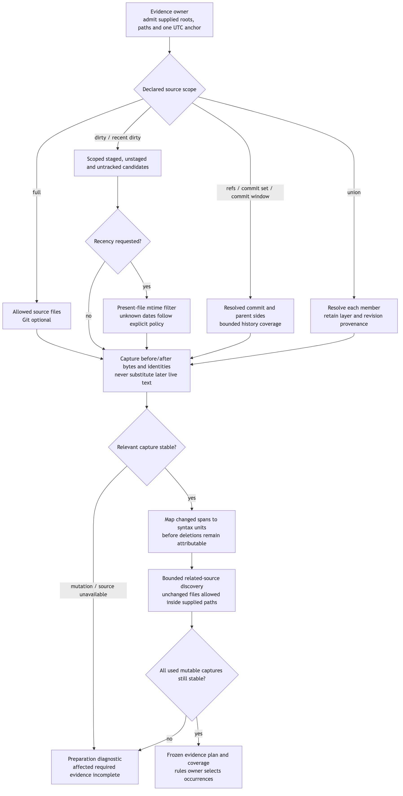
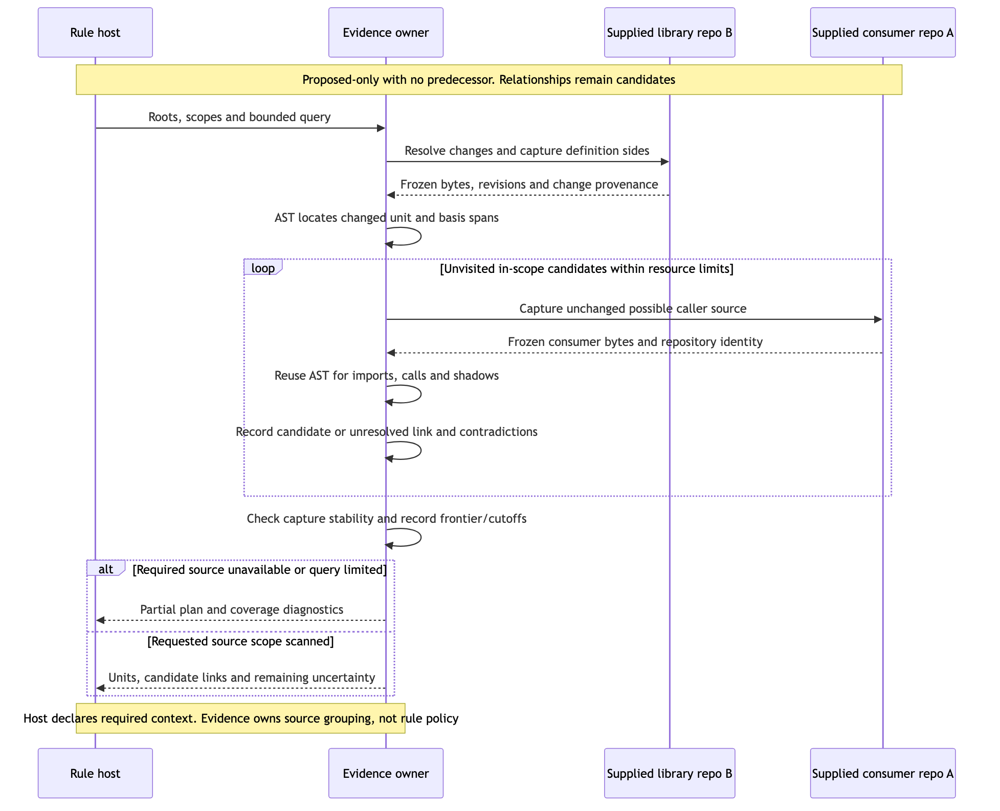

# Connected evidence: change selection, related code and chunks

This is the milestone 2 part of the [Program Design](program-design.md). It realizes Specification C8: Git change selection, connected discovery across supplied repositories, and chunking. The context budget is milestone 1 and lives in the main design. Everything here belongs to `sunstack-evidence`. Rules decides which occurrences these observations select, and whether a group is complete enough to ask a question.

This content was reviewed in the earlier design and carries over. What changed: a rule now reads a change set through a **change-set input**, so rule-authored selectors never name a repository or a seed. Native `prepare_evidence` callers still name repositories and seeds directly, through the full `RelationshipQuery`.

## Roots, scopes and frozen evidence

[Diagram source](assets/change-sourcing-flow.mmd)

A **repository binding** (E17) is the only authority for a root, its allowed paths and its change scope. A change-set binding names the repository key and uses that binding's change selection; it never declares a second scope. A discovery root is the caller's declared input scope, not the changed-file list. Changed files seed analysis, while unchanged files inside the supplied roots remain available as callers, imports and tests. That is what stops a diff-only filter from hiding affected consumers.

| Shape (`evidence_contracts`) | Payload and meaning |
| --- | --- |
| `ChangeScope` | `full`, `uncommitted { layers }`, `revision_diff { base_revision, head: commit \| worktree }`, `commit_set { commit_ids, parent_policy }`, `recent_commits { reference, window, parent_policy }`, `recent_uncommitted { layers, window, unknown_recency }`, `union { members }`. Nested unions are refused |
| `DirtyLayer` | `staged`, `unstaged`, `untracked`; nonempty and unique. HEAD→index and index→worktree stay distinct |
| `TimeWindow` | `lookback { seconds }` or `absolute { since_utc, until_utc }`, resolved once at admission |
| `CommitParentPolicy` | `first_parent` or `each_parent`. A root commit compares against the empty tree |
| `UnknownRecencyPolicy` | Required: `include_with_diagnostic` or `exclude_with_omission`. There is no default |
| `ResolvedChangeMember` | The resolved variant of each scope member, with its changes and coverage. A union returns its members in order |
| `SourceCaptureLimits`, `DiscoveryLimits` | Positive `max_files`, `max_file_bytes`, `max_total_bytes`, `max_matches`, `include_ignored`; and `max_unit_visits`, `max_relationship_candidates`, `max_fan_out`, `max_history_commits`, `max_local_time_ms`. All required |

`git2` resolves tree, index and worktree comparisons. Git work happens once per repository and scope member, never per rule. Renames may be delete plus add.

**Capture.** Selected file bytes are frozen with their content and revision identity. Each capture ends with a verification pass that rereads the mutable files it read, before its selection returns. If relevant content changed during that capture, it is refused once with `source_changed` and `capture_again` advice, with no hidden retry. A change after a capture has returned is a later source change: the frozen bytes stand, as the [evidence session](program-design-contracts.md#prepare_evidence-sunstack-evidence) states. Commit-to-commit sources use blob IDs. A unit or chunk never mixes a span from one version with text from a later read. No transaction spans several repositories.

**Time windows.** One UTC anchor resolves lookback for all repositories. Commit windows walk from the declared references, filter on committer time, and don't stop at the first older commit. Shallow or bounded history is a coverage diagnostic. Commit-set and time scopes keep each commit's own delta; `revision_diff` is an endpoint comparison. These are never merged into a fictional patch.

**Recent dirty files.** Scoped dirty candidates are intersected with file modification times. A recently modified file contributes its whole current diff, including older hunks. Unknown recency follows the caller's explicit policy.

## Change-set selectors in rules

A change-set input binds one repository binding. Its declarations are tagged by `select.kind`:

| `kind` | Payload |
| --- | --- |
| `change_set_literal_text` | `paths: [QueryPath]`, `text` |
| `change_set_regex_text` | `paths`, `pattern` (Rust `regex` dialect: no lookaround or backreferences) |
| `change_set_ast_pattern` | `paths`, `language`, `pattern` (an AST-grep pattern with metavariables, not a YAML rule) |
| `changed_units` | `languages`, `unit_kinds`, `source_sides` |
| `related_units` | `languages` (`rust`, `typescript`, `tsx`), `unit_kinds`, `source_sides`, `directions`, `requested_hops`, `chunk_settings` (grouping must be `single_group`), `minimum_related_units`. It has no seeds and no repository list |

`QueryPath` is tagged: `{ kind: exact, path }` or `{ kind: glob, pattern }`. This replaces the earlier string-or-object union (R37). Globs use `globset` over normalized `/` paths, case-sensitive with literal separators, and are always intersected with the binding's allowed paths. The supported AST languages are the built-in catalog of the pinned AST-grep version. Admission derives accepted names from that catalog, and an unknown name is refused.

**Selection reasons** for change-scoped evaluation are closed:
- `full_scope`, `target_changed`, `context_changed`, `rule_changed`, `new_rule`
- `applicability_changed`, `baseline_unavailable`, `before_analysis_unknown`
- `not_applicable_current`, `no_declared_change`, `selection_diagnostic`

**How change scope selects.** It compares, on both sides:
- target bytes
- selector match sets
- context bytes
- applicability outcomes
- effective definitions, including `common_ruleset_instructions`

When the baseline is unavailable, change scope selects every currently applicable occurrence. A false-to-true applicability change selects even when the target is unchanged. Conversation and payload inputs have no before side, so their occurrences are always `full_scope`.

## Connected discovery

[Diagram source](assets/connected-sourcing-sequence.mmd)

Both sides of each diff span map to enclosing functions, methods, classes and Markdown units, using real AST ranges. A pure deletion seeds a before-side unit only.

**Seeds and scope for a rule.** A rule's `related_units` declaration has no seeds of its own. Admission builds the native query: seeds are the changed units of the bound change-set input's repository binding, and discovery covers every repository binding the invocation supplies, within each binding's allowed paths. So a changed definition in repository B can bring in an unchanged caller from a supplied repository A, and the rule cannot redirect its seed elsewhere.

**Changed units need a change scope.** Changed-unit seeds require a change selection with an admitted before or after side in the seed repository. A repository binding with `change_scope: full` has no delta, so a `changed_units` selection, a rule-authored `related_units` declaration, or a native `SourceUnitSeeds::changed_units` query over it is refused with `no_change_selection`, never answered with every current unit. A full-scope binding can still be discovery context for another binding's changed seeds, and native `selector_units` seeds work in full or change scopes.

**The relationship graph** is invocation-local:
- Each node is keyed by snapshot, repository, revision, path and range.
- A visit is deduplicated by node, direction and depth, so cycles stop revisiting.
- **Basis facts** come from in-scope declarations, imports, explicit aliases and lexical shadowing.
- **`PackageSourceBinding`** `{ importing_repository_id, module_prefix, target_repository_id, target_path_prefix, language }` maps an import prefix to supplied source. It does not claim an installed version.

**Fixed capability set:**
- `GraphLanguage` is `rust`, `typescript` or `tsx`.
- `RelationDirection` is `callers`, `callees`, `imports` or `imported_by`.

| Language | Located evidence | Stays unresolved |
| --- | --- | --- |
| TypeScript, TSX | Named functions, methods and classes; same-file bare calls; ES named and default imports and aliases; static relative and package-source paths | Receiver and dynamic dispatch, namespace and wildcard imports, re-export chains, computed imports, ambiguous declarations |
| Rust | Function items and impl or trait methods; same-file and static-path calls; non-glob `use` paths and aliases; ordinary `mod` files; package-source paths | Macros, receiver and trait dispatch, glob imports, conditional modules, external crate versions |

**Ambiguity and limits:**
- Ambiguous names stay multiple candidates or an unresolved hint, never first-match.
- Hop depth is the query's neighborhood. The resource limits record cutoffs and their frontier.
- `DiscoveryCoverage` is `complete_within_declared_scope`, `limited { cutoffs }` or `unavailable`.

## Semantic chunks

Evidence groups changed units with related excerpts by the rule's declared relationships. An excerpt keeps:
- its repository, source side and content identity
- its byte span
- its enclosing signature and import context

Shared excerpts are deduplicated. A giant unit can become an explicitly partial excerpt, but a rule requiring the whole unit is refused when it doesn't fit.

| Shape | Payload |
| --- | --- |
| `SourceUnitQuery` | `seeds`, `languages`, `unit_kinds`, `source_sides` |
| `SourceUnitKind` | `function { signature }`, `method { signature }`, `class { signature }`, `paragraph`, `section` |
| `ChunkSettings` | `grouping: single_group \| per_seed` (rules allow `single_group` only; native callers may use `per_seed`), `seed_content`, `related_content`, `max_chunk_bytes` |
| `UnitContent` | `whole_unit` or `bounded_excerpt { max_bytes }` |
| `ContextGroupOutcome` | `complete { group, coverage }`, `partial { group, coverage, omissions, diagnostics }`, `unavailable { diagnostics }` |
| `Excerpt` | `unit: SourceUnitKey`, `span: SourceSpan`, `text` (the captured bytes of `span`), `membership: whole_unit \| bounded_excerpt { max_bytes }`, `context: code { enclosing_signature, import_context: [SourceSpan] } \| markdown`, `content_identity` |
| `DiscoveryCoverage` | `complete_within_declared_scope { query_bounds }`, `limited { query_bounds, cutoffs: [{ limit, frontier: [SourceUnitKey] }] }`, `unavailable { diagnostics }` |
| `PackageSourceBinding` | `importing_repository_id`, `module_prefix`, `target_repository_id`, `target_path_prefix`, `language` |

**A required related selector is ready only when:**
- seeds are located
- the requested sides and whole units are present
- the minimum related units are met
- the declared query scanned without a cutoff or an unresolved required endpoint
- the group fits its bounds

Otherwise the required declaration refuses its owner's evaluation. An optional one contributes only with its coverage and omissions. A rule's required evidence is judged as one group. Judging chunks separately, and combining those results, is native caller code.

## Proof

| V | What it observes here |
| --- | --- |
| V5 | Real repositories: commits, layers, renames, mutation during capture |
| V16 | Time windows, unions, root and merge commits, unknown recency |
| V17 | A cross-repository caller, alias and shadow contradictions, partial source failure |
| V18 | Before and after spans mapped into units and chunks, with deletions, giant units and cutoffs |

All four run against real fixtures. The milestone 1 suite must keep passing.
