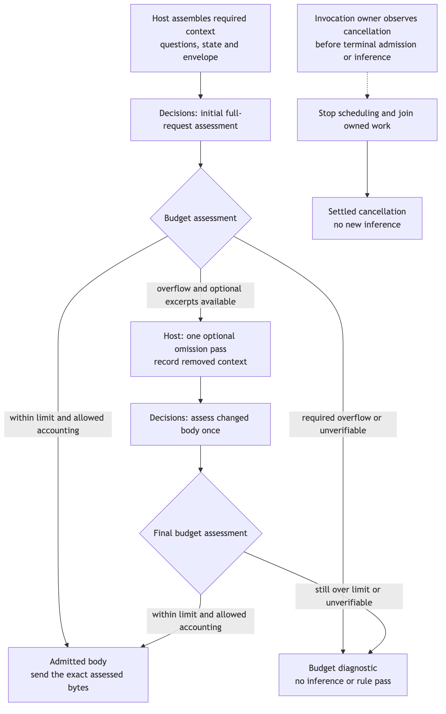

# Rust rule engine: one core, evidence to decisions

The [Specification](specification.md) fixes behavior; [Requirements](requirements.md) supplies its authority and boundaries. The target is one implementation composed from three cohesive Rust library crates and one thin executable crate. Native consumers choose evidence, decisions or rule orchestration directly; a skill tool or optional TS caller invokes the executable. There is no mandatory Bun runtime, JS addon, daemon or language server.

## The integrated model


[Diagram source](assets/program-components.mmd)

The owners above are modules grouped by responsibility into the crates below. Rule questions, applicability, thresholds, feedback and eval expectations remain Sunstack content; Tools interprets the bounded declarations. Crate boundaries are reusable domains, not one crate for each helper or provider.

## Composable crate boundaries

| Crate | Owns and reason to change | Public contract and actual consumer | Excludes |
| --- | --- | --- | --- |
| `sunstack-evidence` | Source capture, Git/time selection, paragraph/source-unit resolution, text/AST-grep queries, related-source discovery, semantic excerpts and coverage; changes when source formats or discovery behavior change | Validated snapshots, target/evidence plans, immutable bundles/chunks and diagnostics; rules and direct repository tools consume it | Decision HTTP, credentials, model questions, provider token accounting, thresholds, lint findings |
| `sunstack-decisions` | Native primitive schemas, request-relative answer validation, backend trait, Jev HTTP adapter, usage and attempt/cancellation semantics; changes when decision contracts or provider protocols change | Structured requests, typed decision outcomes, prepared backend and decision diagnostics; rules and direct decision callers consume it | Git, AST-grep, Markdown paragraph IDs, rule-pack loading, pass/fail policy |
| `sunstack-rules` | JSONL admission, applicability/dependency selection, policy validation/composition, per-rule scheduling and reports; changes when data-rule or finding semantics change | Admitted rule packs, preparation/evaluation operations, findings, selection records and reports; skill tooling/native rule callers consume it | Provider wire decoding, source parsing algorithms, signal handlers and process framing |
| `sunstack-rule-cli` | Invocation JSON framing, environment/configuration wiring, process signals, exit codes and serialization; changes when process UX/protocol changes | The program contract for agents and optional TS callers; calls rules for pack operations and decisions for direct judgments | Duplicate selection, response validation, retry or policy implementations |


[Diagram source](assets/crate-dependencies.mmd)

Arrows show compile-time dependency direction. Evidence and decisions are independent siblings; neither depends on rules or the executable. Rules depends on both; the executable calls rules and decisions. Evidence types are imported through the rules-owned preparation contract, not redefined in the executable. No library imports the executable, and no circular dependency or global service locator is permitted.

Git capture, Markdown targets, regex/text matching and AST-grep stay modules inside evidence because they share captured source bytes, spans, limits and query lifecycle. Canonical primitive types, validation and current provider adapter stay modules inside decisions because they implement one decision contract. Future providers start as adapter modules there; a separate provider crate needs an actual independent consumer/distribution reason. No generic `common`, `utils` or all-domain contract crate is introduced.

Each crate owns its domain types and diagnostics. Rules imports evidence's `SourceSpan`, `TargetId`, selectors, bundles and `EvidenceDiagnostic`, and decisions' question/answer/receipt types and `DecisionDiagnostic`; it does not recreate them or pass provider objects into evidence. Converting an evidence bundle into `SharedEvidenceState` is a rule-composition operation, not a model dependency in evidence. Rules' report diagnostic is a tagged union wrapping those typed diagnostics plus its own rule/invocation diagnostics. The executable adds a protocol-error variant at its outer envelope without moving domain validation into the CLI. No lower crate depends on an upper report schema to describe an error.

The cost is three public library surfaces and a workspace dependency graph. The gain is concrete: local evidence tools do not pull in HTTP/provider dependencies, and decision-only consumers do not pull in Git/AST parsers. V1 proves independent consumers; V15 inspects the actual dependency graph. No smaller one-crate-per-module split is needed for these outcomes.

## Foundation and tradeoffs

At repository baseline `c3220fc`, tracked content is LICENSE, .gitignore and earlier design/review documents. There is no current production or proof call path, crate, package install or runnable engine to preserve. Every local owner, call and return below is added. Existing provider HTTP endpoints are external constraints; existing Sunstack/router source stays unchanged.

| Structural choice | Gain | Cost, payer and revisit signal |
| --- | --- | --- |
| Selected: cohesive Rust evidence, decisions and rules crates plus program | One implementation with independent library use; Rust hosts avoid process overhead; other hosts use a portable request boundary | Tools maintains three public library surfaces, a native shipping matrix and protocol. Add bindings only when a measured caller need justifies them |
| Rust evidence with TS decision service | Easy JS SDK/Zod/Effect use and arbitrary TS policies | Two runtimes, shared semantics and service lifecycle; credible only if executing arbitrary TS rule code is an authorized requirement |
| Rust core plus native JS bindings immediately | Direct calls for existing JS hosts | Addon packaging, async/cancellation and runtime ABI proof before the first customer needs it; defer |
| Mandatory service or persistent index | Warm cross-process state and possible reuse | Adds lifetime, versioning and invalidation machinery without a measured requirement; defer |

The policy interpreter is a bounded data mechanism, not a workflow language. If the first actual rule needs arbitrary cross-answer composition inside JSONL, the policy contract must be revisited. Direct Rust consumers can already compose answers in code. No execution of JS or externally supplied Rust code is introduced.

## Entity bindings and data homes

Rust domain conventions come from the supplied AGENTS and full Rust rules: validated distinct IDs, Serde-tagged enums, `Result`/`Option`, `thiserror` domain failures, one caller-owned Tokio runtime and no raw IO/provider errors crossing the public boundary. Deserialization admits shape; constructors and request-relative validators enforce meaning. `serde_json::Value` is confined to the untrusted provider-envelope boundary; structured internal values use a recursive JSON domain enum.

| E | Semantic owner | Package/module and schema/type home | Boundary shape | Lifetime / convention |
| --- | --- | --- | --- | --- |
| E1 Named question | Judgment admission | `sunstack-decisions/decision_contracts` (new) | `NamedQuestionMap<QuestionName, JudgmentQuestion>`; noul/choice/score enum with `StructuredContainer` instructions; primitive-specific descriptions | Derived immutable; enum and validated names |
| E2 Shared state | Caller supplies, judgment owner preserves | `sunstack-decisions/decision_contracts` (new) | `SharedEvidenceState`: text or JSON object/array; nested values use `StructuredJson` | Invocation-owned snapshot; recursive JSON enum |
| E3 Backend | Adapter prepares, judgment owner selects | `sunstack-decisions/decision_backends` (new); public trait in `decision_contracts` | `DecisionBackend` capability/accounting profile, pure request encoding/assessment and async request operation; `BackendPreparation` ready/refused | Configured in-process; secret private |
| E4 Request | Judgment admission | `sunstack-decisions/decision_contracts` (new) | `StructuredJudgmentRequest { questions, state }`; connection and cancellation passed separately | Derived immutable; fallible constructors |
| E5 Decision run | Judgment owner | `sunstack-decisions/judgment_execution` (new); outcome in `decision_contracts` | `DecisionRunOutcome`: completed/invalid_request/provider_failure/invalid_response/cancelled | Invocation-local; tagged enum |
| E6 Answer | Response admission | `sunstack-decisions/judgment_validation` (new); answer shapes in `decision_contracts` | `JudgmentAnswer`: native noul, choice or score fields; map keyed by requested name | Admitted output; runtime correlation |
| E7 Receipt | Adapter reports, response admission validates | `sunstack-decisions/judgment_validation` (new) | `ExecutionReceipt { resolved_model, usage: { input_tokens, output_tokens, cost_usd? } }` | Derived; finite counts/cost; absence explicit |
| E8 Finding | Policy owner executes Sunstack meaning | `sunstack-rules/rule_policy` (new); shape in `rule_contracts` | `RuleFinding { occurrence, target_id, source_span, policy_result, judgment, feedback }`; occurrence is repository ID, skill path and rule ID | Derived per rule/target; tagged policy enum |
| E9 Rule definition | Rule admission | `sunstack-rules/rule_contracts` (new) | `RuleDefinition { rule_id, target_id, applicability, context_selectors, question, policy, feedback }` | Supplied JSONL then validated immutable data |
| E10 Rule pack | Rule admission | `sunstack-rules/rule_pack_loading` (new); shape in `rule_contracts` | `ValidatedRulePack { repository_id, skill_path, content_identity, rule_sources, rules, definition_locations }`; every source records its path/content identity | Invocation-local; atomic admission |
| E11 Snapshot | Evidence owner | `sunstack-evidence/source_evidence` (new); shape in `evidence_contracts` | `SourceSnapshot { snapshot_identity, repository_captures, captured_rule_sources }`; each capture records resolved changes, revisions/index identity and frozen sources keyed by repository/revision/path/content | Frozen within invocation; no persistent cache |
| E12 Target | Target resolver | `sunstack-evidence/markdown_targets` (new); shape in `evidence_contracts` | `TargetResolution`: resolved paragraph/span, missing, ambiguous or deleted | Derived from captured bytes; distinct `TargetId` |
| E13 Evidence | Evidence owner | `sunstack-evidence/source_evidence` (new); shape in `evidence_contracts` | `EvidenceBundle { snapshot_identity, target, context, facts, uncertainties, completeness }` | Derived; source-linked facts/closed completeness |
| E14 Diagnostic | Boundary that detects issue; rule report wraps without revalidating | Domain diagnostic modules in `sunstack-evidence`, `sunstack-decisions` and `sunstack-rules` (new); aggregate in rules' `report_contracts` | Typed `EvidenceDiagnostic`, `DecisionDiagnostic`, `RuleDiagnostic` and `InvocationDiagnostic`; rules' `ReportDiagnostic` wraps them with their origin. CLI framing diagnostics belong to the executable only | Derived; each payload has one type owner, closed codes and bounded safe fields |
| E15 Selection | Selection owner | `sunstack-rules/rule_selection` (new); shape in `rule_contracts` | `RuleSelection`: selected, not_applicable, outside_change_scope, selection_failed; every variant carries `RuleOccurrenceKey` | Derived once per rule occurrence |
| E16 Lint invocation | Invocation owner | `sunstack-rules/rule_execution` (new); program envelope in `sunstack-rule-cli/protocol_boundary` | `LintInvocationOutcome`: invalid_invocation, preparation_failed, completed_report, incomplete_report or cancelled_report | Ephemeral report; per-rule results preserved |
| E17 Repository binding | Source admission | `sunstack-evidence/repository_sources` (new); `evidence_contracts` owns `RepositoryBinding { repository_id, root_path, input_paths, change_scope }` | Nonempty `RepositoryId`, canonical root, scoped paths and tagged scope; duplicate identities refused | Invocation-local, validated once; no identity database |
| E18 Change selection | Change-source owner | `sunstack-evidence/change_selection` (new); shape in `evidence_contracts` | `ResolvedChangeSelection { repository_id, members, time_bounds?, changed_sources, recency, coverage }`; every member retains layer/commit/parent/revision provenance | Derived from captured source metadata; closed enums |
| E19 Source unit | Structural evidence owner | `sunstack-evidence/source_units` (new); shape in `evidence_contracts` | `SourceUnit { unit_key, source_span, unit_kind, signature, content_identity, syntax_quality }`; key includes snapshot/repository/revision/range | Derived from real AST/Markdown; never symbol identity |
| E20 Relationship candidate | Relationship evidence owner | `sunstack-evidence/related_sources` (new); shape in `evidence_contracts` | `RelationshipCandidate`: `candidate { source_unit, target_unit, call_site_span, relation_kind, basis_spans, facts, uncertainties }`, `contradicted { source_unit, possible_target, basis_spans, contradiction }`, or `unresolved { source_unit, target_hint, relation_kind, basis_spans, reason }`; no invented target unit | Invocation-local graph; no calibrated heuristic confidence |
| E21 Semantic chunk | Evidence assembly owner | `sunstack-evidence/semantic_chunks` (new); shape in `evidence_contracts` | `SemanticChunk { chunk_key, units, relationships, excerpts, omitted_optional, coverage }`; ready/incomplete plan outcomes | Derived immutable content, shared excerpts deduplicated |
| E22 Context budget | Backend request admission | `sunstack-decisions/request_budgeting` (new); shape in `decision_contracts` | `RequestBudgetAssessment`: within_configured_budget with count/basis/margin, exceeded with bounded requirements, or unverifiable with diagnostics; `RequestBudgetSettings` supplied separately | Pure assessment, no inference; adapter-specific accounting |

No owner writes a run database, modifies source or changes Git state. Rule preparation and decision execution can also be used separately; the orchestration module does not make every consumer adopt the skill-lint report.

## Library and program boundaries

| Operation | Inputs / preconditions | Output / effects |
| --- | --- | --- |
| Backend preparation | Explicit endpoint/model/secret and finite attempt settings | Ready backend or safe configuration diagnostic; no inference |
| Prepare rule inputs | Unknown skill-pack bindings, declared input paths, full/changed scope and explicit limits | Admitted pack, snapshot, every selection record and ready evidence or boundary diagnostics; repository reads only |
| Execute judgments | Prepared backend, supplied named request and cancellation context | One closed decision outcome; external inference after validation only |
| Evaluate selected rules | Prepared selections, backend, bounded execution settings and cancellation | Report with findings, failures, skips, coverage and measurements; no source writes |

The program envelope uses `protocol_version: 1` and `operation: prepare_evidence | prepare_rules | run_judgments | evaluate_rules`. `prepare_evidence` exposes the evidence library to code-oriented/process consumers without requiring a skill pack or provider. Unknown version/operation or malformed framing is an invalid invocation. One invocation per process accepts one bounded JSON request from stdin and emits one JSON result to stdout; stderr is bounded operational text, never machine results or input/provider dumps. EOF is a framing boundary. Policy pass/fail is in JSON, not inferred from process success. Exit mapping is explicit below.

The serialized payloads use their owning crate's public types, with a thin program envelope. The CLI serializes those types directly rather than maintaining parallel copies:

| Shape | Required fields / variants and optionality |
| --- | --- |
| `InvocationEnvelope` | `protocol_version: 1`, `operation`, matching `input`; no arbitrary top-level metadata |
| `PrepareEvidenceInput` | Evidence-owned `EvidencePlanInput`; repository bindings, source/relationship query, optional explicit package bindings, chunk settings and limits; no credentials or skill pack |
| `PrepareRulesInput` | `skill_packs: nonempty SkillPackBinding[]`, `repositories: nonempty RepositoryBinding[]`, `scope`, `limits`; no credentials |
| `SkillPackBinding` | `repository_id`, `skill_path`, `rule_paths: nonempty ordered path[]`; skill path is relative to that repository's root, rule paths are explicit caller-authorized file locations |
| `RulePreparationOutcome` | tagged `prepared { preparation }`, `invalid_invocation { diagnostics }`, `preparation_failed { diagnostics }`, `cancelled { diagnostics }`; prepared data contains every selection record, including failures |
| `PreparedRuleInputs` | frozen source/pack identities, ordered admitted packs, every selection record, `SelectedEvidence` per selected occurrence, diagnostics and measurements; no backend |
| `SelectedEvidence` | tagged `ready { bundle }` or `refused { diagnostics }`, keyed by `RuleOccurrenceKey`; refusal never constructs a request |
| `RunJudgmentsInput` | `request: { questions, state }`, `backend_selection`, `attempt_settings`, `request_budget`; no secret value |
| `EvaluateRulesInput` | PrepareRulesInput fields plus `backend_selection`, `attempt_settings`, `request_budget`, `max_concurrent_groups`, explicit `batch_groups` (empty means one call per selected rule) |
| `EvaluationScope` | tagged `full` or `changed`; each repository binding carries its explicit `ChangeScope`; full captures declared files without requiring Git |
| `SourceComparison` | Resolved primitive comparison inside a ChangeScope member: tagged `commits { base_revision, head_revision }` or `worktree { base_revision }`; refs resolved before use; repository-qualified input paths determine untracked inclusion |
| `SourceSpan` | repository ID, repository-relative path, snapshot/revision identity, start/end byte offsets (end exclusive), start/end line and column; user-facing lines/columns are 1-based |
| `RuleEvaluationOutcome` | tagged `finding { finding }`, `evaluation_failed { diagnostics }`, `cancelled { diagnostics }` or `not_started { reason: caller_cancelled }`, all correlated to skill path, rule ID and target ID |
| `LintInvocationOutcome` | tagged `invalid_invocation { diagnostics }`, `preparation_failed { diagnostics, measurements }`, `completed_report { report }`, `incomplete_report { report }`, `cancelled_report { partial_report?, diagnostics, measurements }`; absent partial report means cancellation before report admission |
| `LintReport` | requested scope/comparison, ordered skill-pack/snapshot identities, ordered selection records and evaluation outcomes, diagnostic list plus omitted count, measurements |
| `ProgramResponse` | `protocol_version: 1`, operation, matching closed outcome; failure/partial/cancelled results never contain a completion-shaped default |

Batch groups list `RuleOccurrenceKey { repository_id, skill_path, rule_id }`, not ambiguous bare rule IDs. Admission requires selected occurrences, no repeated occurrence across groups, identical evidence identities and caller-declared independence. Invalid groups refuse the invocation before model calls. The rule request builder assigns `q000001`, `q000002`, etc. in each group's declared order and retains the name-to-occurrence map; these request-local names never replace report identity. Ungrouped selected rules run separately. Direct judgment callers retain their own names.

| Operation outcome | Exit code |
| --- | --- |
| prepared with no selection or evidence failures; completed judgment; completed lint report (including failing findings) | 0 |
| invalid framing/version/operation/configuration/pack; invalid judgment request | 2 |
| preparation failed or prepared with selection or evidence failures; provider failure; invalid response; incomplete lint report | 3 |
| cancelled preparation/judgment/invocation, after owned work settles | 4 |

The rules owner returns preparation data; `prepare_rules` is deliberately named for that operation. Direct local evidence consumers call the evidence library without loading a rule pack or provider.

Secrets enter through configured in-memory native arguments or the executable's inherited environment, never its request document. A process caller closes/cancels explicitly through OS termination signaling; the executable converts a supported termination signal into cancellation, stops admission, joins owned work, emits its terminal result when stdout remains available and exits. Forced process kill/crash may yield no report; the caller must treat missing/truncated output as execution failure, never completion. No multiplexed daemon protocol is needed for v1.

A native host owns its existing Tokio runtime. The executable creates one process runtime. The library never calls nested `block_on` or creates a second runtime. Async functions remain normal native library calls. A future TS client can serialize these contracts; an N-API wrapper is not part of initial delivery.

## The narrow JSONL policy and target format

The invocation binds packs explicitly. A pack is a logical collection of JSONL source paths, not one file:

```json
{
  "skill_packs": [
    {
      "repository_id": "sunstack",
      "skill_path": "skills/create-skill/SKILL.md",
      "rule_paths": ["rules/create-trigger.jsonl", "rules/create-proof.jsonl"]
    },
    {
      "repository_id": "sunstack",
      "skill_path": "skills/update-skill/SKILL.md",
      "rule_paths": ["rules/update-trigger.jsonl", "rules/update-proof.jsonl"]
    }
  ],
  "repositories": [{
    "repository_id": "sunstack",
    "root_path": ".",
    "input_paths": ["skills/create-skill", "skills/update-skill", "shared-references"],
    "change_scope": { "kind": "full" }
  }],
  "scope": { "kind": "full" },
  "limits": {
    "max_files": 200,
    "max_file_bytes": 1048576,
    "max_total_bytes": 8388608,
    "max_matches": 256,
    "max_model_state_bytes": 262144,
    "max_model_request_bytes": 524288,
    "include_ignored": false
  }
}
```

The example is the `PrepareRulesInput` payload, rather than its outer protocol envelope; numeric limits are illustrative settings, not defaults or latency promises. `InvocationLimits` requires positive `max_files`, `max_file_bytes`, `max_total_bytes`, `max_matches`, `max_model_state_bytes` and `max_model_request_bytes`, plus explicit `include_ignored`. File/total limits include rule-source capture; model limits apply to actual UTF-8 serialized state and complete request. Rule paths resolve relative to the invocation's working directory, then normalize into explicit source identities. All bound packs are admitted atomically before inference. Pack identity includes repository ID, normalized skill path, ordered source paths and captured source content identities; rule-definition locations preserve file plus line/column. A shared source is captured once for consumers and validated into each explicit binding, without implicit merging or inheritance.

Representative rule line, formatted here for readability; each source stores one object per line:

```json
{
  "rule_id": "skill.trigger.clarity",
  "target_id": "U001",
  "applicability": { "kind": "always" },
  "context_selectors": [],
  "question": {
    "type": "choice",
    "instructions": { "question": "How explicit is this paragraph's activation condition?", "inspect": "target.text" },
    "criteria": {
      "missing": { "definition": "No activation condition is stated" },
      "vague": { "definition": "Topic named, but activation condition unclear" },
      "explicit": { "definition": "Reader can identify when to use the skill" }
    }
  },
  "policy": {
    "kind": "choice_disposition",
    "labels": { "missing": "fail", "vague": "review", "explicit": "pass" }
  },
  "feedback": {
    "fail": "State the concrete situation that activates this skill.",
    "review": "Make the activation condition more specific.",
    "pass": "Activation condition is explicit."
  }
}
```

`RuleId`, `TargetId` and `RepositoryId` are distinct validated types. `RuleOccurrenceKey` identifies repository, normalized skill path and rule ID; the same ID in another pack is a different occurrence. The binding owns the skill path once. Skill/context paths are normalized relative to their declared repository root; cross-repo selectors name an admitted repository ID explicitly. Resolutions outside supplied roots/paths are refused. Rule files are exactly the caller-authorized JSONL paths, which may be outside those roots; loading one does not grant access to its parent directory. IDs and offsets are validated before diagnostic locations are exposed. This is scope containment for declared evidence, not a general sandbox claim.

The Markdown target resolver uses AST-grep's Markdown block tree to locate paragraph nodes, then recognizes the exact ID prefix in eligible prose. It retains full wrapped paragraph bytes and ancestor context, excluding fence/heading/blockquote/inline-code examples. Structural matching alone does not define the ID convention. A `TargetResolution` cannot choose the first of multiple declarations.

Policy variants are `noul_bands`, `choice_disposition`, `choice_category` and `score_bands`; limits, inclusivity and domain coverage are checked during pack admission. Probability/score bands use ordered lower-inclusive/upper-exclusive intervals, with the last endpoint inclusive, covering the primitive's domain without gaps/overlap. Choice mappings cover exactly admitted labels. Native composition is a consumer function over validated outcomes; no string expressions/eval or arbitrary rule code is loaded.

## Source capture and reusable selectors

The source reader captures caller-declared file paths or expands explicitly declared directories under configured file/byte/ignored-file limits; it never scans a repository merely because a repository exists. Skill and context targets must fall within the supplied repository/path scopes. Full-scope operation is ordinary read-only capture and does not require Git. Native `git2`/libgit2 resolves requested tree comparisons and separate index/worktree layers. Git work is batched per supplied repository and distinct scope member, never per rule. Explicit input scope includes requested untracked files. The design treats rename as delete/add where needed; it does not depend on similarity-based rename detection. Detailed time, connected-discovery and chunk logic follows below.

Captured file bytes, not subsequent worktree reads, feed parsing/search and model state. Commit-to-commit sources use immutable blob IDs. Capture freezes input and rule-source bytes before rule admission, then rejects changed index metadata or content in its final verification pass. That pass can reread mutable files and is counted in IO measurements; downstream selectors/parsers share frozen bytes rather than rereading per rule. Changing relevant content refuses capture once with `source_changed` and `capture_again` advice. There is no hidden capture retry; the caller may start a new invocation. Diff regions for captured text are derived from the same before/after bytes. This is a consistent captured input set for the run, not a repository-wide transactional snapshot guarantee.

The evidence owner shares a captured file's immutable bytes and parsed tree across rule selectors. Regex/text search and AST-grep matches produce source ranges/captures; a local cache lives only for that invocation and is keyed by content identity and language. Query plans are compiled once per distinct selector. No subprocess-per-rule search and no persistent invalidation service are introduced.

Applicability is `always` or a declared presence test over a text/structural selector. A target-file path test is redundant because the per-skill binding already determines the target; it is removed. `git_changed` is observed comparison evidence, not an untrusted rule assertion. Selection decisions carry their reason. A zero candidate count under a failed scan is never proof of absence. Selection reasons are closed: `full_scope`, `target_changed`, `context_changed`, `rule_changed`, `new_rule`, `applicability_changed`, `baseline_unavailable`, `before_analysis_unknown`, `not_applicable_current`, `no_declared_change` or `selection_diagnostic`.

The initial selector grammar is deliberately small and is owned by evidence's `evidence_contracts`:

| Tagged selector | Required payload / semantics |
| --- | --- |
| `paragraph` | `source_path`, `target_id`; resolve exactly one eligible paragraph |
| `file_text` | `source_path`; whole captured UTF-8 file |
| `literal_text` | `paths: path[]`, `text: nonempty string`; case-sensitive substring occurrences |
| `regex_text` | `paths: path[]`, `pattern: nonempty string`; Rust `regex` UTF-8 dialect, default Unicode/case-sensitive mode, inline flags supported; no lookaround/backreferences |
| `ast_pattern` | `paths: path[]`, explicit supported `language`, `pattern: nonempty string`; AST-grep pattern/metavariables only, not arbitrary YAML rule objects or rewrites |
| `related_units` | Explicit changed or selector-qualified seeds, declared repositories, relation direction/hop query and limits; returns attributed units/excerpts/candidate relations, not exact symbols |

The v1 language set has one authority: the built-in `SupportLang` catalog and its accepted language tokens in the [pinned AST-grep language definitions at 0be5673](https://github.com/ast-grep/ast-grep/blob/0be5673107200ee28be83517756e2fd122611fbc/crates/language/src/lib.rs). All built-in variants of that catalog are included; custom/dynamically loaded grammars are outside v1. Admission derives accepted names from that catalog rather than a hand-maintained second list. V6 uses the pinned catalog as the independent acceptance oracle and includes a token absent from it as a refusal control; actual built artifact/catalog agreement is V15 proof.

A query's paths may be exact relative paths or tagged `glob { pattern }` entries, always intersected with caller input scope. Globs use `globset` syntax over normalized `/` paths, case-sensitive with literal separators and backslash escaping enabled; malformed globs fail admission. `*` does not cross directories; `**` uses globset's recursive rules. Each `ContextSelectorDeclaration` has a distinct `selector_id`, `requirement: required | optional`, a selector, and positive `max_matches`/`max_bytes` limits no greater than invocation limits. `ApplicabilityTest` is tagged `always` or `presence { selector, max_scan_bytes }` over literal/regex/AST variants. It need not materialize all matches to prove presence, but absence needs a complete scan. Invalid patterns/unsupported language/unknown fields are preflight diagnostics, not empty matches. Source read or scan failure is selection failure; required context zero matches or overflow blocks that occurrence's inference. Optional omissions are explicit. V3/V6 pin grammar and negative controls; full AST rule configuration needs a real consumer before expanding this contract.

Change scope projects the caller's declared bindings onto both comparison sides. It compares target bytes, selector match sets and captured context bytes, applicability outcomes, and rule definitions keyed by rule ID across the same declared JSONL source paths at the base and current side. The baseline does not claim what a previous invocation loaded. A missing, malformed, outside-repository or otherwise unavailable baseline selects every currently applicable rule in that pack with `baseline_unavailable`; a new or changed definition selects its occurrence. A false-to-true applicability transition selects even when target text is unchanged. Current false applicability is `not_applicable`; unresolved current applicability is `selection_failed`. If before-side context/applicability cannot be established, current-ready occurrences are conservatively selected. Both-side selectors see the same declared input scope projected onto frozen bytes. Before/after target maps handle deleted/moved paragraphs without equating line movement to behavior change. A missing required after target produces a target diagnostic even if a before paragraph exists. Required evidence overflow refuses that rule before inference. Optional context may be omitted only when its optionality and omission are represented in the bundle. No model reranker is on the essential local path.

## Change sourcing: roots, scopes and frozen evidence


[Diagram source](assets/change-sourcing-flow.mmd)

This is a proposed path with no implemented predecessor. The evidence crate owns repository admission, Git/time selection, source capture and syntax discovery; the rules crate owns which occurrences those observations select. A discovery root is the caller's declared input scope, not the changed-file list. Changed files seed analysis; unchanged files inside supplied roots remain available for callers, imports and tests. This distinction prevents a diff-only filter from hiding affected consumers.

| Source control / schema home `sunstack-evidence/evidence_contracts` | Required payload and meaning |
| --- | --- |
| `ChangeScope` | Closed variants `full`, `uncommitted { layers }`, `revision_diff { base_revision, head: commit | worktree }`, `commit_set { commit_ids, parent_policy }`, `recent_commits { reference, window, parent_policy }`, `recent_uncommitted { layers, window, unknown_recency }`, `union { members }`; nested unions refused |
| `DirtyLayer` | `staged`, `unstaged` or `untracked`; nonempty unique selection. Keep HEAD→index and index→worktree observations distinct |
| `TimeWindow` | `lookback { seconds: positive integer }` or `absolute { since_utc, until_utc }`; ordered finite UTC bounds resolved once at invocation admission |
| `CommitParentPolicy` | `first_parent` or `each_parent`; root commit compares against empty tree. Preserve parent attribution; never infer a linear history from timestamps |
| `UnknownRecencyPolicy` | `include_with_diagnostic` (proposed default) or explicit `exclude_with_omission`; deleted/missing/skewed timestamps never receive invented dates |
| `RelationshipQuery` | Repository-qualified seeds or changed units, caller/callee/import direction, requested hop depth, supported language resolution subset and optional test/doc context |
| `DiscoveryLimits` | Positive file/byte/visited-unit/candidate/fan-out/history/time caps; distinct from the query's requested depth; resource exhaustion records limited coverage |
| `EvidencePlanInput` | Repository bindings, source-unit query, optional relationship query, chunk settings and discovery limits; no provider or rule policy |
| `EvidencePlanOutcome` | `prepared { snapshot, changes, units, relationships, chunks, coverage, diagnostics, measurements }`, `refused { diagnostics }`, `incomplete { partial_plan, diagnostics, measurements }`, or settled `cancelled { partial_plan?, diagnostics }`; no findings |

`prepare_evidence` serializes these evidence-owned input/outcome types; the CLI defines no parallel schema. Rule preparation uses the same source operations. Code-oriented hosts may consume prepared chunks and supply their own questions/policy through the native decision API. The initial skill JSONL target format remains paragraph-based; this does not quietly add an executable rule language or a second code-rule-pack format.

One captured UTC anchor resolves lookback intervals for all supplied repositories. Git commit windows walk from resolved declared references and filter committer timestamps without stopping at the first older commit; bounded or shallow history produces a coverage diagnostic. Commit-set/time scopes preserve individual commit/parent deltas, including before units that later disappear. `revision_diff` is instead an endpoint net comparison. These observations are not merged into a fictional historical patch. For current-state linting, historical changes select affected current occurrences; a removed or unavailable required current target is diagnosed. A native caller requesting historical evidence receives its exact commit sides rather than current replacements.

Recent dirty selection first obtains scoped staged/unstaged/untracked candidates, then checks present-file modification times against the resolved interval. A recently modified file contributes its entire selected current diff, including older hunks. Staging itself is not dated by file modification time. Unknown-recency dirty candidates follow the explicit policy and retain a diagnostic/omission reason. Current-state or time-union coverage remains approximate; it does not claim every edit made during that interval. Ignored files follow explicit admission settings. Git operations and source captures are shared per repository/scope, not repeated for each rule.

The reader freezes each selected source side and its content/revision identity. For connected discovery, any additional allowed files are captured through the same verified reader before their excerpts are used. Each capture records its repository/worktree and capture interval; no transaction spans several Git repositories. Relevant mutable bytes/index metadata are verified before sealing the plan; detected mutation refuses the affected capture without hidden retries. A unit/chunk never combines a span from one version with text from a later worktree read. Source failure keeps affected rules incomplete and independent ready peers visible.

## Connected discovery: what the source can establish


[Diagram source](assets/connected-sourcing-sequence.mmd)

The evidence owner maps both sides of diff spans to enclosing functions, methods, classes and Markdown units using real AST ranges. Pure deletion can seed a before-side unit without inventing an after declaration. Parsing/query plans are reused for the same captured content and language. Cheap paths/text/import queries identify candidate files first, but finding callers may still require scanning the full declared discovery scope; no speed improvement is assumed. A primitive selector belongs to an explicit repository ID, defaulting to its skill binding's repository when omitted; a connected relation query lists all permitted repository IDs.

The invocation-local relationship graph keys each node by snapshot, repository, revision, path and range. Visits are deduplicated by node plus requested direction/depth; cycles stop revisiting rather than exhausting the executor. In-scope declarations, import paths, explicit aliases and lexical shadowing provide basis facts. `PackageSourceBinding { importing_repository_id, module_prefix, target_repository_id, target_path_prefix, language }` is optional caller-supplied data in `EvidencePlanInput`; overlapping ambiguous bindings are refused, and the target must be an admitted root/path. It identifies supplied source context, not an installed/released dependency version. Supported static relative-module paths and these explicit bindings can corroborate a link. Relationship-language profiles declare supported syntax/resolution operations at admission; the full AST language catalog does not promise full graph support. Unsupported language rules, dynamic dispatch, macros, package aliases or re-exports return unresolved candidates; matching a name alone is not resolved identity. Custom compiler-grade resolvers and LSP remain outside scope.

Finite requested hop depth defines the query's neighborhood, not “all call stacks.” Resource/fan-out/time limits additionally produce cutoffs with frontier/source attribution. `DiscoveryCoverage` is tagged `complete_within_declared_scope { query_bounds }`, `limited { query_bounds, cutoffs }` or `unavailable { diagnostics }`; parser/relationship uncertainty is preserved even in a fully scanned neighborhood. A caller can use partial candidates for exploration. A rule requiring evidence beyond that coverage remains incomplete. Relevance ordering is a deterministic evidence priority with explicit basis, not a numeric probability; optional model reranking is a caller-declared decision stage with a separate budget and cannot overturn mechanically established contradictions.

## Semantic chunks and model-budget admission



[Diagram source](assets/chunk-budget-flow.mmd)

The evidence owner groups changed units and related excerpts by rule-declared relationships. Excerpts retain repository, source side, content identity, byte span, enclosing signature and relevant import context. Reused excerpts are deduplicated while relationships refer to them by chunk/unit keys. A giant function is not blindly cut at a character count: nested syntactic boundaries may produce explicitly partial excerpts with enclosing context, but a rule requiring the full unit is refused if that unit cannot fit. Optional omission is recorded in both model state and the report.

The rules owner or native host chooses the question and required-context declarations. Evidence owns source grouping; decisions owns the serialized request and selected backend's accounting. This keeps evidence independent of model/HTTP dependencies. `ChunkSettings` names requested source sides, unit/relationship grouping, maximum excerpt/chunk bytes and required/optional roles. Context selectors may request the existing primitive selectors or an explicit `related_units` query; repository IDs and all query/limit fields are admitted before scanning. No implicit graph traversal is added to an ordinary text selector.

`RequestBudgetSettings` has positive `max_input_tokens`, `max_request_bytes`, `max_questions`, `max_requests`, nonnegative safety/reserved-overhead margins and `accounting_policy: require_exact | allow_estimated`. The backend profile declares a known context ceiling when available and an accounting method. Unknown model ceilings are returned as uncertainty; they are not replaced with another model's limit. Native/program callers supply the same settings. The proposed initial policy requires explicit estimation allowance until exact selected-model accounting is demonstrated.

`assess_request_budget` is a pure decisions operation over the actual serialized candidate request, including JSON escaping, questions/criteria/instructions, shared state and adapter envelope. It returns `within_configured_budget`, `exceeded` or `unverifiable`, each with accounting basis and diagnostics; it starts no HTTP request. Estimated counting includes the configured margin and does not guarantee agreement with the provider tokenizer. Hosted rejection remains an execution failure, not a finding. The final serialized body is checked again only when it changes; an unchanged assessed body is the body sent.

On overflow, only explicitly optional excerpts may be removed. The initial bounded mechanism permits one optional-omission pass and one assessment of the changed body, rather than a retry loop; unchanged bodies are never reassessed. Required overflow/refused accounting yields `context_budget_exceeded` or `budget_unverifiable`, no inference and no pass. The invocation owner enforces the finite model-request count separately from these pure assessments. A rule can declare independent per-chunk judgments, but a relationship-spanning rule keeps its required caller/callee evidence together. Cross-chunk aggregation belongs to explicit Sunstack/native policy; averaging or taking maximum probabilities is not an engine default. This preserves R7/R13 while making bounded semantic preparation useful.

## Model-facing evidence state

Rules owns the conversion from evidence types into `SkillRuleState`; decisions accepts it as ordinary structured state and has no Markdown dependency. These fields are serialized unchanged into the HTTP `state` field (R7/R8/R17):

| Field / shape | Required contents |
| --- | --- |
| `state_version` | Integer 1; state paths are an intentional rule contract |
| `target` | `repository_id`, `skill_path`, `target_id`, `text`, `source_span`, `content_identity`; instructions may refer to `target.text` |
| `context` | Ordered entries with `selector_id`, `requirement`, `text`, `source_span`, `content_identity`, and attributed facts/captures |
| `omitted_optional_context` | `selector_id` and closed reason `no_match | unavailable | limit`; omitted count is explicit |
| `source_units`, `relationships`, `chunks`, `coverage` | When a related-unit query is requested: repository/revision-qualified keys, basis spans, candidate/contradicted/unresolved dispositions, declared query bounds and cutoffs; no runtime-stack claim |
| `facts` | Tagged `structural_fact` with closed `fact_code` and source span/capture; only mechanically established facts |
| `uncertainties` | Tagged `relationship_hypothesis { label, basis_spans }` or `analysis_unavailable { reason }`; not provider probabilities |

Fact codes include `paragraph_id_resolved`, `text_match`, `ast_match`, `git_changed`, `declaration_found`, `import_alias_match` and `lexical_shadow_detected`, emitted only when their basis is established. Candidate caller/callee paths carry relationship hypotheses and unresolved conditions separately. Deterministic evidence priority may order candidates but has no probability interpretation; model relevance estimates, if explicitly requested, remain attributed judgments and cannot erase a contradiction. The optional-omission list is part of model state and the report. Question criteria/instructions travel separately, preserving author-owned structure. V9 asserts the actual state body; V17–V19 observe graph/chunk/budget attribution.

## Judgment admission, transport and useful diagnostics

`StructuredJson` represents recursive finite JSON, including nested null; `StructuredContainer` constrains a root to text/object/array. Shared state, instructions, noul descriptions and score levels use that non-null root. Choice descriptions additionally admit top-level null. Noul criteria is `omitted` or `specified { true_description, false_description }`; a half-supplied pair is invalid. Questions preserve structured instructions, choice descriptions, score levels and both noul descriptions. `QuestionName`, `ChoiceLabel` and `ModelSelection` are distinct validated values. The native request map is dynamic where loaded from JSONL; response correlation checks exact names, kinds, labels/probability keys, rubric/index sets, numeric ranges and receipt fields.

The canonical public payloads below are Tools-owned Rust enums/newtypes, serialized with the shown tags. Adapter translation preserves the native primitive meaning, rather than exporting SDK classes:

| Public shape | Required payload |
| --- | --- |
| `JudgmentQuestion` | `type: noul` with instructions and optional paired criteria; `type: choice` with instructions and label-to-description criteria; `type: score` with instructions and ordered level criteria |
| `JudgmentAnswer` / noul | `type: noul`, `yes_probability: finite [0,1]` |
| `JudgmentAnswer` / choice | `type: choice`, `selected_label: ChoiceLabel`, `confidence: finite [0,1]`, `probabilities: map<ChoiceLabel, finite [0,1]>`; keys equal requested labels |
| `JudgmentAnswer` / score | `type: score`, `score: finite [0,last_index]`, `confidence: finite [0,1]`, `legend: map<RubricIndex, StructuredContainer>`, `probabilities: map<RubricIndex, finite [0,1]>`; keys equal requested indices |
| `BackendSelection` | `kind: jev_openrouter`, validated `endpoint` and nonempty `model`; credentials supplied separately |
| `AttemptSettings` | Positive `attempt_timeout_ms`, finite `retry_count`, positive `initial_backoff_ms`, `max_backoff_ms`, `max_response_bytes`; initial backoff does not exceed cap |
| `BackendPreparation` | `ready { backend }` or `refused { diagnostics }`; it starts no inference |

Native answer names are keyed by `QuestionName`; file-loaded keys remain request-relative runtime facts. Canonical fields are mapped from source-verified provider fields at the adapter boundary, never inferred from prose. A body that cannot supply those semantics is invalid response. Query/config/request constructors reject empty IDs, invalid ranges and inconsistent settings before IO. Response reads are bounded by `max_response_bytes`; exceeding the bound is `invalid_response/invalid_body`, without emitting raw data.

The adapter trait exposes supported primitive semantics and async execution, not filesystem or rule policy. Its received body is an explicitly untrusted adapter-envelope value consumed by the judgment owner; it is never a public completed outcome. Unknown provider data is decoded into canonical primitive structures and validated relative to the immutable request. Alternate/injected adapter envelopes are admitted before branching; unexpected adapter faults become safe `unexpected_provider_error` outcomes.

The first Jev adapter calls OpenRouter System One over HTTP directly using a reusable `reqwest` client. It preserves the native questions/state/model protocol and Authorization header. Client errors, body text, response headers and parse trees never leave the adapter raw. No SDK is required. Future Alpha Decisions and OpenAI Decisions adapters can map their own wire contracts; confidence, structured data, usage and cancellation semantics require new conformance evidence before claiming support.

The public decision outcome variants and their fields are:

| kind | Fields / invariants |
| --- | --- |
| `completed` | Required validated answers, receipt and attempt records; no failure diagnostics masquerading as an answer |
| `invalid_request` | Required nonempty safe diagnostics and empty attempt records; no inference or answers |
| `provider_failure` | Required closed failure class, diagnostics and attempt records; optional admitted HTTP status; no answers |
| `invalid_response` | Required nonempty safe diagnostics and attempt records; no partial answer map |
| `cancelled` | Required caller-aborted reason, safe diagnostic and attempt records; no completed answers; cancellation does not establish no remote inference |

Each domain diagnostic is constructed where its issue is detected. Known input contracts reject unknown and duplicate fields; serde default field-ignoring is not admission. This applies recursively to bindings, rule objects, selectors, policies, invocation/configuration envelopes and known request shapes, while arbitrary structured JSON content remains open data. A location identifies the containing contract field or JSONL line/column; unknown input key text and received values are not copied into messages.

| Diagnostic owner / origin | Closed codes |
| --- | --- |
| Evidence / source | `source_unavailable`, `revision_unavailable`, `path_outside_root`, `unsupported_encoding`, `source_changed`, `missing_target`, `duplicate_target`, `deleted_target`, `evidence_limit`, `missing_context` |
| Evidence / selection | `invalid_selector`, `unsupported_language`, `selector_limit` |
| Evidence / connected sourcing | `invalid_repository_binding`, `unknown_repository`, `history_incomplete`, `recency_unknown`, `relationship_unresolved`, `discovery_limit` |
| Decisions / request budget | `context_budget_exceeded`, `budget_unverifiable`, `unsupported_budget_profile` |
| Rules / rule_pack | `malformed_json`, `unknown_field`, `duplicate_field`, `duplicate_rule_id`, `duplicate_rule_source`, `duplicate_skill_binding`, `empty_rule_pack`, `invalid_policy` |
| Rules / selection | `applicability_unknown`, `target_outside_scope` |
| Rules / invocation or execution | `invalid_configuration`, `invalid_batch_group`, `policy_mismatch`, `unexpected_execution_error`, `caller_aborted` |
| Decisions / request | `unknown_field`, `duplicate_field`, `invalid_question`, `invalid_state`, `unsupported_primitive`, `invalid_number`, `invalid_rubric`, `invalid_configuration` |
| Decisions / response | `invalid_body`, `missing_answer`, `unexpected_answer`, `wrong_answer_kind`, `invalid_choice`, `invalid_number`, `invalid_rubric`, `invalid_receipt` |
| Decisions / provider or execution | `provider_rejected_request`, `authentication`, `authorization`, `insufficient_credits`, `provider_resource_unavailable`, `request_too_large`, `rate_limit`, `provider_unavailable`, `timeout`, `connection`, `http_error`, `unexpected_provider_error`, `caller_aborted` |
| Executable / protocol | `malformed_json`, `unknown_field`, `duplicate_field`, `unsupported_protocol_version`, `unsupported_operation`, `invalid_framing`, `input_limit` |

Shared spellings do not create a universal parser: each crate owns its relevant tagged payloads. Rules' `ReportDiagnostic` is a tagged union retaining the already admitted domain payloads, not a second universal parser or schema. Paths have at most 32 safe segments; messages have at most 512 characters; issue lists have at most 100 entries and explicitly report omitted count. These are proposed v1 bounds, not measured latency limits.

Expected shape/range/allowed-label details are constructed from validated declarations, not received provider values. Credential locations use fixed field names; secret values never enter diagnostics. Provider diagnostic paths are empty or validated canonical answer paths; arbitrary unknown provider keys/errors are not echoed. Source spans are permitted caller-scoped repository locations. Retry advice is a tagged enum: `retry_after { milliseconds }`, `repair_request`, `repair_source`, `capture_again`, `repair_configuration`, `restore_provider_access`, `do_not_retry` or `unknown`, with finite bounds. It reports advice, never starts a new caller retry automatically.

Each public `InferenceAttemptRecord` has an ordinal and tagged evidence: `not_dispatched { failure_class }`, `completed { http_status }`, or `remote_outcome_unknown { failure_class, http_status? }`. The judgment owner builds it from the adapter's private HTTP observations after request-relative response admission. A dispatched attempt without a validated completion, including malformed/over-limit responses, timeout or cancellation, remains unknown about remote inference. An admitted HTTP error status guides repair without claiming that no inference or billing occurred. Records are bounded by the admitted attempt count. A later completion does not erase an earlier unknown attempt, and its receipt reports only observed usage. Failure classes are the closed provider/execution diagnostic classes plus `invalid_response`; no raw transport failure is serialized.

HTTP classification is boundary-owned and actionable:

| Observed status | Code / safe advice |
| --- | --- |
| 400 | `provider_rejected_request` / `repair_request` |
| 401 / 403 | `authentication` / `authorization`; `restore_provider_access` |
| 402 | `insufficient_credits` / `restore_provider_access` |
| 404 | `provider_resource_unavailable` / `repair_configuration`; verify endpoint/model selection, do not assert which is missing |
| 413 | `request_too_large` / `repair_request`; reduce declared evidence scope explicitly |
| 429 | `rate_limit` / validated capped `retry_after`, otherwise `unknown` |
| 500, 502, 503, 529 | `provider_unavailable` / `retry_after` only for separately validated capped timing, otherwise `unknown` |
| 524 or local deadline | `timeout` / `retry_after` only for separately validated capped timing, otherwise `unknown`; remote acceptance may remain unknown |
| Other status | `http_error` plus admitted numeric status / `unknown` |

Provider `message`/`metadata` and response headers are never copied. Only separately parsed bounded status and retry timing survive. These classifications guide repair; they do not claim charge reversal, idempotency or semantic accuracy.

Receipt admission preserves nonempty resolved model, nonnegative integer native token counts and optional finite reported USD cost. Adapter maps native `cost` to explicit `cost_usd`; it never estimates prices or invents a zero. Known malformed fields refuse completion; unknown receipt metadata is stripped, while answer maps/index sets remain exact.

## Representative entry-to-effect path

This is a proposed-only path; no predecessor exists. Every local call/return is added. Library callers enter the same invocation owner after the program framing edge.


[Diagram source](assets/execution-sequence.mmd)

Shapes on the new boundaries are the binding table's invocation, validated pack, frozen evidence, structured request, closed decision outcome and lint report. HTTP sends only the admitted native model/questions/state; model-request body logs are disabled. Source capture is read-only; policy/report generation writes only the returned value.

## Failure, overlap and runtime ownership

| State / owner | Admission or transition | Failure / cleanup |
| --- | --- | --- |
| Preflight / rule admission | Pack, configuration and limits are valid | Whole invocation refused; zero provider calls |
| Preparing / evidence owner | Refs/bytes captured, targets and queries resolved | Per-rule selection/evidence failure; independently ready rules remain usable |
| Executing / invocation and judgment owners | Explicit group has complete evidence, supported questions, available capacity | Finite attempts; provider/response failure never invokes success policy |
| Composing / policy owner | Completed correlated judgment and validated matching policy | Deterministic finding; impossible policy mismatch becomes execution diagnostic, no guessed disposition |
| Cancelling / invocation owner | Caller cancellation observed before terminal admission | Stop new scans/calls/attempts, propagate tokens, join owned work; completed peer outcomes retained |
| Terminal / invocation owner | All owned work settled; report admission rules below select the outcome | Immutable complete/incomplete/cancelled result; no background follow-up |

The invocation owner admits the terminal outcome once. Invalid binding/configuration/pack input is `invalid_invocation` before inference. Source capture or revision failure that prevents pack/snapshot admission is `preparation_failed`, with diagnostics and observed measurements rather than a fabricated report; it maps to exit 3. Cancellation observed before terminal admission is `cancelled_report` (exit 4), retaining any admitted partial report and completed peer findings; before admission its partial report is absent.

For an admitted requested scope without cancellation, `completed_report` (exit 0) requires every occurrence to be either a justified `not_applicable`/`outside_change_scope` skip or a selected occurrence with a valid finding. Any `selection_failed`, `evaluation_failed`, refused required evidence, missing/duplicate/deleted required target, or invocation diagnostic preventing an in-scope check makes it `incomplete_report` (exit 3). No failed/unevaluated occurrence is absorbed into a pass. A failing/review/category finding, declared optional-context omission, conservative baseline selection or earlier unknown attempt followed by a validated judgment does not itself make coverage incomplete; those facts remain visible in their own fields. Completeness covers the requested scope only. V12 exercises one successful peer plus each unavailable/failing evaluation case and asserts incomplete report and exit 3; V13 asserts cancellation precedence and retained peer findings.

The native caller supplies a cancellation token; the executable owns its signal-to-token mapping. Invocation tasks are owned in a join set/tracker and drained. Synchronous Git/tree parsing/search work runs in bounded blocking tasks, checking cancellation between bounded units; cancellation cannot forcibly preempt arbitrary blocking code. No “cancelled” terminal claim is made until those owned tasks actually settle. Async HTTP futures are not detached; cancellation/timeout drops the attempt future under the adapter and awaits task settlement before retry/return.

One adapter attempt controller governs the reusable HTTP client. Defaults proposed for initial proof are a 10,000 ms attempt timeout, zero automatic retries, caller-selected finite retry count, and capped backoff/Retry-After. When retries are enabled, only declared transient connection/timeout/rate-limit/server classes qualify; invalid request/response/authentication never retries automatically. Underlying HTTP automatic retry is disabled so another controller cannot multiply attempts. A transport loss may follow accepted inference, so retries can incur extra billing. Usage from a completed response does not establish total billed cost of lost attempts.

Concurrency capacity is explicit invocation configuration. Report order follows skill-binding order, then JSONL-path order and line order, not task completion order. Selected records exist before evidence assembly; an incomplete selected bundle produces `evaluation_failed` without a call. A failure that prevents an applicability decision produces `selection_failed` instead. Shared immutable bytes/trees and a reusable client do not share mutable per-run answer or cancellation state. No global scheduler/limiter, persistent cache, inference idempotency or crash recovery store is added. A crash leaves invocation completion unknown to the process caller until a complete result is observed.

## Proof paths and real dependencies


[Diagram source](assets/proof-boundaries.mmd)

Local library/selector dependencies are real in evidence integration. An HTTP fixture substitutes only the hosted boundary in V9/V13; it must observe actual request bodies/attempts, not mock the adapter being proved. V11 closes the hosted gap through the public Rust API. V12 uses the same per-skill pack (including multiple JSONL sources and cross-skill ID controls) in lint and eval drivers with independently written expectations; it does not migrate or certify the production plugin. V14 profiles cold/warm runs and counts scans/parses/requests before adopting a persistent cache or native addon.

Invalid ID states are rejected by constructors; primitive/result kinds are enum-constrained; JSONL/policy inconsistencies are rejected at pack admission; source/selection incompleteness prevents inference for that rule; wrong answer correlation/unsafe diagnostics are rejected at judgment admission; execution-failure findings are unrepresentable in the report's distinct result variants. Static checks and behavioral negative controls reinforce these boundaries rather than replacing them.

## Obligation realization and proof seams

| U | R and scenario | E | Owner | Interface | Shape and home | State | Failure | Proof seam |
| --- | --- | --- | --- | --- | --- | --- | --- | --- |
| U1,U8,U18,U19 | R1 independent libraries and program reuse | E5,E13,E16 | Domain owners and invocation owner | Evidence/decision/rule entries; program facade | Owned public types in sunstack-evidence/decisions/rules; envelope in sunstack-rule-cli | Independent entry → terminal | No reverse dependencies or required JS | V1 independent native consumers; V2 real process |
| U3,U14,U15 | R2 pack preflight | E9,E10,E14 | Rule admission | Pack loading | ValidatedRulePack, rule_contracts | Supplied → admitted/refused | Atomic no-inference refusal | V3 multiple source files/packs, strict field admission and zero calls |
| U14,U15 | R3 target identity | E11,E12,E14 | Target resolver | Resolve paragraph | TargetResolution, evidence_contracts | Captured → resolved/refused | Missing/duplicate/deleted diagnostic | V4 real Markdown spans |
| U16 | R4 Git/content consistency | E11,E13,E16 | Evidence owner | Capture comparison | SourceSnapshot, evidence_contracts | Read → freeze | Source changed/ref unavailable | V5 repository content mutations |
| U16,U17 | R5 structural candidates | E11,E13 | Evidence owner | Search selector | SourceFact and uncertainty, evidence_contracts | Frozen → matches | Syntax-only attribution | V6 actual AST/text results |
| U14,U16 | R6 selection accounting | E9,E15,E16 | Selection owner | Select rules | RuleSelection, rule_contracts | Rule → one disposition | Unknown cannot silently skip | V7 both-side applicability/context/baseline controls |
| U5,U14,U16 | R7 required evidence | E11,E13,E14 | Evidence owner | Prepare bundle | EvidenceBundle, evidence_contracts | Selected → ready/refused | Limit/missing context diagnostic | V7 no inference on incomplete bundle |
| U3,U4,U5 | R8 structured mixed batch | E1,E2,E4,E5 | Judgment owner | Request admission/execution | JudgmentQuestion and StructuredJson, decision_contracts | Request → execute | No flatten/drop/regroup | V8 domain cases; V9 exact questions and SkillRuleState HTTP body |
| U3,U4 | R9 correlated completion | E1,E5,E6,E7 | Response admission | Validate body/request | JudgmentAnswer and Receipt, judgment_validation | Untrusted → complete/refuse | No partial success | V8 mismatch controls; V9 adapter |
| U2,U3,U14 | R10 useful safe diagnostics | E14 | Detecting boundary owner; rules report wraps | Map issue/failure once | Domain diagnostics in evidence/decisions/rules; ReportDiagnostic in sunstack-rules/report_contracts | Fault → typed diagnostic → report | No duplicate schema/raw values; bounded omission count | V10 status/unknown-field/remote-effect/exposure controls |
| U4,U12 | R11 backend substitution | E1,E3,E5 | Judgment owner and Jev adapter | Backend trait/capabilities | DecisionBackend, decision_contracts | Prepare → select/refuse | Unsupported primitive | V9 conformance; V11 Jev only |
| U6 | R12 native usage/model/cost | E5,E7 | Response admission | Receipt admission | ExecutionReceipt, judgment_validation | Complete | Missing/malformed known fields | V9 supplied/absent cost; V11 hosted |
| U7,U14 | R13 failure vs finding | E5,E8,E14,E16 | Invocation and policy owners | Compose/report | Distinct result variants, rule_contracts | Judgment → finding or failure | No failure-to-pass aggregation | V8/V12 independent failure and whole-report completeness controls |
| U1,U3 | R14 cancellation settlement | E5,E16 | Invocation owner | Cancellation/join | Cancellation token and outcome, rule_execution | Active → cancelling → terminal | No detached owned task | V9/V13 held work and cleanup |
| U3,U6 | R15 bounded one-controller attempts | E3,E5,E7 | Jev adapter | HTTP attempt loop | Attempt settings, decision_backends | Attempt → settle/retry/stop | Finite limits; remote ambiguity | V9/V13 observed attempt count |
| U5,U7,U9,U15 | R16 source-linked policy | E6,E8,E9,E16 | Policy owner | Apply declared policy | RulePolicy/RuleFinding, rule_policy | Valid answer → finding | Refused policy cannot compose | V12 shared rules/independent expectation |
| U4,U17 | R17 facts vs inference | E6,E13 | Evidence and judgment owners | Evidence attribution | Fact/uncertainty/judgment variants | Discover → present | No calibrated heuristic claim | V6/V12 contradiction cases |
| U6,U16 | R18 measured filtering | E11,E16 | Invocation owner | Report measurements | InvocationMeasurements, rule_execution | Run → measured report | No predicted SLA/savings | V14 declared workload profile |
| U2,U10,U14 | R19 credential/body isolation | E3,E11,E14 | Adapter and diagnostic owners | Secret config/safe mapping | Private secret in sunstack-decisions; owned domain diagnostic payloads | Memory-only config | No raw/default body logs | V10 sentinel output capture |
| U9,U10,U11,U13,U18,U19 | R20 bounded composable delivery/quality | none: platform constraint | Repository and program owners | Build/check/public surfaces | Four-crate workspace dependency graph and owned contracts | Development → verified artifacts | Cycles/reverse dependencies and other-repo edits excluded | V1/V2 independent consumers; V15 real gates/dependency graph |
| U16,U20 | R21 selected Git/time changes | E11,E17,E18 | Evidence change-source owner | Resolve ChangeScope | RepositoryBinding/ResolvedChangeSelection, evidence_contracts | Requested → resolved/approximate/unavailable | Unknown dates/history/layers remain attributed | V16 actual Git/filesystem time and cancellation controls |
| U16,U21 | R22 connected repo attribution | E11,E13,E17,E20 | Evidence source/relationship owners | Capture and traverse supplied roots | SourceSnapshot/SourceSpan/RelationshipCandidate, evidence_contracts | Supplied roots → captured connected context | No outside-root reads or atomic multi-repo claim | V17 cross-repo callers and partial-source failures |
| U17,U22 | R23 bounded candidate paths | E18,E19,E20 | Evidence structural/relationship owners | Locate units and query neighborhood | SourceUnit/RelationshipCandidate/DiscoveryCoverage, evidence_contracts | Changed spans → units → candidates | Cycles/cutoffs/unresolved/contradictions visible | V17/V18 independent relation/range expectations |
| U5,U9,U22,U23 | R24 coherent semantic chunks | E9,E13,E19,E20,E21 | Evidence assembly and rule policy owners | Plan excerpts with required roles | SemanticChunk/ChunkSettings, evidence_contracts; policy in rule_contracts | Candidate units → ready/incomplete chunk | No required trim or undeclared score aggregation | V18 relationship-spanning and giant-unit controls |
| U12,U14,U23 | R25 serialized request budget | E3,E4,E13,E21,E22 | Decisions request admission; rules/host assembles | Pure assess_request_budget before execution | RequestBudgetSettings/Assessment, decision_contracts | Proposed body → within/exceeded/unverifiable | No inference/pass on required overflow or refused accounting | V19 actual envelope/token-basis and no-call controls |

All E1–E16 are bound in the entity table. C1–C7 correspond to the interfaces, source/selection, judgments, diagnostic/lifecycle, policy and performance sections above. V1–V15 name future observations, not completed tests. No visual or static design check substitutes for their execution.

## External source basis and compatibility limits

Current published `openrouter-rs` 0.19.0 has a Decisions client and JSON-valued question/answer maps; [published source](https://github.com/realmorrisliu/openrouter-rs/blob/d1b98b1993b30de2fea1690f104921e8121fe4f6/src/api/decisions.rs) establishes that surface, not request-relative answer validity. Its [response path](https://github.com/realmorrisliu/openrouter-rs/blob/d1b98b1993b30de2fea1690f104921e8121fe4f6/src/transport/response.rs) buffers text before parsing without an exposed byte cap. The selected bounded `reqwest` adapter remains until an SDK integration can honor the same limits; neither SDK adoption nor a fork is assumed. [Official OpenAI Decisions](https://developers.openai.com/api/docs/guides/decisions) uses input/question/answer arrays and explicit refusals, distinct from Alpha's state/maps. OpenRouter routing OpenAI Decisions is unverified. Future adapters must prove translation, refusal, budget and receipt semantics independently.

- [AST-grep core at commit 0be5673](https://github.com/ast-grep/ast-grep/blob/0be5673107200ee28be83517756e2fd122611fbc/crates/core/src/lib.rs) provides parse/traverse/search/rewrite library operations. The inspected workspace declares version 0.50.0; no exact dependency is installed here.
- [Markdown language support](https://github.com/ast-grep/ast-grep/blob/0be5673107200ee28be83517756e2fd122611fbc/crates/language/src/lib.rs) and [Markdown tests](https://github.com/ast-grep/ast-grep/blob/0be5673107200ee28be83517756e2fd122611fbc/crates/language/src/markdown.rs) establish syntax support. [Outline heading rules](https://github.com/ast-grep/ast-grep/blob/0be5673107200ee28be83517756e2fd122611fbc/crates/outline/src/default_rules/markdown.yml) do not implement paragraph ID meaning or semantic references; those remain our resolver contract/proof.
- [git2 comparisons](https://docs.rs/git2/latest/git2/struct.Repository.html) and [DiffOptions](https://docs.rs/git2/latest/git2/struct.DiffOptions.html) expose tree/index/worktree and untracked controls. Captured-content agreement and changing-worktree behavior remain our V5 obligation.
- [TypeSafe structured primitives](https://docs.typesafe.ai/primitives/advanced) and [OpenRouter Jev HTTP surfaces](https://openrouter.ai/docs/guides/community/jev) ground v1 native request semantics. [System One response schema](https://openrouter.ai/docs/api/api-reference/systemone/submit-a-system-one-request) documents usage and optional cost.
- [OpenAI Decisions](https://developers.openai.com/api/docs/guides/decisions) and [OpenRouter Alpha Decisions](https://openrouter.ai/docs/client-sdks/python/sdks/decisions/README#alpha-decisions) inform future adapter shape only; neither is v1 support.
- [Tokio owned task tracking](https://docs.rs/tokio-util/latest/tokio_util/task/struct.TaskTracker.html) and [reqwest client configuration](https://docs.rs/reqwest/latest/reqwest/struct.ClientBuilder.html) inform cleanup/timeout/retry mechanisms; physical cancellation and exact library versions require runtime proof.

Remaining structural choices are the narrow rule-policy/paragraph conventions if a real first rule cannot use them, native shipping platforms, and an optional TS integration method. No numeric latency budget, calibrated ranking, immutable distribution destination or alternate provider conformance is inferred from these sources.
