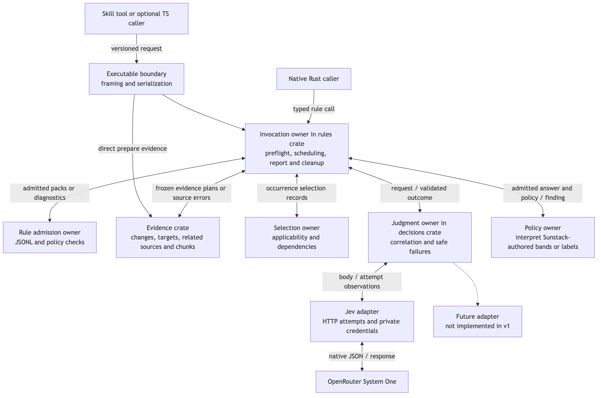
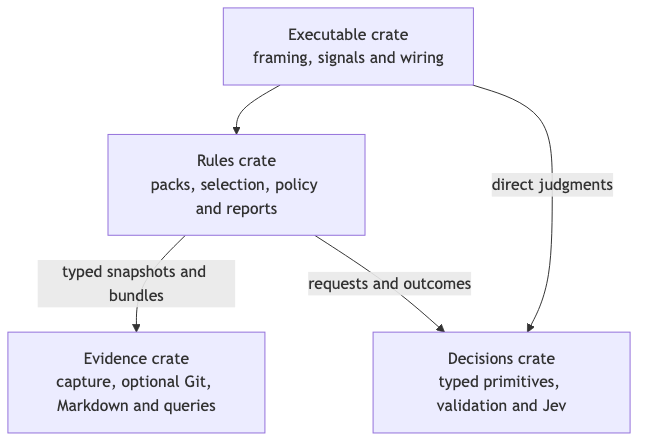
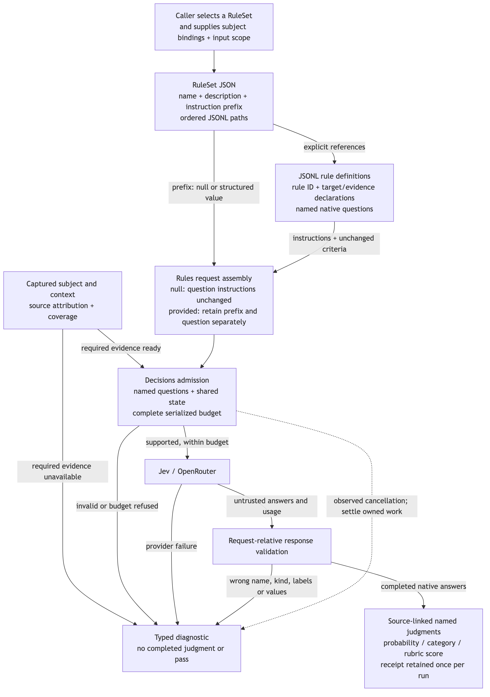
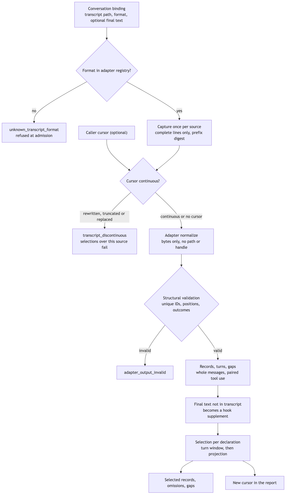
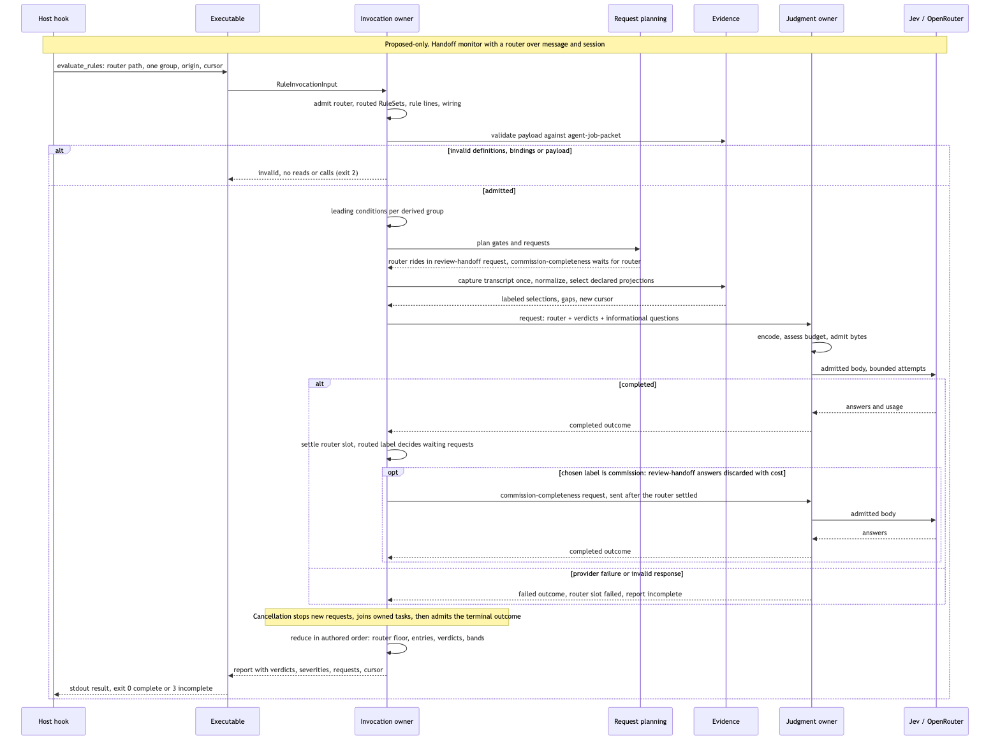
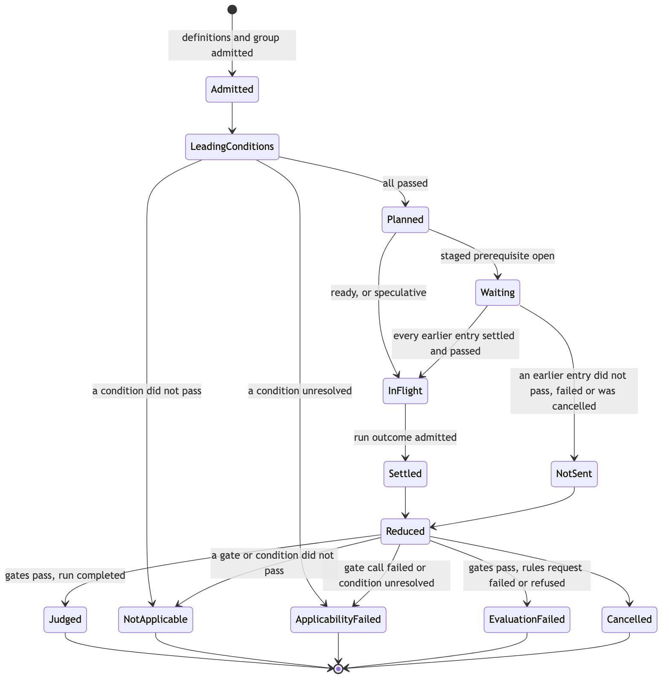
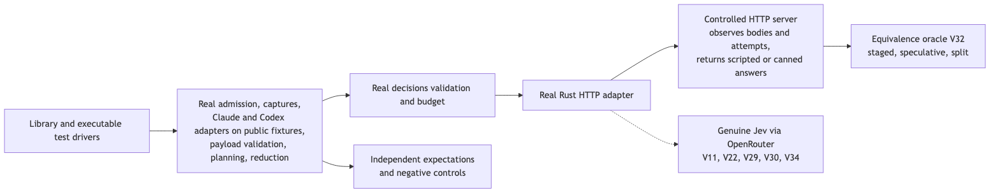

# Rust rule engine: one core, inputs to verdicts

The [Specification](specification.md) fixes behavior, and [Requirements](requirements.md) supplies its authority and boundaries. This document says how the Rust code satisfies them. It covers each entity's home and shape, who owns each truth, how a request reaches Jev and comes back, what happens on failure, and where proof observes it.

The target is one implementation in four crates: three libraries (evidence, decisions, rules) and one thin executable. A Rust host calls the libraries. A hook, a skill tool or an optional TS caller runs the executable with one JSON request. There is no daemon, JS addon, persistent store or second engine.

Two companions complete it. [Public contracts](program-design-contracts.md) gives the exact fields of every program input, outcome, report and diagnostic. [Connected evidence](program-design-connected-evidence.md) covers milestone 2's change sourcing, connected discovery and chunking. Everything else is here, including the context budget that milestone 1 needs.

## The integrated model



[Diagram source](assets/program-components.mmd)

Read it top-down:
1. A caller enters through the executable, or calls the rules library directly.
2. The **invocation owner** admits definitions and bindings, then hands each RuleSet × binding group to **applicability** and **request planning**.
3. Planning asks **evidence** for owner-labeled selections. Evidence covers documents, conversations, payloads and, in milestone 2, change sets.
4. Planning turns each RuleSet × group into one request (or staged gates and budget splits), and the **judgment owner** in decisions sends it to Jev.
5. **Verdict evaluation** applies thresholds, bands and composites in code.
6. The **report** keeps one record per request and per rule occurrence.

Rule meaning stays Sunstack content: questions, applicability, routers, schemas and expectations. Tools admits declarations, reads the bound sources, asks Jev, and returns native answers with verdicts. Hosts decide what block and nudge mean.

## Crates and dependency direction

| Crate | Owns, and its reason to change | Public contract and consumer | Excludes |
| --- | --- | --- | --- |
| `sunstack-evidence` | Reading and selecting supplied sources: document capture, paragraph targets, text and AST matches, transcript capture with built-in and injected adapters, conversation selection and cursors, payload schema validation and pointers, and (milestone 2) Git change selection, source units, relationships and chunks. Changes when a source format or selection behavior changes | Source specs, evidence declarations, captures, selections, target locations, coverage, cursors and evidence diagnostics. Rules and direct evidence callers consume it, and evidence imports nothing from rules | HTTP, credentials, model questions, thresholds, verdicts |
| `sunstack-decisions` | Native primitive questions and answers, request-relative validation, budget assessment of encoded bytes, the backend trait, the Jev HTTP adapter, attempts and cancellation. Changes when decision contracts or provider protocols change | Structured requests, closed run outcomes, receipts and decision diagnostics. Rules and direct judgment callers consume it | Git, AST, transcripts, RuleSets, verdict policy |
| `sunstack-rules` | Definitions (RuleSets, rule files, routers), input bindings, applicability, request planning, verdicts, scheduling and reports. Changes when the authored rule language or execution model changes | Admitted definitions, prepared rules, reports and rule diagnostics. Native hosts and the executable consume it | Provider wire decoding, transcript parsing, process framing and signals |
| `sunstack-rule-cli` | The process protocol: one JSON request on stdin, one result on stdout, signal-to-cancellation mapping, exit codes. Changes when process UX changes | The program contract for hooks, skill tools and TS callers | Any domain validation, scheduling or answer interpretation of its own |



[Diagram source](assets/crate-dependencies.mmd)

Evidence and decisions are independent siblings. Rules depends on both. The executable calls rules for rule operations, decisions for `run_judgments` and evidence for `prepare_evidence`. Nothing depends on the executable, and there is no `common` or all-domain contract crate. Each crate owns its types and diagnostics; rules imports evidence and decision types rather than restating them, and its report diagnostic wraps theirs.

The cost is three public library surfaces and a workspace graph. The gain: a decision-only consumer pulls in no Git, AST or transcript parsing, and an evidence-only consumer pulls in no HTTP stack. V1 and V15 observe that.

## Current system and the selected direction

**Current state.** This repository has no Rust code. It is a pnpm TypeScript workspace (`packages/demistify`, `apps/demistify-poc`). Every engine call path below is proposed, with no predecessor in this repository.

**The predecessor the handoff monitor replaces** is the ai-tools stop-review helper. Its current path:
1. [`stop-review-hook.sh`](/Users/shravansunder/dev/ai-tools/agent-scripts/stop-review/stop-review-hook.sh) reads the Codex Stop hook JSON from stdin.
2. [`render_window`](/Users/shravansunder/dev/ai-tools/agent-scripts/stop-review/extract_stop_review_window.py:223) builds the last five user turns with character caps. Text over the cap is cut by [`_truncate_tail`](/Users/shravansunder/dev/ai-tools/agent-scripts/stop-review/extract_stop_review_window.py:145), and hook-injected text is guessed from its wording by [`is_hook_injected_user_text`](/Users/shravansunder/dev/ai-tools/agent-scripts/stop-review/extract_stop_review_window.py:43).
3. [`call_jev`](/Users/shravansunder/dev/ai-tools/agent-scripts/stop-review/jev_classifier.py:533) asks Jev nouls, and [`compose_decision`](/Users/shravansunder/dev/ai-tools/agent-scripts/stop-review/jev_classifier.py:438) applies a 0.8 threshold.
4. The hook emits allow or block, fails open, and stops after six continues.

That path reads messages only: it cannot see tool use, so it cannot check which files a reviewer read. The engine keeps its useful shape (a bounded window, one combined Jev call, a code-side threshold). It replaces silent truncation with explicit limits and omissions, and wording heuristics with attributed records. The helper stays in ai-tools; migrating it is not part of this work.

**Structural choices:**

| Choice | Selected | Rejected alternative and why | Cost, payer, revisit signal |
| --- | --- | --- | --- |
| Where request grouping lives | Rules plans one request per RuleSet × group over decisions' single-request API | Decisions batching rule requests: decisions would have to know rules, owners and gates | Rules owns a planner and a controlling-answer table. Revisit if a second consumer needs the same grouping without rules |
| Execution model | Plan as data, then one scheduler loop that sends ready requests and reduces settled outcomes in authored order | Event-driven early reduction: results would depend on completion order (spec F5) | Some speculative requests run after their gate fails; their cost is reported. Revisit if measured waste justifies aborting in-flight speculation |
| Transcript formats | Owner-chosen option C: a public `TranscriptAdapter` trait, with Claude Code and Codex built in | A closed enum: every new host needs a Tools release | A public normalized-record contract to keep stable. An injected adapter is trusted code |
| Payload schemas | The `jsonschema` crate, validating Draft 2020-12 offline against a caller-supplied catalog, built without its `resolve-http` and `resolve-file` features | Rust structs per payload: the schemas are Zod-owned in ai-tools and would drift | One dependency, and diagnostics built from paths only, never its messages, because those embed received values |
| Process boundary | One invocation per process, JSON in and out | A daemon or native addon: lifecycle and ABI work with no measured need | A process start per hook event. Revisit with V14 measurements |

Speculative fan-out, routers, bands and composites are owner decisions recorded in the Requirements (6664, 6667, 6671). Only their realization is chosen here.

## Entity bindings and data homes

Rust conventions come from the repository-wide Rust rules:
- validated newtypes for IDs
- Serde internally tagged enums for every union (`kind`, or `type` for the Jev-facing primitives)
- `thiserror` domain errors
- no production `unwrap`
- one caller-owned Tokio runtime

Deserialization admits shape. Constructors and request-relative validators admit meaning. Untrusted provider bodies and payload values are the only places `serde_json::Value` appears, and both are converted at the boundary: provider bodies into canonical answers, payloads into the recursive `StructuredJson` domain enum. `Option` marks an independently absent observation only, such as a provider omitting cost or a hook not supplying a field.

| E | Semantic owner | Package / module (new) | Shape at its boundaries | Lifetime |
| --- | --- | --- | --- | --- |
| E1 Named question | Judgment admission | `sunstack-decisions/decision_contracts` | `JudgmentQuestion`, tagged by `type`: `noul { instructions, criteria: omitted \| specified { true_description, false_description } }`, `choice { instructions, criteria: map<ChoiceLabel, StructuredEntry> }`, `score { instructions, criteria: [StructuredEntry] }` | Immutable |
| E2 Shared state | Rules builds it; decisions preserves it | `sunstack-decisions/decision_contracts` (`SharedEvidenceState`); rules builds `RuleRequestState` | Text, object or array root of `StructuredJson`. The rule state shape is under [Request state](#request-state-and-owner-labels) | Per request |
| E3 Decision backend | Adapter prepares; judgment owner selects | `sunstack-decisions/decision_backends` | `BackendPreparation`: `ready { backend }` or `refused { diagnostics }`; secrets in private memory | In-process |
| E4 Structured request | Judgment admission | `sunstack-decisions/decision_contracts` | `StructuredJudgmentRequest { questions: NamedQuestionMap, state }` | Per request |
| E5 Decision run | Judgment owner | `sunstack-decisions/judgment_execution` | `DecisionRunOutcome`: `completed { answers, receipt, attempts }`, `invalid_request`, `provider_failure`, `invalid_response`, `cancelled` | Per request |
| E6 Answer | Response admission | `sunstack-decisions/judgment_validation` | `JudgmentAnswer`, tagged by `type`: `noul { yes_probability }`, `choice { selected_label, confidence, probabilities }`, `score { score, confidence, legend, probabilities }` | Admitted output |
| E7 Receipt | Response admission | `sunstack-decisions/judgment_validation` | `ExecutionReceipt { resolved_model, usage { input_tokens, output_tokens, cost_usd: Option } }` | Per completed run |
| E8 Rule judgment | Result correlation | `sunstack-rules/report_contracts` | `RuleJudgment { occurrence, verdict: VerdictOutcome, answers: map<QuestionName, JudgmentReference>, target: TargetLocation }` | Report value |
| E9 Rule definition | Definition admission | `sunstack-rules/definition_contracts` | `RuleDefinition { rule_id, evidence: [EvidenceDeclaration], target: DeclarationId, applicability: [ApplicabilityEntry], questions: NamedQuestionMap, verdict: VerdictDeclaration, severity: Severity }` | One JSONL line, then immutable |
| E10 Skill binding | Superseded by E25 and E26 | none | none: a skill document is now a document input | — |
| E11 Source snapshot | Evidence | `sunstack-evidence/source_capture` | `SourceSnapshot` of `CapturedSource` entries, each tagged `document`, `transcript` or `payload`, with source identity, content identity and capture interval | Frozen for the invocation |
| E12 Target location | Evidence target resolver | `sunstack-evidence/evidence_contracts` | `TargetLocation`: `paragraph { document, target_id, span }`, `conversation_records { capture, records }`, `payload_field { input, pointer }`, `code_units { units }` (milestone 2); and `TargetResolution`: `resolved`, `missing`, `ambiguous`, `deleted`, `unavailable` | Derived |
| E13 Evidence bundle | Evidence | `sunstack-evidence/evidence_contracts` | `SelectedEvidence { declaration, content: SelectionContent, omissions, coverage }`; readiness is `ready` or `refused { diagnostics }` | Per request |
| E14 Diagnostic | The boundary that detects the issue | Each crate's diagnostic module; `ReportDiagnostic` wraps them in rules | `{ origin, code, location, guidance, retry_advice }`, closed codes | Report value |
| E15 Selection record | Rules occurrence resolution | `sunstack-rules/report_contracts` | Folded into `RuleOccurrenceResult` (below); every variant carries `RuleOccurrenceKey` | Report value |
| E16 Rule invocation | Invocation owner | `sunstack-rules/invocation_contracts` and `rule_execution` | `RuleInvocationInput` and `RuleInvocationOutcome` (under [Program surface](#program-surface-and-outcomes)) | One process or call |
| E17 Repository binding | Evidence | `sunstack-evidence/repository_sources` | `RepositoryBinding { key, root, input_paths, change_scope }`; milestone 1 admits `change_scope: full` only | Per invocation |
| E18 Change selection | Evidence change selection | `sunstack-evidence/change_selection` | `ResolvedChangeSelection { repository, members: [ResolvedChangeMember], coverage }`; member variants in [Connected evidence](program-design-connected-evidence.md#roots-scopes-and-frozen-evidence) | Per invocation |
| E19 Source unit | Evidence structural units | `sunstack-evidence/source_units` | `SourceUnit { key: SourceUnitKey { snapshot, repository, revision, path, byte_start, byte_end }, kind: SourceUnitKind, span: SourceSpan, content_identity, syntax_quality: parsed \| recovered_with_errors }` | Derived |
| E20 Relationship candidate | Evidence relationships | `sunstack-evidence/related_sources` | `RelationshipCandidate`: `candidate { source_unit, target_unit, call_site_span, relation_kind, basis_spans, facts, uncertainties }`, `contradicted { source_unit, possible_target, basis_spans, contradiction }`, `unresolved { source_unit, target_hint, relation_kind, basis_spans, reason }` | Invocation-local |
| E21 Semantic chunk | Evidence chunks | `sunstack-evidence/semantic_chunks` | `SemanticChunk { key, units: [SourceUnitKey], relationships, excerpts: [Excerpt], omitted_optional: [Omission], unknown_recency_context: [SourceRef], coverage: DiscoveryCoverage }`. `unknown_recency_context` lists each source read as context that the change selection excluded for unknown recency: a dirty file whose time is unknown, never presented as unchanged; readiness `ContextGroupOutcome` | Derived |
| E22 Context budget | Decisions request admission | `sunstack-decisions/request_budgeting` | `RequestBudgetAssessment`: `within_configured_budget { admitted_request }`, `exceeded`, `unverifiable` | Pure, per request |
| E23 Rule file | Definition admission | `sunstack-rules/definition_admission` | `ValidatedRuleFile { source, content_identity, rules: nonempty [located RuleDefinition] }` | Captured bytes |
| E24 RuleSet | Definition admission | `sunstack-rules/definition_contracts` | `RuleSetDefinition { schema_version: 1, name, description, inputs: map<InputName, InputDeclaration>, applicability, common_ruleset_instructions: StructuredEntry, rule_paths }` | Captured bytes |
| E25 Input declaration | Definition admission | `sunstack-rules/definition_contracts` | `InputDeclaration`: `document`, `conversation`, `change_set`, `payload { schema: SchemaName }` | Immutable |
| E26 Binding group | Binding admission | `sunstack-rules/input_binding` | Wire: `{ bindings: map<InputName, InputBinding> }`. Native: `AdmittedBindingGroup { owner, position, binding: bound \| routed { router_group, label }, sources: map<SourceName, AdmittedSource { id: SourceId, spec: SourceSpec }> }`. Each admitted binding is mapped to the evidence-owned `SourceSpec` here, so evidence never sees a rules type | Per invocation |
| E27 Applicability entry | Definition admission | `sunstack-rules/definition_contracts` | `ApplicabilityEntry`: `condition { test: ConditionTest }` or `decision { question, evidence, threshold }` | Immutable |
| E28 Applicability outcome | Applicability evaluation | `sunstack-rules/report_contracts` | `ApplicabilityOutcome`: `applicable`, `not_applicable { entry, basis }`, `applicability_failed { entry, cause }`, `not_evaluated { reason }` | Report value |
| E29 Verdict | Verdict evaluation | `sunstack-rules/definition_contracts` and `verdict_evaluation` | Declared `VerdictDeclaration`: `noul { question, threshold, block_at_or_below? }` or `composite { dimensions: [{ question, weight }], threshold, block_at_or_below? }`; evaluated `VerdictOutcome` | Immutable / report |
| E30 Conversation capture | Evidence | `sunstack-evidence/conversation_capture` | `ConversationCapture { source: TranscriptSource, format, committed_bytes, records, turns, tail: complete \| incomplete { bytes }, gaps, supplement }` | Shared by groups binding the same source |
| E31 Conversation record | Transcript adapter, validated by evidence | `sunstack-evidence/conversation_contracts` | `ConversationRecord { record_id, position, body: user_message \| assistant_message { blocks } \| tool_use(ToolUse), provenance: transcript \| hook_supplement, injection: known_injected \| not_injected \| unknown }` | Per capture |
| E32 Turn | Evidence normalization | `sunstack-evidence/conversation_contracts` | `ConversationTurn { opening: user_message { record_id } \| capture_start, records, boundary: clear \| ambiguous { reason } }` | Per capture |
| E33 Tool use | Transcript adapter, validated by evidence | `sunstack-evidence/conversation_contracts` | `ToolUse { call_id, tool_name, category, input: StructuredJson, outcome: succeeded \| failed \| result_present_status_unknown \| result_missing, result: full_observed { text } \| clipped { text, original_bytes: known \| unknown } \| absent }` | Per capture |
| E34 Conversation selection | Evidence | `sunstack-evidence/conversation_selection` | `ConversationSelection { turns: all \| last { count } \| since_cursor, user_messages, assistant_messages: excluded \| all \| final_only, tool_use: excluded \| included { tools, results }, hook_injected }` | Immutable declaration |
| E35 Monitoring cursor | Evidence | `sunstack-evidence/conversation_selection` | Opaque wire string encoding `MonitoringCursor { source, format, committed_bytes, prefix_digest, record_watermarks }` | Caller-held |
| E36 Typed payload | Evidence payload validation | `sunstack-evidence/payload_inputs` | `AdmittedPayload { schema, value: StructuredJson }`; catalog `PayloadSchemaCatalog` | Per group |
| E37 Invocation origin | Invocation owner | `sunstack-rules/invocation_contracts` | `InvocationOrigin`: `hook { host, event, session, turn, agent, observed_at }`, each field `observed { value } \| unavailable`; or `direct` | Per invocation |
| E38 Transcript format | Evidence adapter registry | `sunstack-evidence/transcript_formats` | `TranscriptFormatName` (validated string); `AdapterRegistry` maps names to built-in or injected adapters | Per invocation |
| E39 Router | Definition admission | `sunstack-rules/definition_contracts` | `RouterDefinition { schema_version: 1, name, description, inputs, evidence, question: choice, routes: map<ChoiceLabel, [RouteTarget { rule_set, inputs: map<InputName, InputName> }]>, confidence_floor }` | Captured bytes |
| E40 Request group | Request planning | `sunstack-rules/request_planning` | `PlannedRequest { id, owner, mode: speculative \| staged_gate \| rules \| split { part, of }, questions: [QuestionBinding], prerequisites: [EntryKey] }`; reported as `RequestRecord` | Per invocation |

No owner writes a database, edits a source or changes Git state.

## Authored definitions

Authors write three file kinds. The [schema inventory](schema-inventory.md) lists every field, and [worked examples](rule-question-examples.md) show both milestone 1 journeys. The JSON Schemas in [`schemas/`](schemas/) are design contracts; production schemas are generated from the owning Rust types with `schemars` and checked against these.



[Diagram source](assets/rule-question-flow.mmd)

**RuleSet JSON** ([schema](schemas/rule-set.schema.json)):
- `schema_version: 1`, `name`, `description`
- `inputs`: a map from input name to a kind-tagged declaration
- `applicability`: an ordered list, which may be empty ([schema](schemas/applicability.schema.json))
- `common_ruleset_instructions`: a structured entry, or null
- `rule_paths`: a nonempty ordered list, relative to the RuleSet file

**Rule line** (one bare object per JSONL line, [schema](schemas/rule-file.schema.json)):
- `rule_id`
- `evidence`: declarations, each `{ id, input, requirement?, select, max_items?, max_bytes? }`
- `target`: one declaration ID
- `applicability`: ordered, may be empty
- `questions`: informational questions; may be `{}`
- `verdict`
- `severity`: `block` or `nudge`, nudge when omitted

**Router JSON** ([schema](schemas/router.schema.json)): `inputs`, `evidence`, one `choice` question, `routes` and `confidence_floor`, as in Specification C13.

**Evidence declarations** ([schema](schemas/evidence-declaration.schema.json)) are owned by `sunstack-evidence/evidence_contracts` and imported by rules. They are tagged by `select.kind`. Admission checks each against its input's kind:

| Input kind | Allowed `select` kinds | May be a target |
| --- | --- | --- |
| document | `paragraph { target_id }`, `whole_document`, `literal_text { text }`, `regex_text { pattern }`, `ast_pattern { language, pattern }` | `paragraph` |
| conversation | `conversation { turns, user_messages, assistant_messages, tool_use, hook_injected }` | `conversation` (the selected records) |
| payload | `whole_payload`, `payload_field { pointer }` | both (the root pointer for a whole payload) |
| change set (milestone 2) | `change_set_literal_text`, `change_set_regex_text`, `change_set_ast_pattern`, `changed_units`, `related_units` | `changed_units`, `related_units` |

A declaration ID is unique within its owner: a rule, a decision entry or the router. Optional `max_items` and `max_bytes` tighten a declaration, and the invocation's cumulative limits always apply. `requirement` is `required` or `optional`; omitted means `required`, the fail-closed reading. A required declaration that cannot be satisfied refuses its owner's evaluation; an optional one is omitted with a reason.

**Admission order** (all before any source read or inference):
1. Strictly decode each file: duplicate keys and unknown fields are refused, and arbitrary keys inside instructions and criteria stay data.
2. Validate each declaration's own rules: thresholds and floors in (0, 1]; bands below the threshold and only on block rules; composite weights positive and summing to 1, naming noul or score informational questions; a single-level score rubric refused in a composite.
3. Check cross-file rules: unique rule IDs per RuleSet, input references resolving with compatible kinds in every RuleSet that loads a rule, route labels inside the choice criteria, routed RuleSets admitted, and wiring that is complete and kind-compatible. A RuleSet is one normalized path within an invocation (Specification E24), so a path appears at most once in `definitions.rule_sets`, and a caller puts all of its groups in that one entry; a repeat is refused with `duplicate_rule_set`. Within one route label a normalized RuleSet path appears at most once, and a repeat is refused with `invalid_route`. The same path under different labels is valid, because only one label runs. Otherwise two occurrences would share one RuleSet, rule ID and group position. Until routing settles, though, each label's route is a separate candidate with its own wiring, so its derived group, gates and requests carry its route label (see [Gates and their controlling answers](#gates-and-their-controlling-answers)).
4. Admit bindings.

Diagnostics carry file, line, column and a safe field path.

**Instructions sent with a question.** Rules wraps each question's authored instructions without merging them:

```json
{
  "owner": "rule:reads-required-sources",
  "reads": ["rule:reads-required-sources/reviewer_reads", "rule:reads-required-sources/commission_sources"],
  "common_ruleset_instructions": { "...": "the RuleSet's value, omitted for routers and decisions" },
  "question": { "...": "the authored instructions, unchanged" }
}
```

Criteria pass through unchanged. A null `common_ruleset_instructions` is left out of the wrapper rather than sent as null. Routers and applicability decisions never receive it.

## Invocation, bindings and origin

`RuleInvocationInput` ([schema](schemas/rule-invocation.schema.json)) carries:
- `definition_root`
- `definitions`: `router { path, binding_groups }` or `rule_sets { rule_sets: [{ path, binding_groups }] }`
- `repositories`: the E17 bindings
- `payload_schemas`: `[{ name, path }]`
- `origin`
- `cursors`: `[{ transcript_path, format, cursor }]`
- `execution { speculation: off | on, max_concurrent_requests }`
- `limits`, `backend`, `attempts` and `request_budget`
- milestone 2 only: `discovery: none | bounded { limits: DiscoveryLimits }` and `package_bindings: [PackageSourceBinding]`, the same evidence-owned types `prepare_evidence` takes ([connected evidence](program-design-connected-evidence.md#connected-discovery)). Both are optional on the wire, with `discovery` defaulting to `none` and `package_bindings` to empty. `input_binding` passes them unchanged into the invocation's one `EvidenceSession`, so discovery limits are cumulative across RuleSets and groups like every other limit. A related-units declaration or a change-set source that needs discovery is refused at admission with `discovery_not_enabled` when `discovery` is `none`. Milestone 1 admission refuses `bounded` discovery and any package binding, as it refuses milestone 2 scopes

Credentials never appear in it.

| Binding (`kind`) | Fields | Admission |
| --- | --- | --- |
| `document` | `repository`, `path` | The path normalizes inside that binding's allowed input paths |
| `conversation` | `transcript_path`, `format`, optional `final_assistant_text` | The format resolves in the adapter registry. The path is read only because it is bound |
| `payload` | `value` | Validated against the schema its declaration names. A binding naming another schema is an unknown field |
| `change_set` | `repository` | Uses that binding's admitted change selection (milestone 2) |

**Router groups.** With a router, each binding group binds only the router's inputs. For each route target, `input_binding` derives one group per router group by applying the route's wiring, and records `binding: routed { router_group }`. A routed RuleSet's input never gets a second, independently supplied value.

**Payload schemas.** `PayloadSchemaCatalog` maps a schema name to a compiled Draft 2020-12 validator:
- **Program callers** list `{ name, path }` entries. The paths resolve from the definition root and are read like definitions.
- **Native callers** construct the catalog directly.
- **Resolution** is offline. The crate is built with default features off, so neither `resolve-http` nor `resolve-file` is compiled in. Validators use `ValidationOptions::offline` with the catalog as their registry, so the catalog's own resources are the only retrievable documents and any other `$ref` fails compilation. Evidence therefore pulls in no HTTP stack.

How a published schema reaches that path stays outside this design, as the Specification says. Validation diagnostics use the error's instance path and schema keyword only. The library's message text embeds received values and is never copied.

**Origin.** `InvocationOrigin` is copied into the report. It is visible to `origin_field_equals` conditions and to nothing else. A field the hook omitted becomes `unavailable`. Turn identifiers keep their host namespace, for example Codex `turn_id` or Claude `prompt_id`.

**Cursors.** Each supplied cursor names its source. A cursor for a source no group binds is refused as an extra binding, and two cursors for one source are refused as a duplicate.

## Conversation evidence



[Diagram source](assets/conversation-capture-flow.mmd)

**Capture** (`conversation_capture`):
- Opens the bound path once per invocation per source, and reads up to the invocation's transcript byte limit.
- Commits only newline-terminated records. A partial final line is recorded as `tail: incomplete`.
- Records a SHA-256 prefix digest so a later cursor can prove continuity.
- Does not lock the file. A source shorter than the cursor's committed bytes, or with a different prefix digest, is discontinuous and refused with `transcript_discontinuous`.
- Runs file reads and parsing on the blocking pool, in bounded chunks, checking cancellation between chunks.

**Adapters** (`transcript_formats`):

```rust
pub trait TranscriptAdapter: Send + Sync {
    fn format_name(&self) -> &TranscriptFormatName;
    fn normalize(&self, capture: &CapturedTranscript<'_>) -> AdapterOutput;
}
```

`CapturedTranscript` exposes only the committed bytes and their source identity; the adapter gets no path or handle. `AdapterOutput` holds records, turns and gaps. The built-in `claude_code_jsonl` and `codex_rollout_jsonl` adapters implement the same trait. A native caller registers more through `AdapterRegistry::with_adapter`, and a name collision with a built-in is refused. The executable exposes built-ins only.

Before any record is used, evidence validates every adapter's output:
- record and call IDs are unique
- positions lie inside the committed bytes
- a `succeeded` or `failed` outcome has a result
- a clipped result's known original size is at least its retained size
- a turn references only its own records

Invalid output refuses the capture with `adapter_output_invalid`. The trait is not a sandbox; an injected adapter is trusted code.

**Normalization rules** (shared by the built-ins and stated in the trait docs):
- An assistant message groups all of its blocks under the host's message identity. Claude: the `message.id` shared by streamed entries. Codex: one `response_item` message.
- Tool calls pair with results by native call ID: Claude `tool_use.id` to `tool_result.tool_use_id`, Codex `call_id`. An unmatched result is an `orphan_result` gap.
- A Codex function output with no status is `result_present_status_unknown`.
- Categories come from the tool name and recorded input only. Claude `Read` is `read_file`, `Edit` and `Write` are `edit_file`, `Bash` is `shell`. A name prefixed `mcp__`, or a Codex namespace, is `mcp`. Unmapped tools are `unknown`.
- Consecutive user messages, and Claude parent links that branch, mark the turn boundary `ambiguous`.
- A hook-supplied final text not found in the transcript becomes a `hook_supplement` assistant record with injection `not_injected`. Its position is after the committed bytes, so a later cursor treats it as new.

The prototype's two failed obligations (supplement attribution and supplement visibility after a cursor) are realized by these last two rules, and V24 and V26 observe them.

**Selection** (`conversation_selection`):
1. Apply the turn window over source turns: all, the last N, or records new or changed since the cursor.
2. Project the record types: user messages, assistant messages (all, or only the final whole message), tool use (filtered by name or category, with results included or excluded), and hook-injected text.
3. Return the selected records, each omission with its reason (`window`, `projection`, `limit`), and coverage gaps.

Text of unknown injection origin is never removed by excluding hook-injected text. A selection that selects no record type is refused at definition admission.

**Cursors.** After selection, evidence returns one cursor per captured source in the report. It is base64url JSON of the source, format, committed byte count, prefix digest, and a per-record watermark: the byte position of the last source entry that contributed to each record. Any record that later entries can amend carries one. A whole assistant message changes when another streamed entry with its message ID arrives, and a tool use changes when its result arrives. "New or changed since" compares those watermarks. A late block therefore returns the whole updated message, and a late result returns with its call. A supplement (the caller-supplied final assistant text the transcript has not yet flushed) is tracked by the same cursor, which records the content digest of the supplement it last returned. It is returned when first seen or when its text changes, and not again while it is unchanged and the transcript still lacks it. When the transcript later commits that message, the committed record is new transcript content and is returned once, and the cursor drops the supplement digest. The engine holds no state between invocations. Measurements report the bytes read and parsed per capture.

## Payload evidence and conditions

`payload_inputs` validates each bound payload before any use. It also projects:
- `whole_payload`
- `payload_field { pointer }`: an RFC 6901 pointer relative to the payload input

Conditions use the same pointer resolution.

`ConditionTest` (rules `applicability_evaluation`) is tagged:

| `kind` | Fields | Result |
| --- | --- | --- |
| `payload_field_equals` | `input`, `pointer`, `value` | Passed if equal. A missing field is unresolved, never false |
| `payload_field_in` | `input`, `pointer`, `values` | As above |
| `payload_field_present` | `input`, `pointer` | Passed if the field is present, including a present JSON `null`; a missing field is unresolved, never false. It has no did-not-pass outcome (Specification C10, R34) |
| `origin_field_equals` | `field: host \| event \| agent_kind \| agent_type`, `value` | An `unavailable` origin field, or a `direct` origin, is unresolved |
| `pattern_present` | `input`, `pattern: literal \| regex \| ast`, `max_scan_bytes` | Scans a document, or a conversation's normalized text. An incomplete scan is unresolved |

## Applicability, planning and execution

This is the core of the engine. One invocation becomes a **plan**, the plan becomes **requests**, and settled requests are **reduced** to results in authored order.



[Diagram source](assets/execution-sequence.mmd)

### Gates and their controlling answers

A **gate** is anything that decides whether later work applies:
- the router
- each RuleSet-level decision entry, per binding group
- each rule-level decision entry, per occurrence

`GateKey { owner, entry_position }` identifies it. The owner is `router { group }`, `rule_set { path, group, route? }` or `rule { path, group, rule_id, route? }`. Each router binding group is its own gate with its own controlling answer, so two router groups can route differently. `route` is the route label, present only for a routed candidate: two labels that route the same RuleSet with different wiring are different candidates, so their decisions over differently wired sources never share a slot, and the selected label's candidate uses only its own answers. After routing settles, only that candidate's occurrences exist, under the public `RuleOccurrenceKey { rule_set, group, rule_id }`.

`request_planning` gives every gate exactly one **controlling slot**, owned by exactly one planned request. Every other request that depends on the gate refers to that slot and never asks again. When the owning request fails or is cancelled, the slot settles failed or cancelled for all dependents.

### Same bound inputs

Each admitted binding resolves to a `SourceId`: a canonical transcript path plus format, a repository key plus normalized path, or a payload's canonical value identity (a digest of its canonical JSON). Equal payload values are the same source, as Specification C13 says, so a routed group's wired payload is the same source as the router group's. Aliases of one source resolve to one `SourceId`; another source or another captured version does not.

A **read set** is the set of `SourceId`s that some evidence declarations read. A gate's read set comes from its own declarations. A rules request's read set comes from the declarations of the rules it judges, computed before any gate is added. A gate is over the same bound inputs as a request when the gate's read set is within that request's read set. Binding an input that no rule reads does not make a gate over it "same input": a decision over a bound but unused document stages. That is the realization of "over the same bound inputs as the rules" in Specification C13.

### The planning algorithm

Planning is pure and deterministic. It runs after admission and after the leading conditions, which are evaluated per group in authored order before any decision.

**Which conditions lead, and when a condition may read.** A leading condition comes before its owner's first decision entry (Specification C13). Every other condition is evaluated only once every entry before it has settled and passed, as C13 says; it never runs or prunes earlier, however cheap it is. Conditions come in two kinds:
- **Acquisition-free** conditions (origin, payload value, source presence) read only admitted facts. A leading one is evaluated before planning, and if it does not pass, its group gets no rules request.
- **Scanning** conditions (for example `pattern_present`) acquire their source. A leading one is scanned before planning. A non-leading one acquires its source only when its turn comes, unless that source is already captured for a request that rides, whose bytes it reads.

The router is the first gate of every candidate RuleSet. It does not change which conditions lead, but it bounds acquisition. A candidate whose rules request can carry the router (the router's read set is within that request's read set, the same-input test below) is sent speculatively, so that request's evidence may be acquired before the router answers (Specification R28). Its leading scans over sources in that request's read set therefore scan before the router answers, and when they pass, the request carries the router in one call. This holds whether the scanned source is one the router reads or one only the rules read. A leading scan over a scan-only source, outside that request's read set, waits until the router has settled and selected the candidate. A candidate that cannot carry the router waits for routing as a whole when speculation is `off`; when it is `on`, that candidate's request runs concurrently with the router's, like any gate over different inputs (step 5), and the router's answer still decides. Either way, a scan-only leading scan waits for routing, and so does the request it leads. Acquisition-free leading conditions still run before planning. A candidate whose acquisition-free leading condition fails gets no rules request, and the router rides another qualifying candidate's request or its own.

A condition is never a gate. It creates no request, and it does not stage the router or a decision before it: those still ride the same-input rules request. If a non-leading condition does not pass, its occurrences are `not_applicable { entry }` and the speculative answers are discarded with their cost. Reported outcomes follow authored order: an entry reached only after a gate that did not pass, failed or was cancelled is reported `not_evaluated`, even if it was computed.

1. **Request order.** Requests are ordered by:
   - RuleSet order: invocation order for `rule_sets`; for a router, label order, then route position
   - group position
   - split index
2. **Rules requests.** Each RuleSet × group whose leading conditions passed gets one `rules` request. It holds every rule occurrence's verdict question (a noul verdict) and informational questions, and every rule-level decision whose read set is within the request's read set.
3. **Carrying gates.** Walk each owner's gates in authored order. For a gate G and a dependent request R:
   - If G is over the same inputs as R, R is sent without waiting for G. G is carried by the first request, in request order, that is over the same inputs and has no unsettled staged dependency.
   - If no request qualifies, G gets its own request.
4. **Staging.** If G is over different inputs and speculation is `off`:
   - R waits until G settles.
   - G's own `staged_gate` request becomes ready only when every entry before G in its owner's list has settled and passed. Its evidence is acquired only then.
   - A same-input decision that comes before G cannot ride with the rules, which wait for G. It gets its own earlier `staged_gate` request.
   - A different-input gate never rides in another staged gate's request. A gate H after G waits for G to pass, even when H reads only G's sources, so each staged request carries exactly one gate.
5. **Speculation on.** If speculation is `on`, R and G's request are sent together, and G's answer still decides. Reduction still applies every entry in authored order.
6. **Router.** The router is the first gate of every candidate RuleSet. It rides in the first candidate rules request that is over the same inputs and has no staged dependency. If none qualifies, it is staged alone, or sent concurrently when speculation is on. With the router riding, every candidate whose rules request's read set covers the router's read set (through the route wiring) is sent too, so that is the speculative fan-out. Every other candidate waits for the router.
7. **Budget.** Each request is encoded and assessed (C8 and the [budget](#context-budget-and-admitted-bytes) section). A rules request over budget is split:
   - Splits are greedy, in authored rule order, along rule boundaries.
   - Carried gates stay in split 0. If split 0 cannot hold them with its first rule, they move to their own request, sent concurrently.
   - A rule that cannot fit alone is refused (`rule_exceeds_budget`). The other rules still run, and the report is incomplete.
   - Every split is reassessed. The invocation's request limit counts staged, speculative and split requests together.

**Question names.** A request's question names are `q000001`, `q000002` and so on, in request-local order. A `QuestionBinding { request_name, owner }` maps each one back. The owner is `router { group }`, `rule_set_decision { entry }`, `rule_decision { rule_id, entry }`, `verdict { rule_id }` or `informational { rule_id, name }`. So an authored question named `verdict` cannot collide with a verdict.

### Request state and owner labels

`RuleRequestState`, sent as the request's `state`:

```json
{
  "state_version": 1,
  "evidence": {
    "rule:reads-required-sources/reviewer_reads": {
      "input": "subject", "kind": "conversation_records", "content": "c1",
      "omissions": [{ "reason": "projection", "count": 14 }],
      "coverage": { "tail": "complete", "gaps": [] }
    },
    "rule:reads-required-sources/commission_sources": {
      "input": "commission", "kind": "payload_field", "pointer": "/sources", "content": "c2",
      "omissions": [], "coverage": { "gaps": [] }
    }
  },
  "contents": { "c1": ["...normalized records..."], "c2": ["...payload value..."] }
}
```

The keys are `<owner>/<declaration id>`. Content is deduplicated by content identity, so two labels can share one content entry while both attributions stay. Each question's instruction wrapper lists the labels it reads. A conversation content entry is a list of normalized records with record IDs, so the model can cite records and rules can resolve targets.

### Scheduling

`rule_execution` owns one scheduler per invocation:
- A ready queue holds requests whose prerequisite entries (gates and the conditions between them) have all settled passing, or which have none. A deferred condition is evaluated in code only when every entry before it has settled and passed, and only then is the evidence it scans acquired. If an earlier entry did not pass, failed or was cancelled, the condition is not evaluated and scans nothing.
- A `Semaphore` enforces `max_concurrent_requests`.
- A `TaskTracker` owns every request task.
- Evidence for a request is acquired when the request becomes ready, not at planning time (lazy acquisition, C3). Captures are shared through the invocation's `SourceSnapshot`.

When a request settles, the scheduler:
1. settles the slots it owns
2. marks dependents ready, or as never sent when a gate did not pass
3. loops until nothing is ready or in flight

A request that will never be sent, because its gate did not pass, failed or was cancelled, is recorded as `not_sent` with that gate as the reason. A speculative request already in flight is never aborted by a gate outcome. Its answers are discarded and its cost is kept.

**Evidence refused when a request becomes ready.** Acquisition is lazy, so a required declaration can be refused after planning and before dispatch. It refuses only its own owner's evaluation:
- **A rule's required evidence:** that rule's questions leave the request before encoding, and the rest are budgeted and sent. Its occurrence becomes `selection_failed { diagnostics }`, but only once its controlling gates have settled and passed; if a gate does not pass, the occurrence is `not_applicable` as usual. `RequestRecord.questions` lists only the questions actually encoded.
- **A gate's own required evidence (decision or router):** its question leaves any request it rides in, its own staged request is not sent, and the gate's slot is `failed { cause: evidence { diagnostics } }`. Dependents then reduce exactly as they do for any failed gate.
- **No questions left:** when every question in a request has lost its owner this way, the request is recorded as `not_sent { reason: evidence_refused { diagnostics } }`, with the owners' evidence diagnostics wrapped. It is never recorded as a `sent` decision run or as a budget refusal.

### Reduction in authored order

`applicability_evaluation` and `verdict_evaluation` compute every result from settled outcomes, never from completion events. For each rule occurrence, in order:

1. **Router** (if any):
   - not routed to this RuleSet → no occurrence exists
   - uncertain or no route → the router outcome alone
   - failed → `evaluation_failed`
   - cancelled → `cancelled`
2. **RuleSet entries**, in order:
   - A condition is evaluated in code: passed, did not pass, or unresolved.
   - A decision reads its slot. A completed answer passes when yes probability ≥ threshold; failed or cancelled carry through.
   - The first entry that does not pass gives `not_applicable { entry }`. A failure gives `applicability_failed { entry }`.
3. **Rule entries**: the same, at the occurrence level.
4. **The rules request**:
   - completed → verdict evaluation
   - failed → `evaluation_failed { request }`
   - cancelled → `cancelled`
   - not sent → follows the gate that stopped it

The two cases that matter to F5:
- Gate did not pass: the occurrence is `not_applicable` whatever happened to its speculative request. That request's failure still appears in `requests`.
- Gate passed and the rules request failed: `evaluation_failed`, and the report is incomplete.

Answers from requests whose occurrences are not applicable are listed in `RequestRecord.discarded`, with the request's observed cost. They never reach a `RuleJudgment`.

**Verdict evaluation** is a pure function:
- **Noul value:** the verdict question's yes probability.
- **Composite value:** the weighted sum of noul yes probabilities and score positions divided by their last rubric index.
- **Pass** when value ≥ threshold. **Fail** otherwise.
- **On fail**, `activation` is one of:
  - `nudge`
  - `block`, for a block rule with no band, or a value ≤ its band
  - `nudge_above_band { band }`, for a block rule whose value is above its band

`VerdictOutcome` records the basis (noul answer reference, or every composite dimension's normalized value and weight), value, threshold and result. Execution failure never reaches this function.

**Router outcome:** `routed { label }`, `uncertain_intent { confidence, floor, distribution }`, `no_route { label }`, `router_failed { cause }` or `not_evaluated { reason }`. Confidence is the Choice answer's native `confidence`, compared inclusively with the floor.

## State and lifecycle



[Diagram source](assets/occurrence-lifecycle.mmd)

| Owner | States | Illegal transitions and handling |
| --- | --- | --- |
| Invocation (`rule_execution`) | admitting → planning → running → reducing → terminal; or cancelling → terminal | Cancellation after reduction admits the partial report. No request starts after cancelling |
| Gate slot (`request_planning`) | open → settled (completed answer, failed, cancelled) | Settled once. A second writer is a programming error, prevented by single ownership in the plan |
| Planned request | waiting → ready → in flight → settled; or waiting → not sent | A request never moves from not sent to in flight |
| Occurrence result | derived once at reduction | No mutable per-occurrence state exists before reduction |

## Representative entry-to-effect path

The handoff monitor, milestone 1 journey 2. The current predecessor is the stop-review helper path above. The proposed path:

1. A host hook runs `sunstack-rule evaluate` with `definitions.router`, one binding group:
   - `message`: the reviewer's `AgentJobPacket` payload
   - `session`: the reviewer's transcript path, format and final assistant text
   - plus the hook origin and the previous cursor
2. `protocol_boundary` decodes the envelope. `rule_execution::evaluate_rules` admits the router and the routed RuleSets, validates the packet against `agent-job-packet`, and derives each routed group.
3. Leading conditions run, for example `payload_field_equals /role = "reviewer"`.
4. Planning finds the router over the same inputs as `review-handoff`, so the router rides in that request. `commission-completeness` reads only `message` and waits for the router.
5. Evidence captures the transcript once, normalizes it through the Codex adapter, and selects the declared projections.
6. The judgment owner encodes, budgets and sends the request. Jev returns one answer map.
7. Reduction applies the router floor, any decision thresholds, then each rule's verdict and band.
8. The report goes to stdout with a new cursor. Exit 0 means a complete report, whatever its verdicts. The hook maps `block` and `nudge` to its own action.

The sequence diagram above shows this path with its failure branches.

## Program surface and outcomes

Envelope: `{ protocol_version: 1, operation, input }`. The result is `protocol_error { protocol_version, diagnostics }` or `operation_result { protocol_version, result: { operation, outcome } }`. The executable serializes the libraries' own types. Every field of every variant below is in [Public contracts](program-design-contracts.md).

| Operation | Input | Outcome variants (`kind`) | Model call |
| --- | --- | --- | --- |
| `prepare_evidence` | `EvidencePlanInput` (evidence-owned: repositories, sources, declarations, limits, cursors) | `prepared { selections, coverage, cursors, measurements }`, `incomplete { partial, diagnostics }`, `refused { diagnostics }`, `cancelled { progress }` | None |
| `prepare_rules` | `RuleInvocationInput` without backend execution | `prepared { selections, planned_requests, evidence, measurements }`, `prepared_with_failures { ... , diagnostics }`, `preparation_failed`, `invalid`, `cancelled` | None. Routers and decisions are `not_evaluated`, and the plan covers every candidate |
| `run_judgments` | `{ request, backend, attempts, request_budget }` | `DecisionRunOutcome` | One |
| `evaluate_rules` | `RuleInvocationInput` | `RuleInvocationOutcome`: `invalid`, `preparation_failed`, `complete_report { report }`, `incomplete_report { report }`, `cancelled { progress: before_report_admission \| report_admitted { partial_report } }` | One or more |

`RuleInvocationReport` contains:
- `origin`
- `routing`: `rule_sets`, or `router { groups: [{ position, outcome }] }`, one outcome per router binding group
- `groups`: each with RuleSet, position, `binding` (`bound`, or `routed` from a router group), `applicability` and `entries` (each evaluated entry with its basis, and a decision's answer reference when it completed)
- `occurrences`: each a `RuleOccurrenceResult`
- `requests`
- `captures`: conversation coverage per source
- `cursors`
- `diagnostics`, with an omitted count
- `measurements`

`RuleOccurrenceResult` (`kind`) is one of:
- `judged { judgment }`
- `not_applicable { stopped_at, basis }`
- `outside_change_scope { reason }`
- `selection_failed { diagnostics }`
- `evaluation_failed { cause }`
- `cancelled`
- `not_started { reason }`

A report is complete when every occurrence is `judged`, `not_applicable` or `outside_change_scope`, and the router (if any) is routed, uncertain or no route. Otherwise it is incomplete.

| Exit | Meaning |
| --- | --- |
| 0 | Success for the operation: prepared, completed run, or complete report |
| 2 | Invalid invocation, definition, binding or request; protocol error |
| 3 | Incomplete or failed work: prepared with failures, preparation failed, provider failure or invalid response, incomplete report |
| 4 | Cancelled, after owned work settled |

Credentials come from the executable's environment (`OPENROUTER_API_KEY`) or a native in-memory argument, never the request document. The executable maps SIGINT and SIGTERM to the invocation's cancellation token, waits for settlement, writes its result if stdout is open, and exits. A killed process may write nothing, and the caller treats that as failure.

## Decisions crate

Retained from the reviewed design. The decisions crate does not know about rules. `DecisionRunOutcome`, receipts and attempt records are spelled out in [Public contracts](program-design-contracts.md#run_judgments-sunstack-decisions).

- **Content types.** `StructuredJson` is the recursive JSON enum. `StructuredEntry` admits string, object, array or null roots for every instruction and criterion. Shared state roots are text, object or array.
- **Response admission.** It checks exact question names, kinds, labels, probability keys, rubric indices, finite ranges and receipt fields against the request. A mismatch is `invalid_response`, with no partial answers.
- **Receipts.** They keep the resolved model, native token counts and an optional reported USD cost. Absence is not zero.
- **Attempts.** One adapter controller runs finite attempts, defaulting to a 10,000 ms timeout and zero automatic retries. Retries cover only declared transient classes, and the HTTP client's own retries are disabled. Each `InferenceAttemptRecord` is `not_dispatched`, `completed` or `remote_outcome_unknown`, and its `AttemptFailureClass` includes `caller_aborted` and `invalid_response`, which a whole run reports through its own `cancelled` and `invalid_response` outcomes rather than as a provider failure.
- **HTTP classification.** Status codes map to closed codes and safe retry advice:
  - 400 → `provider_rejected_request`
  - 401/403 → `authentication`/`authorization`
  - 402 → `insufficient_credits`
  - 404 → `provider_resource_unavailable`
  - 413 → `request_too_large`
  - 429 → `rate_limit`
  - 5xx/529 → `provider_unavailable`
  - 524 or a local deadline → `timeout`
  - anything else → `http_error`

  Provider messages and headers are never copied.
- **The Jev adapter** calls OpenRouter System One over a reusable `reqwest` client, with bounded response reads (`max_response_bytes`).

### Context budget and admitted bytes

`assess_request_budget` is pure. It works on the actual encoded body, including instructions, criteria, state, escaping and the envelope:
- **Accounting** is exact, estimated with a margin (only when the caller allows estimation), or unavailable.
- **Admission.** Only a `within_configured_budget` assessment yields an `AdmittedBackendRequest`, an immutable value bound to its bytes and backend. Dispatch accepts nothing else.
- **On overflow**, one omission pass removes every optional declaration's content, records the omissions, and reassesses once. Then request planning splits along rule boundaries.
- **Required overflow** is refused, with no inference and no verdict.

## Diagnostics

| Owner / origin | Closed codes (additions to the reviewed set in bold) |
| --- | --- |
| Evidence / source | `source_unavailable`, `path_outside_root`, `unsupported_encoding`, `source_changed`, `missing_target`, `duplicate_target`, `deleted_target`, `evidence_limit`, `missing_context` |
| Evidence / transcript | **`unknown_transcript_format`**, **`transcript_unavailable`**, **`transcript_discontinuous`**, **`invalid_cursor`**, **`adapter_output_invalid`**, **`transcript_limit`** |
| Evidence / payload | **`unknown_payload_schema`**, **`payload_schema_mismatch`**, **`payload_schema_invalid`**, **`invalid_pointer`** |
| Evidence / selection | `invalid_selector`, `unsupported_language`, `selector_limit`, **`empty_projection`** |
| Rules / definitions | `malformed_json`, `unknown_field`, `duplicate_field`, `unsupported_schema_version`, `duplicate_rule_id`, `duplicate_rule_source`, **`duplicate_rule_set`**, `empty_rule_file`, **`invalid_threshold`**, **`invalid_band`**, **`invalid_composite`**, **`invalid_target`**, **`undeclared_input`**, **`input_kind_mismatch`**, **`invalid_route`**, **`invalid_wiring`** |
| Rules / bindings | **`unbound_input`**, **`duplicate_binding`**, **`extra_binding`**, **`binding_kind_mismatch`** |
| Rules / applicability | **`condition_unresolved`**, **`decision_failed`**, **`router_failed`** |
| Rules / execution | `invalid_configuration`, **`rule_exceeds_budget`**, **`request_limit`**, `unexpected_execution_error`, `caller_aborted` |
| Evidence / connected (milestone 2) | `revision_unavailable`, `invalid_repository_binding`, `unknown_repository`, `history_incomplete`, `recency_unknown`, `relationship_unresolved`, `discovery_limit`, **`discovery_not_enabled`**, `unsupported_relationship_query`, `invalid_context_group`, `missing_related_context`, `required_group_incomplete`, **`no_change_selection`** |
| Decisions / request | `unknown_field`, `duplicate_field`, `invalid_question`, `invalid_state`, `unsupported_primitive`, `invalid_number`, `invalid_rubric`, `invalid_configuration` |
| Decisions / budget | `context_budget_exceeded`, `budget_unverifiable`, `unsupported_budget_profile` |
| Decisions / response | `invalid_body`, `missing_answer`, `unexpected_answer`, `wrong_answer_kind`, `invalid_choice`, `invalid_number`, `invalid_rubric`, `invalid_receipt` |
| Decisions / provider and execution | `provider_rejected_request`, `authentication`, `authorization`, `insufficient_credits`, `provider_resource_unavailable`, `request_too_large`, `rate_limit`, `provider_unavailable`, `timeout`, `connection`, `http_error`, `unexpected_provider_error`, `caller_aborted` |
| Executable / protocol | `malformed_json`, `unknown_field`, `duplicate_field`, `unsupported_protocol_version`, `unsupported_operation`, `invalid_framing`, `input_limit` |

Bounds:
- Paths have at most 32 safe segments.
- Messages have at most 512 characters.
- Lists have at most 100 entries, plus an omitted count.

Messages are written by the boundary owner, never copied from library, SDK, HTTP or schema-validator text. Diagnostics and default logs never contain selected evidence, transcript text, payload values or provider bodies (R19). Results contain only the selections the caller asked for.

## Failure, cancellation and concurrency

- **Invalid definitions, bindings or configuration** refuse the invocation before any source read (exit 2).
- **Capture failure** for a source fails only the requests needing it, and the report is incomplete. A discontinuous cursor fails the selections over that source.
- **Shared fate.** A request's failure fails every question in it. Reduction decides what each owner's outcome is.
- **Cancellation** stops the scheduler from starting requests or attempts, propagates the token into evidence work and adapters, and awaits the `TaskTracker`. Then it admits the terminal outcome. Before a report exists it carries no report; after report admission it carries the partial report with completed peers.
- **Concurrency.** Shared captures are immutable (`Arc`). Gate slots are written once by their owning request task. The reqwest client is shared. Nothing mutable is shared across requests except the scheduler's own state, which only its loop touches.
- **Blocking work.** Synchronous file, parse and scan work runs in `spawn_blocking` units, with no nested runtime. Report order is plan order, not completion order.

## Proof architecture



[Diagram source](assets/proof-boundaries.mmd)

- **Local components are real in integration tests:** RuleSet loading, captures, both adapters over qualified fixtures, selection, payload validation with the jsonschema crate, planning, scheduling and reduction.
- **The hosted boundary** is the only substitute. A controlled HTTP server observes real request bodies and attempts and returns scripted answers (V9, V13, V31).
- **Canned answer maps** drive the equivalence oracle (V32): the same answers under staged, speculative and split plans must reduce to equal results.
- **Genuine Jev calls** close the hosted gap (V11, V22, V29, V30, V34).
- **Invalid states and their enforcement:**
  - Unrepresentable: union payloads, a band on a nudge rule, results without a completed run.
  - Refused by constructors: thresholds, IDs, nonempty collections, weights.
  - Refused at admission: references and wiring.
  - Refused at response admission: answer correlation.
- **Static checks** run alongside: crate-graph inspection (V15), and generated schemas compared with the reviewed ones.

Each milestone ships only after its V rows run through the real library and executable. A paired verifier challenges each slice's proof before it is built and observes it afterwards.

## Requirement, design and proof trace

| U | R and scenario | E | Owner | Interface | Shape and home | State | Failure | Proof |
| --- | --- | --- | --- | --- | --- | --- | --- | --- |
| U1, U8, U18, U19 | R1 libraries and program reuse | E5, E13, E16 | Domain owners; invocation owner | Library entry points; program operations | Public crate types and every operation's outcome in [Public contracts](program-design-contracts.md); envelope in `sunstack-rule-cli/protocol_boundary` | Entry → terminal | No reverse dependency or JS runtime | V1, V2 |
| U3, U14, U15 | R2 definition preflight | E9, E14, E23–E25, E29 | Definition admission | Load definitions | `RuleSetDefinition`, `RuleDefinition`, `ValidatedRuleFile` in `definition_contracts` | Supplied → admitted or refused | Refused before reads or calls | V3 |
| U14, U15 | R3 target resolution | E11, E12, E14 | Evidence target resolver | Resolve declared target | `TargetLocation`, `TargetResolution` in `evidence_contracts` | Captured → resolved or refused | Missing, duplicate, deleted or unavailable is never judged | V4 |
| U16 | R4 captured Git content | E11, E13, E16 | Evidence | Capture comparisons | `SourceSnapshot`; milestone 2 change types | Read → frozen | `source_changed` | V5 |
| U16, U17 | R5 attributed matches | E11, E13 | Evidence selectors | Text and AST selection | `SelectedEvidence` facts in `evidence_contracts` | Frozen → matches | Syntax only | V6 |
| U14, U16, U25 | R6 every occurrence disposed | E9, E15, E16 | Reduction | Reduce occurrences | `RuleOccurrenceResult` in `report_contracts` | Derived once | Uncertain is never silently not applicable | V7 |
| U5, U14, U16 | R7 required evidence before inference | E11, E13, E14 | Evidence; request planning | Prepare a request's selections | `SelectedEvidence` readiness | Ready or refused | No request for refused required evidence | V7 |
| U3–U5, U31 | R8 structure preserved through grouping | E1, E2, E4, E5, E40 | Request planning; decisions | Build request; admit | Instruction wrapper; `RuleRequestState` | Ready → request | Owner labels and declarations unchanged | V8, V9 |
| U3, U4 | R9 correlated answers | E1, E5–E7 | Response admission | Validate response | `JudgmentAnswer`, `ExecutionReceipt` in `judgment_validation` | Untrusted → admitted | Mismatch is `invalid_response` | V8, V9 |
| U2, U3, U14 | R10 safe, useful diagnostics | E14 | Detecting owner; report wraps | Map once | Domain diagnostics; `ReportDiagnostic` | Fault → diagnostic | No raw values | V10 |
| U4, U12 | R11 backend independence | E1, E3, E5 | Judgment owner; Jev adapter | `DecisionBackend` | `decision_backends` | Prepared or refused | Unsupported semantics refused | V9, V11 |
| U6 | R12 usage and cost | E5, E7 | Response admission | Receipt admission | `ExecutionReceipt` | Completed | Absent cost stays absent | V9, V11 |
| U7, U14, U25, U26 | R13 failures are not verdicts | E5, E8, E14, E16, E28 | Reduction | Reduce | `RuleOccurrenceResult`, `VerdictOutcome` | Settled → derived | Failure variants carry no verdict | V8, V12 |
| U1, U3 | R14 owned cancellation | E5, E16 | Invocation owner | Cancellation token; `TaskTracker` | `RuleInvocationOutcome.cancelled { progress }` | Running → cancelling → terminal | No detached task | V9, V13 |
| U3, U6 | R15 one attempt controller | E3, E5, E7 | Jev adapter | Attempt loop | `AttemptSettings`, `InferenceAttemptRecord` | Attempt → settle | Finite; remote outcome unknown kept | V9, V13 |
| U5, U7, U9, U15 | R16 reusable definitions | E6, E8, E9, E16, E24 | Correlation | Native answers with verdicts | `RuleJudgment` references | Completed → judged | No generated expectations | V12 |
| U4, U17, U27 | R17 attribution kinds kept apart | E6, E13, E31 | Evidence; adapters; decisions | Facts, records, answers | Record `provenance`; fact and uncertainty variants | Captured → selected | No heuristic as probability | V6, V12, V24 |
| U6, U16, U27 | R18 measurements | E11, E16, E35 | Invocation owner; capture | Measurements | `InvocationMeasurements` in `report_contracts` | Run → measured | No predicted savings | V14, V26 |
| U2, U10, U14 | R19 bounded exposure | E3, E11, E14, E30 | Adapter; diagnostic owners; executable | Secret config; safe mapping | Private secret; selections only in results | Memory-only | No evidence in logs or diagnostics | V10 |
| U9–U11, U13, U18, U19 | R20 bounded delivery | none: delivery constraint | Workspace owner | Four crates | Workspace graph | Built → verified | No other-repository edits | V1, V2, V15 |
| U16, U20 | R21 change selection | E11, E17, E18 | Evidence change selection | Resolve scope | [Connected evidence](program-design-connected-evidence.md) | Requested → resolved | Approximate recency labeled | V16 |
| U16, U21 | R22 connected attribution | E11, E13, E17, E20 | Evidence relationships | Bounded discovery | Connected evidence types | Roots → captured context | No out-of-scope reads | V17 |
| U17, U22 | R23 bounded candidates | E18–E20 | Evidence relationships | Fixed graph queries | Connected evidence types | Query → candidates | Unresolved stays visible | V17, V18 |
| U5, U9, U22, U23 | R24 coherent chunks | E9, E13, E19–E21 | Evidence chunks | Group declaration | Connected evidence types | Group → ready or refused | No JSONL split | V18 |
| U12, U14, U23 | R25 serialized budget | E3, E4, E13, E21, E22 | Decisions budget; planning splits | `assess_request_budget` | `RequestBudgetAssessment`, `AdmittedBackendRequest` | Encoded → admitted or refused | Required overflow refused | V19 |
| U15, U24 | R26 checked input contracts | E9, E24–E27 | Definition and binding admission | Admit references and groups | `InputDeclaration`, `AdmittedBindingGroup` in `input_binding` | Supplied → admitted | Refused before reads | V20 |
| U15, U24 | R27 independent groups | E15, E16, E26, E28 | Planning; reduction | Per RuleSet × group plan | `RuleOccurrenceKey` with group position | Per group | No merging of identical groups | V21 |
| U25 | R28 ordered applicability | E27, E28 | Applicability evaluation | Leading conditions; ordered reduction | `ApplicabilityEntry`, `ApplicabilityOutcome` | Entry by entry | Unresolved is failed; failed call stops the group | V22 |
| U26, U31 | R29 verdict and severity | E8, E9, E29 | Verdict evaluation | Pure evaluation | `VerdictDeclaration`, `VerdictOutcome` | Completed → pass or fail | No verdict without a completed run; nothing policy-related sent | V23, V33 |
| U24, U27 | R30 attributed capture | E30, E31, E38 | Evidence capture | Capture and normalize | `ConversationCapture`, `ConversationRecord` | Captured or refused | Tail and gaps reported | V24 |
| U27 | R31 faithful records | E31–E33 | Adapters; validation | Normalize; validate | `ToolUse`, `ConversationTurn` | Bytes → validated records | Orphans as gaps | V24 |
| U27 | R32 generic selection | E34 | Evidence selection | Select | `ConversationSelection` | Records → selection | Nothing selected is refused | V25 |
| U27 | R33 incremental cursor | E35 | Evidence selection | Since-cursor selection | `MonitoringCursor` | Valid or invalid | Rewrite or truncation refused | V26 |
| U28 | R34 validated payloads | E36, E27 | Evidence payloads | Validate; project; condition | `PayloadSchemaCatalog`, `AdmittedPayload` | Supplied → admitted | Missing field is unresolved | V28 |
| U30 | R35 origin as provenance | E37 | Invocation owner | Copy into report; condition | `InvocationOrigin` | Per invocation | Never routes or authorizes reads | V29 |
| U27 | R36 injected adapters | E30, E38 | Evidence adapter registry | `TranscriptAdapter` | `transcript_formats` | Registered → validated output | Invalid output refused | V27 |
| U29 | R37 tagged unions | all contract entities | Each owning crate | Serde-tagged enums; generated schemas | `schemas/` | — | Unknown fields refused | V3, V8 |
| U31 | R38 one request per RuleSet × group | E4, E40, E27, E39 | Request planning; scheduler; reduction | Plan, schedule, reduce | `PlannedRequest`, `RequestRecord`, gate slots | Planned → settled → reduced | Shared fate; order-independent reduction | V31, V32 |
| U25, U31 | R39 router | E39 | Request planning; reduction | Router gate | `RouterDefinition`, `RouterOutcome` | Gate → routed, uncertain, no route or failed | Failed router makes the report incomplete | V34 |
| U26, U31 | R40 composite verdict | E29 | Verdict evaluation | Composite evaluation | `VerdictDeclaration.composite` | Completed → value | Value is not a confidence | V35 |
| U3, U29, U31 | R41 checked pattern declarations | E29, E39 | Definition admission | Admit | Definition contracts | Supplied → admitted or refused | Refused before reads | V3, V33–V35 |

**Coverage.** Every E has a binding row, with E10 superseded. Every R has a trace row. U1–U31 are each reached by at least one row. None of the V rows has been executed; they are future observations.

## Milestones

| Milestone | Modules | Proof gate |
| --- | --- | --- |
| 1: skill lint and handoff monitor | All of decisions; evidence capture, paragraph targets, text and AST selectors, transcripts, payloads, full-scope repository bindings; all of rules; the executable | V1–V4, V6–V15, V19–V35 with genuine Jev calls for V11, V22, V29, V30 and V34 |
| 2: Git change selection, connected discovery and chunking | Evidence change selection, source units, relationships, chunks; change-set inputs | V5, V16–V18, plus the milestone 1 suite still passing |

## External sources

- [jsonschema 0.57](https://docs.rs/jsonschema/0.57.0/jsonschema/struct.ValidationOptions.html#method.offline) supports Draft 2020-12, `ValidationOptions::offline` and a closed registry. Its [default features](https://docs.rs/crate/jsonschema/0.57.0/features) include `resolve-http` and `resolve-file`, which the design turns off. Its error text includes instance values, so diagnostics use paths only. The plan pins the exact version.
- [Transcript adapter experiment](/Users/shravansunder/dev/sunstack-tools/tmp/practices-research/2026-10-15-hook-subjects/transcript-adapter-experiment.md) (2026-10-15, throwaway): trait extension worked without library edits (E0599 for the enum). Its two failed obligations shape the supplement and cursor rules above.
- Claude Agent SDK [parser tests at c10b52c](https://github.com/anthropics/claude-agent-sdk-python/blob/c10b52c674e5c709c7263544b38e8a5dad10e01d/tests/test_message_parser.py#L88) and Codex [rollout tests at 3bae578](https://github.com/openai/codex/blob/3bae578af33e43268e7bc2d6d5d0266f704bb554/codex-rs/rollout/src/tests.rs#L54) are the public fixture sources for V24.
- [TypeSafe primitives](https://docs.typesafe.ai/primitives/advanced), [confidence](https://docs.typesafe.ai/confidence) and [patterns](https://docs.typesafe.ai/patterns) ground the request and pattern semantics. [OpenRouter Jev](https://openrouter.ai/docs/guides/community/jev) grounds the HTTP surface.
- [Tokio TaskTracker](https://docs.rs/tokio-util/latest/tokio_util/task/struct.TaskTracker.html) and [reqwest ClientBuilder](https://docs.rs/reqwest/latest/reqwest/struct.ClientBuilder.html) inform cleanup and attempt control.
- ai-tools [`AgentJobPacket`](/Users/shravansunder/dev/ai-tools.skills-practices-principles/plugins/sunstack-dev/skills/practices-manage-agents/schemas/agent-job-packet.ts) is a Zod discriminated union on `role`, with camelCase fields. Payload values keep their case; Tools does not rename them.

**Remaining unverified:**
- the installed hosts' current raw transcript formats
- live hook final-text delivery
- Cursor's raw format
- exact crate versions
- tokenizer agreement for estimated budgets
