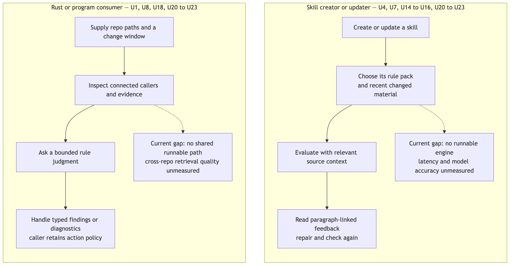

# Rust rule engine: people, purpose and boundaries

The engine checks things against reusable rules and returns source-linked, model-judged answers. It serves three kinds of customer.

**Skill creators and updaters** check a Markdown skill against reusable rules. They get pass/fail, classification or rubric feedback, and the location of the paragraph to repair. The expensive model call receives relevant, source-linked evidence that fast local analysis selected.

**Agent-workflow owners** monitor agent work as it happens. The first case is the handoff from a Lead agent to a reviewer: did the reviewer read the files its commission required, and does its handback address the job? A host hook calls the engine with the session and the commission; the engine reads the evidence, decides whether a RuleSet applies, and returns answers that the host turns into a nudge or a block.

**Rust and TypeScript developers**, such as codex-router, need the same evidence and decision semantics without a Bun process in their execution path. TypeScript applications may call the Rust program; they do not need a second implementation of its behavior.

[Specification](specification.md) defines the observable contract. [Program Design](program-design.md) proposes its Rust realization. The [October 11 proposals](../2026-10-11-rule-runner/requirements.md) remain historical alternatives. No implementation, installed dependency or runtime integration exists in this repository at this revision.

## The customer journeys

[Diagram source](assets/requirements-change-journeys.mmd)

| Customer | Job sequence | Current missing capability and evidence | Desired outcome |
| --- | --- | --- | --- |
| Skill creator/updater and rule author | Write or update a skill → select RuleSets → collect evidence → evaluate rules → read source-linked answers → repair | The owner supplied the JSONL-to-paragraph use case. The repository has no loader, evidence engine or runner. No failure-rate or latency baseline exists | Cheap local filtering, precise model inputs, useful answers, and a separate explanation when evaluation fails. U4, U7, U14–U17 |
| Agent-workflow owner | Lead sends a typed commission → reviewer works → reviewer hands back → host hook calls the engine with the session and commission → applicability → rules → nudge or block | The owner's stop-review helper (ai-tools `agent-scripts/stop-review`) reads a Codex transcript window and asks Jev, but it extracts messages only, never tool use, so it can't check which files were read. Nothing checks handoffs today | The host learns, per rule, whether the reviewer's observed work meets the commission, with honest `unknown` where evidence is missing. U24–U30 |
| Rust or TypeScript developer | Supply an invocation → call the reusable engine → handle answers, severities or diagnostics | The owner asks for Rust reuse and optional TS consumption. Only design documents exist | One implementation, callable as a Rust library or a program. U1, U3, U8, U12, U18 |

There is no new UI screen. Answers and diagnostics are data for an agent, terminal or host application. Integrating with the skill-authoring plugin, codex-router or host hooks is separate work; this design does not claim any integration works.

## Authorized needs

U1–U14 keep the earlier needs, revised by the owner's explicit Rust-first reset: "we have built nothing so we have no priors." U15–U19 cover RuleSets, reusable evidence and crate boundaries. U20–U23 cover time-scoped and connected-repository change evidence. U24–U30 cover hook-invoked monitoring, applicability, severity, conversation evidence and typed inputs. Priorities are unranked by the owner. Activity numbers refer to owner decisions recorded on work root `01a12ca7-621c-71b9-8fc3-0cf055fe6952`.

| ID | Need and reason | Evidence and authority |
| --- | --- | --- |
| U1 | One reusable Rust engine, callable as a library and as a program, without imposing a JS runtime on Rust consumers | Authorized: owner asks why TS/Bun is needed and agrees to the Rust core with "yes lets make a brand new spec" |
| U2 | Credentials belong to execution configuration, never to rule definitions or published results | Authorized: original secrets requirement, unchanged |
| U3 | Precise typed contracts, plus semantic validation of untrusted inputs and outputs. Types communicate what callers can rely on | Authorized: original typing requirement and the current engineering and Rust rules |
| U4 | Native public noul, choice and score judgments, mixed named questions, probabilities, fractional scores, and structured JSON instructions and criteria | Authorized: owner confirms the public primitives and supplies the TypeSafe advanced-structure documentation |
| U5 | Independent questions may share evidence. Consumer-owned composition and dependent follow-up stay explicit | Authorized: original shared-state and composition direction |
| U6 | Preserve observed usage, resolved model and optional billing cost, so economics can be measured | Authorized: original usage requirement; savings remain unmeasured |
| U7 | Lint and later evals reuse rule meaning; expectations stay independent of the engine | Authorized: original reuse direction and the skill-lint first customer |
| U8 | Rust is the engine runtime. TypeScript or Bun may be a caller, with no second engine or compulsory sidecar | Authorized: owner's Rust discussion and agreement to the single core |
| U9 | Reusable mechanisms belong in sunstack-tools. Sunstack owns skill meaning, rule content and expected eval outcomes | Authorized: repository split, continued through the reset |
| U10 | Rust domain enums, distinct validated IDs, explicit errors, one Tokio runtime and responsibility-based modules | Authorized: supplied AGENTS and Rust rules |
| U11 | Separate Requirements, Specification and Program Design; independent design review before planning and implementation | Authorized: original design commission |
| U12 | Replaceable decision providers. Jev/OpenRouter first; OpenAI Decisions and OpenRouter Alpha Decisions are future candidates | Authorized: owner names the future alternatives and limits initial support to Jev |
| U13 | Language-appropriate formatting, linting, type checking and tests | Authorized: existing craft and proof rules |
| U14 | Forward useful schema, model and validation diagnostics to agents. Hide raw SDK and provider internals; keep failures out of answers | Authorized: owner's explicit useful-error correction |
| U15 | Select named RuleSets and apply them to caller-supplied inputs. A skill document is one kind of input; a conversation, a code change and a typed payload are others. Each RuleSet has a name, a description, common instructions for its rules, and ordered JSONL rule files. Each rule asks named questions with rich instructions and criteria | Authorized: owner defines reusable JSONL rules plus a separate RuleSet, accepts the name RuleSet, and asks for the update (6535 lineage). Generalized beyond skills by the owner's decision that rules judge documents, code changes or supplied content (6535) and conversations (6606). Instruction field named `common_ruleset_instructions` (6603) |
| U16 | Accept caller-declared input paths. Provide fast filtering and preparation using Git comparisons, text search and AST-grep; supply useful evidence to decision engines | Authorized: owner moves these capabilities into the core and asks for faster filtering |
| U17 | Structural facts, relationship hypotheses and model judgments stay distinguishable. Uncertain candidates can still inform an agent | Authorized: owner-supplied AST-grep and evidence-tag research |
| U18 | TS can consume Rust through a thin boundary. Direct Rust consumers pay no mandatory process or JS cost | Authorized: owner accepts the one-core proposal |
| U19 | Composable Rust crates with clear responsibility and dependency boundaries, not tiny crates | Authorized: owner: "Rust should be composable crates ... with clear boundaries" |
| U20 | Select uncommitted changes, explicit commits or comparisons, commits in a time window, or their union. Recent uncommitted selection uses approximate file timestamps | Authorized: owner chooses "Approximate recent files using timestamps" |
| U21 | Analyze connected caller-supplied repositories; a changed definition may bring unchanged callers from another repository into the evaluation | Authorized: owner selects "Connected analysis across supplied repos" |
| U22 | Map changed source to syntax units, discover bounded caller and callee paths, and supply attributed semantic chunks to rule judgments | Authorized: owner describes diff → call relationships → semantic chunks → Jev judgment |
| U23 | Respect the selected model's context budget, keep related evidence together, and expose omitted or unavailable context | Authorized: owner requires context-length consideration |
| U24 | A host hook invokes the engine with parameters only: session and agent identity, transcript and file paths, typed payloads and selected RuleSets. The hook stays as thin as possible. Tools performs all acquisition: scraping, Git diff, AST-grep and transcript reading | Authorized: "our control from input parameters hook is as lite as possible. we control scraping, git diff, ast grep, jsonl reading" (6589). A codex-router hook with a schema is assumed; its registration and transport are out of scope (Lead channel, recorded in the transfer handoff) |
| U25 | Each RuleSet decides whether it applies through an ordered list of deterministic conditions and model decisions. RuleSets never name host hooks; the host routes events to candidate RuleSets | Authorized: "filter with jev is still a filter", naming `condition` and `decision` (6593); RuleSets have no visibility of harness hooks (6535) |
| U26 | Each rule carries a severity, block or nudge, that tells the host how to act on a finding. An omitted severity means nudge. Severity is never sent to the model | Authorized: "the severity should be by rule, can have a default severity of nudge unless overridden" (6571); "block or nudge is part of rule definition, not given to jev" (6602) |
| U27 | Read agent conversation transcripts and select user messages, assistant messages and tool use over the whole session, the last N turns, or only what is new, generically and without hardcoded presets. Claude Code and Codex first; Cursor and other hosts can be added later. Monitoring must be efficient | Authorized: "the ability to check transcript like I do in my helper" (6535); "make it more generic, you are hardcoding things", "file reads should be tool_use" (6606); "monitor the transcripts in some way in very efficient ways"; "codex/claude code/cursor, we can add other ones later" |
| U28 | Typed payloads, such as the `AgentJobPacket` commission, are inputs validated against their schema before use. Their Zod schemas live in Sunstack (ai-tools). Commission and handback correlate through router message and reply identities | Authorized: "i prefer typed messages. zod can be converted to json schema easily" (6571); "we define the schemas with zod in Sunstack (ai-tools repo)" (scope decision in the Lead channel) |
| U29 | Every contract's discriminated unions are valid JSON and follow strict discriminated-union practice | Authorized: "make sure how we use discriminated union is valid json because there's strict guidelines for it" (6605) |
| U30 | Session identity and other hook information are invocation inputs, available as provenance in results | Authorized: "i need to have as inputs session id, any other information" (6535 lineage) |

## What the Rust reset supersedes

| Earlier proposal | Current boundary | Reason |
| --- | --- | --- |
| Bun must execute the engine; a TS library is the main surface | Rust library plus a thin executable; optional TS caller | Explicit owner reset |
| Zod 4 or Effect Schema owns core validation | Rust owns engine deserialization and semantic validation. Zod still owns externally supplied hook and commission payload schemas in ai-tools | JS validation libraries don't require a JS engine; payload ownership stays with Sunstack |
| SDK owns retries; Rust talks to a Bun host | The Rust adapter owns one bounded HTTP attempt controller | Direct Rust execution calls the provider HTTP API |
| The model runner never collects repository evidence | Source capture, diff, search, structural selection and transcript reading are core scope | Owner explicitly expands the core's job |
| Rules bind only to skill documents | Rules apply to caller-supplied documents, conversations, code changes and typed payloads | Owner decisions 6535 and 6606 |

No shipped behavior or data needs migration. Earlier review receipts do not establish acceptance of this revision.

## Scope and protected systems

This design covers composable Rust libraries, a thin executable boundary, and local skill-lint and handoff-monitor examples and proof fixtures. Sunstack supplies rule content: questions, applicability, evidence requirements, rubrics and severities. Tools admits those declarations, acquires and prepares evidence, executes decisions, and correlates native answers with their sources. Consumers may interpret probabilities and scores in their own code. Whether a rule's evidence proves a claim, for example that a file was read, is rule meaning owned by the rule author; complex judgments use model decisions (6602).

Permitted repository: sunstack-tools. Existing skill packages, production hooks, codex-router, ai-tools schemas, infrastructure and eval datasets are read-only consumers or reference sources in this job. Registering hook schemas in codex-router, implementing hook transport, changing ai-tools schemas, publishing packages and installing services are outside this work.

The caller chooses when to invoke the engine and which RuleSets to offer. RuleSet name and description help a person or agent choose; they are never model instructions or execution conditions. Applicability (U25) is the only engine-side decision about whether a RuleSet acts. The engine keeps only invocation-local capture, query and execution data. The host owns state across invocations: monitoring cursors, loop counters, and correlation between a dispatch and its handback.

The engine reads only sources the caller passed: repository roots and paths, transcript paths, and typed payloads. It never guesses session directories. Approximate dirty-file recency, transcript lag and missing tool results stay visible as uncertainty; missing evidence never becomes a negative or positive finding.

Native noul, choice and score answers are preserved. Choice criteria may directly define pass, fail, review or domain categories. A RuleSet groups rules and returns their named answers together; it computes no overall verdict.

Excluded: a mandatory Bun service; a mandatory native JS addon; LSP or type-checker replacement; automatic edits; dynamic provider discovery; a persistent index, daemon, watcher or result store; a generic workflow language; hidden retrieval or truncation; automatic acceptance or merge authority; new skill or eval authoring inside Tools; named conversation presets; dynamically loaded adapter plugins.

## First-delivery boundary

**Confirmed by the owner (6651):** "a, then b ... milestones stacked prs ... and i want it to be working ... each implementation has verify." Delivery is two milestones, each a stack of slice PRs, with milestone 2 stacked on milestone 1. Each milestone must work through its real path. Every slice's proof is challenged and observed by a paired verifier.

**Milestone 1** serves the skill-lint and handoff-monitor customers. It includes the RuleSet and rule contracts, applicability, severity and results; the Jev decision path with model-budget admission and visible omissions (U23); document, payload and conversation inputs, with Claude Code and Codex transcripts; and the executable. **Milestone 2** adds Git change selection and connected code discovery with semantic chunking (U20–U22), reusing the same budgeted decision path. Cursor transcripts follow once their raw format is qualified. Deferral is sequencing, not removal: U20–U23 remain authorized needs.

## Evidence needed to close the outcome

The first delivery needs real Rust library and executable paths, strict admission checks, source, Markdown and transcript integration, boundary and negative controls, and a genuine mixed-primitives Jev request with validated answers and usage. Controlled HTTP transport proves local wiring; it does not prove hosted behavior or semantic accuracy. A skipped hosted call is an integration gap.

Transcript evidence needs qualified fixtures for each supported host format: messages, tool calls paired with their results, results missing or clipped, subagents, lag, and records the adapter does not recognize. A throwaway experiment (2026-10-15) proved the adapter extension mechanics on public Claude and Codex fixtures. It also exposed gaps the design must close: whole-message identity, turn boundaries, provenance for text the hook supplies, an outcome for results whose success is unknown, and efficient incremental reading. Cursor's raw format is unqualified.

Fast filtering needs measurements over declared workloads: repository size, changed files, rule count, scanned bytes, parsed files, transcript bytes read, selected, skipped and failed checks, elapsed time, and model request count. No numeric performance promise has been supplied. Accuracy and ranking calibration need independently labeled examples, not self-generated expectations.

Connected discovery and chunking additionally need known caller and callee examples, contradictory or shadowed matches, deletions, cross-repository attribution, cycle and fan-out limits, and model-budget failures. Syntax discovery and bounded search cannot certify exhaustive history or compiler-resolved references.

## Source basis and remaining choices

Authority is the owner conversation, recorded on work root `01a12ca7-621c-71b9-8fc3-0cf055fe6952`, plus the supplied AGENTS and language rules. The observational basis is this repository, the ai-tools stop-review helper and `AgentJobPacket` schemas, current host hook documentation, AST-grep source, and Git, Rust, OpenRouter and Decisions documentation cited in Program Design.

Owner choices that shape the Specification, all settled on 2026-10-15:
- **Named inputs** (6664): a RuleSet declares named inputs (document, conversation, change set, typed payload); the invocation binds each name to a supplied source; rules refer to inputs by name.
- **Host adapters** (6678): built-in Claude Code and Codex adapters, plus a public adapter interface that native callers can extend. Cursor follows once its format is qualified.
- **Applicability decisions** (6678): a decision entry is a yes/no question with a threshold; the RuleSet applies only while every entry passes.
- **Failed decisions** (6678): stop, and report the failure clearly; never a skip or a pass.
- **Rule verdicts** (6678): every rule ends in pass or fail through a required yes/no verdict question with a threshold. Severity applies when the verdict is fail.

Unverified: provider and model availability and credentials, numeric latency targets, supported distribution platforms, the optional TS binding, Cursor's transcript format, and live host behavior.
