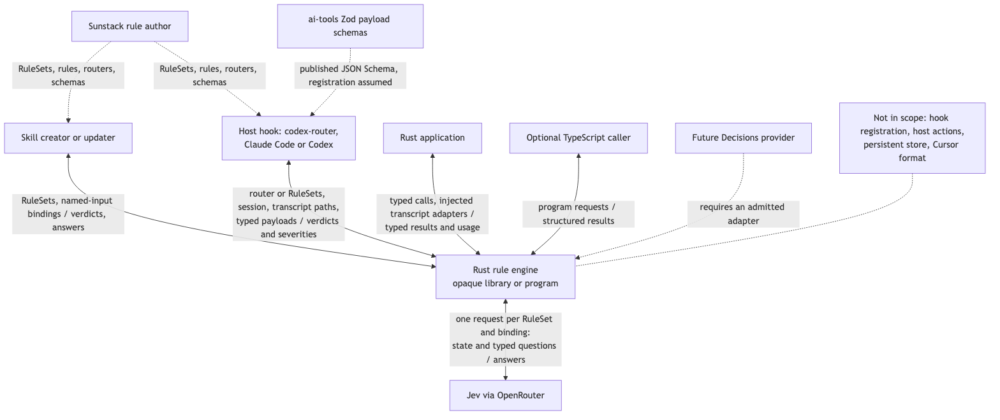
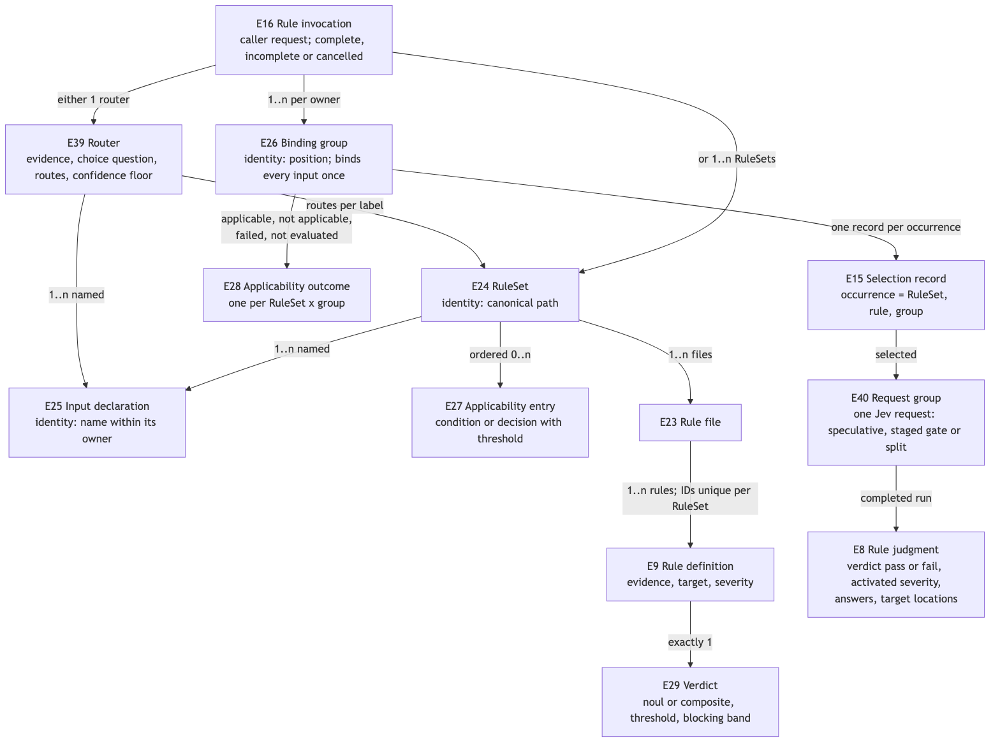
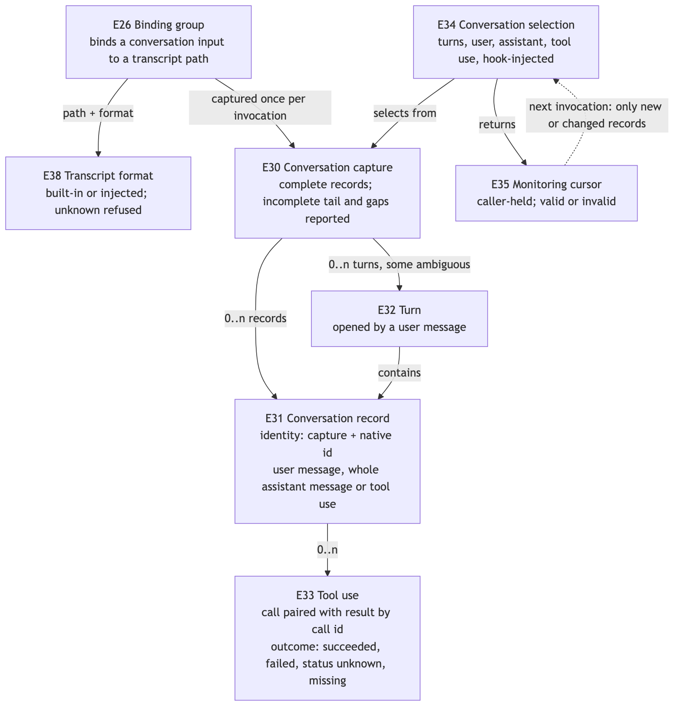
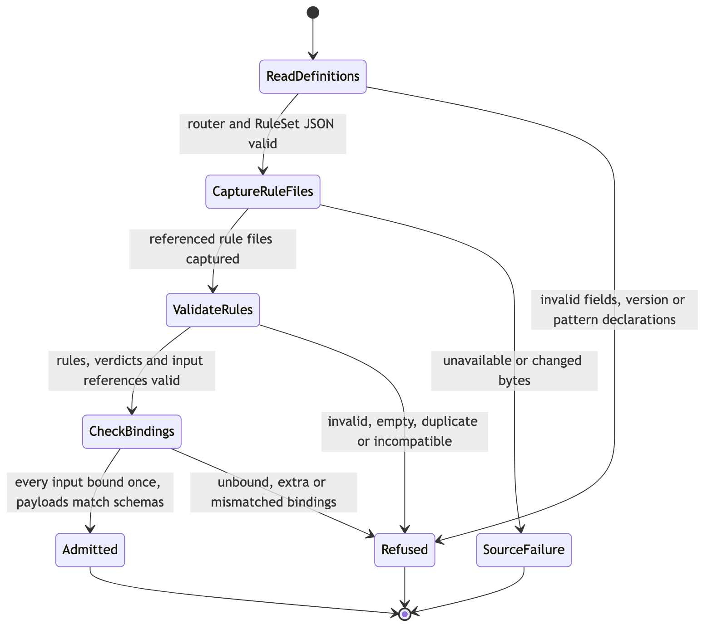
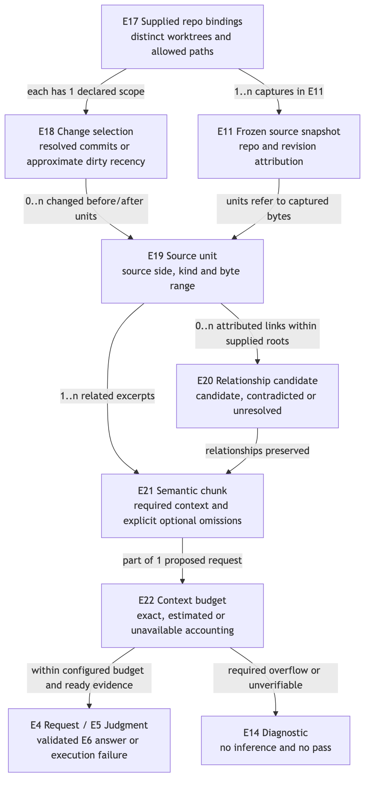

# Rust rule engine: observable contracts

This document realizes the authorized needs in [Requirements](requirements.md). [Program Design](program-design.md) gives each entity and obligation a Rust owner, a data shape and a proof seam. The milestone 1 journeys are skill lint (a RuleSet over a skill document) and handoff monitoring (a RuleSet over a typed commission and a reviewer's conversation, invoked by a host hook). Native Rust consumers get the same contract.

## What callers see



[Diagram source](assets/specification-context.mmd)

The engine has no authority to approve tools, accept a skill, merge changes, block an agent or declare software verified. It returns answers, verdicts and severities. The host decides what to do with them. Production plugin, router and hook integrations, and alternative providers, are outside this work.

## How a check runs

An invocation names a router or RuleSets, and binding groups. A binding group says which supplied source each named input means for this run. For each RuleSet and binding group, the engine:
1. admits the definitions and bindings
2. runs deterministic conditions
3. prepares the declared evidence
4. asks Jev **one** combined request carrying every applicable rule's verdict and questions; routers and decisions over the same input ride along speculatively
5. applies the declared thresholds and bands in code
6. returns one result per rule occurrence

```text
invocation: router or RuleSet paths, binding groups, repository bindings, origin, limits, execution settings, cursors
  -> admission: router, RuleSets, rule files, input declarations, bindings, payload schemas   (no source reads)
  -> deterministic conditions                                                                   (no model call)
  -> per RuleSet × binding group: ONE request over the shared evidence
       router question + decision questions on the same input (speculative)
       + every rule's verdict and informational questions
     (gates over different input: a staged request first, unless the caller opts into speculation;
      over budget: deterministic split along rule boundaries, reported)
  -> code applies: router floor and routes, decision thresholds, verdict thresholds and blocking bands
  -> per rule occurrence: verdict pass | fail and activated severity, native answers, locations
     or not applicable (speculative answers discarded and reported), or a typed failure with no verdict
```

## Entities and identities

E1–E8 keep the decision-domain meanings. E9–E16 cover rules and evidence; E17–E22 cover connected change sourcing and model budget; E23–E24 cover rule files and RuleSets. E25–E29 add named inputs, binding groups, applicability and verdicts. E30–E38 add conversation evidence, typed payloads, origin and transcript formats. E39–E40 add routers and request groups. E10 (Skill binding) is superseded by E25 and E26 under the owner's named-inputs decision; a skill document is now one document input. These are invocation and content identities, not a persisted identity service.

### Decisions

| Entity | Same-instance rule and relationships | Invariants and observable states | Basis |
| --- | --- | --- | --- |
| E1 Named question | Its name within one E4 request; a request has 1..n questions | One noul, choice or score, with structured instructions and criteria. Supplied → admitted or refused | U3–U5 |
| E2 Shared state | One evidence value associated with an E4 request; every question reads that value | Text, or a structured JSON object or array, with nested null values allowed; no silent truncation. Supplied → admitted or refused | U4, U5 |
| E3 Decision backend | One prepared provider and model connection; a run selects exactly one | Only declared supported semantics can execute. Prepared or preparation refused. The actual model is observed separately | U2, U12 |
| E4 Structured request | One nonempty named-question set plus shared state. Repeated contents do not make two E5 runs the same. In rule evaluation, one E40 request group produces one E4 | Independent questions only; the consumer schedules answer-dependent follow-up. Supplied → admitted or refused | U3–U5, U31 |
| E5 Decision run | One invocation of E3 with an E4. Retries stay inside it | One terminal outcome: completed, invalid request, provider failure, invalid response or cancelled | U1, U3, U14 |
| E6 Answer | One E5 run plus one E1 name. A completed run has exactly one answer per question | Kind, names, labels and rubric match the request; probabilities and fractional scores retained. Untrusted → admitted or refused | U3, U4 |
| E7 Receipt | One completed E5 run's execution metadata | Resolved model and native usage. Reported cost if available; absence is not zero. Untrusted → admitted or refused | U6 |

### Rules, inputs and results

| Entity | Same-instance rule and relationships | Invariants and observable states | Basis |
| --- | --- | --- | --- |
| E23 Rule file | One normalized JSONL source path and its captured contents. Several E24 may reference it | One bare rule definition per nonblank line; no header or wrapper. At least one rule, with source locations. Supplied → admitted or refused | U3, U4, U15 |
| E24 RuleSet | One normalized RuleSet JSON source path within an invocation. Captured contents determine its content identity; `name` and `description` are descriptive metadata | Declares 1..n E25 inputs, an ordered E27 applicability list, common instructions for its rules, and ordered E23 paths. Rule IDs are unique across its loaded files. Its instructions apply to its own rules' questions and verdicts only: never to applicability decisions and never to another RuleSet. Supplied → admitted or refused | U15, U25 |
| E25 Input declaration | Its name within one E24. Names are unique per RuleSet | Kind is document, conversation, change set or payload; a payload names its schema. Every reference to the name from the RuleSet's rules and applicability must be compatible with its kind, in every RuleSet that loads those rules | U15, U24, U28 |
| E26 Binding group | One position in the invocation's binding list for one E24. Two groups binding identical values are still two groups | Binds every declared E25 name exactly once, to a supplied source of the matching kind: a document path inside an E17, an E17's change selection, a transcript path with its E38 format, or an E36 payload. Undeclared or missing names are refused. Supplied → admitted or refused | U15, U24 |
| E27 Applicability entry | Its position in one ordered list, owned by an E24 or an E9 | A condition (deterministic, over bound inputs, E37 origin or source presence) or a decision (a noul question, its declared evidence and a threshold in (0, 1]). An empty list means the owner always applies. Admitted → evaluated: passed, did not pass, unresolved or failed, or not evaluated | U25 |
| E28 Applicability outcome | One E24 × E26 (or one rule occurrence, for rule-level applicability) | Exactly one of: applicable; not applicable, naming the entry and its basis; applicability failed, naming the entry and a clear failure diagnostic; or not evaluated, with the reason (cancelled, or the invocation was refused) | U25 |
| E9 Rule definition | A nonempty rule ID within one E24 | Holds evidence declarations over named inputs; one declaration marked as its target; an ordered E27 list; 0..n informational E1 questions; one E29 verdict; and a severity of block or nudge, nudge when omitted. Neither severity nor the verdict threshold is ever sent to a model. Supplied → admitted or refused | U15, U26 |
| E29 Verdict | Exactly one per E9 | Either a noul verdict (its own noul question, whose yes probability is the verdict value) or a composite verdict (weighted noul and score dimensions drawn from the rule's informational questions, each normalized to [0, 1], with weights summing to 1). Both have a threshold in (0, 1] and may declare a blocking band `block_at_or_below` below the threshold. For a completed judgment: pass when the value ≥ threshold, otherwise fail. A blocking rule blocks only when the value ≤ its band; otherwise it acts as nudge. No verdict exists without a completed judgment | U26, U31 |
| E39 Router | One normalized router JSON path within an invocation | Declares named inputs, one choice question over them, routes from each label to RuleSets (each route wiring that RuleSet's declared inputs to the router's inputs), and a confidence floor in (0, 1] compared with the answer's native Choice confidence. For a completed answer: below the floor, no RuleSet runs ("uncertain intent"); otherwise exactly the chosen label's RuleSets run, each still applying its own applicability. Supplied → admitted or refused | U25, U31 |
| E40 Request group | One E4 request within an invocation: one RuleSet × E26 group, or one split of it, or one staged gate | Lists its questions (router, decisions, verdicts and informational questions, each bound to its owner) and its mode: speculative, staged gate, or rules. Splits along rule boundaries are deterministic and reported. Discarded speculative answers are reported with their cost, never as answers or verdicts | U31 |
| E15 Selection record | One rule occurrence: E24 path, E9 rule ID and E26 group | Exactly one of: selected; not applicable; outside the requested change scope; or selection failed. Always with a reason | U16, U25 |
| E8 Rule judgment | One selected rule occurrence with a completed E5 run | References the verdict outcome, the activated severity when the verdict is fail, every informational native answer, and the resolved E12 target locations. Execution failure never becomes a judgment | U7, U9, U14, U26 |
| E16 Rule invocation | One caller request: either an E39 router or ordered E24 paths, plus 1..n E26 groups, E17 repository bindings, E37 origin, limits, backend configuration, execution settings (speculation for gates over different input: on or off) and E35 cursors | Each admitted rule occurrence has one E15 record. Limits are cumulative across RuleSets and groups. Complete for the requested scope, incomplete, or cancelled | U1, U15, U24, U31 |

### Evidence

| Entity | Same-instance rule and relationships | Invariants and observable states | Basis |
| --- | --- | --- | --- |
| E11 Source snapshot | One invocation's captured content and resolved revisions for its bound sources. Each item is identified by its source (repository and path, transcript path, or payload), revision or content, and capture interval | Locations refer to these bytes, never to later reads. Captured, or unavailable or changed during capture. No atomic instant across repositories or transcripts is claimed | U16, U21, U27 |
| E12 Target location | A rule's target declaration resolved within one E26 group's captures | One of: a paragraph (a document plus a paragraph ID, resolving to exactly one paragraph); code units (repository, revision and spans); conversation records (an E30 capture plus a set of E31 identities); or a payload field (an E36 input plus a pointer). Resolved, missing, ambiguous, deleted or unavailable | U15, U27 |
| E13 Evidence bundle | The target and context occurrences selected from one snapshot for one rule occurrence or applicability decision, with their provenance and completeness | Includes source locations, facts and explicit uncertainty; no invented context. Ready, or incomplete or refused | U16, U17 |
| E14 Diagnostic | One safely described issue at a definition, binding, source, selection, request, response, provider, applicability or invocation boundary | Has an origin, a closed code, a safe path or location, and repair guidance. Never passes through input, body or credentials | U14 |

### Conversation evidence

| Entity | Same-instance rule and relationships | Invariants and observable states | Basis |
| --- | --- | --- | --- |
| E38 Transcript format | A format name: a built-in (Claude Code JSONL, Codex rollout JSONL) or a format declared by a caller-supplied adapter | Built-in or injected; an unknown name is refused. Cursor is not a built-in until its raw format is qualified | U27 |
| E30 Conversation capture | One transcript source (path plus E38 format) captured over one interval within an invocation. Groups binding the same source share the capture | Only complete records count; an incomplete tail is reported. Hook-supplied final assistant text is a separately attributed supplement. Unknown, malformed or unsupported records are coverage gaps. Captured, unavailable, or rejected for discontinuity | U27 |
| E31 Conversation record | One E30 capture plus the host's native message or record identity. Without one, its position in the capture | A user message, a whole assistant message (all of its blocks), or an E33 tool use. Provenance is transcript or hook supplement. Injection origin is known injected, not injected, or unknown | U27 |
| E32 Turn | One E30 capture plus the user message that opens it. A leading turn may have no user message | Contains the assistant messages and tool uses after its user message, up to the next one. The boundary is marked ambiguous for consecutive user messages or unresolved branches | U27 |
| E33 Tool use | One E30 capture plus the native call ID. A result with no matching call is an orphan gap, never a guessed tool use | Tool name; category (read file, edit file, shell, search, web, MCP, other or unknown); recorded input; outcome (succeeded, failed, result present with unknown status, or result missing); result (full observed field, clipped with original size known or unknown, or absent) | U27 |
| E34 Conversation selection | One evidence declaration over one conversation input in one E26 group | Turns (all, last N, or since a cursor); user messages (included or excluded); assistant messages (excluded, all, or final only); tool use (excluded, or included with a tool filter and results included or excluded); hook-injected text (included or excluded). Selects at least one record type. Yields selected records, omissions with reasons, and coverage gaps | U27 |
| E35 Monitoring cursor | One E30 source plus a committed position and continuity evidence, returned by the engine and held by the caller | Selects only records new or changed since that position, including late results for earlier calls and late supplements. Valid, or invalid because the source was rewritten, truncated or replaced | U27 |

### Inputs and provenance

| Entity | Same-instance rule and relationships | Invariants and observable states | Basis |
| --- | --- | --- | --- |
| E36 Typed payload | The payload value bound to one payload input in one E26 group | Validated against its named schema before use. Supplied → admitted, or refused for a schema mismatch or unknown schema | U28 |
| E37 Invocation origin | One per E16 | Either a hook (host, event, session, host-namespaced turn, agent as main, subagent or unknown, and observed time) or direct. Provenance only: it never routes RuleSets or authorizes reads. An unavailable field is explicit | U30 |

### Change sourcing and model budget (milestone 2 except E22)

| Entity | Same-instance rule and relationships | Invariants and observable states | Basis |
| --- | --- | --- | --- |
| E17 Repository binding | One caller key associated with one canonical worktree root in the invocation. Linked worktrees stay distinct even when they share Git objects | The sole authority for repository roots, allowed paths and change scope. Duplicate keys or roots and undeclared cross-root reads are refused | U20, U21 |
| E18 Change selection | One E17 binding plus its declared scope and resolved interval or revisions. A union keeps each member's provenance | Dirty layers, commit events and net comparisons stay distinguishable. Requested → resolved, approximate or unavailable. Time metadata is not local edit history | U20 |
| E19 Source unit | One E11 source and revision, plus a syntactic kind and byte range. Before and after units are distinct, linked only with evidence | A function, method, class or Markdown paragraph or section candidate. Located or unavailable. Syntax never implies compiler symbol identity | U22 |
| E20 Relationship candidate | One E11 source unit or call site, plus a relation kind and an identified endpoint or unresolved target hint | Candidate, contradicted or unresolved. A missing target identity is never invented; never a runtime stack or a calibrated probability | U17, U21, U22 |
| E21 Semantic chunk | One requested evidence plan, plus its E19 and E20 membership and content identities | Related excerpts, attribution and omissions are kept. Planned → ready or incomplete. Splitting never silently erases a required relationship | U22, U23 |
| E22 Context budget | One proposed E4 request, plus the selected backend's accounting profile and finite caller limits | Counts questions, verdict, state and serialization overhead. Assessed as within budget, exceeded or unverifiable; estimated accounting stays labeled | U12, U23 |



[Diagram source](assets/specification-entities.mmd)



[Diagram source](assets/specification-conversation-entities.mmd)

A target location never implies symbol or type identity. A syntax match, a relationship hypothesis, an adapter's normalized record and a model judgment are different kinds of evidence.

## Obligations and proof coverage

Each P→O cell names a concrete problem and the observation that shows it solved. R identifiers are local to this design set.

| R | Observable obligation, including the negative case | U / E | Problem → outcome | Contract / proof |
| --- | --- | --- | --- | --- |
| R1 | Rust callers MUST compose the evidence, decision and rule libraries without a JS runtime. Evidence preparation MUST work without a decision-provider dependency, and decision execution without repository, AST or transcript dependencies. Program callers MUST get the same behavior and outcomes | U1, U8, U18, U19 / E5, E13, E16 | P1 duplicated or entangled runtime → O1 independently reusable parts | C1 / V1, V2 |
| R2 | Invalid RuleSet JSON or version, malformed JSONL, duplicate rule IDs within a RuleSet, invalid questions, a missing verdict, an invalid threshold or invalid input declarations MUST refuse admission before any source read or inference, with source-linked diagnostics | U3, U14, U15 / E9, E14, E23–E25, E29 | P2 bad data can infer → O2 refusal before any work | C2 / V3 |
| R3 | A target MUST resolve to its declared kind within its binding group's captures. A paragraph ID MUST match exactly one eligible paragraph. Missing, duplicate, deleted or unavailable targets MUST NOT become judgments | U14, U15 / E11, E12, E14 | P3 wrong subject judged → O3 source-linked target resolution | C2, C3 / V4 |
| R4 | Requested Git comparisons and source evidence MUST refer to resolved, captured content. Staged, unstaged, untracked, rename and deletion behavior MUST be explicit | U16 / E11, E13, E16 | P4 mutable or ambiguous diffs → O4 traceable comparison | C3 / V5 |
| R5 | Text and structural selectors MUST return source-located facts and candidates without claiming compiler-backed symbol or type identity | U16, U17 / E11, E13 | P5 raw matches mislead → O5 attributed local evidence | C3 / V6 |
| R6 | Every admitted rule occurrence MUST expose a selection disposition and reason. Uncertain applicability MUST NOT be silently treated as not applicable | U14, U16, U25 / E9, E15, E16 | P6 filtering hides checks → O6 visible coverage | C3, C10 / V7 |
| R7 | Required targets and declared evidence MUST be present before inference. Missing, over-limit or unresolvable evidence MUST produce diagnostics, never silent trimming | U5, U14, U16 / E11, E13, E14 | P7 incomplete input false-flags → O7 declared evidence honored | C3 / V7 |
| R8 | The engine MUST preserve mixed named primitives and structured JSON instructions and criteria over shared state. Grouping questions into requests MUST NOT drop evidence or change which evidence a question's owner declared | U3, U4, U5, U31 / E1, E2, E4, E5, E40 | P8 flattening loses meaning → O8 native structured requests | C4, C13 / V8, V9 |
| R9 | A completed run MUST contain exactly the requested answer names, kinds, labels and rubric ranges, plus a valid receipt. A mismatch MUST be an invalid response | U3, U4 / E1, E5–E7 | P9 HTTP success mistaken for a valid judgment → O9 correlated validation | C4 / V8, V9 |
| R10 | Diagnostics MUST keep origin, a safe path or location, a closed code, bounded actionable text and observed retry advice. Raw errors and values MUST NOT escape | U2, U3, U14 / E14 | P10 opaque or leaky failure → O10 useful, safe repair feedback | C5 / V10 |
| R11 | Backend selection MUST be independent of rule meaning. Initial execution supports Jev only, and unsupported semantics are refused rather than probabilities fabricated | U4, U12 / E1, E3, E5 | P11 provider coupling → O11 replaceable semantic boundary | C4 / V9, V11 |
| R12 | Completed execution MUST preserve the observed model, native token usage and any supplied billing cost. Absence MUST stay unavailable, and savings MUST NOT be asserted without measurement | U6 / E5, E7 | P12 a count mistaken for economics → O12 measurable execution | C4 / V9, V11 |
| R13 | A native answer or verdict MAY be unfavorable. Invalid input, unavailable evidence, applicability failure, provider failure, invalid response and cancellation MUST remain distinct execution outcomes, never verdicts or judgments | U7, U14, U25, U26 / E5, E8, E14, E16, E28 | P13 failure becomes a pass → O13 answer and execution separation | C5, C6 / V8, V12 |
| R14 | Observed cancellation MUST stop new work and attempts, and wait for owned in-flight work before returning terminal cancellation. It MUST NOT claim that remote billing was reversed | U1, U3 / E5, E16 | P14 detached work → O14 owned settlement | C5 / V9, V13 |
| R15 | Exactly one controller MUST apply configured finite attempts and timeouts. Retries and ambiguously accepted inference MUST be visible as execution behavior, never hidden in judgments | U3, U6 / E3, E5, E7 | P15 retry multiplication → O15 bounded attempts | C5 / V9, V13 |
| R16 | Rule execution MUST preserve source-linked native answers and verdicts, so lint and eval consumers reuse the same definitions. The engine MUST NOT generate independent eval expectations | U5, U7, U9, U15 / E6, E8, E9, E16, E24 | P16 duplicated meaning or circular eval → O16 reusable definitions, independently judged | C6 / V12 |
| R17 | Structural facts, heuristic labels, adapter-normalized records and provider probabilities MUST keep distinct attribution. A heuristic score MUST NOT pose as a calibrated probability | U4, U17, U27 / E6, E13, E31 | P17 approximate evidence mistaken for truth → O17 readable uncertainty | C3, C4, C11 / V6, V12, V24 |
| R18 | The engine MUST expose local-work, transcript-read and provider-work measurements sufficient to evaluate efficiency, without claiming an unmeasured speed target | U6, U16, U27 / E11, E16, E35 | P18 "fast" is unverifiable → O18 measured workload | C7 / V14, V26 |
| R19 | Credentials MUST stay at the transport boundary. Definitions, results, default logs and diagnostics MUST NOT contain credentials, raw provider bodies or raw transcript content | U2, U10, U14 / E3, E11, E14, E30 | P19 data exposure → O19 bounded privacy | C5 / V10 |
| R20 | Delivery MUST stay in sunstack-tools and meet language-appropriate checks and proof, including independent crate consumption and acyclic responsibility boundaries. Other repositories, alternate providers, native addons and publication need separate scope | U9–U11, U13, U18, U19 / none: delivery constraint | P20 integration overreach → O20 bounded composable delivery | C1, C7 / V1, V2, V15 |
| R21 | Change selection MUST expose dirty layers, selected commits or comparisons, resolved time bounds and member provenance. Timestamp-based recent dirty selection MUST be labeled approximate, and unknown recency MUST be visible | U16, U20 / E11, E17, E18 | P21 a time filter misstates history → O21 inspectable selected changes | C3, C8 / V16 |
| R22 | Connected analysis MUST stay inside supplied repository and path scopes, and keep repository, worktree and revision attribution for every source and relationship. One unavailable repository MUST stay visible in overall coverage | U16, U21 / E11, E13, E17, E20 | P22 cross-repository confusion → O22 attributed connected evidence | C3, C8 / V17 |
| R23 | Changed source MUST seed bounded syntax-unit and candidate relationship discovery, exposing limits, contradictions, unresolved links and coverage. No exhaustive call-stack or symbol claim is permitted | U17, U22 / E18–E20 | P23 a diff loses related behavior → O23 useful bounded relationships | C8 / V17, V18 |
| R24 | Semantic chunks MUST preserve source sides, membership and required relationships. Optional omissions MUST be explicit. A rule's required evidence MUST be judged as one group; only native callers may judge chunks separately, composing results in their own code | U5, U9, U22, U23 / E9, E13, E19–E21 | P24 chunking breaks rule meaning → O24 coherent rule evidence | C8 / V18 |
| R25 | Budget assessment MUST include the serialized questions, verdict, instructions, state and adapter overhead. Unsupported or exceeded accounting MUST be explicit. Required evidence that cannot fit MUST NOT yield a judgment | U12, U14, U23 / E3, E4, E13, E21, E22 | P25 a model limit silently loses context → O25 bounded, visible evaluation | C4, C8 / V19 |
| R26 | Every named-input reference from a rule's evidence, target or applicability, and from RuleSet applicability, MUST resolve to a declared input of a compatible kind, in every RuleSet that loads the rule. Every binding group MUST bind each declared input exactly once to a compatible supplied source. Violations MUST refuse admission before any source read | U15, U24 / E9, E24–E27 | P26 rules silently run on the wrong material → O26 checked input contracts | C2, C9 / V20 |
| R27 | Each RuleSet × binding group MUST be evaluated independently: applicability, selection, evidence and judgments. A rule occurrence MUST be identified by RuleSet, rule ID and binding group. Groups with identical values MUST NOT merge. Invocation limits MUST be cumulative across groups | U15, U24 / E15, E16, E26, E28 | P27 one group's answer applied to another → O27 per-group results | C9, C10 / V21 |
| R28 | Applicability entries MUST be evaluated in declared order, and the first entry that does not pass MUST stop evaluation. Later entries' answers MUST NOT be used, and evidence that only later entries or the stopped rules declare MUST NOT be acquired, except when it rides in a speculative request (R38). A condition MUST be deterministic over bound inputs, origin or source presence. An unresolvable condition MUST be applicability failed, never false. A decision MUST pass only when its yes probability ≥ its threshold. A failed decision call MUST stop that RuleSet × group with clear failure information, mark the report incomplete, and run none of its rules. Every evaluated entry MUST be recorded with its basis and cost | U25 / E27, E28 | P28 the wrong checks run, or none, silently → O28 visible, ordered applicability | C10 / V22 |
| R29 | Every completed rule judgment MUST carry a verdict: pass when the verdict value (a noul yes probability, or a composite weighted value) ≥ its threshold, otherwise fail. A rule's severity, block or nudge (nudge when omitted), MUST be activated only on fail. A blocking rule with a declared band MUST block only when the value ≤ the band, and otherwise act as nudge. No severity, threshold, band, weight or route MUST appear in a model request. Without a completed judgment there MUST be no verdict | U26, U31 / E8, E9, E29 | P29 no uniform outcome for hosts to act on → O29 pass/fail with confident severity | C6, C12 / V23, V33 |
| R30 | The engine MUST read only transcript paths the caller bound, in a declared E38 format. An unknown format MUST be refused. Captures MUST count only complete records and report an incomplete tail. Unknown, malformed or unsupported records MUST be coverage gaps. Hook-supplied final text MUST be a separately attributed assistant supplement, never treated as hook-injected | U24, U27 / E30, E31, E38 | P30 transcripts misread or silently partial → O30 attributed conversation capture | C11 / V24 |
| R31 | Normalization MUST keep whole-message identity across blocks, mark ambiguous turn boundaries, pair tool calls with results by native ID, report orphan results as gaps, distinguish the four tool-use outcomes and the three result fidelities, and assign one of the eight categories without interpreting shell commands | U27 / E31–E33 | P31 lossy normalization misleads rules → O31 faithful records | C11 / V24 |
| R32 | Conversation selection MUST be generic: turns, user messages, assistant messages, tool use and hook-injected text, each set independently, with no named presets. A selection that selects no record type MUST be refused. Results MUST state their omissions and gaps | U27 / E34 | P32 hardcoded windows → O32 composable selection | C11 / V25 |
| R33 | Given a valid cursor, selection MUST return only records new or changed since it, including late tool results for earlier calls and late supplements. A rewritten, truncated or replaced source MUST invalidate the cursor. The engine MUST keep no state between invocations, and MUST report the bytes it read and parsed | U27 / E35 | P33 re-reading whole transcripts → O33 efficient incremental monitoring | C11 / V26 |
| R34 | A typed payload MUST be validated against its named schema before any condition, selector or question uses it. An unknown schema or a mismatch MUST refuse admission. A condition over a missing payload field MUST be unresolved, never false | U28 / E36, E27 | P34 malformed commissions mislead checks → O34 validated typed inputs | C9 / V28 |
| R35 | The invocation origin MUST be carried into results as provenance, with unavailable fields explicit and turn identifiers kept in their host's namespace. Origin MUST NOT route RuleSets or authorize source reads | U30 / E37 | P35 untraceable results or origin misuse → O35 provenance only | C9 / V29 |
| R36 | A native caller MAY supply transcript adapters for additional formats. The engine MUST pass adapters only captured bytes, keep acquisition itself, and validate adapter output structurally: unique identities, positions inside the capture, and outcomes consistent with results | U27 / E30, E38 | P36 every new host needs a Tools release → O36 extensible host support | C11 / V27 |
| R37 | Every authored and wire contract union MUST be internally tagged, with each variant carrying its own complete fields and unknown fields refused. Author content in instructions and criteria stays free JSON | U29 / all contract entities | P37 ambiguous unions → O37 valid discriminated unions | C2, C9 / V3, V8 |
| R38 | Every applicable rule in one RuleSet × binding group MUST be judged in one request, with owner-labeled evidence, unless the budget forces a split. Splits MUST fall deterministically on rule boundaries and be reported. A rule that cannot fit alone MUST be refused. A router or decision over the same bound inputs MUST ride in a request speculatively. A gate over different inputs MUST be staged unless the invocation enables speculation. Each gate MUST have exactly one controlling answer per binding group. Only leading conditions MAY run before decisions. Answers for rules that turn out not to apply MUST be discarded and reported with their request's observed cost, never becoming answers or verdicts. Completed admitted answers MUST reduce to the same results as staged execution. Questions in one request MUST share its fate | U31 / E4, E40, E27, E39 | P38 one call per rule wastes round trips over the same source → O38 one call per RuleSet and input | C13 / V31, V32 |
| R39 | A router MUST ask one choice question over its declared inputs. It MUST compare the answer's native Choice confidence with its floor. Below the floor, no RuleSet MUST run, and the result MUST say "uncertain intent". Otherwise exactly the chosen label's RuleSets MUST run, with their inputs wired from the router's inputs, each still applying its own applicability. A failed router call MUST stop with clear failure information, like a failed decision | U25, U31 / E39 | P39 every candidate RuleSet pays for its own gate → O39 one routing decision per event | C13 / V34 |
| R40 | A composite verdict MUST draw only on the rule's own informational noul and score questions. It MUST normalize them (a noul's yes probability as is; a score's position divided by its last rubric index), use positive weights summing to 1, and compare the weighted value with its threshold. It MUST NOT combine answers across rules or RuleSets. A composite value is not a confidence measure | U26, U31 / E29 | P40 multi-dimension rules need a combined verdict → O40 declared composite within one rule | C12 / V35 |
| R41 | Admission MUST refuse any of these:<br/>• a blocking band at or above the threshold, or on a nudge rule<br/>• a composite dimension that names a missing or non-noul/score question, or a score with a single-level rubric<br/>• a non-positive weight, or weights not summing to 1<br/>• a router whose routes name labels outside its choice criteria, unadmitted RuleSets, or input wirings that are missing, unknown or kind-incompatible<br/>• a router floor outside (0, 1] | U3, U29, U31 / E29, E39 | P41 contradictory pattern declarations → O41 checked declarations | C2, C13 / V3, V33–V35 |

## C1: Two entry surfaces, one implementation

The Rust libraries expose independently reusable evidence preparation (including transcript capture and selection), prepared-judgment execution, and rule orchestration. Each contract is defined by the domain that owns it; orchestration imports those types rather than recreating their schemas. A thin program accepts bounded structured invocations and returns the same data contracts. Neither starts hidden model inference or needs a JS runtime. The program is an invocation process, not a daemon. TS, native-addon or WASM packaging is optional later work.

Dynamic JSONL names and labels are validated against each actual request at runtime. Native callers get typed primitive and result variants, not a false claim of compile-time knowledge of file-loaded keys.

## C2: RuleSets, inputs, rules and verdicts



[Diagram source](assets/rule-file-admission.mmd)

A RuleSet declares:
- `name` and `description`: metadata for people and agents choosing RuleSets. Never model instructions, never execution conditions.
- **Named inputs**: each with a kind (document, conversation, change set, or payload with a named schema).
- **Applicability**: an ordered list of condition and decision entries (C10).
- **Common instructions for its rules** (`common_ruleset_instructions`): applied to every rule question and verdict in its files. Never to applicability decisions and never to another RuleSet. Null adds nothing. Supplied instructions and each question's own instructions both survive as separately labeled structured values, with no merging, flattening or substitution.
- **Ordered rule file paths.**

Each nonblank JSONL line is one bare rule definition:
- a rule ID
- evidence declarations over named inputs, one of them marked as the rule's **target**
- an applicability list (empty means always)
- 0..n informational questions
- a required **verdict**: a noul question plus a threshold (the default), or a composite of the rule's own dimensions plus a threshold, optionally with a blocking band (C12)
- a **severity**: block or nudge, nudge when omitted

The target says what the rule's result points at (E12). A paragraph-ID target is the skill-lint case. A conversation record set, code units or a payload field are equally valid targets.

All questions and the verdict read the same prepared evidence and travel in one request. JSONL files can be reused across RuleSets. Duplicate rule IDs across one RuleSet's files refuse admission; the same ID in different RuleSets is a distinct occurrence.

Admission happens before any source is read or any model is called:
- Bad JSON, an unsupported version, duplicate IDs or keys, empty collections, unknown contract fields, invalid questions, a missing verdict, or a threshold outside (0, 1] all refuse admission.
- So does an input reference that is undeclared or kind-incompatible in any RuleSet loading the rule (R26).
- JSON locations include the file, line and column, and a bounded, safe containing-field path. Arbitrary keys inside structured instructions and criteria stay data.

RuleSet paths resolve from an explicit definition root supplied by the invocation; the executable supplies its working directory as that root. Rule file paths resolve from their RuleSet file's directory. Reading a RuleSet authorizes its named rule files only: no directory scan, and no access to evidence outside caller scope.

**Paragraph targets.** The convention is `U001: paragraph text` at the start of a Markdown paragraph, with an ID made of an ASCII letter followed by at least three digits. IDs are scoped to one document and matched case-sensitively. Paragraph text includes wrapped continuation lines until the paragraph ends. A list item's paragraph may qualify; code fences, headings, inline code and quoted examples do not create targets. There is no implicit "first match wins". For a removed paragraph in change-scoped execution, the before snapshot can identify the occurrence, but the deleted target cannot be judged as if present.

## C3: Scope, filtering and model-ready evidence

The caller declares repository bindings (E17), each with input paths and a change scope, and binds named inputs to sources inside them. A document input names a path inside one repository binding's admitted scope. A change-set input selects that repository binding's admitted change selection; it never defines a second scope. Full scope needs no Git repository. Change scope resolves the declared comparison or change-event selection (C8), considering target, context, applicability and rule-definition changes on the available before and after sides. Merely changing line numbers is not a change of paragraph identity or content. A missing baseline or incomplete dependency analysis conservatively selects; unresolved current applicability is a selection failure. Missing evidence never proves irrelevance.

Repository comparison covers two resolved commits, or a resolved base against captured working-tree content. Working-tree scope includes staged and unstaged content, plus explicitly requested untracked sources. Added, modified, deleted and renamed paths are reported. Rename handling may be delete plus add.

Evidence is acquired lazily. A source is read only when an applicability entry or rule that will actually run declares it. Declaring an input never causes a read by itself. Evidence includes target text or records, declared context, source and content identities, locations and selector provenance. The model-facing state has a defined target, attributed context entries and explicit optional omissions. Text search finds text occurrences; structural search identifies syntax nodes and captures; neither proves type or symbol identity. Target IDs, source existence and mechanically checkable structure are established locally.

Limits on files, bytes, transcript bytes, candidates and model input are explicit invocation settings, cumulative across RuleSets and binding groups. Exceeding a limit gives incomplete evidence or selection diagnostics, never silent truncation, dropped rules or a fabricated zero result. Required evidence must be complete for each model call. There is no persistent index, learned ranker or mandatory model reranking.

Each rule occurrence has a selection record (E15) with a machine code and a safe explanation. A report is complete only for its stated scope, never implicitly for a whole repository or conversation.

## C4: Native decisions and adapters

**Primitive answers:**
- **Noul** returns a finite yes probability in [0, 1].
- **Choice** returns a supplied label, a concentration confidence, and probabilities for exactly the supplied label set.
- **Score** returns a finite probability-weighted position from zero to the final rubric index, a confidence, and the actual index, legend and probability set.

Fractions stay fractions. Transport validation applies no automatic conversion to a percentage or a boolean. Verdict thresholds (C12) and decision thresholds (C10) are applied by the engine after validation and never sent to the model.

**Structured content:**
- Instructions for every primitive, choice option descriptions, score level descriptions and both noul descriptions accept the documented EntryType roots: string, object, array or null. Objects and arrays may hold arbitrary recursive JSON.
- JSON null is literal content, distinct from an omitted field. Shared state keeps its text, object or array root, with nested null allowed.
- Noul criteria may be omitted. When supplied, both true and false descriptions are required.
- Choice labels form a nonempty map. Score criteria form a nonempty ordered rubric.
- Unsupported roots and values are refused before inference. [TypeSafe structured primitives](https://docs.typesafe.ai/primitives/advanced)

A request has multiple named, independent questions over one shared state. In rule evaluation, one request carries a RuleSet × binding group's questions: its applicable rules' verdicts and informational questions, plus, speculatively, any router or decision questions over the same evidence (C13). Answer-dependent follow-up stays with the caller, or with a staged gate. No undocumented exact probability-sum or legend-text constraint is invented.

**Backends.** Jev via OpenRouter is the first actual backend. OpenAI Decisions and OpenRouter Alpha Decisions are future candidates; their adapters must independently establish primitive, confidence, structured input and receipt semantics. Missing fields are never fabricated to make an unsupported model look conforming.

**Provider data** is validated against the actual request before completion:
- Native model and token usage, and any reported USD cost, are preserved.
- Malformed receipt fields refuse completion.
- Unknown receipt metadata is excluded, without rejecting otherwise valid additive metadata.
- Unknown answer names, or requested probability or index keys that don't match, are errors.

## C5: Diagnostics, attempts and cancellation

**Diagnostics** identify:
- a source: `rule_set`, `rule_file`, `input_binding`, `source`, `transcript`, `selection`, `applicability`, `request`, `response`, `provider`, `execution`, `invocation` or `protocol`
- a closed code
- a safe path or location
- actionable guidance

Expected kinds, ranges and allowed labels may be described from admitted declarations. Received values, raw bodies and transcript text are excluded. Messages are written by the boundary owner, never copied from SDK or HTTP error text. Retryability is known yes, known no or unknown; it is advice, not an automatic retry.

**Execution outcomes.** A decision run ends as completed, invalid request, provider failure, invalid response or cancelled. Preparation and evidence failures have their own diagnostics; neither creates a fake decision run. Requests are validated before inference. A valid request that is already aborted cancels without inference. An abort observed before completed admission wins over successful response admission; a later abort cannot change a returned result.

**Attempts.** Attempt timeout and retry count are finite configuration values. The provider adapter owns one controller. Attempts stop on cancellation, and failures keep their class, status and safe retry advice. Each attempt records whether it was not dispatched, produced an admitted completion, or ended with an unknown remote outcome. Requests already accepted remotely may cost money even when their response is lost. There is no idempotency or refund promise.

**Partial failure.** Per-rule and per-group failures stay visible while independent work finishes. An invalid RuleSet, binding or configuration stops the invocation before any reads or calls. Invocation cancellation stops further scheduling, waits for owned work, and reports completed, cancelled and not-started rule occurrences distinctly.

## C6: Native answers, verdicts and result composition

**What every completed rule exposes:**
- its verdict (pass or fail)
- its activated severity, when the verdict is fail
- all its informational native answers
- its resolved target locations

Each is correlated to its RuleSet, rule ID and binding group, with origin provenance. Choice labels can directly be pass, fail, review or domain categories. The model supplies probabilities, selected labels and rubric positions; transport validation preserves them rather than inventing another verdict. The only engine-derived judgment is the declared verdict threshold (C12).

**How results are kept separate:**
- Consumers may apply their own interpretations to informational answers, but those interpretations never pose as provider outputs.
- Rule execution failures, missing evidence, applicability failures, invalid responses and cancellation stay separate; none becomes an answer, a verdict or a clean pass.
- Report completeness describes whether the requested rules were evaluated, not whether their verdicts are favorable.

**What a RuleSet groups.** A RuleSet selects its rule definitions, applies its common instructions and returns their results together, per binding group. It computes no overall verdict, and has no all, any or average operator, expression evaluator or workflow DAG. Consumers can combine results in their own code.

## C7: Efficiency, delivery and proof

Local evidence preparation, including transcript capture and selection, works without a provider call. Reports include:
- files considered, read and parsed
- transcript bytes read and parsed
- bytes scanned and included
- rules selected, skipped and failed
- applicability entries evaluated
- elapsed local and provider time
- model request and attempt counts

These are measured facts, not predicted savings. No numeric latency SLA is set.

Delivery is two milestones. Each must work through its real path: the real library and executable over real fixtures, plus a genuine Jev call. Every slice's proof is challenged before its build and observed after it by a paired verifier.

| V | Required observation | Limit |
| --- | --- | --- |
| V1 | Independent native consumers use evidence without provider dependencies, decisions without Git, AST or transcript dependencies, and rules through composition. No JS runtime or hidden startup inference | Static source inspection is not execution |
| V2 | A real executable consumes structured input and emits typed outcomes. A process caller observes stdout, stderr, exit codes and cancellation, including: an unknown operation returning a protocol error and no fabricated result; a rule fail with block activated exiting 0; cancellation before and after report admission | Does not prove a native JS addon or production integration |
| V3 | RuleSet and JSONL preflight: strict fields and keys, bare rule lines, question maps, required verdicts and thresholds, input declarations, duplicate IDs within a RuleSet, reused IDs across RuleSets, tagged unions, and zero source reads or inference on refusal | Does not prove rule semantics |
| V4 | Real Markdown parsing: wrapped paragraphs, list paragraphs, example and fence exclusion, missing, duplicate and deleted IDs, and source ranges; other target kinds resolve or fail by kind | AST parsing is not semantic correctness |
| V5 | Real repository fixtures: commits, staged, unstaged and untracked inputs, additions, deletions, renames and content mutation during capture | Not every Git layout or platform |
| V6 | Actual text and AST-grep matches, range and capture integrity, and controls against false semantic inference | Syntax discovery is not compiler-backed resolution |
| V7 | Selection and evidence controls: changes on both sides, changed target, rule or common instructions, an unchanged neighboring RuleSet, absent baseline, required and optional limits, and lazy acquisition | Coverage is relative to the requested scope |
| V8 | Primitive and request-relative tests plus native static contract checks: names, kinds, labels, rubrics, rich JSON and null in every position, rejected numeric or boolean entry roots, partial noul criteria, malformed numbers and diagnostics | Does not establish model accuracy |
| V9 | The real Rust HTTP adapter under controlled transport: instruction structure, verdict and question correlation, no cross-RuleSet leakage, no severity or threshold in request bodies, bounded errors, retries and aborts, and receipts | A controlled server stands in for the hosted service |
| V10 | Useful status-specific diagnostics, unknown-field locations and remote uncertainty kept; sentinel credentials, raw values, provider error text, bodies and transcript content excluded | Does not authenticate source contents |
| V11 | A genuine Rust public API call to Jev via OpenRouter: a mixed-primitives request, validated structured answers, model and usage | Credential-gated; skipped means unverified |
| V12 | The same RuleSet and rule definitions in lint and eval fixtures, source-linked native answers and verdicts, independently supplied expectations, and every failure-to-pass control | Not production integration or semantic accuracy |
| V13 | Controlled scheduling and cancellation joins owned tasks; no new attempt after cancellation | Cannot undo remote inference or billing |
| V14 | Declared workload measurements of cold and warm local runs and request reduction, with selection correctness held fixed | No improvement percentage or SLA without data |
| V15 | Applicable Rust formatting, lint, type and test gates, independent crate consumption, acyclic dependency checks, and library and executable artifact integrity on selected platforms | Release proof only if separately requested |
| V16 | Real Git and filesystem cases: dirty layers, explicit commits, root and merge commits, time windows and unions, nonmonotonic dates, recent files with older hunks, deleted or unknown timestamps, reverted net content | Approximate dirty recency is not edit history |
| V17 | Connected repositories and worktrees: an unchanged consumer caller, import alias and shadow contradictions, unresolved packages, duplicate identities, outside-scope refusal, cycles, partial source failure and stable attribution | Candidates do not establish compiler resolution |
| V18 | Real AST ranges mapped from before and after diff spans into units and chunks: deletions, giant units and caller-callee preservation, with limits and omissions visible | Local grouping is not model accuracy |
| V19 | Actual serialized requests admitted or refused under exact, estimated and unverifiable budget profiles, including question, verdict and escaping overhead, shared-state deduplication and required-evidence overflow; no call or judgment on refusal | Tokenizer agreement needs real backend evidence |
| V20 | Named-input admission controls: an undeclared reference; a kind mismatch (a paragraph selector on a conversation input); a shared rule file under two RuleSets declaring different kinds; unbound, duplicate and extra bindings; zero source reads on refusal | Shape checks only |
| V21 | Binding groups: three groups of one RuleSet getting different applicability answers; two groups with identical values reported separately; limits exhausted cumulatively across groups | Invocation-local identity only |
| V22 | Applicability: a condition true, false and unresolvable; a decision just above and just below its threshold; a failed decision call giving an incomplete report with a clear diagnostic and no rules run; later entries and their evidence not acquired after a stop. The mixed-order list [decision D, condition C]: D failing gives not applicable, and C is never evaluated even though it would be unresolvable; D passing then gives C's legitimate unresolved failure. A genuine Jev decision call | Does not establish decision accuracy |
| V23 | Verdicts and severity: pass and fail at the threshold boundary; omitted severity reported as nudge; block activated only on fail; no verdict or severity on execution failure; request bodies with no severity or threshold | Host actions are out of scope |
| V24 | Conversation capture and normalization over qualified fixtures for each built-in format, including public Claude SDK and Codex test fixtures: a multi-block final message kept whole; consecutive users marked ambiguous; orphan results as gaps; unknown and malformed records as gaps; all four tool-use outcomes; clipped and absent results; an incomplete tail; a hook supplement attributed as assistant evidence and never as injection; an unknown format refused | Fixtures are not live-host qualification |
| V25 | Selection settings: the final message, the last 5 turns with and without tool use, all user messages, a reviewer's tool use filtered by name and by category, results excluded; selecting nothing refused | Selection is not judgment |
| V26 | Cursor: append then resume; a late result updating its earlier call; a late supplement visible; rewritten, truncated or replaced sources refused; bytes read and parsed measured over successive captures | Measurement, not a speed target |
| V27 | Adapter extension: an external crate's adapter for a new format used without changing the library; structurally inconsistent adapter output refused | An injected adapter is trusted code, not a sandbox |
| V28 | Typed payloads: the generated `AgentJobPacket` JSON Schema admitting a valid commission and refusing invalid ones. The declaration's schema governs; a binding that tries to name a different schema is refused as an unknown field. A condition over a missing field is unresolved, never false | Schema registration is assumed, not proved |
| V29 | Milestone 1 handoff monitor, end to end: the executable invoked with hook origin, a commission payload and a reviewer transcript fixture, through applicability, rules and a genuine Jev call, giving verdicts, severities, locations and origin provenance in the report | Not a live codex-router hook |
| V30 | Milestone 1 skill lint, end to end: the executable over a skill document and RuleSet, with a genuine Jev call, giving paragraph-linked verdicts and answers | Not production skill-plugin integration |
| V31 | Request grouping over controlled HTTP:<br/>• one request per RuleSet × group, with exactly the expected question names<br/>• owner-labeled evidence, where two rules selecting different projections of one transcript keep distinct labels, and deduplicated content keeps both attributions<br/>• no threshold, band, weight, route or severity in any body<br/>• a staged gate over different inputs sent first; concurrent requests when speculation is enabled<br/>• deterministic splits under a tight budget, and a rule that cannot fit alone refused<br/>• each split reassessed for budget<br/>• two candidate RuleSets and one split RuleSet resolving one controlling router and decision answer each, with no contradictory dispositions | Request shape, not model accuracy |
| V32 | An equivalence oracle: the same completed, admitted canned answers give the same results under staged, speculative and split execution, apart from provenance and cost; discarded speculative answers are reported and never become verdicts. Separate observations:<br/>• one malformed informational answer fails every rule in that combined request<br/>• a speculative request that fails after its gate stopped its rules leaves them not applicable, with the failure and cost logged | Canned answers stand in for the provider; failure isolation differs by grouping by design |
| V33 | Confidence bands: with threshold 0.8 and band 0.3, values 0.30, 0.31, 0.79 and 0.80 give block, nudge, nudge and pass; a band at or above the threshold, or on a nudge rule, is refused at admission | Logic only |
| V34 | Router:<br/>• each label selects exactly its routes<br/>• native Choice confidence 0.59 and 0.60 around floor 0.6 gives "uncertain intent" and routed; the distribution [0.6, 0.3, 0.1] (confidence 0.4) does not route at floor 0.6<br/>• an unrouted label runs nothing<br/>• wiring maps two RuleSets that both declare `subject`, one as a document and one as a conversation, to the right router inputs; incompatible wiring is refused<br/>• a failed router call stops with clear failure information<br/>• request count is measured against per-RuleSet decisions on one declared workload<br/>• a genuine Jev routing call | Routing accuracy needs independently labeled examples |
| V35 | Composite verdicts: normalization of noul and score dimensions; weighted values at the threshold boundary; per-dimension native confidence reported. Refused: missing or wrong-type dimensions, a single-level score rubric, non-positive weights, and weights not summing to 1 | Logic only |

No V row has been executed by authoring this Specification.

## C8: Connected changes, relationships and context budgets

This section is milestone 2, except the context budget, which milestone 1 needs for every model call.



[Diagram source](assets/specification-change-journey.mmd)

**Change scope.** Each repository binding has its own allowed input paths and change scope. Full scope remains available without Git. Change scopes include:
- staged, unstaged and untracked layers
- explicit commit sets with a stated merge-parent policy
- before and after revisions
- reachable commit-time windows
- approximate recent dirty files
- explicit unions

A relative interval is anchored once per invocation and returned as UTC bounds. Commit timestamps do not establish local arrival time. Dirty layers stay separately attributed even when their net content cancels. Missing or shallow history and traversal limits are coverage diagnostics, not proof that nothing changed.

**Recent dirty selection** intersects Git dirty candidates with file modification times, and returns the current selected diff, including older hunks in a recently touched file. Deleted paths, unavailable timestamps, staging-only changes and clock skew keep unknown-recency attribution. The caller must explicitly choose whether unknown-recency candidates are included with a diagnostic, or excluded with a visible approximate-scope omission; omitting that choice refuses admission.

**Connected discovery.** Changed before and after spans seed source units. Unchanged callers and callees in any supplied binding may contribute context; they must still lie inside declared discovery paths. Imports, aliases, declarations, tests and lexical scope provide attributed evidence. Dynamic dispatch, macros, shadowing and unresolved package paths are uncertainty, not asserted identity. Traversal has finite depth, fan-out, file, node, byte and time limits, and all cutoffs are recorded. No bound is claimed to find "all callers".

**Chunks.** A rule declares the context it needs. Chunks keep changed units, relevant caller and callee excerpts, required imports and signatures, source sides and relationship links. Optional excerpts may be omitted only with reasons, and required-context overflow refuses that evaluation. A rule's required evidence is judged as one group. Judging chunks separately, and composing those results, is native caller code.

**Context budget (milestone 1 and 2).** Backend-specific budget assessment applies to the complete serialized request before inference. Limits include configured input tokens, request bytes, question count and request count. A known provider context ceiling further constrains the caller limit. Token accounting is exact, estimated with a margin, or unavailable; estimated admission requires the caller's explicit allowance. An unavailable counter or limit never produces a within-budget assessment. Oversized required units, unrepresentable backend semantics or budget failure produce useful diagnostics; they never silently trim input or yield a judgment.

## C9: Hook invocation, named inputs and binding groups

A host hook, or any other caller, invokes the engine with parameters only:
- the definition root, and either a router path or RuleSet paths
- binding groups: for a router, groups that bind only the router's inputs (each route wires its RuleSet's inputs to them, C13); otherwise, groups per RuleSet
- execution settings: whether gates over different evidence are staged or speculative
- repository bindings
- the origin
- limits, backend configuration and cursors

The engine does all the reading. The hook never prepares evidence.

**What a binding group supplies** for each declared input:

| Input kind | What the binding supplies |
| --- | --- |
| Document | A repository binding key plus a path inside that binding's allowed paths |
| Change set | A repository binding key. The binding's admitted change selection is used, never redefined |
| Conversation | A transcript path, its E38 format, and optionally the hook's final assistant text as a supplement |
| Payload | A JSON value only. The input declaration names the schema, and that schema governs validation; a binding cannot substitute another. Schemas such as `AgentJobPacket` are authored in Zod in Sunstack (ai-tools) and published as JSON Schema; how a schema reaches the engine is assumed and outside this design |

**Admission (R26, R34).** Every binding group must bind each declared input exactly once with a compatible kind. Payloads must validate against their schema. References must be compatible in every RuleSet loading a rule. Admission reads no sources.

**Origin (R35).** The origin is either `hook`, with host, event, session, turn identifier in its host's namespace, agent (main, subagent with ID and type, or unknown) and observed time, or `direct`. It is copied into the report as provenance and visible to conditions. It never selects RuleSets, never authorizes reads, and any field the host did not supply is reported as unavailable.

**Grouping (R27).** Results are grouped per RuleSet and per binding group, in caller order. Two groups with identical values are reported separately. Identity is report-local: a group's position, preserved in the immutable report, identifies it.

## C10: Applicability

A RuleSet's applicability list, and each rule's own list, holds entries evaluated in declared order.

**Entries:**
- A **condition** is deterministic. It tests:
  - a payload field (equal to a value, in a set, or present), by pointer relative to a named payload input
  - an origin field
  - the presence of a literal, regex or AST pattern within a named document or conversation input, under a scan limit
- A **decision** is a noul question, the evidence it declares over named inputs, and a threshold. It passes only when the yes probability ≥ the threshold. Its question never receives the RuleSet's common instructions.

**Outcomes per entry:**
- **Passed:** go on to the next entry.
- **Did not pass:** stop. The outcome is not applicable, with the entry and its basis.
- **Unresolved condition** (a missing payload field, an incomplete scan): stop. The outcome is applicability failed. A missing field is never false.
- **Failed decision call** (timeout, invalid response, provider failure, budget refusal or unavailable evidence): stop. The outcome is applicability failed, with a diagnostic naming the entry, the failure class and the retry advice. That RuleSet × group's rules do not run, and the report is incomplete.

Entries after a stop are not used, and evidence only they need is not acquired. The exception is a speculative request (C13), where a decision over the same evidence as the rules is answered alongside them and applied afterwards in code. Every evaluated entry is recorded: conditions with their basis, decisions with their native answer, receipt and attempt history. An empty list means always applicable. RuleSet applicability is decided per binding group; rule applicability per rule occurrence.

## C11: Conversation evidence

**Capture (R30).** The engine reads only transcript paths bound in the invocation, in their declared format:
- Built-in formats: Claude Code JSONL and Codex rollout JSONL.
- A native caller may add an adapter for another format (R36). An unknown format is refused.
- Only complete records count; an incomplete tail is reported.
- Records the adapter doesn't recognize, malformed records and unsupported record types are coverage gaps with positions, never dropped silently.
- When the hook supplies the final assistant text and the transcript doesn't yet contain it, that text becomes a supplement. It is attributed to the hook as its transport, it counts as assistant evidence, and it is never treated as hook-injected text.

**Normalization (R31).** A record is one of three kinds:
- **User message:** one message.
- **Assistant message:** one whole message, all of its blocks.
- **Tool use:** a call paired with its result by the host's call ID.

Rules for normalization:
- A result with no matching call is an orphan gap.
- Turns open at a user message; consecutive user messages and unresolved branches mark the boundary ambiguous.
- Tool-use outcomes:
  - succeeded
  - failed
  - result present with unknown status, for example a function output that doesn't state success
  - result missing, for example Cursor transcripts that omit outputs
- Results are the full observed field, clipped (with the original size when the host states it), or absent. "Full" means the full recorded field, not necessarily the original process output.
- Categories are `read_file`, `edit_file`, `shell`, `search`, `web`, `mcp`, `other` and `unknown`. They are assigned only from the tool's own identity and recorded input. A shell command that prints a file stays `shell`.
- Whether a set of tool uses proves something, for example that a file was read, is rule meaning: rules judge it, using decisions when it's complex.

**Selection (R32).** A conversation selector sets each of these independently:
- turns: all, the last N, or since a cursor
- user messages: included or excluded
- assistant messages: excluded, all, or final only
- tool use: excluded, or included, filtered by all tools, named tools or categories, with results included or excluded
- hook-injected text: included or excluded

Rules for selection:
- It must select at least one record type.
- Turn windows are taken over source turns before other filters apply.
- There are no named presets; the final message, the last 5 turns and a reviewer's tool use are all just settings.
- Every selection reports what it omitted and why, and its coverage gaps. Excluding hook-injected text cannot remove text of unknown origin; that stays marked unknown.

**Cursor (R33).** After a selection, the engine returns a cursor for the capture. Given that cursor in a later invocation:
- It returns only records that are new or changed since: new records, late results that complete earlier calls, and late supplements.
- It refuses a cursor whose source was rewritten, truncated or replaced, with a diagnostic.
- It keeps nothing between invocations; the caller holds the cursor.
- It reports the bytes it read and parsed, so efficiency is measured rather than claimed.

**Adapters (R36).** An injected adapter receives only bytes the engine captured, and the engine validates its output:
- identities are unique within the capture
- positions lie inside the capture
- outcomes are consistent with their results

An injected adapter is trusted code, not a sandbox.

## C12: Verdicts and severity

Every rule has exactly one verdict with a threshold. A noul verdict adds its own noul question to the rule's request, and that question receives the RuleSet's common instructions. A composite verdict adds no question: it reads the rule's informational questions. Thresholds, bands and weights never enter a request.

A noul verdict judges the supplied evidence directly. Like every question in a request, it is independent of its siblings and cannot consume another question's answer; "at the end" means the rule's final outcome, not a later question. The verdict's answer is correlated through its own binding, distinct from informational question names, so a question named `verdict` cannot overwrite it. Response validation covers the whole request: an invalid informational answer makes the response invalid, and a well-formed verdict cannot bypass that. Thresholds are finite values in (0, 1] on the same scale as the yes probability, the comparison is inclusive (≥), and no percentage conversion is applied.

A verdict comes in one of two variants, tagged by `kind`:
- **`noul` (the default):** the verdict has its own noul question, and its value is that question's yes probability.
- **`composite`:** the value is a weighted sum of the rule's own informational noul and score questions. A noul contributes its yes probability; a score contributes its position divided by its last rubric index. Weights are positive and sum to 1. A composite never draws on another rule.

For each completed judgment:
- **Pass:** the verdict value ≥ its threshold.
- **Fail:** otherwise. The rule's severity, `block` or `nudge` (default `nudge`), is reported as activated.
- **Blocking band:** a blocking rule may declare `block_at_or_below`, a verdict value below its threshold. It then blocks only when the value is at or below that band. A fail between the band and the threshold is reported as a fail with the severity acting as nudge, and the report says why. Pass/fail itself stays binary.
  - For a noul verdict, a low yes probability is the model's confident "no", so the band is TypeSafe's confidence gating: the answer says what, confidence says whether to act.
  - For a composite verdict, the band compares the weighted value only. A low composite value can still come from uncertain dimensions, so the report includes each dimension's native confidence, and no confidence guarantee is claimed.

The engine never acts on severity. Hosts decide what block and nudge mean on their surface: continuing the agent, a message, an exit code. When there is no completed judgment, there is no verdict and no activated severity:
- refused evidence or a failed call makes the report incomplete, with the reason
- cancellation makes the invocation cancelled (C14), with completed peers retained

## C13: Execution model and declarative patterns

Every rule in a RuleSet × binding group reads the same bound inputs, so their questions travel together. TypeSafe evaluates the questions of one request in parallel, and code applies the declared patterns afterwards. [TypeSafe patterns](https://docs.typesafe.ai/patterns)

**Request groups (R38).** For each RuleSet × binding group, the engine:
1. runs the leading deterministic conditions, meaning those before the first decision entry. Conditions after a decision are evaluated in authored order only once that decision has passed.
2. builds **one** request: every applicable rule's verdict and informational questions, plus their declared evidence, organized by owner. Each question's selections are labeled with the rule and selector that declared them. Identical content is included once and keeps every attribution.
3. adds, speculatively, each router or decision question over the same bound inputs as the rules
4. stages a gate over different bound inputs: it is asked in its own request first, unless the invocation enables speculation. In that case both requests run concurrently, and the gate's answer still decides.
5. splits a request over budget deterministically along rule boundaries. A single rule whose required evidence cannot fit is refused, never split inside itself.
6. applies the router floor, decision thresholds, verdict thresholds and blocking bands in code, in authored order

Rules for these requests:
- **One controlling answer.** Each router and each decision entry has exactly one controlling answer per binding group, from exactly one request: the designated speculative request in deterministic order, or its staged request. Every dependent request group and split refers to that answer and never asks the gate again. If the owning request fails or is cancelled, the gate is failed or cancelled for all its dependents.
- **Discarded answers.** Answers for rules that turn out not to apply are discarded. The report gives them their request, the request's observed cost, and why they were discarded. They never become answers, verdicts or severities.
- **Equivalence.** For completed, admitted answers, the results are those staged execution would give on the same provider answers; only provenance and cost differ. The model may answer differently when it sees shared context, so no equal-probability promise is made across groupings.
- **Shared fate.** All questions in one request share its fate. An invalid response, provider failure or cancellation fails every rule and gate in that request. They are reported per rule, with the shared request as the cause, and no per-question salvage. A speculative request that fails after its gate has stopped its rules leaves those rules not applicable, and its failure and cost stay in the attempt log.
- **Accounting.** Each actual request owns one answer map, one receipt and one attempt history. Rule, gate, router and split references resolve into it; nothing is copied or billed per question.
- **Budget.** Budget admission (C8) applies to each final encoded request after deduplication and splitting, including carried gate and router questions. Invocation request limits are cumulative across staged, speculative and split requests.

**Routers (R39).** A router file is the trigger-level way to choose RuleSets, TypeSafe's intent routing:

```json
{
  "schema_version": 1,
  "name": "agent-handoff-router",
  "description": "Chooses which handoff RuleSets apply to an agent message.",
  "inputs": { "message": { "kind": "payload", "schema": "agent-job-packet" }, "session": { "kind": "conversation" } },
  "question": {
    "type": "choice",
    "instructions": "What kind of agent message is this?",
    "criteria": { "review_handback": "A reviewer returning its finished review.", "clarifying_question": "An agent asking a question mid-task.", "commission": "A Lead assigning work.", "other": "Anything else." }
  },
  "routes": {
    "review_handback": [ { "rule_set": "review-handoff.ruleset.json", "inputs": { "subject": "session", "commission": "message" } } ],
    "commission": [ { "rule_set": "commission-completeness.ruleset.json", "inputs": { "commission": "message" } } ]
  },
  "confidence_floor": 0.6
}
```

- **The floor uses native confidence.** It compares the Choice answer's native confidence (concentration), not the selected label's probability. For three labels at [0.6, 0.3, 0.1] the confidence is 0.4, so a floor of 0.6 does not route.
- **Below the floor**, no RuleSet runs, and the result says "uncertain intent" with the answer's distribution.
- **A label with no route** runs nothing, and the result says so.
- **Routed RuleSets** still apply their own applicability.
- **Input wiring.** Each route wires the routed RuleSet's declared inputs to the router's inputs by name, for example `{ "rule_set": "review-handoff.ruleset.json", "inputs": { "subject": "session", "commission": "message" } }`. Admission checks each wiring for kind compatibility for every route, chosen or not. The hook binds only the router's inputs, and per-RuleSet input names never collide.
- **Speculation.** When the router's inputs are the same as the routed RuleSets', its question can ride in one of their requests as the single controlling router answer, and code applies the route.
- **Instructions.** A router's question never receives a RuleSet's common instructions.

**The declarative pattern catalog:**

| Pattern | Declared in | Engine behavior | Proof |
| --- | --- | --- | --- |
| Speculative fan-out | Nothing to declare: it is the execution model. Speculation across differing evidence is an invocation setting | One request per RuleSet × group; same-evidence gates ride along; discarded answers reported | V31, V32 |
| Intent routing | A router file | One choice question picks RuleSets; a confidence floor stops uncertain routing | V34 |
| Confidence gating | `threshold` on decisions and verdicts; `block_at_or_below` on blocking verdicts; `confidence_floor` on routers | Code compares answer values with declared bounds; none of them reach the model | V22, V33, V34 |
| Composite scoring | A `composite` verdict | Weighted, normalized dimensions within one rule | V35 |

## C14: Program surface and terminal outcomes

These obligations carry over from the earlier design; the executable must keep them.

**The executable's contract:**
- **One request, one result.** The executable accepts one bounded JSON request on stdin and writes one JSON result on stdout. stderr carries bounded operational text only, never results, inputs, transcript content or provider bodies.
- **Versioned envelope.** The request carries a protocol version and one operation: prepare evidence, prepare rules, run judgments, or evaluate rules. Each operation's result is tagged with that same operation.
- **Protocol errors.** An unknown version or operation, malformed framing, or an over-limit input returns a protocol error with no result. It never becomes a fabricated result for a known operation.

**Exit codes:**

| Exit | Meaning |
| --- | --- |
| 0 | A completed report, whatever its verdicts |
| 2 | An invalid invocation, definition, binding or request |
| 3 | Preparation failed, or the report is incomplete |
| 4 | Cancelled, after owned work has settled |

A rule `fail`, even with `block` activated, is a successful evaluation with exit 0. Hosts act on verdicts and severities, not exit codes. A crash or killed process may produce no result; the caller treats missing or truncated output as an execution failure, never completion.

**Terminal outcomes.** An invocation ends as exactly one of:
- invalid
- preparation failed
- a complete report
- an incomplete report
- cancelled

**Cancellation:**
- **Before a report exists:** cancellation carries no report, and none is fabricated.
- **After the report has been admitted:** cancellation carries the partial report with its completed peer judgments retained.
- Owned work always settles before the terminal result is returned.

## Undefined behavior and negative space

- No overall RuleSet or invocation verdict, and no aggregation across rules or groups. A composite verdict combines only one rule's own dimensions.
- No answer-dependent questions inside one request. A staged gate is the only dependent step.
- No promise about provider cost per question. Fan-out cost is measured, not assumed.
- No ordering promise between independent RuleSets or groups beyond report order. Report order follows caller order, not completion order.
- No reading of undeclared paths, session directories or host stores, and no fetching of schemas or transcripts from remote locations.
- No interpretation of shell commands into file reads.
- No guarantee that a transcript is complete for a live session. Captured content is what was flushed when it was read.
- No cross-invocation identity for binding groups or cursors beyond what the caller keeps.
- No host action. Block and nudge are data.
