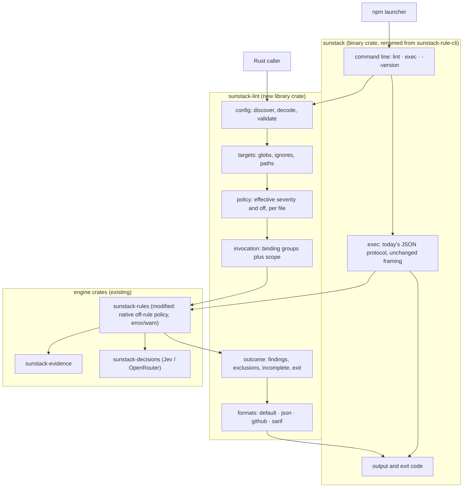
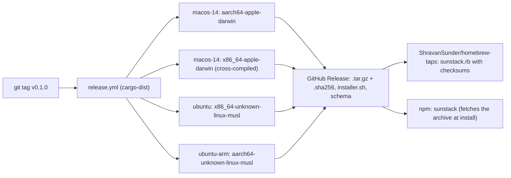

# sunstack runner: Program Design

How the internal system satisfies the [Specification](specification.md), which the [Requirements](requirements.md) authorize. The rule engine's own [Program Design](../2026-10-12-rust-rule-engine/program-design.md) stays authoritative for evidence selection, request planning and judgment; this document adds the runner and the two engine changes it needs.

## The structure in one picture



`lint` turns a config into the engine's existing invocation, passes a native off-rule policy beside it, then reads the engine's report back as lint findings with each finding's effective severity. `exec` keeps today's protocol byte for byte, apart from the severity words.

## Selected structure

| Choice | Selected | Alternatives considered | Why this one | Cost and who pays | Reopen if |
| --- | --- | --- | --- | --- | --- |
| Where lint lives | A new library crate, `sunstack-lint`, called by the binary | Lint code inside the binary crate | R7 needs Rust callers to get the same report without depending on a binary. A library also keeps the binary thin. | One more crate to version (maintainer) | Lint stays CLI-only after a year with no Rust caller |
| Turning a rule `off` | A native-only `RulePolicy` argument to the engine's evaluation entry, keyed by rule set and binding group, applied before work is registered. It is not part of the invocation's wire format. | (a) Post-filter the report; (b) write temporary filtered rule-set files; (c) one invocation per file; (d) a serialized `policy` field on each binding group | (a) pays for off rules; (b) breaks source locations and provenance; (c) loses request batching; (d) changes `exec`'s accepted input and result variants, against R6 (design review MC2). The engine refuses the same rule set twice, so per-target policy has to be native. | A second native entry point beside `evaluate_rules` | Policies need to cross the `exec` protocol |
| Overriding severity | Lint computes each finding's effective severity from the engine's result and its own policy | The engine applies severity overrides | Severity never reaches the model (U26), and the engine already reports what lint needs: a mechanical result's declared severity, and a judged result's activation. Keeping overrides in lint leaves the engine and `exec` unchanged. | Lint owns one mapping table | A later use needs overrides inside the engine |
| Change scope | The engine's existing change selection, given every configured target | Lint prefilters targets to changed files | The engine already selects unchanged targets whose rule, rule set or context changed; prefiltering would drop them. | Each run enumerates all configured targets (cheap, local) | Target enumeration becomes slow on very large repositories |
| Config error locations | `serde_json` plus `serde_path_to_error`, with duplicate keys refused, as the engine does for rule files; semantic errors locate their key in the source text | A spanned JSON parser | Same behaviour and dependencies as the engine; no new parser | Locating keys by text search is approximate when a key appears twice (refused anyway) | Configs gain comments or JSONC |
| Release | cargo-dist: one workflow builds four targets once and publishes archives, a shell installer, a Homebrew tap formula and its own npm package | Hand-written workflows; a custom npm package per platform | Least maintenance (research report); the experiment showed it generates every channel | npm installs need GitHub at install time (documented) | A repository needs offline or script-free npm installs |
| Severity words | Hard cutover: `Severity::{Error, Warn}`, `Activation::{Error, Warn, WarnAboveBand}`; `block`/`nudge` refused | Accept both words | The owner chose one vocabulary, and nothing is published | Every fixture and schema changes once | — |

## Entity binding

| E | Semantic owner | Home | Shape at boundaries | Kind | Convention |
| --- | --- | --- | --- | --- | --- |
| E1 Lint config | `sunstack-lint` config module | new: `sunstack-lint` | File: JSON per Specification C4, snake_case. In Rust: `LintConfig { schema: Option<String> /* serde rename "$schema", editor hint only, never validated against */, rule_sets: BTreeMap<EntryName, RuleSetEntry>, rules: BTreeMap<RuleSelector, SeveritySetting>, overrides: Vec<OverrideBlock>, ignore_patterns: Vec<GlobPattern>, backend: Option<BackendConfig>, limits: Option<LintLimits> }`, `#[serde(deny_unknown_fields)]`, `JsonSchema`. `LintLimits` is defined under Public shapes below. | persisted (file) | engine: serde + schemars + `deny_unknown_fields` |
| E2 Rule-set entry | `sunstack-lint` config module | new | `RuleSetEntry { path: PathBuf, files: Vec<GlobPattern> }`; `EntryName` is a validated newtype (no `/`) | persisted | engine newtype IDs |
| E3 Rule | engine (`sunstack-rules` rule identity) | existing: `RuleId` | Config selector `RuleSelector::{Exact { entry, rule: RuleId }, AllInEntry { entry }}`, written `<entry>/<rule>` or `<entry>/*`; native `RuleId` unchanged | derived | engine `RuleId` |
| E4 Severity | authored: engine (`sunstack-rules` definition contracts); effective: `sunstack-lint::policy` | modified: `Severity` | `Severity::{Error, Warn}` (serde `"error"`, `"warn"`, default `Warn`); config `SeveritySetting::{Error, Warn, Off}`; effective severity per finding from the classification table below | persisted (rule files, config) | engine closed enums |
| E5 Override | `sunstack-lint` config module | new | `OverrideBlock { files: Vec<GlobPattern>, rules: BTreeMap<RuleSelector, SeveritySetting> }` | persisted | — |
| E6 Lint run | `sunstack-lint` run module | new | In: `LintRequest { config_path: Option<PathBuf>, paths: Vec<PathBuf>, scope: ScopeChoice, max_warnings: Option<u32> }`, `ScopeChoice::{Default, All, Since { rev: String }}`. Out: `LintReport` and `LintStatus::{Clean, NothingSelected, Findings, Incomplete, Invalid, Cancelled}`, both under Public shapes | derived | closed variants |
| E7 Finding | `sunstack-lint` outcome module | new | `Finding { rule: RuleSelector, file: PathBuf, span: Option<SourceSpan>, severity: Severity, severity_origin: SettingOrigin, message: String, judgment: Option<JudgmentSummary> }` | derived | engine `SourceSpan` |
| E8 Backend selection | engine (`sunstack-decisions`) | existing: `BackendSelection` | Config `BackendConfig::{JevOpenrouter { model: ModelName, endpoint: Option<String> }}` maps to `BackendSelection::JevOpenrouter`; default endpoint `https://openrouter.ai/api/v1/systemone`; key read from `OPENROUTER_API_KEY` by the existing factory | persisted (config) | engine `BackendSelection` |
| E9 Release | release workflow | new: `dist-workspace.toml`, `.github/workflows/release.yml` | Git tag `v<semver>`; version from the workspace `Cargo.toml` | persisted (tags, release) | cargo-dist |
| E10 Platform build | release workflow | new | `sunstack-<target>.tar.gz` plus `.sha256`, targets `aarch64-apple-darwin`, `x86_64-apple-darwin`, `x86_64-unknown-linux-musl`, `aarch64-unknown-linux-musl` | persisted | cargo-dist naming |
| E11 Install channel | release workflow, tap repository, npm registry | new | Homebrew formula `sunstack.rb` in the existing `ShravanSunder/homebrew-taps`, pushed with a write deploy key; installer `sunstack-installer.sh`; npm package `sunstack` | persisted | cargo-dist generated |

## Components and interfaces

| Component | Job (one reason to change) | Consumers | Owns |
| --- | --- | --- | --- |
| `sunstack` binary | Parse the command line, dispatch, write output, map status to exit code, handle signals | people, CI, npm launcher | process boundary; exit codes (C2); `--version` |
| `exec` module (in the binary) | Today's protocol, moved without change apart from severity words | programs | protocol framing (unchanged) |
| `sunstack-lint::config` | Find, decode and validate `sunstack.lint.json`; export its JSON schema | lint run, `--check`, `--rules`, `--init` | E1, E2, E5 validity and locations |
| `sunstack-lint::targets` | Enumerate each entry's target files: config globs, minus `ignore_patterns` and Git-ignored files, limited to command-line paths | lint run | which file binds to which entry |
| `sunstack-lint::policy` | Compute each rule's effective setting per target (R10) | invocation, `--rules <file>` | effective severity and `off` |
| `sunstack-lint::invocation` | Build the engine's `RuleInvocationInput`: one `BoundRuleSet` per entry, one binding group per target with its policy, the repository binding with change scope, limits and backend | lint run | scope translation; config-changed rule; default limits |
| `sunstack-lint::outcome` | Turn the engine outcome into findings, exclusions, incomplete parts and `LintStatus` | formats, Rust callers | lint status (C2); "No checks selected" |
| `sunstack-lint::formats` | Render a `LintReport` as default, json, github or sarif | binary | output shapes (C3) |
| `sunstack-rules` (modified) | Skip `off` rules named by a native `RulePolicy` before registering work; rename severity words | lint, exec | off-rule exclusion; `Activation` words |
| release workflow | Build four targets once, attach archives and checksums, publish installer, formula and npm package | maintainers | E9–E11 |

Public library entry points of `sunstack-lint`:

```rust
pub fn discover_config(start: &Path, explicit: Option<&Path>) -> Result<ConfigLocation, LintInvalid>;
pub fn load_config(location: &ConfigLocation) -> Result<LintConfig, LintInvalid>;
pub async fn check(config: &LintConfig, cancellation: CancellationToken) -> CheckResult;
pub fn list_rules(config: &LintConfig, checked: &CheckResult, file: Option<&Path>) -> Vec<RuleListing>;
pub async fn run(request: LintRequest, cancellation: CancellationToken) -> LintReport;
pub fn render(report: &LintReport, format: OutputFormat) -> String;
pub fn config_schema() -> schemars::Schema;
```

`LintInvalid` carries `{ file: PathBuf, line: Option<u32>, column: Option<u32>, json_path: Vec<String>, code: LintInvalidCode, message: String }`; `LintInvalidCode` is a closed enum (`NoConfigFound`, `Syntax`, `UnknownField`, `DuplicateKey`, `DuplicateEntry`, `SameRuleSetTwice`, `UnknownSelector`, `BadGlob`, `MissingRuleSet`, `UnsupportedInputs`, `OldSeverityWord`, `PathNotFound`, `NoGitForDefaultScope`, `BackendMissing`, `CredentialMissing`).

The engine change is a native argument, not a wire field:

```rust
pub struct RulePolicy {
    pub off: BTreeMap<GroupKey, BTreeSet<RuleId>>, // GroupKey = rule-set path + binding-group position
}
pub async fn evaluate_rules_with_policy(
    input: RuleInvocationInput,
    policy: RulePolicy,
    context: RuleExecutionContext,
) -> PolicyEvaluation;
pub struct PolicyEvaluation {
    pub outcome: RuleInvocationOutcome,
    // the exact evidence state of each sent judgment request, kept from request materialization;
    // keyed by the same request index the report's JudgmentReference uses
    pub request_evidence: BTreeMap<usize, sunstack_decisions::SharedEvidenceState>,
}
// evaluate_rules(input, context) is evaluate_rules_with_policy(input, RulePolicy::default(), context).outcome
```

A rule that is `off` for a group is never registered there: no occurrence, no request, and no applicability gate run on its behalf, while gates that enabled peers need still run, in both the legacy and deferred expansion paths. It is left out of that group's rule-coverage count, so turning a rule off never makes coverage partial, and it does not appear in the report. Lint counts it as an exclusion from its own policy. An unknown `RuleId` in a policy makes the outcome `Invalid` with a diagnostic naming the rule-set path and group. `exec` always passes the empty policy and serializes only `outcome`, so its input, result variants and bytes are unchanged apart from the severity words. `request_evidence` exists only in Rust: the request materializer already builds each `StructuredJudgmentRequest { questions, state }`, and the policy entry keeps a copy of each sent request's `state`. It is bounded by the request byte limit that already applies.

### Finding classification

Lint turns each failed occurrence into a finding. `override` is the effective setting from `sunstack-lint::policy` (R10) for that rule and file, or none.

| Engine result | Effective severity |
| --- | --- |
| mechanical `Checked { declared_severity, outcome: fail }` | the override when present, otherwise `declared_severity` |
| judged, `Activation::Error` (a failed verdict at or below the band, or with no band) | `warn` if overridden to `warn`, otherwise `error` |
| judged, `Activation::WarnAboveBand` (authored `error`, above the band, below the threshold) | `warn`, even when overridden to `error`: the authored band keeps its meaning |
| judged, `Activation::Warn` (authored `warn`, no band) | `error` if overridden to `error`, otherwise `warn` |
| any passed result | no finding |

Unresolved, cancelled and failed local or judged outcomes are never findings. They are incomplete parts, as in Run outcome.

### Repository binding

Lint builds one `RepositoryBinding`:

- `root` is the Git work-tree root that contains the config. Under `--all` outside Git, it is the config's directory.
- Every target path the report prints, in a finding's or an incomplete part's `file` and in every format, is relative to `root`, with `/` separators. A nested config therefore reports `docs/one.md`, not `../docs/one.md`. That is the form GitHub annotations and SARIF need to attach to repository files. Diagnostics keep the path of the file they refer to, which may lie outside `root`, such as a `--config` file.
- `input_paths` is `[Glob { pattern: "**" }]`. That way the targets, every rule-set file, its rule files and Markdown sources, and any context a rule declares are admitted and change-tracked. The engine's dependency selection then finds unchanged targets whose definition or context changed, and unrelated edits select nothing (design review MC5).
- Targets never include Git-ignored files: lint's own target selection drops them, together with `ignore_patterns`. A document rule set's evidence declarations can only select inside the bound document (the engine's input-kind check in `definition_admission.rs`), so a lint rule has no context outside its target, and the exclusions need no exception for context (R12). `include_ignored: false` only affects the engine's catalogue walk.
- `change_scope` comes from `ScopeChoice` and the command-line paths:
  - no paths and no scope flag: `uncommitted`, with the staged, unstaged and untracked layers;
  - named paths and no scope flag: `full`, so a clean, tracked named file is checked (R4);
  - `--all`: `full`;
  - `--since <rev>`: a revision diff from `rev` to the working tree, whether or not paths are named.

  When the config file itself is in the changed set, lint uses `full` and records why. Change capture needs `EvidenceDiscovery::Bounded`, so lint supplies the engine's existing bounded discovery settings.

Lint's own target selection (entry globs, minus `ignore_patterns` and Git-ignored files, limited to command-line paths) decides the binding groups. When it produces no binding group at all, lint returns `NothingSelected` without calling the engine, which refuses an empty binding list. Reopen this binding if cataloguing `**` is slow on large repositories.

### Public shapes

```rust
pub struct LintLimits {                       // config `limits`; every field optional
    pub max_files: Option<NonZeroU32>,        // → InvocationLimits.max_files
    pub max_file_bytes: Option<NonZeroU64>,   // → InvocationLimits.max_file_bytes
    pub max_total_bytes: Option<NonZeroU64>,  // → InvocationLimits.max_total_bytes
    pub max_matches: Option<NonZeroU32>,      // → InvocationLimits.max_matches
    pub max_model_requests: Option<NonZeroU32>,      // → RequestBudgetSettings.max_requests
    pub max_input_tokens_per_request: Option<NonZeroU32>, // → RequestBudgetSettings.max_input_tokens
    pub attempt_timeout_seconds: Option<NonZeroU32>, // → AttemptSettings.attempt_timeout_ms
    pub max_concurrent_requests: Option<NonZeroU32>, // → ExecutionSettings.max_concurrent_requests
}
pub struct LintReport {
    pub version: String,
    pub config: PathBuf,
    pub scope: ScopeReport,                   // { kind: Default | All | Since { rev }, widened: Option<WidenedReason::ConfigChanged> }
    pub status: LintStatus,
    pub findings: Vec<Finding>,
    pub counts: SeverityCounts,               // { error: u32, warn: u32 }
    pub exclusions: ExclusionCounts,          // { off, ignored, not_applicable, outside_change_scope, zero_matches }: u32
    pub incomplete: Vec<IncompletePart>,      // { rule: Option<RuleSelector>, file: Option<PathBuf>, reason: IncompleteReason }
    pub usage: UsageSummary,                  // see below; zero requests when no model work ran
    pub evidence_seen: BTreeMap<usize, SharedEvidenceState>, // per sent request, from PolicyEvaluation.request_evidence; findings refer to it by request index
    pub limits: EffectiveLimits,              // every LintLimits field, resolved to its applied value
    pub diagnostics: Vec<LintDiagnostic>,     // { file: Option<PathBuf>, line, column: Option<u32>, code, message }
}
pub enum IncompleteReason {
    SelectionFailed, EvaluationFailed, NotStarted, PreparationFailed,
    CoveragePartial, CoverageNone, ProviderFailure, RequestLimitReached,
}
pub struct UsageSummary {
    pub model_requests: u32,                  // InvocationMeasurements request count
    pub input_tokens: Option<u64>,            // sum over completed requests' ExecutionUsage; None when no receipt reported tokens
    pub output_tokens: Option<u64>,
    pub cost_usd: Option<f64>,                // sum of ExecutionUsage.cost_usd that were reported; None when none was
    pub cost_reported_requests: u32,          // completed requests whose receipt carried a cost
    pub cost_missing_requests: u32,           // completed requests whose receipt did not; absence is never counted as zero
}
pub struct JudgmentSummary {
    pub request_index: usize,                 // key into LintReport.evidence_seen
    pub basis: VerdictBasis,                  // native: noul | composite
    pub result: VerdictResult,                // native: pass | fail
    pub value: f64,
    pub threshold: f64,
    pub answers: Vec<ResolvedAnswer>,         // every question of this rule in that request, resolved below
}
pub struct ResolvedAnswer {
    pub question: QuestionName,
    pub answer: sunstack_decisions::JudgmentAnswer, // the typed value (noul, choice, score, informational) from RuleInvocationReport::answer(reference)
}
pub enum SettingOrigin { Authored, EntryWildcard, ExactRule, Override { index: u32 } }
pub enum CheckResult { Valid { rules: Vec<RuleListing> }, Invalid { diagnostics: Vec<LintDiagnostic> } }
pub struct RuleListing {
    pub rule: RuleSelector, pub source: SourceLocation /* file, line */, pub kind: RuleKind /* Mechanical | Judged */,
    pub authored: Severity, pub configured: SeveritySetting,
    pub for_file: Option<EffectiveSetting>,   // with --rules <file>: { setting: SeveritySetting, decided_by: SettingOrigin }
}
```

The `json` format serializes `LintReport` with snake_case field names and `kind`-tagged enums, as the engine does. The one exception is `RuleSelector` (E3), which always serializes as its written string, `<entry>/<rule>` or `<entry>/*`: as a key in the config's `rules` and `overrides` maps, and as `rule` in findings, listings and incomplete parts. The config and the report therefore share one selector form, and a tagged object, which can't be a JSON key, never appears. Its field names are stable within a major version, and fields may be added.

## The lint call path

There is no current predecessor for `lint`. The proposed path:

```mermaid
sequenceDiagram
  participant U as caller
  participant B as sunstack binary
  participant C as lint config
  participant T as targets and policy
  participant I as invocation
  participant R as sunstack-rules
  participant D as sunstack-decisions
  participant O as outcome and formats
  U->>B: sunstack lint [paths] [scope flags]
  B->>C: discover_config, load_config
  C-->>B: LintConfig or LintInvalid (exit 2)
  B->>R: check_rules on every entry (no targets, no key)
  R-->>B: assembled rules or refusal (exit 2)
  B->>T: enumerate targets; effective policy per target
  T-->>I: entries x targets, off rules per group (targets with every rule off are dropped)
  I->>I: scope: Default (uncommitted) / All / Since(rev); config changed → All, recorded
  I->>R: evaluate_rules_with_policy(input, RulePolicy)
  R->>D: only reachable judged rules and model gates (key read lazily)
  D-->>R: answers or provider failure
  R-->>O: RuleInvocationOutcome
  O-->>B: LintReport and LintStatus
  B-->>U: rendered report, exit code
```

`exec` keeps its current path: `main` → `protocol_boundary::read_frame` → `decode_request` → `operation_execution::execute_operation` → library → response, with the empty `RulePolicy`. The only edge that changes is that `main` now dispatches on the command line first.

## Run outcome

| Engine outcome or fact | Lint result | Exit |
| --- | --- | --- |
| `LintInvalid` before the engine runs; engine `Invalid` | `Invalid` with located diagnostics | 2 |
| `Cancelled` | `Cancelled`, keeping completed findings | 4 |
| `PreparationFailed`; `IncompleteReport`; `rule_coverage` not `full`; any occurrence `selection_failed`, `evaluation_failed` or `not_started`; a request-limit or provider failure | `Incomplete`, keeping completed findings | 3 |
| Any finding classified `error`, or `warn` findings above `--max-warnings` | `Findings` | 1 |
| No binding group produced (the engine is not called) | `NothingSelected`, printed as "No checks selected" | 0 |
| Engine report with no selected work: every occurrence is `outside_change_scope`, `not_applicable` or `zero_matches`, none is checked or judged, and nothing is incomplete | `NothingSelected`, with the exclusion counts | 0 |
| Otherwise | `Clean` | 0 |

Rules turned `off` (counted by lint), `not_applicable`, `outside_change_scope` and `zero_matches` are exclusions, never incomplete.

Default limits when `limits` is omitted (tunable with evidence; listed in the README and recorded in every `json` report): files 2000; bytes per file 1 MiB; total bytes 64 MiB; matches 10,000; transcript bytes 8 MiB; Git-ignored files excluded; model requests per run 200; input tokens per request 32,000; request bytes 256 KiB; questions per request 32; attempt timeout 60 s; 2 retries with 0.5–8 s backoff; response bytes 1 MiB; 4 concurrent requests; speculation off.

## Failure, cancellation and concurrency

- Ctrl-C and SIGTERM reach the existing `ProcessSignals`, which cancels the shared `CancellationToken`; the engine settles owned work and lint reports `Cancelled` (exit 4). Through npm, the cargo-dist launcher forwards signals to the child.
- A model or network failure is the engine's provider failure; the engine's retry settings apply once; lint never retries a run.
- Lint runs one invocation per command, so there is no concurrency beyond the engine's own request scheduler (bounded by `max_concurrent_requests`).
- Lint reads the repository and writes only to standard output and standard error. `--init` is the only command that writes a file, and it refuses to overwrite.

## Trust boundary

| Asset | Entry | Policy owner | Enforcement |
| --- | --- | --- | --- |
| OpenRouter key | environment variable | `sunstack-decisions` factory | read lazily, only when model work is reachable; never in config, report, diagnostics or logs (existing engine rule U2) |
| Repository text | files under the repository root | `sunstack-evidence` | paths outside the root are refused (existing); text leaves the machine only inside a judged request to the configured endpoint |
| Config and rule files | repository | `sunstack-lint::config`, `sunstack-rules` admission | strict decoding; unknown fields refused |

## portable-builds and install



The three crates that use `git2` turn on `vendored-libgit2` and keep default features off. cargo-dist is configured with `unix-archive = ".tar.gz"` so minimal systems need no `xz`. A release check in the workflow inspects each binary's dynamic dependencies (`otool -L`, ELF headers) and fails on anything but operating-system libraries. The config schema is generated from `LintConfig` by `config_schema()` and attached to the release.

## Proof seams

| Seam | Real | Stand-in | Observes |
| --- | --- | --- | --- |
| Process tests of `sunstack` with fixture repositories | binary, engine, files, Git | an unreachable backend endpoint for runs that must not call a model | exit codes, all four formats, scope selection, severity policy, cancellation |
| Engine tests of `RulePolicy` | `sunstack-rules` | a recording backend (existing test pattern) | an `off` rule makes no request, including an off-only model gate, while gates enabled peers need still run; coverage stays full |
| Lint classification tests | `sunstack-lint::outcome` | engine results built in the test | the classification table: mechanical and judged, each severity override, the band |
| Hosted run | Jev on OpenRouter with the owner's key | none | one real judged rule from the static Linux build with no CA bundle |
| Container matrix | release builds in clean Alpine and Debian (x64, arm64) | none | no shared libraries; `--version`, `lint --check`, a lint run |
| Release rehearsal | a private test repository running the generated workflow | a local mirror serving those exact release bytes to the installers | archives, checksums, formula, npm package; installs and exits through each channel |

## Trace

### runner

| U | R | E | Owner | Interface | Shape and home | State | Failure | Proof |
| --- | --- | --- | --- | --- | --- | --- | --- | --- |
| U1 | R1 lint a repository from its config | E1, E2, E6, E7 | `sunstack-lint::run` | `run(LintRequest)` | `LintReport` in `sunstack-lint` | none persisted | `LintInvalid` → exit 2 | process tests (V1) |
| U1 | R2 exit codes (C2) | E6 | binary + `sunstack-lint::outcome` | `LintStatus` → `ExitCode` | closed `LintStatus` | none | each row of Run outcome | process tests (V2) |
| U1, U2 | R3 formats | E7 | `sunstack-lint::formats` | `render(report, format)` | default text, json (`LintReport`), GitHub annotations, SARIF 2.1.0 | none | — | format comparison (V1) |
| U1, U7 | R4 change scope | E6 | `sunstack-lint::invocation` | `ScopeChoice` → engine `ChangeScope`; repository binding with `**` | `RepositoryBinding` | none | outside Git with default scope → `NoGitForDefaultScope` | scripted Git history with docs-only targets and rules elsewhere (V3) |
| U1, U5 | R5 `--check`, `--rules`, `--init` | E1, E3 | `sunstack-lint::config`, `::policy` | `check`, `list_rules`, init writer | `CheckResult`, `RuleListing` | `--init` writes one file | overwrite refused | process tests (V4) |
| U3 | R6 `exec` unchanged | — none: protocol | binary `exec` module | stdin/stdout JSON | engine wire contracts | none | existing protocol errors | existing protocol tests (V5) |
| U2 | R7 Node and Rust | E6 | npm launcher; `sunstack-lint` library | `npx sunstack`; `run()` | same `LintReport` | none | — | npm and library comparison (V6) |

### config

| U | R | E | Owner | Interface | Shape and home | State | Failure | Proof |
| --- | --- | --- | --- | --- | --- | --- | --- | --- |
| U6 | R8 discovery | E1 | `sunstack-lint::config` | `discover_config` | `ConfigLocation` | none | `NoConfigFound` | process tests (V7) |
| U5, U6 | R9 validation | E1, E2, E5 | `sunstack-lint::config` | `load_config` | `LintConfig` (with `$schema` admitted), `LintInvalid` | none | each `LintInvalidCode` | config cases (V7) |
| U4, U5 | R10 effective severity | E3, E4, E5 | `sunstack-lint::policy` and `::outcome`; `sunstack-rules` for `off` | `RulePolicy`; finding classification | `RulePolicy` in `sunstack-rules`; classification in `sunstack-lint::outcome` | none | unknown rule → `Invalid` | severity table, classification and engine policy tests (V8) |
| U5 | R11 document-input rule sets only | E2 | `sunstack-lint::config` (after `check_rules`) | `check` | `UnsupportedInputs` | none | refused at check | process test (V9) |
| U1 | R12 targets and paths | E2, E6 | `sunstack-lint::targets` | target enumeration | `Vec<PathBuf>` per entry | none | `PathNotFound` | ignore cases (V9) |
| U7 | R13 backend only when reached | E8 | `sunstack-decisions` factory (lazy) with lint's pre-check | `BackendConfig` → `BackendSelection` | engine `BackendSelection` | none | `BackendMissing`, `CredentialMissing` → exit 2 | key and no-key runs (V10) |
| U4 | R14 one vocabulary | E4 | `sunstack-rules` | serde of `Severity`, `Activation` | `"error"`, `"warn"`, `"warn_above_band"` | rule files | `OldSeverityWord` | fixture sweep (V11) |
| U5 | R15 published schema | E1 | `sunstack-lint::config` + release workflow | `config_schema()` | `sunstack.lint.schema.json` release asset | release asset | — | schema vs binary cases (V12) |

### portable-builds

| U | R | E | Owner | Interface | Shape and home | State | Failure | Proof |
| --- | --- | --- | --- | --- | --- | --- | --- | --- |
| U8 | R16 four standalone builds | E10 | release workflow | cargo-dist targets | `sunstack-<target>.tar.gz` | release assets | dependency check fails the release | container matrix and linkage check (V13) |
| U8 | R17 HTTPS without a CA bundle | E8 | `sunstack-decisions` (rustls with bundled roots) | `reqwest` client | existing | none | private-CA limit documented | hosted run from static build (V10) |
| U9 | R18 git2 with libgit2 compiled in | — none: build | Cargo features | `vendored-libgit2` | three `Cargo.toml` files | none | — | linkage check (V13) |

### install

| U | R | E | Owner | Interface | Shape and home | State | Failure | Proof |
| --- | --- | --- | --- | --- | --- | --- | --- | --- |
| U10, U11 | R19 archives and checksums | E9, E10 | release workflow | GitHub Release | `.tar.gz`, `.sha256` | release | partial publish is resumed, never rewritten | release rehearsal (V14) |
| U10 | R20 Homebrew | E11 | release workflow + tap repository | `brew install shravansunder/taps/sunstack` | `sunstack.rb` | tap commit | — | release rehearsal (V14) |
| U10, U11 | R21 shell installer | E11 | release workflow | `sunstack-installer.sh` | release asset | — | — | release rehearsal (V14) |
| U2, U10 | R22 npm | E11 | cargo-dist npm package | `npx sunstack` | npm `sunstack` | installed package | install needs GitHub | release rehearsal (V14) |
| U10, U11 | R23 one version | E9 | workspace version | `--version` | `Cargo.toml` `[workspace.package] version` | tag | mismatch fails the release | release rehearsal (V14) |
