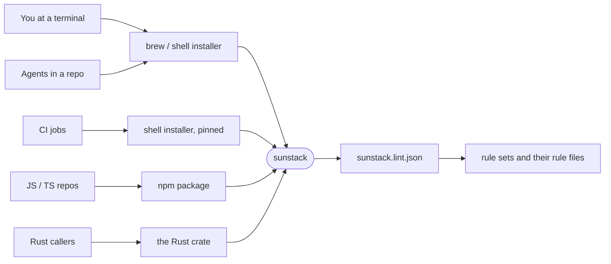

# sunstack runner: Requirements

The owner wants one tool, `sunstack`, that people install the way they install other developer tools and that runs anywhere. Its first command, `sunstack lint`, checks a repository against rule sets named in a config file. The rule engine underneath already exists. Its Requirements are in [2026-10-12-rust-rule-engine/requirements.md](../2026-10-12-rust-rule-engine/requirements.md) and remain the authority for what rules mean and how they are judged. This document covers the runner around it: the command people type, the config it reads, the builds that run on any machine, and the channels that install them.

Source: the owner's messages to the 🦁 Lead on 2026-10-18, quoted below. The owner confirmed the goal boundary and the capability list with "yes" (twice: after the boundary and after the rename to `sunstack lint`), and again with "yes to what you said" after the config shape. Every row below is `authorized` by the owner. The owner set the priority for all of it: "for now fockus is our runner how it looks liek and good config how it runs anywhere what way to bundle so we just use it form brew or wahtver propel use to isntall it".

## Capabilities

| Key | Capability | Purpose | Home rows | Also serves |
| --- | --- | --- | --- | --- |
| `runner` | The runner | One `sunstack` command that runs lint, and later other uses, from a terminal, from Node and from Rust | [U1](#runner), [U2](#runner), [U3](#runner) | — |
| `config` | The config | One file per use that says what to run, at what severity, on which files, with which model backend | [U4](#config), [U5](#config), [U6](#config), [U7](#config) | U4 also serves `runner` |
| `portable-builds` | Runs anywhere | Binaries that run on Linux and macOS without anything else installed | [U8](#portable-builds), [U9](#portable-builds) | — |
| `install` | Install it the usual way | Install from Homebrew or whatever people normally use | [U10](#install), [U11](#install) | — |

## Who this is for

- **The owner at a terminal**, linting repos and skills locally.
- **Agents** (Claude Code and Codex sessions) that run lint inside a repository as part of their work.
- **CI jobs**, which start from a clean machine on every run.
- **Rule authors and adopting repositories**, starting with ai-tools' skill rules, which write rule sets and point a config at them.

## Rows

### runner

| ID | Capability | Need or outcome, and why it matters | Evidence | Authority |
| --- | --- | --- | --- | --- |
| U1 | `runner` | Run lint on a repository from a terminal and know from the exit code whether it passed, the way oxlint works. | "make a rust crate with pattern stlone wform oxlint where we have a config thaqt useses the rulessets and rules"; "we create a runer that runs from easily" | authorized |
| U2 | `runner` | Run the same lint from Node (an npm package) and from Rust, with the same config and the same results. | "then we create a runer that runs from easily -> native/rust/ts for now"; "why not make a create as a linter taht we can run from cli/node/" | authorized |
| U3 | `runner` | One binary for the whole system. Lint is its first command; session decisions, skill tests and other uses come later as commands of the same binary. | "litn is a use case of susntack-evidence? ssytem we gnna use it for otehr htigns?"; "we use it for skill tests, i think we would use it for session deicions and many othe rusecasess  soon"; name: "sunstack lint" | authorized |

### config

| ID | Capability | Need or outcome, and why it matters | Evidence | Authority |
| --- | --- | --- | --- | --- |
| U4 | `config`; also serves `runner` | One severity vocabulary everywhere: `error` stops (what the engine called block) and `warn` advises (what it called nudge). | "maybe shoudl we use the same terminoligy for both?  that error is block, warn is nudge?"; "for rule lints tho, its error, warning, or off no?" | authorized |
| U5 | `config` | A checked-in config that says which rule sets run, with rules some built in and the rest defined by the repo. Built-in rule sets come later; the config must leave room for them. | "a config thaqt useses the rulessets and rules some that are builnt in som rest deifne.l"; built-in rule sets confirmed as not now | authorized |
| U6 | `config` | Each use has its own config file. Lint reads `sunstack.lint.json`, which points at rule-set files and holds no rules itself. | "no do sunstack.lint.json"; "does ussntack.lint.json contain eieryting or we have json and jsonl files?" | authorized |
| U7 | `config` | Model-judged rules use Jev now. A local decision model is a later option, chosen in the same config without changing the rules. | "it will always need jev for now, later optional native deicional model local.  does tha tmaek sense same config." | authorized |

### portable-builds

| ID | Capability | Need or outcome, and why it matters | Evidence | Authority |
| --- | --- | --- | --- | --- |
| U8 | `portable-builds` | It runs on Linux and macOS without anything else installed. | "what simprotant rathe rthan ts is how it can easily be diestrubted an drun everywehre (linux, macos)" | authorized |
| U9 | `portable-builds` | Git access stays on git2-rs (libgit2). | "oh we hsoud be usign libgit2"; "https://github.com/rust-lang/git2-rs we shoudl be usign this" | authorized |

### install

| ID | Capability | Need or outcome, and why it matters | Evidence | Authority |
| --- | --- | --- | --- | --- |
| U10 | `install` | Install it from Homebrew, or whatever people normally use. | "what way to bundle so we just use it form brew or wahtver propel use to isntall it" | authorized |
| U11 | `install` | Distribution matters more than the TypeScript side: easy to ship, easy to run everywhere. | "what simprotant rathe rthan ts is how it can easily be diestrubted an drun everywehre" | authorized |

## Goal boundary (confirmed by the owner, 2026-10-18)

- **Capabilities:** runner, config, portable-builds and install, as listed above.
- **Existing foundation, reused as it is:** the engine crates (`sunstack-evidence`, `sunstack-rules`, `sunstack-decisions`), the rule-set and rule-file formats, the Jev/OpenRouter backend, change scopes, and today's JSON request protocol.
- **Missing:** lint commands, the `sunstack.lint.json` config, exit codes from severity, output formats, standalone builds for Linux and macOS, the `sunstack` name, and the release channels.
- **May change:** `sunstack-tools` (the CLI crate, its name and commands, the git2 build feature, the severity words, the release workflow); the formula in the existing Homebrew tap `ShravanSunder/homebrew-taps`; the `@sunstack/cli` npm package, and the plain npm name `sunstack` as a deprecated placeholder pointing to it.
- **Must not change:** what rules mean and how they are judged, and Demistify's release.
- **Not now:** oxlint or SwiftLint integration; a Node addon or Swift SDK; built-in rule sets; a local decision model; Windows; homebrew-core; crates.io; macOS notarization; a custom npm package per platform; pipelines in which one decision feeds another.
- **Done means:** on clean macOS and Linux, `brew install` and the shell installer give a working `sunstack` that lints a repository from its config with the right exit codes. The npm package works after a release from a private test repository. The owner: "you should  impelment and get it fuly tested adn verified".

## Open

None blocks the Specification. Severity defaults, exit codes and change-scope defaults are Specification decisions, recorded there.
