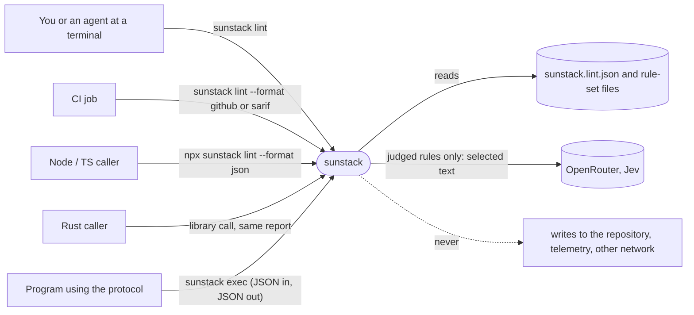

# sunstack runner: Specification

What must be observably true of the `sunstack` binary, its `sunstack lint` command, the `sunstack.lint.json` config, its builds, and its install channels. [Requirements](requirements.md) authorize every obligation here. The rule engine's own [Specification](../2026-10-12-rust-rule-engine/specification.md) still governs what a rule means, how evidence is selected, and how judgments are made; this document only adds the runner around it.

## Capability map

Which obligations belong to each confirmed capability? Names and purposes re-render the [confirmed list](requirements.md#capabilities).

| Key | Capability | Purpose | Home obligations | Also serves |
| --- | --- | --- | --- | --- |
| `runner` | The runner | One `sunstack` command for lint now and other uses later, from a terminal, Node and Rust | [R1–R7](#runner) | R4 and R5 also serve `config` |
| `config` | The config | One file per use: what to run, at what severity, on which files, with which backend | [R8–R15](#config) | R12 and R14 also serve `runner` |
| `portable-builds` | Runs anywhere | Binaries that run on Linux and macOS with nothing else installed | [R16–R18](#portable-builds) | — |
| `install` | Install it the usual way | Homebrew or whatever people normally use | [R19–R23](#install) | R22 also serves `runner` |

The path from need to proof is [Requirements](requirements.md) → this Specification → [Program Design](program-design.md) → [Verification Design](verification-design.md).

## Who uses which surface



## Problem

Today the engine runs only from a hand-written JSON request on standard input (`crates/sunstack-rule-cli/README.md`). There is no config file, no command that lints a repository, and no exit code tied to severity: a failed rule still exits 0. The macOS build links Homebrew's libgit2, so it fails on a Mac without it, and there is no release channel, so using the engine means building from source (`/private/tmp/2026-10-runner-distribution/experiment/report.md`, H1). Rule files say `block` and `nudge`, while lint users expect `error` and `warn`.

| ID | Problem | Outcome |
| --- | --- | --- |
| P1 | A repository cannot check itself with one command; every run needs a hand-built request, and the exit code ignores failures | O1: one command and one checked-in config lint a repository and return an exit code that reflects what failed |
| P2 | There is no installable build, and the existing build is tied to the machine that built it | O2: anyone on Linux or macOS installs a working binary through the usual channels |
| P3 | Severity words differ between rule files and lint convention | O3: one vocabulary, `error` and `warn`, everywhere |

## Entities

| ID | Term | Identity rule | Relationships | Invariants | Observable states | Basis |
| --- | --- | --- | --- | --- | --- | --- |
| E1 | Lint config | The file named by `--config`; otherwise the nearest file named `sunstack.lint.json` found by walking up from the current directory. Two runs share a config when they resolve the same file path. | Has 1..n rule-set entries (E2), 0..n overrides (E5), 0..1 backend selection (E8) | Holds no rule definitions. Relative paths in it resolve from its own directory. Unknown fields are refused. | `valid`, `invalid` | U5, U6 |
| E2 | Rule-set entry | Its name, unique within one config | Belongs to one E1; references one rule-set file; has 1..n file globs for that rule set's input | The referenced rule set declares exactly one input, of kind `document`. The entry name prefixes the IDs of its rules. | `valid`, `invalid` | U5, U6 |
| E3 | Rule | The rule-set entry name plus the rule's own ID, written `<entry>/<rule id>`, such as `skills/skill.description`. The same rule in two configs is the same rule only when both point at the same rule-set file. | Belongs to one rule set; has one default severity; has one effective severity per file | Its definition lives only in a rule file. | `enabled`, `off` for a given file | U5, U6 |
| E4 | Severity | One of `error` or `warn` in rule files; config adds `off` | Each rule has one default; each finding has one effective severity | Never sent to the model. A rule with no severity is `warn`. | — | U4; engine U26 |
| E5 | Override | Its position in the config's `overrides` list | Belongs to one E1; has 1..n file globs and 1..n rule settings | Applied in list order; a later match wins | — | U5 |
| E6 | Lint run | One invocation of `sunstack lint`: one config, one set of target files, one change scope | Uses one E1; produces 0..n findings (E7) and one report | Reads the repository; never writes to it | `clean`, `findings`, `invalid`, `incomplete`, `cancelled` | U1 |
| E7 | Finding | One rule (E3) failing at one location in one file | Belongs to one E6; has one effective severity | A rule turned `off` for a file produces no finding there | `error`, `warn` | U1, U4 |
| E8 | Backend selection | Its kind plus model and endpoint | Belongs to 0..1 E1 | Holds no credential; the key comes only from the process environment | — | U7 |
| E9 | Release | Its version number | Has four platform builds (E10); is published to every install channel (E11) | Every channel serves the same bytes for a target | `draft`, `published` | U10, U11 |
| E10 | Platform build | Release version plus target: macOS arm64, macOS x64, Linux x64, Linux arm64 | Belongs to one E9 | Runs with only the operating system's own libraries | — | U8, U9 |
| E11 | Install channel | One of: Homebrew tap, shell installer, GitHub Release archive, npm package | Serves every E9 | Installs the matching E10 unchanged | — | U10 |

## runner

| ID | Requirement | From |
| --- | --- | --- |
| R1 | `sunstack lint [paths…]` loads the governing config (E1), runs every enabled rule over the files its rule-set entries select, limited to `paths` when given, and reports findings (E7) with rule, file, location, severity and message. | U1 |
| R2 | The exit code of a lint run reflects its outcome, as set out in [C2](#c2-exit-codes). | U1 |
| R3 | `--format` selects `default` (for people), `json` (stable, for agents and Node), `github` (workflow annotations) or `sarif` (SARIF 2.1.0, for code review). Every format carries the same findings. | U1, U2 |
| R4 | With no paths and no scope flag, lint covers uncommitted work (staged, unstaged and untracked) and says so in its output. `--all` covers every configured target. `--since <rev>` covers changes between `<rev>` and the working tree. Named paths are linted fully unless a scope flag is also given. A target whose rule, rule set or context changed is linted even if the target itself did not change; when `sunstack.lint.json` itself changed, every configured target is linted and the report says why. Outside a Git repository, the default scope exits 2 and suggests `--all`; `--all` works without Git. | U1, U7 |
| R5 | `sunstack lint --check` validates the config and every rule set it names without reading targets, needing a key or making a model request. `--rules` lists each rule with its entry, source location, kind (mechanical or judged), authored severity and configured severity; `--rules <file>` shows the effective severity for that file and which setting decided it. `--init` writes a skeleton `sunstack.lint.json` with no rules, and refuses to overwrite an existing file. | U1, U5 |
| R6 | `sunstack exec` keeps today's JSON protocol: one request on standard input, one response on standard output, exit codes 0, 2, 3 and 4 with today's meanings. Only the severity words change (R14). | U3 |
| R7 | The same lint is callable from Node through the npm package (`npx sunstack lint --format json`) and from Rust as a library call that returns the same report as `--format json`. The npm package installs and launches the command; it offers no TypeScript API. | U2 |

### C1. Commands

```text
sunstack lint [paths…] [--config <file>] [--all | --since <rev>]
              [--format default|json|github|sarif] [--max-warnings <n>]
sunstack lint --check  [--config <file>]
sunstack lint --rules [file] [--config <file>]
sunstack lint --init
sunstack exec
sunstack --version | --help
```

`sunstack` with no command prints help and exits 2. Later uses add sibling commands; `lint`'s flags never change meaning when they do.

### C2. Exit codes

| Code | Meaning | Precedence |
| --- | --- | --- |
| 2 | Invalid input: bad flags, no config found, invalid config or rule set, an unknown rule or entry name, a named path that does not exist, a judged rule enabled with no usable backend or key, or the default scope outside Git | highest |
| 4 | Cancelled by the caller (Ctrl-C or SIGTERM) | |
| 3 | Incomplete: some enabled rule could not be evaluated on a selected target (selection failed, evaluation failed, not started, a backend or request-limit failure), or rule coverage was not full | |
| 1 | At least one `error` finding, or more `warn` findings than `--max-warnings` | |
| 0 | Clean: everything selected was evaluated and nothing exceeded the limits | lowest |

An incomplete run exits 3 even when it also has `error` findings; the report lists both, so a run that skipped work never reads as "only lint findings". A rule turned `off`, an ignored target, a not-applicable rule, a target outside the change scope and a rule that matched nothing are intentional or valid outcomes, counted in the report, and are not incomplete. When nothing was selected, the run exits 0 and says "No checks selected", never "Passed".

### C3. Report

The `json` report contains: the config path; the version; each finding (rule, file, line and column span, effective severity, message, and for judged rules the model's answer and the evidence it saw); the incomplete parts with their reasons; counts by severity; and, when judged rules ran, model requests made, tokens and cost as the engine reports them. Field names are fixed within a major version; new fields may be added.

## config

| ID | Requirement | From |
| --- | --- | --- |
| R8 | Without `--config`, lint uses the nearest `sunstack.lint.json` walking up from the current directory. If none is found, it exits 2 and names the file it looked for. | U6 |
| R9 | The config follows [C4](#c4-sunstacklintjson). An unknown field, a missing rule-set file, a duplicate entry name, two entries naming the same rule-set file, an unknown rule ID in `rules` or `overrides`, or a bad glob exits 2 with the file, line and column. | U5, U6 |
| R10 | A rule's effective severity for a file is decided in this order, later steps winning: its authored default from the rule file, `<entry>/*` in `rules`, the exact rule ID in `rules`, then each matching override block in list order, where an exact rule ID wins over `<entry>/*` within the block. The effective policy is fixed per rule set and file before any model request, so a rule that is `off` for a file costs nothing there. A rule's authored confidence band still applies to a judged verdict with value `v`, threshold `t` and band `b`: `v ≥ t` passes; for an effective `error`, `v ≤ b` is an `error` finding and `b < v < t` is a `warn` finding; for an effective `warn`, any `v < t` is a `warn` finding. An effective `warn` never makes the run exit 1 on its own. | U4, U5 |
| R11 | A rule-set entry may only name a rule set with exactly one `document` input. `--check` refuses any other rule set and names its input kinds. | U5 |
| R12 | Lint never targets files that match `ignore_patterns` or that Git ignores. A lint rule's evidence comes only from its target document (R11), so these exclusions decide which files are linted and nothing else. Paths given on the command line resolve from the current directory; paths in the config resolve from the config's directory. | U1 |
| R13 | Lint needs `backend` in the config and `OPENROUTER_API_KEY` in the environment only when the run reaches model work: a judged rule, or a model-based applicability decision, for a selected target. When model work is reachable and either is missing, lint exits 2 before any model request. Runs that reach no model work, including `--check`, `--rules` and a run with nothing selected, need neither. The key is never written to output. | U7 |
| R14 | Rule files use `error` or `warn` for severity, and a rule without one is `warn`. `block` and `nudge` are refused with a message naming the replacement. Reports, schemas, `exec` responses and documentation use the same words, including the outcome for a failed verdict above the confidence band. | U4 |
| R15 | Each release publishes the JSON schema of `sunstack.lint.json` at a versioned URL. The schema and the binary agree on the config's structure: field names, types, required fields and allowed values. Checks that need the filesystem or the loaded rules (a missing rule-set file, two entries naming the same file, an unknown rule ID), and glob syntax, which JSON Schema can't express exactly, belong to the binary alone and are not in the schema. Numeric limits carry their full range, minimum and maximum, in the schema. | U5 |

### C4. sunstack.lint.json

```json
{
  "$schema": "https://github.com/ShravanSunder/sunstack-tools/releases/download/v0.1.0/sunstack.lint.schema.json",
  "rule_sets": {
    "skills": { "path": "rules/skill-standards.ruleset.json", "files": ["plugins/**/SKILL.md"] }
  },
  "rules": {
    "skills/*": "error",
    "skills/skill.load-result": "warn"
  },
  "overrides": [
    { "files": ["plugins/**/retired-skills/**"], "rules": { "skills/*": "off" } }
  ],
  "ignore_patterns": ["tmp/**"],
  "backend": { "kind": "jev_openrouter", "model": "jev-latest" }
}
```

Field names are snake_case, as in rule-set and rule files.

| Field | Required | Meaning |
| --- | --- | --- |
| `$schema` | no | Schema URL for editor completion; not used for validation |
| `rule_sets` | yes | Entry name → rule-set file path and the globs whose files bind to its one document input |
| `rules` | no | `<entry>/<rule id>` or `<entry>/*` → `error`, `warn` or `off` |
| `overrides` | no | Ordered list of file globs plus a `rules` map, applied to matching files |
| `ignore_patterns` | no | Globs lint never targets |
| `backend` | when a judged rule is enabled | `kind` (`jev_openrouter` now), `model`, optional `endpoint`; later kinds, such as a local model, are added beside it without changing rule files |
| `limits` | no | Caps on files read, bytes, matches and model requests per run. When omitted, lint uses its own documented defaults, which the README lists and the `json` report records. A run that reaches a cap is incomplete. |

A rule turned `off` everywhere is not run at all and costs no model request. A rule turned `off` for some files produces no finding on them.

## portable-builds

| ID | Requirement | From |
| --- | --- | --- |
| R16 | Each release has builds for macOS arm64, macOS x64, Linux x64 and Linux arm64. Linux builds load no shared library at all; macOS builds load only libraries the operating system ships. Each runs `--version`, `lint --check` and a lint run on a clean macOS, Alpine and Debian system. | U8 |
| R17 | Judged rules reach OpenRouter on a system with no CA certificate bundle. Certificates from a private CA in the operating system's trust store are not used; this limit is documented. | U8 |
| R18 | Git access uses git2-rs with libgit2 compiled into the binary and no Git network features. | U9 |

## install

| ID | Requirement | From |
| --- | --- | --- |
| R19 | Each release publishes, for every target, an archive and its checksum on GitHub Releases. Archives extract with `tar` and `gzip`, which minimal Linux and macOS systems have. | U10, U11 |
| R20 | `brew install shravansunder/tap/sunstack` installs the release build on macOS (arm64, x64) and Linux (x64, arm64). | U10 |
| R21 | A one-line shell installer installs the release build on macOS and Linux, and can pin a version. | U10, U11 |
| R22 | `npm i -D sunstack` followed by `npx sunstack …` runs the release build, passes its exit code through, and forwards Ctrl-C to it. The package fetches the build at install time; the README states that this needs network access to GitHub, writes into the installed package, and may need build approval under pnpm. | U2, U10 |
| R23 | `sunstack --version` reports the release version, which equals the Git tag and the version on every channel. | U10, U11 |

## Cross-cutting obligations

| Quality | Obligation |
| --- | --- |
| Security | The OpenRouter key comes only from the environment, is never written to output, a report or a config, and is sent only to the configured backend. |
| Privacy | Text selected for a judged rule is sent to OpenRouter. Mechanical rules send nothing. The README says this. |
| Cost | Judged rules cost money per request. the default uncommitted scope, `--since`, `limits` and `off` are the controls, and the report shows requests, tokens and cost. |
| Reliability | A model or network failure makes the run incomplete (exit 3), never clean. |
| Compatibility | `exec` keeps its protocol apart from the severity words. `sunstack.lint.json` is versioned by its schema URL; a breaking change needs a new major version. |
| Performance | Not specified: the owner set no threshold. |
| Accessibility, data lifecycle, compliance | Not applicable: a CLI that reads files and writes reports. |

## Not in this Specification

- No TypeScript API in the npm package; Node callers run the command.
- No routers in `lint`; rule sets are offered directly.

- No automatic fixes, watch mode or editor integration.
- No writes to the repository during a lint run.
- No telemetry, and no network use except the configured backend for judged rules.
- No built-in rule sets, local model backend, Windows build, homebrew-core formula, crates.io package or notarization.
- No rule sets with `conversation`, `payload` or `change_set` inputs in `lint`; those belong to later commands.

## Proof obligations

| ID | For | Passes when | Fails when |
| --- | --- | --- | --- |
| V1 | R1, R3 | A config with one mechanical and one judged rule set lints a fixture repository, and every format lists the same findings with rule, file, location, severity and message | a finding is missing, or formats disagree |
| V2 | R2 | Fixtures produce each exit code 0–4; a run with both an `error` finding and an incomplete part exits 3 and lists both; a run with nothing selected exits 0 and says "No checks selected" | any outcome maps to a different code |
| V3 | R4 | In a scripted Git history, the default scope, `--since` and `--all` select the expected targets; an unchanged target whose rule changed is selected; a changed config selects every target; the default outside Git exits 2 | an unchanged, unaffected file is linted, an affected one is missed, or a scope falls back silently |
| V4 | R5 | `--check` makes no model request and reads no target, and catches each invalid-config case; `--rules` lists every loaded rule, including rules turned `off`, with its entry, source location, kind, authored severity and configured severity, and `--rules <file>` names the effective severity and the setting that decided it for a file covered by an override; `--init` in an empty directory creates a skeleton with the expected content (the `$schema` line and an empty `rule_sets`), and refuses to overwrite an existing file; once a fixture adds a valid rule-set entry to that skeleton, `--check` accepts it, while the bare skeleton is refused for having no rule sets | a model request is made, an invalid config passes, a listed field is missing or wrong, an `off` rule is left out of the list, the deciding setting is misreported, or `--init` creates nothing, writes other content, or overwrites |
| V5 | R6 | The engine's existing protocol tests pass through `sunstack exec` with only the severity words changed | any other protocol change |
| V6 | R7 | `npx sunstack lint --format json` and the Rust library call return the same report as the CLI for the same fixture | reports differ |
| V7 | R8, R9 | Discovery picks the nearest config; each invalid config exits 2 with file, line and column | the wrong config is used, or an error lacks its location |
| V8 | R10 | A table of severity cases (authored default, wildcard, exact, override blocks in order, `off`, an `error` override on a rule with a confidence band) gives the expected severity per file, and a rule `off` for every target makes no model request | any case differs, or an `off` rule is paid for |
| V9 | R11, R12 | A non-document rule set is refused by `--check`; files matching `ignore_patterns` and Git-ignored files are never targets, even when an entry's glob matches them | any is not the case |
| V10 | R13, R17 | A config with no reachable model work runs with no key, including mechanical rules behind a deterministic gate and a run with nothing selected; reachable model work (a judged rule or a model-based gate) without a key exits 2 before any request; a real Jev judgment completes from a static Linux build with no CA bundle | any is not the case |
| V11 | R14 | Rule files with `block` or `nudge` are refused with the replacement named; reports use `error` and `warn` | old words are accepted or appear |
| V12 | R15 | For configs that differ only in structure, the published schema and the binary accept and reject the same ones; separately, configs that are structurally valid but reference a missing rule-set file, the same file twice or an unknown rule ID, or contain a malformed glob, pass the schema and are refused by the binary. A numeric limit above its type's range is refused by both | the schema and the binary disagree on a structural case, or a semantic case is accepted by the binary |
| V13 | R16, R18 | Each release build loads only the allowed libraries, and runs `--version`, `lint --check` and a lint run on clean macOS, Alpine and Debian | an extra library is loaded, or a run fails |
| V14 | R19–R23 | In a private test repository, the generated release workflow builds all four targets for two test versions, and produces archives, checksums, the Homebrew formula and the npm package for each. Installing those exact bytes through each channel, from a local mirror of the releases, gives a binary that reports its release version, lints a fixture with the right exit codes, and stops on Ctrl-C, including through the npm launcher. The shell installer, asked for the older version while the newer one is available, downloads and installs the older version's bytes. Installing from the public release URLs is proven at the first public release, outside this work | any channel fails, reports another version, installs the newer version when the older was requested, or loses an exit code or signal |
