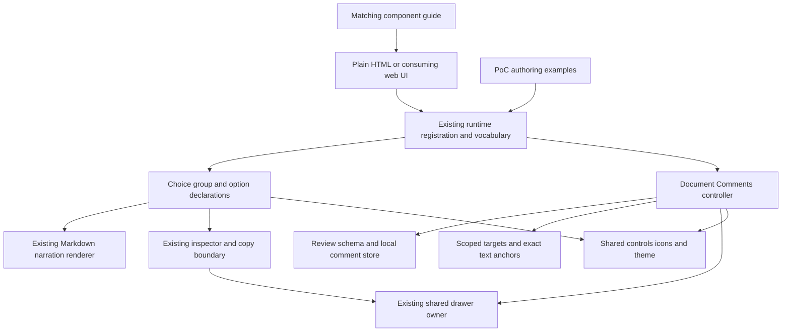
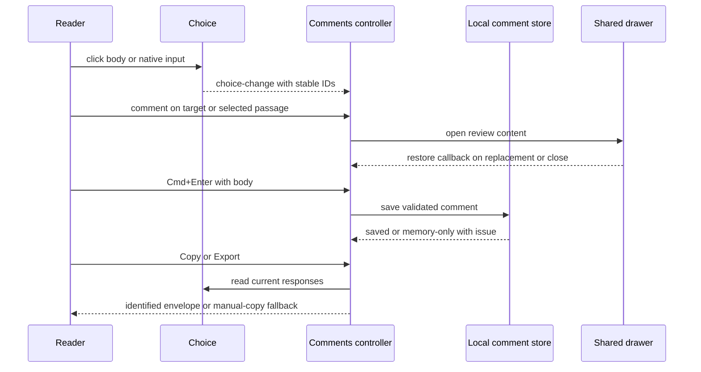

# Component structure and ownership

The design realizes [R1–R10](specification.md) inside the existing library/app split. Native elements own interaction; the matching product guide owns their authoring contract. The private experiment is a behavior reference, not a module to embed unchanged.



## Entity binding

| Entity | Semantic owner and home | Shape at a boundary | State convention |
|---|---|---|---|
| E1 Document revision | Existing `ex-document`; new review identity validation in `packages/demistify` core | Authored DOM ID plus required `document-id` and `revision` when comments bind | Explicit identity; not inferred from URL or content digest |
| E2/E3 Choice and option | New choice island; inert original source retained before rendering | `ex-choice`/direct `ex-option` source; current native input set; stable authored question/option IDs | Source is immutable configuration; native inputs own current selection |
| E4 Answer | Choice island; schema/type derived in new core review model | `{questionId, question, selected:[{optionId,label}]}` | Derived on read/change; not locally persisted |
| E5 Comment | New core comment store, presented by the Comments island | `{commentId,anchor,body,createdAt,updatedAt}` | Store owns saved/in-memory records and edit identity |
| E6 Anchor | New core anchor helpers | Entity variant, or text variant with `targetId,label,selectedText,sourceText,start,end,prefix,suffix` | UTF-16 canonical source range plus actual browser quote; exact verification, no fuzzy relocation |
| E7 Review | Core review schema and Comments controller | `ReviewEnvelope` below; comments store is a derived comments-only schema | Comments persisted locally; answers sampled from current choices |
| E8 Target | Scoped target registry owned by the Comments controller | Authored ID/label mapped to the original DOM node in its bound document | Derived from document/choice/option and explicit `data-comment-label` opt-ins; never inspector copies |

TypeScript follows the repository's strict conventions. Zod owns boundary shapes; exported types derive from those schemas. No handwritten duplicate of the serialized model is maintained.

## Public contracts

The source package exposes the review model alongside its existing source exports. Browser consumers use custom elements and bubbling, composed events; no framework adapter is required.

```ts
interface ChoiceResponse {
  readonly questionId: string;
  readonly question: string;
  readonly selected: readonly { readonly optionId: string; readonly label: string }[];
}
// Actual exported types are derived from the single Zod schema.
interface ReviewEnvelope {
  readonly format: 'demistify-review-1';
  readonly documentId: string;
  readonly documentRevision: string;
  readonly reviewId: string;
  readonly comments: readonly PageComment[];
  readonly answers: readonly ChoiceResponse[];
}
```

`PageComment.anchor` is a closed `entity | text` variant. The entity variant has target identity and label; the text variant adds the fields in the binding table. Empty bodies, invalid ranges, duplicate comment IDs, wrong identity and unknown formats are rejected at the store boundary. The local comments-only snapshot is derived from the envelope schema by omitting answers. Local keys include the format version and an unambiguous encoding of the explicit document/revision tuple. No prototype key or format is read or migrated.

`ex-choice.response` returns a fresh current response. `choice-change` carries that response after an answer changes. `ex-comments.review` returns a fresh envelope; `review-change` reports changed review content. Empty answers are omitted from the review's answer list. Mutation through returned objects cannot alter component state. No setters, transport, reset protocol, account identity or cross-tab merge protocol is introduced.

## Selection and rendering

The choice group retains its inert authored options before replacing them with a fieldset/cards or native table. IDs remain semantic author identities; generated native input IDs/names are instance-scoped, with correct label/description references. Single/multiple semantics come from native radio/checkbox inputs. Option declarations do not become a second selection store.

The card-click handler checks the original composed event path for interactive controls. This is preservation-critical: a comment handler may replace its SVG before bubbling reaches the card, so `event.target.closest(...)` alone can select the wrong answer. A nonempty drag selection suppresses card activation. Native label/input clicks retain their normal default action and are not activated a second time.

The existing renderer owns both inline title parsing and focused body rendering. The body imports `renderNarrationContent` through the library source/build graph; it does not discover hashed output names or inject a page-global module path. Full extras remain normal library content in the details slot. Unsupported titles and missing required content use the existing runtime issue boundary and remain visible errors.

The details button is created by shared controls/icons with the accepted circle/gap/type tokens. It calls the native inspector through an owned integration, not by rewriting another element's rendered controls. The inspected source is the option's extra-content owner; CSS projects active inspection to the whole original card/row and suppresses the internal wrapper marker. Full extras keep their native headings; the optional inline variant represents local detail headings semantically without admitting them to the document outline.

## One panel owner

The existing `islands/drawer.ts` becomes the replacement authority for sidebar-mode content at both widths. Today `inspector.ts` routes a narrow sidebar directly through `openModal`, bypassing that authority; move that sheet branch into the drawer owner and route `openSidebar` through it at every width. Reuse the existing dialog-sheet, `takeContent` and restore behavior. Comments supplies its header, body and restore callback to this same owner. Its internal open result supplies a scoped close handle that closes only that open session, so disconnecting an older controller cannot close a newer inspector.

Opening Comments closes/restores current sidebar content; opening an inspector invokes the review restore callback and updates the Comments trigger. Fullscreen/modal entry explicitly closes/restores active drawer content before taking its live source. This is a changed call edge in `openModal`, not behavior already supplied by current source. Existing dialog focus return and content restoration stay authoritative. The review body uses shared panel motion and narrow full-width behavior. There is no second authoritative rail, body-padding flag or observer of private drawer DOM.

Reader-control placement and responsive shape live in the existing navigation style owner, including the neutral circular Comments/theme controls and search capsule. Comment-specific styles own annotation/open/count colors, not toolbar geometry. Required Phosphor outline/filled glyphs are supplied through the shared icon/packaging owner with its license; no per-page icon vectors or missing subset glyphs are assumed.



## Anchors, storage and failures

The target registry is scoped to the bound document and refreshes for supported island-ready/authored content changes. It owns one control set per original target. Comment controls and source carriers are excluded from text projection; a selected quote remains separate from the canonical source range when browser whitespace differs. Cross-block selections anchor to the document target. Revealing a target uses the existing target-revelation path before checking its range/context. Missing/changed text stays an unavailable anchor that can still be read and exported.

The store has `ready | unavailable | invalid` persistence states. Saving validates first, updates in-memory comments, then attempts local persistence. Write failure is visible and the in-memory review remains copyable. An invalid saved value is preserved and blocks overwriting that raw value; new in-memory feedback is explicitly unsaved. Reopening the same valid identity restores its review/comment IDs. A changed revision starts another scoped review. Concurrent tabs are outside the collaboration contract; no retry, merge log, CRDT or server is added.

Comments are rendered with text nodes; Markdown is confined to the existing author-content renderer. Local JSON is validated before use. Copy/export is the explicit user transfer step, never an automatic network effect. Clipboard rejection reveals a read-only manual-copy field; exported JSON is built from the same envelope. Existing IME/modifier/editable safeguards govern shortcuts. Empty/invalid composition does not save.

## Lifecycle and copies

| Owner | Connection and state | Cleanup and illegal cases |
|---|---|---|
| Choice | Retains authored source, input nodes/current selection and one fresh listener lifetime per connection | Reconnect renews listeners without duplicate UI or re-consuming rendered markup. Configuration is supplied before connection. |
| Comments | Binds one original document revision, creates scoped registry/store/controller and one reader trigger | Abort listeners, disconnect observers, remove controls/owned highlights and close only its active panel on disconnect. Reconnect of the same instance preserves its state. Duplicate binding is a visible authoring error. |
| Inspector copy | Existing `registerInspectionCopy` reconstructs a read-only choice snapshot from retained source/current values | No original radio `name`, editable duplicate response or duplicate original comments controller. Fullscreen borrows/restores the real component and retains original response state. |

The original document is the only feedback authority. Inspector copies may show supporting content but do not become another review document or response writer. Moving original content for fullscreen must not discard state when callbacks reconnect it. No generic component framework or alternate render lane is needed.

## Obligation trace

| U · R · E | Owner | Interface, shape and home | State/failure | Proof seam |
|---|---|---|---|---|
| U1/U3 · R1 · E2–E4 | Choice island | Native controls, response getter/event; core response schema | Single/set selection; composed-path exclusions and text-drag guard | Actual input state and emitted identified response |
| U1 · R2 · E3 | Choice renderer + existing Markdown | Title/body/detail carriers; shared narration source | Visible title/content failure; async body readiness | Rendered text/tree, button/title rectangles and extras SVG |
| U1/U3 · R3 · E3/E8 | Existing inspector/drawer | Native inspection and source marker | Replace/close/restore; no wrapper strip | Full card marker, same source/selection and unchanged outline |
| U2 · R4 · E5/E6/E8 | Target/anchor helpers | Scoped registry and closed anchor schema | Exact or unavailable; never fuzzy | Actual browser quote, target ID/range and refusal result |
| U2 · R5 · E1/E5/E7 | Comment store | Derived persisted snapshot, explicit tuple key | Ready/unavailable/invalid; no invalid overwrite | Read-back identities/body and visible storage result |
| U2 · R6 · E4–E7 | Comments controller/view | Review getter/event, Copy/Export envelope | Clipboard/manual fallback; no auto send | Actual transferred/enveloped comments and answer IDs |
| U2/U3 · R7 · E5/E7 | Shared controls/styles + comments view | Keyboard handlers and reader trigger/panel | IME/editable guards, reduced motion, open/count states | Native editing, panel state, geometry and colors |
| U3 · R8 · E1–E8 | Element lifecycle + inspection-copy owner | Retained source/current inputs, scoped cleanup | Duplicate binding rejected; copies read-only | Independent consumer, reconnect/copy/fullscreen state |
| U4 · R9 · E1–E8 | Product guide and presentation workflow | One API guide; view/retrieval/composition teaching | Missing binding/API reported, no invented syntax | Fresh candidate-loaded artifacts and actual page behavior |
| U5 · R10 · E1–E8 | Existing package/CI/PR workflow | Vocabulary/checker/editor data, Changeset, plugin metadata | Source/version split and readiness-only terminal | Current build/check/review/CI/PR snapshots |

## Selection and tradeoffs

Moving the prototype's separate bundle into the existing library removes its hashed-import bridge, DOM-query inspector coordination and fixed page IDs. Keeping a second standalone widget runtime would preserve those seams and make authoring depend on two APIs, so it is rejected. A framework rewrite or backend would add unrelated consumers and persistence authority, so it is outside scope.

The cost is a small library-owned review model/store/anchor/view family plus explicit native-copy/lifecycle handling. The local-only comment contract and read-only inspection snapshots are deliberate limits. A future request for concurrent collaboration, framework-controlled values or live submission reopens those boundaries; it is not prebuilt here.
