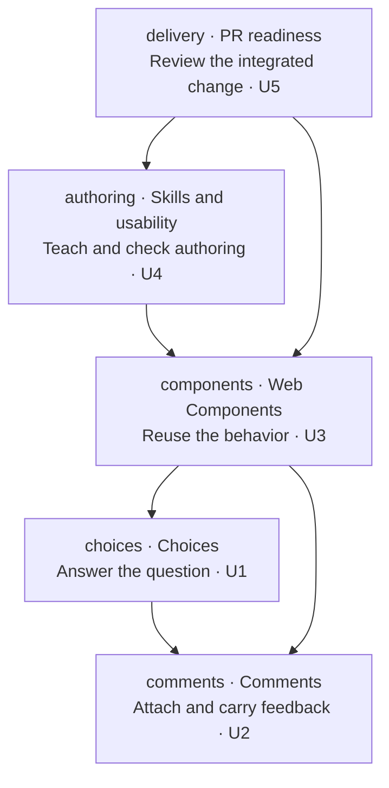
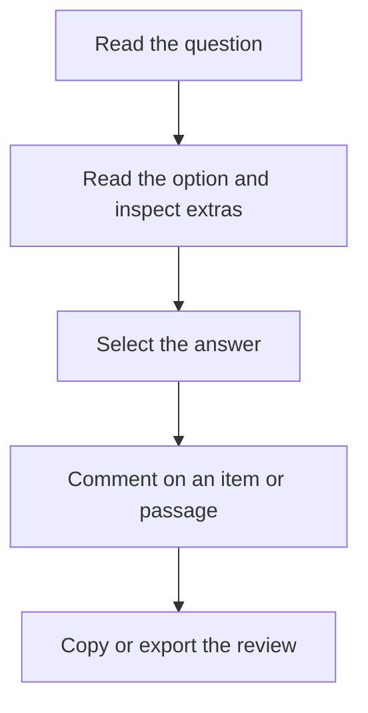

# Choices and comments

Readers should be able to answer a question, inspect supporting material and leave precise feedback in an ordinary Demistify document. Authors should obtain those interactions from reusable components rather than page-specific scripts.

The capability names come from the owner's choices, comments, Web Components, skills/usability and PR requests. The adopted UI and interaction reference is the reviewed local experiment, including the later correction that clicking noninteractive card content selects its answer.

## People and outcomes

| Need | Capability | Person and authorized outcome | Why it matters | Priority and basis |
|---|---|---|---|---|
| U1 | choices | A reader selects one answer or independent answers, reads a rich Markdown body and opens optional supporting details through a circular button beside the title. | The answer, explanation and extra material remain distinct and easy to use. | Required; owner UI decisions and card-click correction, 24 October 2026. |
| U2 | comments | A reader comments on an item or exact passage, returns to that source and carries comments and selected answers together from one Comments panel. Saved comments survive reopening the same document revision. | Feedback remains attributable and usable outside the document. | Required; adopted comments experiment and owner keyboard, toolbar and feedback corrections. |
| U3 | components | An HTML or web-UI consumer loads reusable native components with coherent state ownership, lifecycle and existing Demistify navigation/inspection. | Reuse must not depend on private page IDs, copied renderers or an application framework. | Required; owner's request to turn the accepted experiment into well-engineered Web Components and existing package boundary. |
| U4 | authoring | An agent finds the release-matched component guide, chooses response/comment views when the reader needs them, and authors a usable page from both updated skills. | The feature must transfer to new documents, rather than exist only in its demonstration. | Required; owner asks for skill and usability PR work with the authoring skills loaded. |
| U5 | delivery | A maintainer can review scoped source PRs with current checks, independent review and usable examples. | A successful private preview alone does not establish reusable library or authoring readiness. | Required; owner asks to prepare PRs; source-repository release rules remain authoritative. |

All U rows are authorized outcomes. The implementation choices and public contracts proposed to realize them are in the separate design documents.

## Reader journey

The current experiment demonstrates the desired reader journey. Its previously observed defects were ambiguous title/body hierarchy, a detail action at the wrong position, an empty inspector wrapper receiving the active highlight, and comments accidentally selecting an answer during icon repaint. Those defects must not return during integration. An author's distinct journey is to bind the correct guide/runtime, compose the supplied facts once, add only needed response/comment affordances, then check the delivered page.

The current UI reference is [the approved card/details composition](assets/choice-reference.jpg): title, circular details action, Markdown body and extra material in a sidebar. This image is a presentation reference, not authority for the data contract.

## Boundary

Keep the normal reader, shared palette/type/spacing, Reading/Canvas widths and native inspection. No backend, account system, live agent transport, collaboration server, reply threads, cross-revision relocation, automatic publication or deployment is requested. Answers remain current page input state; only comments are promised local persistence. Concurrent editing in several tabs is not a collaboration feature. The private experiment's stored/exported formats are not existing public contracts or migration inputs.

The product component guide owns syntax. The presentation workflow owns information choice, composition and delivered-page observation. The requested terminal is reviewable, ready source PRs; merging, package-version consumption, deployment and installed-cache refresh are separate work.

Follow [observable behavior](specification.md), [structure](program-design.md) and [proof design](verification-design.md).
