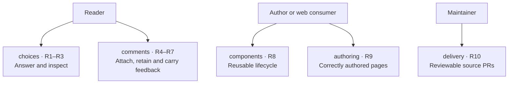
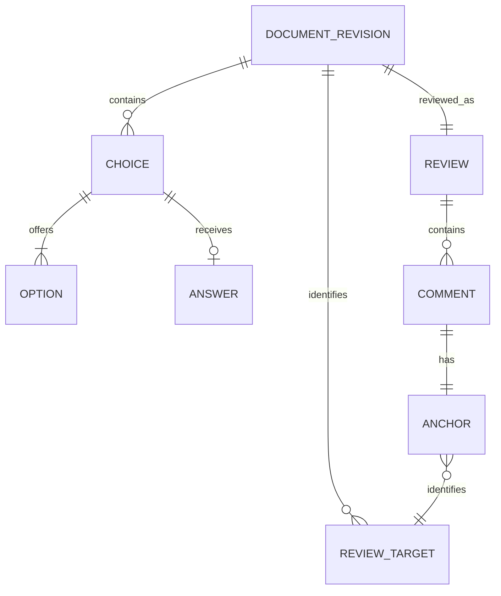

# Observable choices and comments

This contract realizes [U1–U5](requirements.md#people-and-outcomes) without requiring an application framework or backend.

Demistify is opaque at this altitude: authors supply markup and content; readers use selection, inspection and feedback; consuming web UIs receive identified response/review values. There is no network response submission.

## Entities

| Entity | Identity and relationships | Invariants and observable states |
|---|---|---|
| E1 Document revision | An explicitly authored logical document identity plus revision. One revision contains zero or more choices and review targets and has one review surface. A different URL is not by itself a different logical document. | Revision identifies the content being reviewed. New revisions do not silently inherit anchors from another revision. |
| E2 Choice | Stable authored identity within E1; contains one or more E3 options and has at most one current E4 answer. | A single choice permits at most one selected option; a multiple choice permits an independent selected set. Empty is unanswered. |
| E3 Option | Stable authored identity within E1 and membership in one E2. | Its title/body/extras belong to the same option. Inspecting or commenting does not select it. |
| E4 Answer | E2 identity plus the currently selected E3 identities. | Labels explain identities; label formatting does not change which option was selected. State changes through selection, not visual inspection. |
| E5 Comment | Stable comment identity within one E7 review, one E6 anchor, body and creation/update times. | Editing retains identity. Empty comments are not saved. Saved, unsaved or source-unavailable states are visible honestly. |
| E6 Anchor | Whole E8 target, or exact selected passage within that target, including range/context sufficient to verify that passage. | A changed or missing source is unavailable; it is not guessed or relocated. |
| E7 Review | One identified review of E1; contains saved E5 comments and a current E4 answer snapshot when read/carried. | Comment persistence and current answer selection are distinct. Carrying the review retains its document/review/comment/question/option identities. |
| E8 Review target | Stable authored identity within E1 and readable label; may be a choice, option, document or explicitly opted-in content block. | Renderer controls and inspector copies do not create new original targets. Targets may be visible, revealable, changed or missing. |

## Choices

| Obligation | Authorized need | Observable contract and deciding reference |
|---|---|---|
| R1 | U1, U3 | Native `ex-choice` and `ex-option` support single and multiple answers with stable IDs and native form-control keyboard behavior. Clicking any noninteractive card title/body/background selects or toggles its option. Buttons, Comments, Details, links and other form controls perform their own action without selecting; dragging to select text selects no answer. The accepted click examples decide this, including a Comment SVG replaced during its own click. |
| R2 | U1 | The title uses constrained inline Markdown at the shared 18px semibold role. The body uses the exact walkthrough narration Markdown contract at the shared 15px body role: paragraphs, emphasis, lists, quotes, links and code, with headings normalized to lead text. Extras may contain full library views. The circular 32px details button follows the title with an 8px gap and remains beside wrapped title text. The approved composition and existing narration contract are the reference. |
| R3 | U1, U3 | Details use native sidebar/phone-sheet behavior, mark the complete source card while open, leave the answer unchanged and restore focus on close. They do not add/remove document navigation. Existing reader navigation, widths, themes and fullscreen state restoration continue to work. No empty-wrapper highlight or duplicate response controls may appear. |

## Comments

| Obligation | Authorized need | Observable contract and deciding reference |
|---|---|---|
| R4 | U2 | One `ex-comments` surface binds to an E1 document revision. Choices/options and explicitly opted-in blocks are identifiable E8 targets. A reader can comment on a whole target or actual selected text, including text spanning blocks within the document. Controls/source carriers are excluded from quoted text. An anchor reveals its source when possible and reports exact mismatch/missing source without guessing. |
| R5 | U2 | Comments save locally under the explicit document/revision identity and retain review/comment IDs, bodies, anchors and timestamps after reload. Invalid saved data, unavailable storage and failed writes are visible; raw invalid stored data is not silently overwritten. In-memory feedback can still be carried. No answer-persistence, cross-revision migration or multi-tab merge promise is added. |
| R6 | U2 | One Comments panel contains composition, existing comments, current selected answers and unified Copy/Export. The carried review includes stable document, revision, review, comment, target, question and option identities and exact selected quotes when present. Clipboard failure provides an honest manual-copy path. Nothing is submitted to an agent or server automatically. |
| R7 | U2, U3 | C toggles Comments outside editable controls and respects modifier/composition/repeat handling. Cmd+Enter saves a nonempty comment; Enter and Shift+Enter insert newlines. The toolbar uses neutral circular controls, a distinct open Comments wash and violet annotation/count roles; counted glyphs are filled. Empty entity controls reveal on hover/focus and are reachable on touch. Panel motion uses shared timing and reduced-motion behavior. At 390 CSS px controls do not cover content or cause page overflow. |

## Reuse, authoring and delivery

| Obligation | Authorized need | Observable contract and deciding reference |
|---|---|---|
| R8 | U3 | Components run from the built drop-in runtime/theme in ordinary HTML and another independently authored page, without page scripts or a framework. Disconnect/reconnect does not duplicate controls/listeners or lose the same instance's response state. Inspection copies cannot join the original radio group, create duplicate original feedback targets or alter original answers; fullscreen restores the live original state. |
| R9 | U4 | The matching component guide teaches the actual API, identities, body/extras and interactions. `presentation-html` teaches when to ask for a response or feedback, retrieves that guide and keeps reading/comparison/recommendation distinct from answering. Each candidate is applied by a fresh agent to a realistic new task; recognition includes an explanation-only case. A usable checked artifact, actual loaded candidate source and observed interactions are the reference, not frontmatter validation alone. |
| R10 | U5 | Product and workflow source PRs are current with their real default branches, contain fitting tests/examples/release metadata and pass their required source/CI/PR gates. The feature source retains the package version and declares a Changeset; workflow metadata/changelog remain coherent. No merge, deployment or installed-skill refresh is inferred. |

## Public authoring surface

`ex-choice` requires an authored `id` and question `title`; `multiple` selects checkbox semantics. Direct `ex-option` children require an `id`, inline-Markdown `title` and one `template slot="summary"` containing the card body. Optional `slot="details"` holds extra native content. Cards are Reading width; `view="table"` is Canvas width. `details="inline"` keeps optional local disclosure; sidebar is the default.

`ex-comments for="content"` binds to an `ex-document` with that DOM ID, explicit `document-id` and `revision`. Choices/options and the document are automatic targets. Other content opts in with a unique `id` and `data-comment-label`. Duplicate IDs, missing required content/identity or an invalid binding are authoring errors visible through the common checker/runtime issue system. One comments surface per reader document is supported; configuration is supplied before connection, not a reactive-attribute protocol.

## Proof obligations and limits

V1 decides R1 using the stated native selection examples; V2 decides R2 using the actual narration contract and approved title/body/button geometry; V3 decides R3 through open/close/replacement and unchanged navigation/state; V4 decides R4 through exact target/quote matching and refusal; V5 decides R5 through same-revision reload and explicit failure states; V6 decides R6 through actual carried content and identities; V7 decides R7 through editing/keyboard, motion and desktop/390px observations; V8 decides R8 through independent consumers, reconnect and copied/borrowed-state examples; V9 decides R9 through candidate-loaded fresh author artifacts; V10 decides R10 through the current reviewable source and PR gates. All material comparisons require the complete matching built runtime and guide.

The targeted browser contract is Chromium with narrow and wide layouts in both themes. Physical touch, WebKit, file-origin storage behavior and a framework-specific adapter remain unestablished. These limits do not replace any observation above. No accounts, server transport, threads or concurrent editing protocol is specified.
