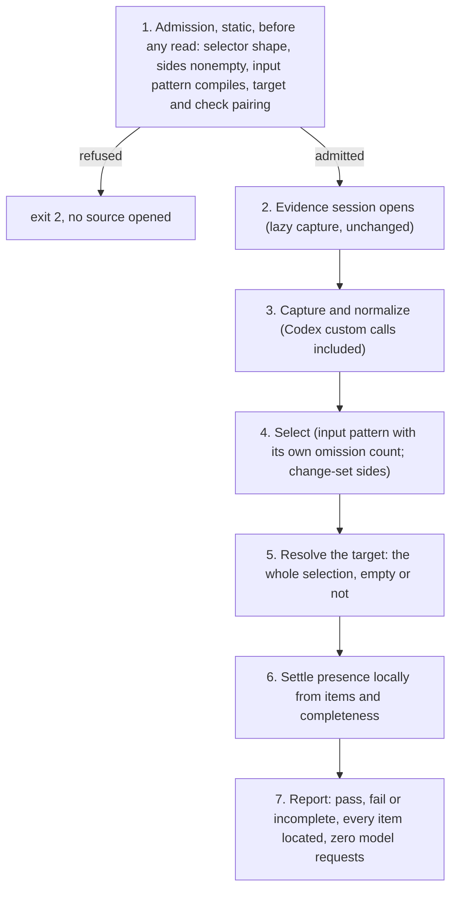

# Engine evidence additions: Program Design

How the engine realizes [R42–R45](specification.md). Each change lands at the owner that already holds the behavior: no new crate, dependency, runtime or layer. Revised after design review (F1, F3, F4).

## The path a mechanical rule takes, in order

## Binding and owners

| Concern | Owner (existing) | Change |
| --- | --- | --- |
| Static admission (R43, R44, R45) | `sunstack-evidence/src/evidence_admission.rs` (shared selector validation, `:126`), called from `sunstack-rules/src/definition_admission.rs` (`:295`) for `check_rules` and `evaluate_rules`, and directly for a standalone `prepare_evidence`. `sunstack-lint/src/config_validation.rs:122–149` is unchanged: lint still refuses conversation and change-set RuleSets as unsupported inputs | Shared validation refuses an input pattern that doesn't compile, and a missing or empty sides set. `validate_rule_definition` (`:148–152`) admits `Expect { Present }` when the target selection is a change-set or conversation selection, and keeps `invalid_target` for any other check on them. Markdown and frontmatter admission are unchanged |
| Codex custom calls (R42) | `sunstack-evidence/src/transcript_normalization.rs`, `NormalizationState::codex` (`:297`) | Arms for `custom_tool_call` and `custom_tool_call_output`, beside the `function_call` arms, pairing by `call_id` through the same pending-call map. The category is mapped from the name alone. The input is kept as recorded: text stays a JSON string. The outcome is read only from a native status field on the output record, never from text inside its content; a Codex custom output with no such field is result present with unknown status |
| Input pattern (R43) | `sunstack-evidence/src/conversation_contracts.rs` (`ToolUseSelection::Included`, `:31` area) and `conversation_selection.rs` (`:89`) | `Included` gains `input_pattern: Option<String>`, wire key `input_pattern`. Selection applies it after the name or category filter, over the input text R43 defines: the decoded string, or the compact JSON serialization from `serde_json::to_string`. The omission list gains one closed reason, `input_pattern`, carrying the excluded count. Window, projection and limit omissions keep their reasons |
| Sides (R44) | `sunstack-evidence/src/evidence_contracts.rs` (the three `ChangeSet*` variants of `EvidenceSelection`, `:183`) and `frozen_queries.rs` (`select_change_set`, `:306`) | Each variant gains a required `sides: Vec<MatchSide>` with values `added`, `removed`, `after_file` and `before_file`. `select_change_set` intersects each match's span with the `before_spans` and `after_spans` it already holds, by side, and keeps a match that satisfies any declared side. The match's `SourceSpan.source` already carries the revision and its side |
| Target resolution (R45) | `sunstack-evidence/src/evidence_contracts.rs` (`TargetLocation`, `:375`) and `sunstack-rules/src/request_state.rs` (`resolve_target`, `:125`) | `TargetLocation` gains `ChangeMatches { matches: Vec<SourceSpan> }`. `resolve_target` gains a `SelectionContent::Matches` arm that returns it, empty or not. `TargetLocation::ConversationRecords` changes from `record_ids: Vec<RecordId>` to `records: Vec<ConversationRecordLocation { record_id, position }>`, both taken from the selected `ConversationRecord` (`conversation_contracts.rs:141`, which already carries `position: u64`). The arm builds it, empty or not. This is a hard cutover: every conversation target, judged or mechanical, reports positions. `code_target` and the other arms are unchanged |
| Materialization (R45) | `sunstack-rules/src/request_planning/request_materialization.rs` (`:69` resolves the target, `:180–187` calls settlement) | `:69` is unchanged: with the target resolving, a change-set or conversation rule reaches `Ready` instead of `MissingTarget`. At `:180–187`, the `SelectionReadiness::Ready` arm passes `omissions` and `coverage` along with `content` into `settle_mechanical`. This is the edge that carries completeness |
| Local settlement (R45) | `sunstack-rules/src/local_check_evaluation.rs` (`settle_mechanical`, `:69`; `check_expect`, `:37`) | `settle_mechanical` takes the omissions and coverage beside the content and hands them to a presence branch for `Matches` and `ConversationRecords`. That branch counts the items, treats a limit, cutoff or unavailable source among the omissions or coverage as incomplete, and applies the R45 table. The frontmatter and Markdown branches ignore the new inputs and are unchanged |
| Reporting (R45, F1) | `sunstack-rules/src/request_planning/occurrence_reporting.rs` (`:103`) | No new path. The mechanical branch already takes the resolved target, which now carries every item. An incomplete settlement reports exit 3 through the existing incomplete outcome |
| Schemas | the design set's generated `schemas/` and the CLI's exported schema | Regenerated by the repository's generator after the contract changes |

## Failure

- Static refusals (exit 2) happen in step 1, before the evidence session opens.
- An orphan Codex output stays a gap. An unrecognized record type stays a positioned coverage gap.
- An incomplete selection never passes `present: false`, and never fails `present: true` on emptiness. It reports exit 3 with the limiting omission.

## Trace

| R | Owners | Interface | Failure | Proof |
| --- | --- | --- | --- | --- |
| R42 | `transcript_normalization.rs` | E33 from Codex custom records | orphan output stays a gap | V36 |
| R43 | `evidence_admission.rs`, `conversation_contracts.rs`, `conversation_selection.rs` | `input_pattern` and its omission reason | invalid pattern, exit 2 | V37, V38, V40 |
| R44 | `evidence_admission.rs`, `evidence_contracts.rs`, `frozen_queries.rs` | `sides` on change-set selections | missing or empty sides, exit 2 | V39, V40 |
| R45 | `definition_admission.rs`, `request_state.rs`, `request_materialization.rs` (`:180–187`), `local_check_evaluation.rs`, `occurrence_reporting.rs`, `TargetLocation` | presence over the whole selection; `ChangeMatches` and positioned `ConversationRecords` targets | incomplete, exit 3; other checks `invalid_target` | V37–V41 |
