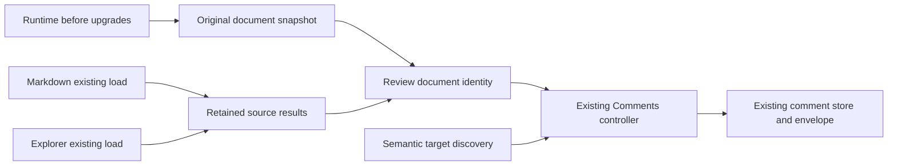

# Default comments — program design



- A small `core/review-document.ts` module owns original snapshots, source-load registration/results and derived identity. It does not fetch, render, store comments, or manage the drawer.
- Runtime captures originals before custom-element registration, then installs the missing default binding after registration. Document connection supplies a snapshot for subsequently connected roots as a best-effort extension; static authored pages are the guaranteed source-capture path.
- The snapshot fixes the initial external-input element inventory. Each initial Markdown/Explorer connectedCallback synchronously registers its WHOLE load promise before the first await or dynamic import; the promise covers import, existing fetch, retained source and render/error settlement. After all element definitions complete, identity walks that fixed inventory, verifies every input registered, and awaits every loaded/failed result before hashing. An unregistered initial input is a visible identity error, never silently omitted. Completion order cannot change input ordering. Prepared embedded Markdown uses its snapshotted retained source and has no pending fetch. Offscreen Mermaid need not render: its authored source is already in the snapshot. Source jobs normalize failure into a fingerprint input; their existing visible load errors remain.
- Comments resolves identity asynchronously and checks connection generation before binding. Recheck the one-controller WeakMap after the await. Opt-out is checked before setup. The existing schema validates overrides; store/key/envelope stay unchanged.
- `review-anchors.ts` generates stable structural IDs for eligible nodes and derives human labels. Derive automatic target IDs from stable structural paths without assigning new DOM IDs to source containers: Markdown uses its own DOM ID to scope public heading fragments, so adding a container ID would change existing navigation. Exclude generated controls and descendants of opaque tree/Explorer UI. `choice-comments.css` handles target positioning, text gutter and interaction visibility using a target marker installed by the controller; no new menu/rail.
- Vocabulary/checker expose comments="off" and optional metadata. Invalid for-targets and duplicate explicit surfaces remain errors.
- Product API guide owns exact API details; presentation-html points to the matching guide and removes opt-in boilerplate. Installed caches and released assets remain untouched.

Tradeoff: content edits intentionally start a new namespace. Automatic structure IDs reduce author tokens; explicit IDs/revisions remain useful for a deliberate stable review contract. There is no migration or auto-retargeting of earlier feedback.

## Boundary shapes and ownership

```ts
type ReviewSourceResult = { readonly kind: 'loaded'; readonly source: string } | { readonly kind: 'failed' };
interface ReviewDocumentSource { readonly markup: string; readonly inputs: readonly HTMLElement[] }
// Existing schema remains authoritative for the final identity.
type DocumentIdentity = z.infer<typeof documentIdentitySchema>;
```

E1 maps to the original DocumentIsland and a WeakMap snapshot in review-document; E4 maps to a WeakMap per island containing its settling load promise and source result. E3 remains ReviewTarget from review-anchors; E2 remains the current ReviewEnvelope schema and comment-store. Temporary source failure has a failed result; invalid authored identity rejects through existing Comments error reporting. The existing fetch and localStorage boundaries are preserved; no new network interface or persisted format is introduced.

Current path: author explicitly binds Comments -> synchronous identity schema -> store -> target discovery -> controls. Changed path: runtime snapshot -> existing island upgrades/source loads -> default binding if absent -> identity resolution -> existing store/controller. Preserved edges: explicit binding -> same namespace, controller -> envelope/store, target -> anchor validation, drawer -> native shell. On source failure the island retains its visible failure and the fingerprint includes a failed marker; on invalid identity Comments reports an alert. On disconnect the generation is invalidated before an awaited connection can bind; reconnect recomputes against the same captured source.

## Obligation-to-owner and deciding seam

| Obligation / entity | Owner and interface | State/failure and storage | Proof seam |
| --- | --- | --- | --- |
| R1 / E1,E2; Specification Page and review identity paragraph 1 | runtime default installer; Comments.for -> original root | absent/authored/off binding; no new storage | VD R1/R2/R4 normal page |
| R2 / E1,E4; identity paragraphs 2–4 | review-document snapshot, synchronous source registration, resolve identity -> existing documentIdentitySchema | fixed input inventory -> loaded/failed or visible unregistered error; fingerprint transient; existing tuple store unchanged | VD R2 adverse load orders, recovery and request count |
| R3 / E1; identity paragraph 1 | document comments="off" -> installer/controller early return | no trigger/control/store bind; existing metadata preserved | VD R2/R3 override/opt-out table |
| R4 / E3; Automatic targets paragraphs 1–2 | review-anchors -> existing ReviewTarget; controller target marker -> shared styles | original stable target or duplicate-ID error; no new persistence | VD R4/R5 target and geometry rows |
| R5 / E2,E3; identity paragraph 4 and Automatic targets paragraph 2 | Comments generation + boundDocuments post-await; existing capture/resolve/store/view | disconnected wait cannot bind; competing instances yield one bound controller; existing envelope/localStorage errors retained | VD R4/R5 pending lifecycle and existing selection/store/keyboard tests |
| R6; all observable default paragraphs | vocabulary/checkHtml and two matching guide homes | source-only guidance until matching release; no installed mutation | VD R6 checker/examples/skill review |
| R7; Requirements delivery boundary | separate repositories' PR workflow | PR-ready-unmerged; no release state | VD R7 remote checks |
