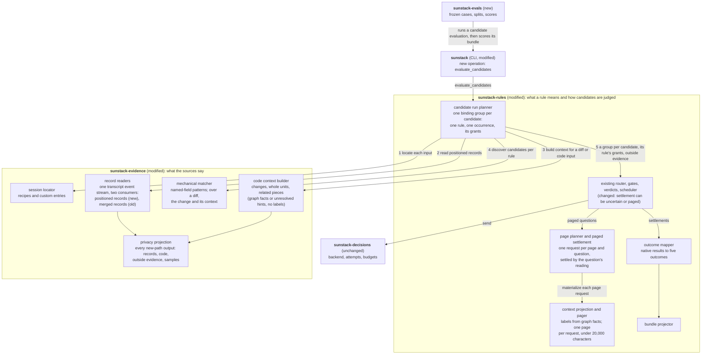
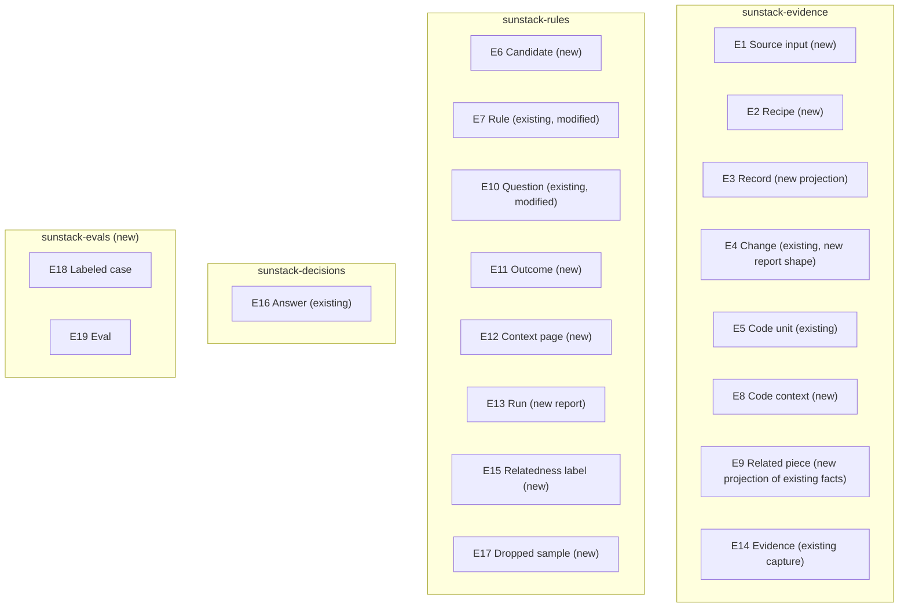
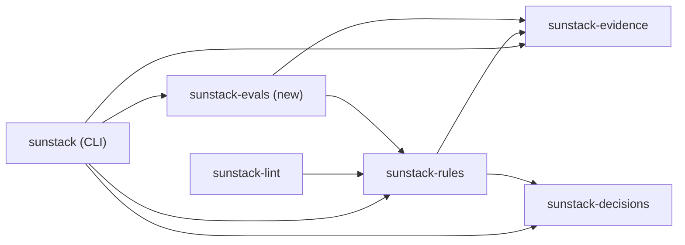
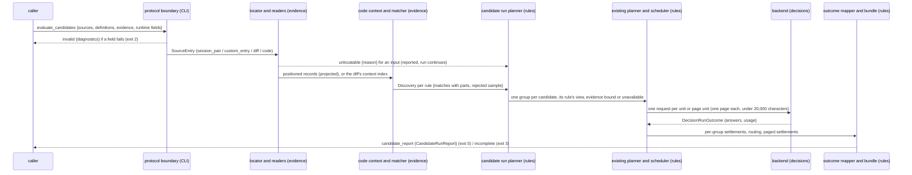
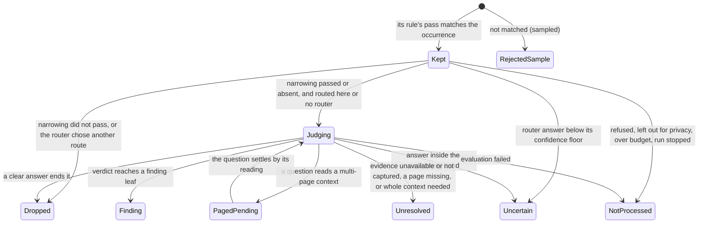
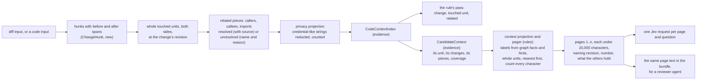
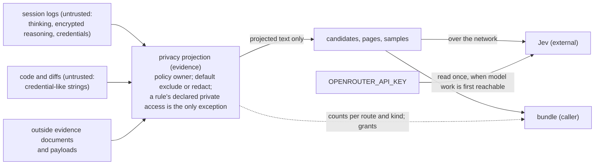

# Session ingestion and decision trees: how the engine does it

Draft 2, by the 🦁 Lead, 2026-10-27. Part three of Project 2's design set: [requirements](requirements.md), [specification](specification.md), program design, [verification design](verification-design.md). It realizes the Specification's obligations R1 to R33 over its entities E1 to E19, inside the existing engine at `1e986a9e`. Terms are the Specification's; code names appear only in the binding and trace tables and in shapes. The current engine model this design rests on, with its anchors, is `tmp/project-2/current-system-model.md` in this worktree. Draft 2 answers the four-document review's findings D1 to D8.

## The structure in one picture



Arrows are calls, numbered in the order the planner makes them. Everything that leaves evidence for a request or the bundle passes the privacy projection first.

An `evaluate_candidates` run takes source inputs, a tree (rules, or a router that routes to rules) and the outside facts its questions may need. Evidence locates each session by its recipe and parses it once into a transcript event stream, from which it projects positioned records, keeping a tool call and its result as two records; for a diff or code input it builds the code context (the change, the whole touched units, and their related code as graph facts or unresolved hints). Each rule's mechanical pass then runs over the records, or over the change and its context, and returns one occurrence per match. Rules makes one binding group per candidate (one rule's match on one occurrence), with only that rule switched on through the planner's existing per-group rule switch and that rule's privacy grants applied to its own view of the occurrence; it binds the caller's outside evidence (or marks it unavailable) and lets the existing router, gates and verdicts run. Rules also projects the context for each candidate: relatedness labels from evidence's graph facts, and pages. A question over a context larger than one request runs one request per page and settles by how the question says it reads a context. The outcome mapper turns the native results into one of five outcomes per candidate, and the bundle projector returns every candidate with its occurrence, answers, evidence and pages.

## The decision

**Selected:** extend the two owners that already exist (evidence captures and selects, rules decides), add one new operation that composes them, and add one crate for evals. No new runtime crate.

| Option | Shape | Serves well | Serves poorly | Cost and who pays |
| --- | --- | --- | --- | --- |
| **A, selected: candidates as binding groups** | evidence emits positioned occurrences per rule; rules makes one binding group per candidate (one rule, one occurrence), with only that rule switched on and its grants applied; existing planner runs them | R12 "each candidate alone": separately bound groups already keep their own answers as separate occurrences (the rules crate's test `tests/binding_groups.rs:14`); the per-group rule switch exists (`plan_contracts.rs:325-336`); a group's privacy view and evidence never mix with another rule's (R32); reuses scheduler, budgets, cancellation | more requests than one aggregate judgment, and two rules on one occurrence ask separately (a router question too); rules maintainers own the fan-out, paged settlement and outcome mapping | request count grows with candidates and pages, bounded by `max_requests` (R33); paid in model cost per run |
| B: a new occurrence expansion for records | extend Markdown-style deferred expansion to conversation records and code matches | one RuleSet binding; fewer groups | expanded children share the rule's applicability slots (`plan_contracts.rs:354-366`), so gates would not be per candidate; breaks R12 | a planner change in the hottest code; rules maintainers |
| C: a caller-side pipeline | a script outside the engine emits payload groups to `exec` | fastest to start | the owner chose ingestion in the engine (decision 1); duplicates provenance, coverage and privacy | rejected by the owner's decision |

**Falsifiers that would reopen it:** if per-candidate groups multiply requests past what the eval shows is affordable (sharing an occurrence's requests between rules with identical grants and evidence is the first saving to consider, not taken now) (a run's cost per candidate measured in U17's eval), revisit B with per-occurrence applicability slots; if a reviewer agent needs pages that rules can't render without the model protocol, move the pager's page material into evidence and keep only the budget in rules.

**The one new crate, and why:** `sunstack-evals` holds labeled cases, splits and scoring. Its boundary is one the compiler must hold (R30): rules never depends on it, so no label type can reach a judge request. Everything else extends existing crates, as `domain-rust` asks ("prefer a few large crates").

**Room to grow after Project 2.** The owner asked for crates that compose and leave room to evolve. The design keeps that room at four seams, each one already needed by an obligation now, and adds no plugin system:

| Seam | Grows by | Without touching |
| --- | --- | --- |
| a provider recipe (E2) | a new agent's logs: a recipe file, or a format reader behind the existing `TranscriptAdapter` trait | rules, decisions, the operation |
| `CandidateSource` in evidence | a new kind of source (another record kind, another code selector) | the planner, which sees only positioned occurrences |
| a rule's mechanical pass and questions, and the router (E7, E10) | a new rule or decision tree, as RuleSet and router JSON | engine code (R16) |
| `sunstack-evals` | a different scoring method, if Project 1 settles one | rules, which cannot depend on it |

Dependencies keep pointing one way (CLI and evals above rules, rules above evidence and decisions), so a later version can replace one crate's internals behind its interface without reaching across.

## Where each entity lives

Conventions found in the touched crates: domain states are Serde-tagged enums (`#[serde(tag = "kind", rename_all = "snake_case", deny_unknown_fields)]`, e.g. `report_contracts.rs:209-211`), every public contract derives `schemars::JsonSchema`, identities are newtypes, and decoding is the rules crate's strict two-pass decoder (`strict_decoding.rs:60`). The decisions crate tags its answers with `type` instead (`decision_contracts.rs:134`); new types follow the crate they live in.



| E | Semantic owner | Package home | Schema/type home | Shape at each boundary | Disposition | Convention |
| --- | --- | --- | --- | --- | --- | --- |
| E1 Source input | session locator | `sunstack-evidence` (new module) | `source_inputs.rs` (new): `SourceInput`; the operation wraps it as `SourceEntry { source, evidence }` in rules (`candidate_contracts.rs`, new), because outside-evidence bindings are a rules type | exec input JSON, `kind` tagged: `session_pair { provider, session }`, `custom_entry { location, schema }`, `diff { repository, scope: ChangeScope }`, `code { repository, revision, paths }` | derived per run | tagged enum, `deny_unknown_fields`, `JsonSchema` |
| E2 Recipe | session locator | `sunstack-evidence` (new) | `session_recipes.rs` (new): `ProviderRecipe` | configuration JSON: `provider`, `locate { roots, pattern }`, `read { format: claude_code_jsonl \| codex_rollout_jsonl \| cursor_export_jsonl \| cursor_database }`, `map { fields }`; built-ins compiled in, overrides in the run's input | configuration | as above |
| E3 Record | positioned record projection | `sunstack-evidence` (new module `positioned_records.rs`; `transcript_events.rs` new) | `PositionedRecord` (below), projected from the `TranscriptEvent` stream (below) a reader parses once from the captured bytes; the existing merging normalizer folds the same stream, so `ConversationRecord` (`conversation_contracts.rs:141`) and its merge rules (`transcript_normalization.rs:82-91`, `:137-144`) keep their outputs for the old operations | inside `SourceOccurrence::Record`; in the bundle through the candidate's occurrence | derived from the log | tagged enum, newtype ids |
| E4 Change | Git capture | `sunstack-evidence` (existing) | `change_contracts.rs:199` `CapturedChange` (existing, holds `before_spans` and `after_spans`); `ChangeHunk` (new) in `change_reporting.rs` (modified), beside `ResolvedChangedPath` (`:56`), which today reports changed paths without their spans | `ChangeHunk { hunk_id: HunkId, path, before: Option<ChangeSpan>, after: Option<ChangeSpan> }`, with `ChangeSpan` the existing span (`change_contracts.rs:193`) | derived from the frozen capture | newtype id, existing span |
| E5 Code unit | Git capture and unit extraction | `sunstack-evidence` (existing) | `connected_contracts.rs:51` `SourceUnitKey`, `:76` `SourceUnit` | inside pages and occurrences | derived | existing |
| E6 Candidate | candidate run planner | `sunstack-rules` (new module `candidate_runs.rs`) | `candidate_contracts.rs` (new): `CandidateId { rule: RuleRef, occurrence: OccurrenceId }`; `SourceOccurrence` (below) lives in evidence (`candidate_sources.rs`, new) | `CandidateEntry` in the bundle (below) | derived per run | newtype ids, tagged enum |
| E7 Rule | rule definitions | `sunstack-rules` (existing) | `definition_contracts.rs:133` `RuleDefinition` (modified, additive optional fields read only by `evaluate_candidates`: `mechanical_pass: MechanicalPass` (with `context_parts`), `narrowing`, `private_access: Vec<PrivateKind>`) | RuleSet JSON files | configuration | existing |
| E8 Code context | code context builder (captures); context projection in rules (labels and pages) | `sunstack-evidence` (new module `code_context.rs`); `sunstack-rules` (`context_pages.rs`) | evidence: `CodeContextIndex` per diff or code input (changes, touched units, related pieces, coverage) and `CandidateContext` per candidate (the unit holding its match, the changes in it, its related pieces, coverage), with no labels or pages; rules: `CandidateContextView { context: CandidateContext, labels, pages }` | evidence to rules in process; `CandidateContextView` in the bundle | derived per input and per candidate | tagged enum for coverage |
| E9 Related piece | code context builder (projects); relationship discovery (finds) | `sunstack-evidence` | `RelatedPiece` (below), projected from `connected_contracts.rs:213` `RelationshipCandidate`: `Candidate` and `Contradicted` become `Resolved`, `Unresolved` (`:229`, source unit, `target_hint`, reason, no target) becomes `Unresolved`; it carries graph facts or the hint, never a label | inside `CandidateContext`; labeled in `CandidateContextView` | derived | tagged enum |
| E10 Question | rule definitions | `sunstack-rules` (existing) | `RouterDefinition` (`:268`), applicability decisions (`:198`), verdicts; decisions and verdicts gain optional `uncertain_below` and `page_reading: PageReading` (default `whole_context`) | RuleSet and router JSON | configuration | existing |
| E11 Outcome | outcome mapper | `sunstack-rules` (new `candidate_outcomes.rs`) | `CandidateOutcome` (below) | inside `CandidateEntry` | derived per run | tagged enum, bounded reasons |
| E12 Context page | context pager | `sunstack-rules` (new `context_pages.rs`) | `ContextPage { number, of, revision, holds, rendered_chars, content_identity, text }` | rendered into one page request; carried whole in `CandidateContextView.pages`, `text` byte-identical to what the request carried | derived per candidate | struct, `JsonSchema` |
| E13 Run | bundle projector | `sunstack-rules` (new `candidate_reports.rs`) | `CandidateRunReport` (below) | exec response JSON | derived per run | tagged enums |
| E14 Evidence | evidence session (captures); candidate run planner (binds) | `sunstack-evidence` (existing capture); `sunstack-rules` (new binding) | `evidence_contracts.rs:170` `EvidenceDeclaration` and existing `InputBinding` kinds (`invocation_contracts.rs:57`); new `EvidenceBinding` (below) in rules; a payload is validated against the existing `payload_schemas` catalog (`invocation_admission.rs:88-94`, `payload_inputs.rs:37`) | operation input: `evidence` for the run and per source entry, with `definition_root` and `payload_schemas` as `evaluate_rules` has them; `EvidenceUse` in the bundle | derived | tagged enum |
| E15 Relatedness label | context projection in rules (derives from evidence's graph facts and hints); narrowing pass (judges `unrelated`) | `sunstack-rules` (`context_pages.rs`) | `RelatednessLabel` (below), keyed by piece in `CandidateContextView.labels` | inside the view, its pages and the bundle | derived | tagged enum |
| E16 Answer | backend run | `sunstack-decisions` (existing) | `decision_contracts.rs:135` `JudgmentAnswer`; rules' `DecisionSettlement` (`plan_contracts.rs:157`) gains `Uncertain` and a paged form; the bundle records each as an `AnswerRecord` | `AnswerRecord` in `CandidateEntry` | derived | existing |
| E17 Dropped sample | candidate run planner | `sunstack-rules` (`candidate_reports.rs`) | `DroppedSample { rule, pass: mechanical \| narrowing, occurrence, excerpt }` (excerpt projected for privacy) | bundle JSON | derived per run | tagged enum |
| E18 Labeled case | eval store | `sunstack-evals` (new crate) | `labeled_cases.rs`: `LabeledCase { case_id, session: SessionKey, source_anchor, question: QuestionRef, label: yes \| no \| unknown, split: development \| held_out }` | frozen case files (JSONL), with a case-set manifest holding each file's content identity | persisted (files) | newtypes, tagged enums |
| E19 Eval | eval scorer | `sunstack-evals` (new) | `eval_reports.rs`: `EvalReport` (below) | report JSON | derived | tagged enums |

The shapes callers and consumers branch on:

```rust
// evidence, transcript_events.rs (new) (E3, R5, R31): one parse, two consumers
#[serde(tag = "kind", rename_all = "snake_case", deny_unknown_fields)]
pub enum TranscriptEvent {
    MessagePart { message_id: RecordId, author: RecordAuthor, position: SourcePosition, blocks: Vec<MessageBlock>,
                  injection: InjectionOrigin },  // existing enum, classified from the source envelope while the reader has it (hook | user | unknown)
    ToolCall { call_id: CallId, tool: ToolName, input: serde_json::Value, position: SourcePosition },
    ToolResult { call_id: CallId, outcome: ToolOutcome, result: ToolResult, position: SourcePosition },
    Gap { gap: CoverageGap },                    // unsupported, malformed, orphan: what the merge reports today
}
pub trait TranscriptEventReader: Send + Sync {   // implemented by every built-in and new reader
    fn format_name(&self) -> &TranscriptFormatName;
    fn events(&self, capture: &CapturedTranscript<'_>) -> Vec<TranscriptEvent>;
}
// Built-ins: normalize_builtin (transcript_normalization.rs:402) becomes "events, then the existing merge"; the
// existing TranscriptAdapter::normalize output is unchanged. An external adapter that implements only
// TranscriptAdapter still serves the old operations; on evaluate_candidates its input is unlocatable { unreadable }.

// evidence, positioned_records.rs (new) (E3, R5): a call and its result are two records
#[serde(deny_unknown_fields)]
pub struct PositionedRecord {
    pub record_id: PositionedRecordId,       // source input + first position
    pub author: RecordAuthor,                // user | assistant | tool | system | custom
    pub positions: Vec<SourcePosition>,      // every contributing line, in order (a streamed message has several)
    pub injection: InjectionOrigin,          // a hook's injected text stays marked as injected, not the user's
    pub body: PositionedBody,
}
#[serde(tag = "kind", rename_all = "snake_case", deny_unknown_fields)]
pub enum PositionedBody {
    Message { blocks: Vec<MessageBlock> },
    ToolCall { call_id: CallId, tool: ToolName, input: serde_json::Value },
    ToolResult { call_id: CallId, outcome: ToolOutcome, result: ToolResult },
    Custom { fields: BTreeMap<FieldName, serde_json::Value> },
}

// evidence, candidate_sources.rs (new) (E6, R7, R8)
#[serde(tag = "kind", rename_all = "snake_case", deny_unknown_fields)]
pub enum SourceOccurrence {
    Record { record: PositionedRecordId, matched_at: SourcePosition, field: FieldPath, span: TextSpan },
    ContextMatch { part: ContextPart, unit: Option<SourceUnitKey>, span: SourceSpan, hunk: Option<HunkId> },
    CodeMatch { unit: SourceUnitKey, span: SourceSpan },
}
#[serde(rename_all = "snake_case")]
pub enum ContextPart { Change, TouchedUnit, Related }   // a rule's pass reads all three unless `context_parts` narrows it

// evidence, code_context.rs (new) (E9, R21, R22): captured facts only; no rule meaning
#[serde(tag = "kind", rename_all = "snake_case", deny_unknown_fields)]
pub enum RelatedPiece {
    Resolved { piece_id: PieceId, seed: SourceUnitKey, connection: RelationDirection, unit: SourceUnitKey, facts: Vec<RelationshipFact>, uncertainties: Vec<RelationshipUncertainty> },
    Unresolved { piece_id: PieceId, seed: SourceUnitKey, connection: RelationDirection, name_as_written: String, call_site: SourceSpan, reason: RelationshipUncertainty },  // never source text
}

// rules, context_pages.rs (new) (E8, E12, E15, R22 to R26): the rule-side projection of evidence's context
#[serde(deny_unknown_fields)]
pub struct CandidateContextView {
    pub context: CandidateContext,                    // evidence's captured context, as returned
    pub labels: BTreeMap<PieceId, RelatednessLabel>,  // one per piece; an unresolved piece is always uncertain
    pub pages: Vec<ContextPage>,                      // the exact text each page request carried
}

// rules, context_pages.rs (new) (E15, R22)
#[serde(tag = "value", rename_all = "snake_case")]
pub enum RelatednessLabel {
    Related { basis: RelatedBasis },               // in the input itself, or judged relevant for the rule
    ProbablyRelated { fact: RelationshipFactRef },  // resolved syntax connection, no qualification
    Uncertain { reasons: Vec<UncertaintyReason> },  // ambiguous, contradicted, recovered, weak, unresolved
    Unrelated { judged_by: AnswerId },              // only by an explicit judgment for one rule
}

// rules, candidate_contracts.rs (new) (E14, R13): the caller names each outside fact, or says it is unavailable
#[serde(tag = "kind", rename_all = "snake_case", deny_unknown_fields)]
pub enum EvidenceBinding {
    Bound { binding: InputBinding },              // the existing binding kinds: document, payload, repository at a revision
    Unavailable { reason: UnavailableReason },
}
#[serde(rename_all = "snake_case")]
pub enum UnavailableReason { NotRecorded, Withheld, Unknown }

// rules (E10, R25): how a question reads a context split across pages
#[serde(rename_all = "snake_case")]
pub enum PageReading { AnyPage, EveryPage, WholeContext }

// rules, candidate_outcomes.rs (new): exactly one per candidate (R17)
#[serde(tag = "kind", rename_all = "snake_case", deny_unknown_fields)]
pub enum CandidateOutcome {
    Finding { path: Vec<AnswerId> },
    Dropped { at: QuestionRef, answer: AnswerId },
    Uncertain { at: QuestionRef, answers: Vec<AnswerId> },
    Unresolved { at: QuestionRef, missing: UnresolvedCause },
    NotProcessed { reason: NotProcessedReason },
}
#[serde(tag = "kind", rename_all = "snake_case", deny_unknown_fields)]
pub enum UnresolvedCause {
    EvidenceUnavailable { evidence: SourceName, reason: UnavailableReason },
    EvidenceNotCaptured { evidence: SourceName, diagnostic: EvidenceCode },
    PageMissing { pages: Vec<u32> },
    NeedsWholeContext { pages: u32 },
}
#[serde(rename_all = "snake_case")]
pub enum NotProcessedReason { Refused, LeftOutForPrivacy, OverBudget, RunStopped, EvaluationFailed }

// rules, candidate_reports.rs (new) (E13, R17 to R19, R26, R32, R33)
#[serde(deny_unknown_fields)]
pub struct CandidateRunReport {
    pub completeness: RunCompleteness,
    pub candidates: Vec<CandidateEntry>,         // exactly one per candidate; narrowed-out ones included
    pub dropped_samples: Vec<DroppedSample>,
    pub inputs: Vec<InputReport>,                // per source entry: located | unlocatable {reason}; records, unfit, left out
    pub privacy: PrivacyReport,                  // left out per route and kind; private access granted per rule
    pub usage: RunUsage,                         // requests, attempts, tokens, cost (absent stays absent), wall time
}
#[serde(deny_unknown_fields)]
pub struct CandidateEntry {
    pub candidate_id: CandidateId,
    pub rule: RuleRef,
    pub occurrence: SourceOccurrence,            // opens the finding at its line or span (R19)
    pub outcome: CandidateOutcome,               // its AnswerIds resolve in `answers` below
    pub answers: Vec<AnswerRecord>,              // every answer the candidate's tree used, router included
    pub evidence: Vec<EvidenceUse>,              // each outside fact: name, binding or unavailable, content identity
    pub context: Option<CandidateContextView>,   // pieces, labels, coverage, and the pages with their exact text (R24, R26)
    pub privacy_view: PrivacyView,               // the grants this candidate's rule declared; its view saw only those
}
#[serde(deny_unknown_fields)]
pub struct AnswerRecord {
    pub answer_id: AnswerId,
    pub question: QuestionRef,
    pub page: Option<u32>,                       // set for a page request's answer
    pub answer: Option<JudgmentAnswer>,          // native, as the backend reported it (R14); absent when not sent
    pub settlement: QuestionSettlement,          // passed | did_not_pass | uncertain | unresolved | not_sent
}
#[serde(tag = "kind", rename_all = "snake_case", deny_unknown_fields)]
pub enum RunCompleteness {
    NothingFound,                                // every candidate dropped by a clear answer
    Findings { count: u32, inconclusive: u32 },  // findings never hide the inconclusive rest
    Inconclusive { uncertain: u32, unresolved: u32, not_processed: u32 },
    Partial { stopped_by: StopReason, findings: u32, inconclusive: u32 },  // also any unlocatable input
}

// evals, eval_reports.rs (new) (E19, R28, R29)
#[serde(deny_unknown_fields)]
pub struct EvalReport {
    pub rule: RuleRef,
    pub rule_version: ContentIdentity,           // the frozen RuleSet and router files
    pub case_set: CaseSetIdentity,               // the frozen manifest's identity
    pub split: Split,                            // development | held_out
    pub filter: FilterScore,                     // yes-labeled cases kept, and each missed CaseId
    pub steps: Vec<StepScore>,                   // per question: correct, wrong (CaseIds), unknown answers (CaseIds)
    pub end_result: EndScore,                    // true, false and missed findings; inconclusive
    pub unknown_labels: u32,                     // counted, never scored as negative
    pub cost: RunUsage,
    pub speed: SpeedSummary,                     // wall time; per-candidate p50 and p95
}
```

`RunCompleteness::NothingFound` is constructible only when every outcome is `Dropped` and every input was located; any `Uncertain`, `Unresolved` or `NotProcessed`, or any unlocatable input, makes it `Inconclusive` or `Partial` (an invalid state kept out by construction in the projector, R18). Every `AnswerId` an outcome names resolves inside its own `CandidateEntry`, so a reader never reaches into runtime state.

## Components

| Component | Owns (E, R) | Lives in | Exposes | Consumed by | Changes when |
| --- | --- | --- | --- | --- | --- |
| session locator | E1, E2; R1 to R4 | evidence (new) | `locate(SourceInput) -> Located \| Unlocatable { reason: missing \| ambiguous \| unreadable }` | record readers | a provider moves its logs |
| record readers and positioned records | E3; R5, R31 | evidence (built-in readers refactored to parse once into events; new Cursor and schema-mapped readers; new projection) | `TranscriptEventReader::events(capture) -> Vec<TranscriptEvent>` (new trait, every built-in and new reader); the existing `TranscriptAdapter::normalize` folds the same events for old callers; `project_positioned(events) -> Vec<PositionedRecord>` | privacy projection, matcher; the old merge | a log format changes |
| privacy projection | E3, E8, E14, E17 private states; R6, R32 | evidence (new) | `project(text_or_record, grants) -> Projected { kept, left_out: Vec<LeftOut> }`, called on every new-path route: records, code context text, outside evidence text, sample excerpts | readers, code context builder, evidence selection on the new path, planner (samples) | the privacy policy changes |
| mechanical matcher | E6 occurrences, E17; R7, R8, R10, R11 | evidence (new) | `CandidateSource::discover`, implemented for records and for code (over a code input, or a diff's change and context, limited by the pass's `context_parts`), each returning positioned matches and a deterministic rejected sample | candidate run planner | pattern kinds are added |
| code context builder | E4, E5, E8, E9; R20, R21, R22 | evidence (new) | `build_index(diff_or_code_input, revision) -> CodeContextIndex`; `candidate_context(index, occurrence) -> CandidateContext` | matcher, context pager | the graph gains languages or edge kinds |
| candidate run planner | E6, E14 binding, E17; R9, R12, R13, R16, R27, R32 | rules (new) | `plan_candidate_run(input) -> CandidateRunPlan`: one binding group per candidate, only its rule switched on through the existing per-group rule switch, its rule's privacy view of the occurrence and its evidence, outside evidence bound or marked unavailable, payloads checked against `payload_schemas`, the router when the tree has one | existing planner and scheduler | candidate kinds or the tree's entry change |
| narrowing pass | R9 | rules (new, uses existing Noul gate) | a rule-level gate whose `did_not_pass` is recorded as the candidate's `Dropped` at the narrowing question | candidate run planner | the narrowing policy changes |
| page planner and paged settlement | E12, E16; R23 to R25, R33 | rules (changed: planner, settlement) | expands a question over a multi-page context into one page unit per page; settles its controlling slot by `PageReading` (below) | existing scheduler, outcome mapper | the reading policies change |
| context projection and pager | E8 view, E12, E15; R22 to R24, R26 | rules (new, `context_pages.rs`, called from `request_materialization.rs`) | `project_context(CandidateContext) -> CandidateContextView`: labels from evidence's facts and hints, then pages; renders one page into a page unit's request and counts its characters | page planner, bundle projector | the cap, packing or label policy changes |
| outcome mapper | E11, E16 bands; R13 to R15, R17 | rules (new) | `map_outcome(group_report, routing) -> CandidateOutcome` per candidate | bundle projector | the outcome vocabulary changes |
| bundle projector | E13; R18, R19, R26, R32, R33 | rules (new) | `CandidateRunReport` | CLI, evals | the bundle's shape changes |
| eval store and scorer | E18, E19; R28 to R30 | evals (new crate) | `freeze_cases`, `score(bundles, case_set) -> EvalReport` | rule authors | the eval method changes (Project 1 settles it) |

## Ownership and dependency direction



- **Allowed edges** are the existing ones plus `evals → rules`, `evals → evidence`, `cli → evals`. Evidence and decisions still depend on nothing above them.
- **Forbidden edges**, each a compiler-held boundary: `rules → evals` (labels never reach judges, R30); `evidence → rules` (evidence never learns rule meaning; it receives a mechanical pass as data); `decisions → rules`. Enforcement class: crate manifests, checked by `cargo tree` in the repository's gates.
- **Single owners:** the source occurrence and the record's positions are evidence's; the privacy policy is evidence's, applied on every new-path route; the candidate's identity, its evidence binding and its outcome are rules'; an answer is decisions'; a paged question's settlement is rules' settlement, under the one scheduler that owns budgets and cancellation; a case's label is evals'. The relatedness label has one schema home (rules) with two writers by kind: rules' context projection derives `related`, `probably_related` and `uncertain` from evidence's facts and hints, and only the narrowing pass writes `unrelated` with its answer. Evidence's context types carry no rule-owned type, so `evidence → rules` stays absent.

## Interfaces

**The operation (C1, C5), owner the CLI's protocol boundary, consumer any caller.** `evaluate_candidates` is a new operation name under protocol version 1; old operations keep their decoders and meaning (R31). Input, strict-decoded:

```text
{ sources: [SourceEntry { source: SourceInput, evidence?: { <input name>: EvidenceBinding } }],
  definitions: { kind: rule_sets, rule_sets: [path] } | { kind: router, path },
  evidence?: { <input name>: EvidenceBinding },
  recipes?: [ProviderRecipe],
  definition_root, payload_schemas,
  repositories, limits, backend, attempts, request_budget, execution, samples_per_pass? }
```

`definitions` keeps the existing `InvocationDefinitions` kinds (`invocation_contracts.rs:31-41`) without caller-built binding groups, because the planner builds them. `definition_root` and `payload_schemas` mean what they mean for `evaluate_rules`: RuleSet, router and payload-schema paths resolve against the root (`invocation_admission.rs:88-94`), and the payload-schema catalog is compiled before any payload is validated (`evidence_preparation.rs:211`). The runtime fields are flat and shaped as `evaluate_rules`' input has them (`execution.max_concurrent_requests` at `:85`, `request_budget.max_requests`); a diff or code input names a repository by its key in `repositories`. Today a conversation binding is a caller-supplied `transcript_path` and `format` (`invocation_contracts.rs:62-67`); a source input replaces both with a provider and session, or a custom entry. Result, closed: `candidate_report { report }` (exit 0, including `inconclusive` and `findings`), `invalid { diagnostics }` (exit 2, a failing field named, nothing ran, R1), `incomplete { report }` (exit 3, partial with its stop reason), `cancelled { report }` (exit 4). Undefined, on purpose: candidate order within the report.

**Outside evidence (D3; R13, R15).** A rule's evidence declarations name inputs, as today. The caller binds each input name once for the run (`evidence`) and may override it for one source entry (`SourceEntry.evidence`), with an existing binding kind or `unavailable`. Admission on the new path (new `candidate_admission`, beside the unchanged `admit_group`, `input_binding.rs:55`) accepts an input that is `unavailable` or absent, and records it as unavailable instead of returning `UnboundInput` (`:73`); every question that reads it settles `Unresolved { EvidenceUnavailable }` with no request, while the candidate's other questions and other candidates run. A bound input whose capture fails settles `Unresolved { EvidenceNotCaptured }` through the existing evidence refusal. A supplied payload (an owner decision, a run's receipt) is validated offline against its declared schema in `payload_schemas`, as today; a schema missing from the catalog (`UnknownPayloadSchema`, `payload_inputs.rs:37`) or a value that doesn't match it is a caller error, refused `invalid` before anything runs, never treated as unavailable and never guessed. The old operations keep `UnboundInput`.

**The tree's entry and routing (D8, D11; R12, R16, R32).** Discovery comes first: every rule reachable from the entry (each listed RuleSet, or every RuleSet a router's routes name) runs its mechanical pass. The planner then makes one binding group per candidate, one rule's match on one occurrence, and switches on only that rule through the existing per-group rule switch (`plan_contracts.rs:325-336`). The occurrence binds to the input the rule's target declaration reads (`RuleDefinition.target`); with a router, to the router input every route maps onto that input (`RouteTarget.inputs`), and admission refuses a tree where that mapping is ambiguous. Each group's view of the occurrence and of its outside evidence is projected with its own rule's privacy grants before the group's evidence and requests are planned; the raw capture underneath is shared and immutable. With rule sets, the rule's gates and verdict run for its group. With a router, the router's question is asked for the group; the candidate ends `Dropped` at the router with its answer when the chosen route doesn't name its RuleSet, `Uncertain` when the router's answer is below its confidence floor (`UncertainIntent`), and otherwise its rule runs. Two rules matching one occurrence are two candidates in two groups: their requests are separate, each with its own rule's view, so request materialization, which joins a request's selections into one state (`request_materialization.rs:342-364`), never mixes two rules' grants or answers (R12, R32).

**Reading a log once (D10; R5, R31).** Today a reader's only output is the merged `AdapterOutput` (`TranscriptAdapter::normalize`, `transcript_formats.rs:12-15`), and the built-in parser writes JSON lines straight into the merging state (`normalize_builtin`, `transcript_normalization.rs:402`), so the per-line positions the new records need are gone by the time anything else sees them. The change is in the reader: each built-in format parses captured bytes once into a `TranscriptEvent` stream (`TranscriptEventReader`, a new evidence-owned trait), and the existing merge becomes a fold over that stream, so `normalize`'s output and the old cursors are unchanged; the positioned projection folds the same stream without merging. The event carries everything the merge reads today: for a message, its id, author, position, blocks and its existing `InjectionOrigin`, which the reader classifies from the source envelope while it still has it (today's Claude rule, `transcript_normalization.rs:171-182`: `origin.kind` `hook` → known injected, `user` → not injected, otherwise unknown); tool calls and results stay not injected, as today (`:133`). So a hook's text and a user's identical text stay distinct through the fold and the old selection's hook exclusion (`conversation_selection.rs:96`) keeps working. The new Cursor and schema-mapped readers implement `TranscriptEventReader` from the start. An external adapter registered only through `TranscriptAdapter` keeps serving the old operations; on `evaluate_candidates` its input is reported `unlocatable { unreadable }` rather than read through a merge that has lost its positions.

**A diff's context and the pass (D1; R7, R8).** For a diff input, the code context builder first builds the input's `CodeContextIndex`: each hunk, the whole units it touches (both sides), and their related pieces. A rule's mechanical pass over a diff reads all three parts unless its `context_parts` names fewer; each match records its `ContextPart`. A candidate's own context is the unit holding its match, the changes inside that unit, and that unit's related pieces (for a match in a related piece, also its seed unit). The changed lines are never an implicit limit.

**Evidence to rules, in process.** `CandidateSource::discover(pass: MechanicalPass, input: LocatedInput) -> Discovery { matches: Vec<SourceOccurrence>, rejected_sample: Vec<SourceOccurrence>, coverage }`. `MechanicalPass` is data the rule declares (named-field predicates combined `any`/`all`, regex or literal, ast-grep queries for code, and `context_parts`), so evidence executes patterns without knowing rule meaning. `rejected_sample` holds up to `samples_per_pass` items (default 20) per pass and input, chosen deterministically, evenly spaced over the dropped items in source order, so a rerun over the same input returns the same sample (R10). A record-field pattern reads the decoded field (never the raw JSON line), so a JSON-encoded argument is decoded before matching (the research's `payload.arguments` case).

**Paged questions (D2; R23 to R25, R33).** When a candidate's context renders to more than one page, the page planner (a change to the existing planner) gives every question that reads the context input and declares `any_page` or `every_page` one page unit per page; each page unit is an ordinary unit the existing scheduler admits, budgets and sends as its own request, carrying the question and that one page. A question that declares `whole_context` (the default) over a multi-page context settles `Unresolved { NeedsWholeContext }` with no request. Settlement changes in one place: a paged question's controlling slot holds one state per page, each filled only by its own page unit's request (so the existing rule that only a slot's controlling request settles it, `request_settlement.rs:80-91`, holds per page), and the slot leaves `Pending` by its reading:

| Reading | Settles passed | Settles did not pass | Otherwise, once every page is settled or not sent |
| --- | --- | --- | --- |
| `any_page` | the first page that passes, whenever it arrives | every page did not pass | uncertain if a page answered inside its band; unresolved (`PageMissing`) if a page failed or was never sent |
| `every_page` | every page passed | the first page that did not pass, whenever it arrives | as above |

Once a slot settles, its page units not yet sent are dropped from the queue; requests already in flight drain under the existing cancellation owner. Page answers are never voted on or averaged: the settlement references the deciding page's `AnswerRecord`, or every page's when all were needed, each with its own reported probability. Every page request counts against `max_requests`; when the limit stops the remaining pages, the slot settles by the table with those pages `not_sent`.

**The uncertainty band (E16, R14).** A decision or verdict may declare `uncertain_below` (a probability under which the answer is uncertain even if it would pass or fail its threshold, with its symmetric upper edge for "no"). With the band absent, gates keep today's binary meaning, so existing RuleSets are unchanged (R31). Router `UncertainIntent` maps to `Uncertain`.

**Cutover.** None: `evaluate_candidates` is additive, every new RuleSet and router field is optional and read only by it, and no stored data changes shape. The only persisted state is the evals crate's frozen case files, which are new. Not applicable here: accessibility (no screen), migration (nothing stored before).

## The main path, current and proposed

The current path (anchors in the current-system model, groups 1 to 6):

```text
exec evaluate_rules → decode_rule_invocation (strict) → load_invocation (RuleSets or router, caller-built groups)
  → admit_group (every declared input bound, else UnboundInput)   (input_binding.rs:55-73)
  → EvidenceSession::select → ConversationRecords selection → resolve_target: ONE target with every record id   (request_state.rs:182)
  → topology → request graph (same-source gates carried with verdicts) → scheduler → one request per unit set   (request_materialization.rs:379)
  → settlement: only a slot's controlling request settles it   (request_settlement.rs:80-91)
  → RuleInvocationReport (occurrences: checked/judged/not_applicable/...; complete even with UncertainIntent)  (report_contracts.rs:465)
```

The proposed path, with each edge's status:

| Edge | Status | What it does now | Realizes |
| --- | --- | --- | --- |
| exec → `evaluate_candidates` decoder | added | new operation, same strict decoder style; old operations untouched | R1, R31 |
| decoder → session locator | added | each source located by recipe or custom entry; unlocatable reported per input | R2 to R4 |
| locator → record readers | changed | readers chosen by recipe format, not by a caller-supplied path and format | R3 |
| captured bytes → built-in reader | changed | each built-in reader parses once into a `TranscriptEvent` stream; the existing merge folds it, so `normalize`'s output and old cursors are unchanged | R5, R31 |
| transcript events → positioned record projection | added | calls and results stay two records with their own positions; streamed messages keep every position | R5 |
| every new-path output → privacy projection | added | records, code text, outside evidence and samples projected; counts per route | R6, R32 |
| diff or code input → code context builder | added | the input's context index (hunks, touched units, related pieces, resolved or unresolved) | R7, R20 to R22 |
| projected records and context → mechanical matcher | added | positioned matches per rule pass, parts recorded, deterministic samples | R7, R8, R10 |
| matcher → candidate run planner | added | one binding group per candidate; only its rule switched on through the existing per-group switch; its rule's privacy view of the occurrence | R12, R32 |
| planner → new-path admission | added | outside evidence bound per run or per input, or unavailable; absent is unavailable; payloads validated against `payload_schemas` | R13 |
| planner → router or rule sets | intentionally unchanged | the existing router question, routes, gates and verdicts run per group | R12, R16 |
| planner → narrowing gate | added | optional per rule; narrowed-out candidates recorded as dropped | R9 |
| planner → page units | changed | a question over a multi-page context becomes one unit per page | R23 to R25 |
| scheduler → backend | intentionally unchanged | the same admission, budgets, attempts, concurrency and cancellation, now also for page units | R33 |
| materialization → context pager | changed | a page unit's request renders exactly its one page, counted | R23, R24 |
| settlement → paged control | changed | a paged slot settles by its reading; plus the uncertainty band | R14, R25 |
| settlement → outcome mapper | added | native results and routing to five outcomes | R13, R14, R17 |
| report projection → bundle projector | added | `CandidateRunReport` replaces `RuleInvocationReport` on this operation only | R18, R19, R26 |
| aggregate conversation target and `admit_group` | intentionally unchanged for `evaluate_rules` | the old operation keeps its one-target selection and its binding rule | R31 |



## A candidate's lifecycle



Owner: the outcome mapper. Illegal transitions are kept out by construction: a candidate's outcome is written once, from its own group's settlements and routing; a paged question cannot settle twice, because its slot leaves `Pending` once.

## Code context and pages



- **Counting (R23):** the pager counts the context as rendered for that request, in Unicode scalar values: diff portions, code, labels, relationship summaries, unresolved names and reasons, anchors and any carried summary of other pages. It counts once per request, after every piece of context the request carries is rendered, so context added outside a page (such as relationship metadata) can't slip past the cap. The decisions crate's byte and token budget still applies on top.
- **Packing (R24):** whole units first, ordered by the change itself, then nearest relationship first (the ordering is design, not obligation). An unresolved piece takes only its line: the name as written, the call site and the reason. A unit too big for one page: **gap, O1**. If the owner answers "exact continuations", the pager emits numbered parts of that unit's exact source with "part k of n"; if "unprocessed", the candidate's outcome is `NotProcessed { OverBudget }`.
- **Combining (R25):** by the question's `PageReading`, in paged settlement above.
- **Same pages for agents (R26):** each `CandidateContextView` carries its pages whole, the exact text each page request carried with its content identity, so a reviewer agent reads from the bundle the same pages the judge received; no second rendering exists to drift.
- **Revision (R20, R21):** today's context capture reads the current worktree for unchanged files (`repository_context.rs:167`). The code context builder reads unchanged files at the change's revision from the frozen Git capture instead, extending the existing capture owner; it never mixes worktree text into an older revision. Until that extension lands, a context built against the worktree says so in its coverage.
- **Privacy in code (R32):** code text passes the same privacy projection as records: a credential-like string is replaced by a fixed marker, the piece's coverage says `redacted`, and the bundle's privacy report counts it per route, so a page never claims exact source it didn't send.

## Failure, partial success and recovery

| Boundary | Detection | Containment | Visible as | Owner |
| --- | --- | --- | --- | --- |
| a field fails the input schema | strict decoder | the whole run refused before anything runs | `invalid` with the field (exit 2) | protocol boundary |
| a router's input mapping is ambiguous | new-path admission | the whole run refused before anything runs | `invalid` naming the router and input (exit 2) | candidate run planner |
| a supplied payload names a schema missing from `payload_schemas`, or doesn't match it | existing payload admission | the whole run refused before anything runs | `invalid` with the payload's field (exit 2) | candidate run planner |
| a source's format has no event reader (an external adapter registered only for the old path) | locator | that input only | `unlocatable { unreadable }`; completeness `partial` | record readers |
| a session can't be found, or matches two logs | locator | that input only; the rest run | the input `unlocatable` in `inputs`; completeness `partial` | session locator |
| a record doesn't fit its schema | reader | that record only | counted and listed as unfit with its position | record readers |
| a source changes while read | existing capture identity checks | that input refused | `not_processed { refused }` for its candidates | record readers |
| an outside fact is unavailable or absent | new-path admission | the questions that read it | `unresolved { evidence_unavailable }`; no request | candidate run planner |
| an outside fact's capture fails | existing evidence refusal | the questions that read it | `unresolved { evidence_not_captured }` | candidate run planner |
| a question needs the whole context and it spans pages | page planner | that question | `unresolved { needs_whole_context }` | page planner |
| a page request fails or is never sent | existing attempts; the scheduler's limit | that page's state | the question settles by its reading, or `unresolved { page_missing }` | paged settlement |
| the backend fails, times out or answers malformed | existing attempts and response validation | that request's units | `not_processed { evaluation_failed }`, never a verdict | outcome mapper |
| `max_requests` reached | existing scheduler | remaining units not sent | `not_processed { run_stopped }` or a paged question's missing pages; completeness `partial` | bundle projector |
| caller cancels | existing cancellation (owned tasks drained) | the run | `cancelled` with the partial report (exit 4) | scheduler |

Retries stay where they are: the decisions crate retries only transient classes within `retry_count`; no new retry is added. A run is a read: re-running it repeats no external side effect.

## Concurrency

Candidates are independent groups under the existing scheduler: requests run concurrently up to `max_concurrent_requests` (a semaphore, `request_scheduler.rs:69`), each request owns its immutable admitted bytes, and a settlement fills only the slot, or the page state, its own request controls (`request_settlement.rs:80-91`). Two candidates never share a slot, even on the same occurrence, so no ordering between them affects an outcome; they share only the immutable raw capture. Within a paged question, pages may finish in any order: a decisive page settles the slot whenever it arrives, and the non-decisive result waits for every page, so the outcome doesn't depend on arrival order. Locating and reading run on blocking workers as capture does today, bounded by the invocation's byte and file limits.

## Privacy, trust and cost



- **Policy owner:** the privacy projection (evidence), on every route that leaves evidence on the `evaluate_candidates` path: records, code context, outside evidence text and dropped-sample excerpts. By default it leaves out thinking, Codex analysis-channel text and encrypted reasoning items, and replaces credential-like strings with a fixed marker, counting each per route and kind (R6, R32). A rule that needs a private kind declares it in `private_access`; the projection lets that kind through for that rule's candidates only, and the bundle's `privacy.granted` lists the rule and kind. Because every candidate has its own group, the projection runs per group: two rules on one occurrence get two views, and no request, router answer or page carries one rule's grant into another rule's judgment. The old operations' selection behavior is unchanged (R31); this resolves the conflict the current-system model records (D8) by placing the projection only on the new path.
- **Credential:** unchanged: the backend is built once, when model work first becomes reachable ("construction waits for reachable model work", `rule_backend_factory.rs:5`), and only then is the key read (`operation_execution.rs:22`); it is never stored in recipes, cases or bundles.
- **Cost (R33):** the request count, page requests included, is bounded by `max_requests`; the bundle carries the existing per-request usage and cost (`ExecutionUsage`, `decision_contracts.rs:156`), summed, with absent cost kept absent.

## Proof seams

| Dependency | Class | Real or replaced in proof |
| --- | --- | --- |
| session logs | true external (files written by agents) | real, frozen copies of Codex, Claude Code and Cursor logs; never live while being written |
| Git repositories | locally substitutable | real temporary repositories and one real commit |
| Jev | true external | replaced by the existing loopback controlled server for structure; real in the hosted runs |
| the CLI process | in-process vs process | the real binary through the existing process-test harness for C1 and exit codes |

The test harness differs from production at one seam only: the backend (loopback server with scripted answers versus the hosted model), which the existing `decision_http.rs` and `controlled_http.rs` support already provides, including holding one request while answering another, which paged settlement's arrival-order cases need. No proof call graph beyond that is needed.

## How each obligation is realized

Each `R` cell carries its home capability key.

| U | R | E | owner | interface | shape and home | state | failure | proof |
| --- | --- | --- | --- | --- | --- | --- | --- | --- |
| U1 | R1 (`inputs`) a malformed input refused, field named | E1 | protocol boundary | `evaluate_candidates` decoder | `SourceEntry`, `SourceInput` | none: stateless decode | `invalid { diagnostics }`, exit 2 | process test through the binary |
| U1 | R2 (`inputs`) several session pairs | E1 | session locator | `locate` per input | `SourceInput::SessionPair` | per-input located/unlocatable | per-input containment | process test with several frozen logs |
| U2, U3 | R3 (`inputs`) recipes locate and read; unlocatable never empty | E1, E2 | session locator | `locate -> Located \| Unlocatable` | `ProviderRecipe`, evidence `session_recipes.rs` | located/unlocatable | `Unlocatable { missing \| ambiguous \| unreadable }`; completeness `partial` | process tests per built-in provider with frozen logs |
| U2 | R4 (`inputs`) a custom entry reaches the tree | E1 | record readers (schema-mapped) | `TranscriptAdapter` for a schema definition | `SourceInput::CustomEntry` | located | schema mismatch counted per record | process test with a custom JSONL source |
| U4 | R5 (`inputs`) records keep author, position, source; unfit counted | E3 | record readers; positioned record projection | `TranscriptEventReader::events`; `project_positioned` | `TranscriptEvent`, `PositionedRecord`, evidence `transcript_events.rs`, `positioned_records.rs` | mapped/unfit | unfit listed with position; a format with no event reader → `unlocatable { unreadable }` | test against source lines: a call and its result on different lines, a streamed message over several lines; the old merged-record and cursor tests unchanged |
| U4 | R6 (`inputs`) private blocks left out and counted | E3 | privacy projection | `project` on records | `PrivacyReport` | private | none: a policy | process test with thinking and reasoning items |
| U5, U13 | R7 (`inputs`) diff and code inputs reach outcomes; a diff starts context, never limits it | E1, E4, E5, E8 | mechanical matcher; code context builder | `build_index`; `discover` with `context_parts` | `SourceOccurrence::ContextMatch { part }`; `ChangeHunk` (new) | derived | capture refusal → `not_processed` | process test on a real commit: a match in a touched unit outside the change is kept unless `context_parts` excludes it |
| U6 | R8 (`filtering`) mechanical pass keeps matches with occurrences | E6, E7 | mechanical matcher | `CandidateSource::discover` | `MechanicalPass` in `RuleDefinition` (modified); `SourceOccurrence` | kept | selector refusal → input `not_processed` | process test: planted match kept, non-match not |
| U7 | R9 (`filtering`) optional narrowing, narrowed out recorded | E6, E7 | narrowing pass | rule-level Noul gate | `RuleDefinition.narrowing` | kept → dropped at narrowing | backend failure → `not_processed` | loopback test, with and without narrowing |
| U8 | R10 (`filtering`) each pass samples its drops | E17 | candidate run planner | `Discovery.rejected_sample`, deterministic | `DroppedSample`, rules `candidate_reports.rs` | none: derived | none: sampling cannot fail the run | process test: samples are real drops; a rerun returns the same ones |
| U6 | R11 (`filtering`) no verdict from tool names alone | E6 | definition admission | `MechanicalPass` keeps, never decides | on `evaluate_candidates` only, admission refuses a rule whose verdict is a mechanical test over record fields (old operations unchanged, R31) | none: admission rule | refused at admission | admission test; paired cases differing only in tool names |
| U9 | R12 (`judging`) each candidate's tree on its own | E6, E7, E10 | candidate run planner | one group per candidate; only its rule on through `plan_contracts.rs:325-336` | `BindingGroup` (existing); `CandidateId` | per-group settlements | per-group containment | loopback test: each request carries one candidate's material; two rules on one occurrence ask separately; outcomes follow each candidate's answers |
| U10 | R13 (`judging`) evidence named; unavailable → unknown, unresolved | E10, E14, E16 | candidate run planner (admission); outcome mapper | `EvidenceBinding` per run or per input; `candidate_admission`; `payload_schemas` | `UnresolvedCause::EvidenceUnavailable \| EvidenceNotCaptured` | unresolved | no request for that question; other questions and candidates run; an unknown or mismatching payload schema → `invalid` | loopback test with a valid payload fact, a document fact, the evidence unavailable, absent, failing capture, and a payload whose schema is missing or doesn't match |
| U11 | R14 (`judging`) probabilities kept; inside the band → uncertain | E16 | outcome mapper; settlement | `uncertain_below`; `DecisionSettlement::Uncertain` | `AnswerRecord.answer` native | uncertain | none beyond the band | loopback test around the band; hosted run compares bundle and raw response |
| U9, U10 | R15 (`judging`) same text, two evidence contexts | E16 | candidate run planner | per-input `evidence` overrides | `SourceEntry.evidence` | per group | none | loopback test with paired inputs differing only in their evidence |
| U9 | R16 (`judging`) a new tree needs no engine change | E7, E10 | rule definitions; candidate run planner | `definitions: rule_sets \| router` | `RouterDefinition`, `RuleDefinition` (existing) | configuration | ambiguous router mapping → `invalid` | process test of a new router and RuleSets: routed, not routed, uncertain intent |
| U12 | R17 (`outcomes`) exactly one outcome per candidate | E6, E11, E13 | outcome mapper | `map_outcome` | `CandidateEntry.outcome` | one terminal outcome | every failure maps to a variant | process test: entry count equals candidate count |
| U12 | R18 (`outcomes`) never "all clear" when inconclusive | E13 | bundle projector | `RunCompleteness` | `CandidateRunReport` | completeness derived | `Partial { stopped_by }` | projector test: four replayed runs and an unlocatable input |
| U12 | R19 (`outcomes`) one bundle, outcomes point to occurrences | E11, E13 | bundle projector | `CandidateEntry { occurrence, answers, evidence }` | rules `candidate_reports.rs` | none: derived | none | serialized-bundle walk for each outcome kind, without runtime state |
| U5, U13 | R20 (`code-context`) diff context: change, both sides, whole touched units | E4, E5, E8 | code context builder | `build_index`, `candidate_context` | `CodeContextIndex`, `CandidateContext` | derived | capture refusal → `not_processed` | process test on a real commit |
| U13 | R21 (`code-context`) related code through the AST graph | E5, E8, E9 | code context builder | existing relationship discovery, projected | `RelatedPiece::Resolved` | derived | historical capture for unchanged files is required; until it lands, coverage says `worktree` (Requirements, *Not verified*) | process test on a real repository, with a dirty worktree edit that must not appear |
| U14 | R22 (`code-context`) labels with basis; unresolved kept as name and reason | E9, E15 | code context builder (pieces); context projection (labels); narrowing pass for `unrelated` | `RelatedPiece`; `project_context` → `CandidateContextView.labels` | evidence `code_context.rs` (no labels), rules `context_pages.rs` | derived | none | process test: a call to a name defined nowhere, an ambiguous call, a resolved one |
| U15 | R23 (`code-context`) at most 20,000 characters of context per request | E12 | context pager | one page per page unit, counted | `ContextPage.rendered_chars` | derived per request | none: a page never exceeds the cap; an oversized unit waits on O1 | process test counting every recorded request |
| U15 | R24 (`code-context`) paged, whole units, coverage named | E8, E12 | context pager | packing | `ContextPage`, `CandidateContext.coverage` | derived | gap: a unit too big for one page waits on O1 | process test with an oversized context |
| U13, U15 | R25 (`code-context`) combined per question by its reading, never voting | E8, E16 | paged settlement | `PageReading`; per-page states | `DecisionSettlement` (paged), `AnswerRecord.page` | pending → settled once | missing page → `PageMissing`; `whole_context` → `NeedsWholeContext` | loopback test: each reading, a decisive page arriving last, a page never completing, a stopped run |
| U13 | R26 (`code-context`) Jev and a reviewer get the same pages | E8, E12 | bundle projector | pages carried whole in the bundle | `ContextPage.text` in `CandidateContextView` | derived | none | process test comparing each bundle page with the recorded request |
| U16 | R27 (`code-context`) code rule matches become candidates with context | E6, E8 | mechanical matcher and code context builder | `discover` per match, not per unit | `SourceOccurrence::CodeMatch { unit, span }` | kept | gap: holds once the owner confirms O2 | process test with a code rule over a real repository |
| U17 | R28 (`evals`) frozen labels, held-out split | E18, E19 | eval store | `freeze_cases` | `LabeledCase`, manifest with content identities | persisted case files | a changed frozen file refuses to score | eval-crate test on a frozen set |
| U17 | R29 (`evals`) the report's scores once per version | E19 | eval scorer | `score` | `EvalReport` | derived | unknown labels counted, never scored negative | eval-crate test against a hand-worked table |
| U17 | R30 (`evals`) labels never in a judge input | E18 | crate boundary | none: `rules` does not depend on `evals` | crate manifests | none | a forbidden edge fails the build | `cargo tree` gate; recorded-request scan for a planted label |
| none: a boundary from the Requirements | R31 (cross-cutting) old operations keep their meaning | none: protocol, not an entity | protocol boundary | old decoders, `admit_group` and normalizer unchanged; new operation additive | `protocol_boundary.rs` (modified: one new arm) | none | unknown operation still `UnsupportedOperation` | existing process, cursor and schema tests unchanged and passing |
| U4 | R32 (cross-cutting) no private content leaves by default | E3, E8, E14, E17 | privacy projection, run per candidate group | `project` on every new-path route; `private_access` | `PrivacyReport { left_out, granted }`; `CandidateEntry.privacy_view` | private | none: policy | process test: sentinels through a session, a code context, an outside document and a sample, with and without a grant; two rules on one occurrence, one granted, the other's requests without the sentinel |
| U12 | R33 (cross-cutting) model work bounded and reported | E13, E16 | scheduler (bounds); bundle projector (reports) | `max_requests`, page units included; `ExecutionUsage` summed | `RunUsage` | none | limit reached → `not_processed { run_stopped }` or missing pages | loopback test at a small `max_requests` |

## Deviations and unresolved decisions

- **O1 (owner):** a unit too big for one page: exact continuations or unprocessed. The pager holds either; R24's row is a gap until the owner answers.
- **O2 (owner):** "related triggers" for a code rule. R27's row is a gap until the owner confirms.
- **Historical code graph:** the code context builder must read unchanged files at the change's revision from the frozen capture. Until that extension exists, a context built from the worktree is labeled so in its coverage (R21's gap).
- **Project 1's eval method:** if it differs from `sunstack-evals`' scoring, the evals crate follows it.
- No other deviation: every Specification obligation has a row; every entity has a binding.
