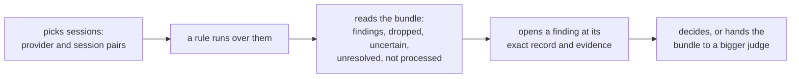
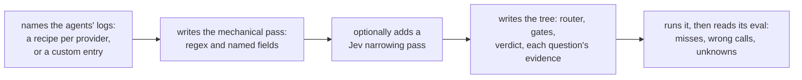
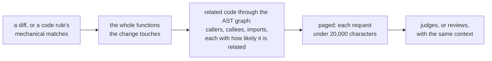

# Session ingestion and decision trees: people, purpose and boundaries

Draft 1, by the 🦁 Lead, 2026-10-27. Part one of Project 2's design set: requirements, [specification](specification.md), [program design](program-design.md), [verification design](verification-design.md). It normalizes meaning the owner has already settled, in [Project 2's reviewed spec](#sources) (revision 2, 26 October) and the owner's corrections of 27 October, into stable `U` rows. It invents no owner meaning: the two questions still open with the owner are marked open below.

The engine can already read Codex and Claude Code session logs, capture Git changes, run ast-grep and regex, and put one question tree to Jev. What it can't do is turn one session, one diff or one code rule into many attributed candidates, give each one the context a judge needs, and account for every candidate's outcome. This project adds that, inside the engine.

## Who it is for

**The owner, as the reader of findings and the one who decides.** They want to know what agents thought, planned and decided, judged against evidence rather than against patterns in their tool calls: a technology chosen without the repository or an owner decision behind it; a step taken without the check they named. Today they read the logs themselves or trust an agent's summary.

**Rule authors.** The owner, and the skills that write and run rules (`skill-audit`, Project 1's ten eval-only standards, Project 3's design rules). They write a rule as a mechanical first pass, an optional Jev narrowing pass, and a decision tree whose questions each name the evidence they need. Today a rule can only run over one whole session as a single unit.

**Judges and reviewer agents.** Jev, a bigger judge after it, and reviewer agents that need the same context. They receive candidates with their context: the session records around them, or a diff with the whole functions it touches and the code related to it. Today they get whole files or nothing, with no limit on size and no way to tell related code from incidental code.

**The engine's existing callers.** Anything that already calls `sunstack exec` (the skill-authoring rule runner, hosts that monitor agents). Their requests keep their meaning.

There is no new UI screen: candidates, outcomes and context are data for an agent, a terminal or a host. **No current UI.**

## Capabilities

The owner confirmed these six on 27 October ("Yes, as proposed", with their corrections to filtering and to the diff capability). This table is the list's one home; the other documents refer to a capability by its key.

| Key | The owner's name | What users get | Home rows |
| --- | --- | --- | --- |
| `inputs` | inputs | any agent's session log (by provider and session, or a custom entry), a diff, or code becomes positioned, attributed records; nothing is silently dropped | U1 to U5 |
| `filtering` | filtering | a mechanical first pass keeps everything that might matter, an optional Jev pass narrows it, and both sample what they drop | U6 to U8 |
| `judging` | judging | each candidate runs its rule's decision tree, each question with the evidence it needs; "unknown" never becomes "no" | U9 to U11, U18 |
| `outcomes` | outcomes | every candidate ends with exactly one outcome, bundled for a bigger judge; a partial run never reads as all clear | U12 |
| `code-context` | code context (renamed from the diff tree) | a diff, the whole functions it touches, and related code through the AST graph, each related piece with how likely it is related, paged under 20,000 characters per request, for Jev and for reviewer agents | U13 to U16 |
| `evals` | evals | each rule scored on real, labeled, held-out session evidence | U17 |

## Journeys

### The owner, reading what a run found

- **Pain today, and its evidence:** the engine judges a whole session as one unit, so a run can't say which record a finding came from (research: "a conversation selection becomes one target containing every selected record ID"). A clean run can still be mostly uncertain: on 12 real candidates, 10 came back uncertain while the run completed without error. Failed PR #78 decided from tool-call patterns, which the owner rejected: "we cannot do this primitive stuff".
- **Desired difference:** every candidate traceable to its line; a run that left anything uncertain, unresolved or unprocessed never reads as "all clear". U1, U4, U9, U10, U12.

### A rule author, writing a session rule

- **Pain today, and its evidence:** adding an agent means code, not configuration (Cursor isn't read at all; Codex's newer custom tool calls aren't read); there is no pattern on a field's text; and nothing measures what a filter misses. Failed PR #165's lexical lints ran without Jev: "the litns dont sue jev are brittle".
- **Desired difference:** a new agent is a recipe; a rule's filter keeps what might matter and its misses are measured; Jev decides. U2, U3, U6, U7, U8, U17.

### A reviewer agent or a judge, getting code context

- **Pain today, and its evidence:** the owner: "The diff itself is not enough. So we need the diff, the whole functions that the diff touches, and then the related ASD gram". Change-set matches scan whole files, not what changed; the relationship search answers "unresolved" when its graph is incomplete; and on a real commit, one candidate's relationship metadata alone measured 76,772 characters, while today's limit only caps code excerpts (a local probe of the engine, 27 October).
- **Desired difference:** the same bounded, attributed context for Jev and for agents; related code labeled by how likely it is related, never asserted as a certain call stack. U13 to U16.

## Authorized needs

Every row below is `authorized`: the owner settled it in Project 2's reviewed spec (revision 2, whose two decisions they made on 26 October) or in their messages of 27 October, quoted. Priority: every row is in this project's scope, ordered by the reviewed spec's units (the engine design first; inputs and code inputs side by side; the filter after inputs; the tree and outcomes after the filter; evals once the questions are frozen). The owner set that order.

### inputs

| ID | Need and reason | Evidence and authority |
| --- | --- | --- |
| U1 | Sessions are named as provider and session pairs, one or many, in JSON checked against a strict schema; an input that doesn't fit is refused, naming the field, never guessed at | Authorized: "we just take in the session id, the rest is configraiotns", "so allow an array of sesison ids as inptus"; decision 2 (26 October): "should be json with strong schema types." |
| U2 | Codex, Claude Code and Cursor are the built-in providers; any other source is a custom entry giving its location and a schema definition | Authorized: decision 2: "we shodu alklow custom with input lcoaiton, schema deifition as well to support any other outside ofthe main 3." |
| U3 | Where each agent's logs live and how to read them is configuration, a recipe, so adding an agent means adding a recipe, not code (a new storage format such as a database may still need one adapter) | Authorized: decision 1 (26 October), ingestion in the engine "with recipes as configuration"; "the regex first pas filter hsoudl be extensaible and ocnfigurable for any agent" |
| U4 | Every record keeps who wrote it, its exact position, the session it came from, and what's missing or unreadable; a record that doesn't fit its schema is counted and reported, never silently dropped; private blocks (thinking, encrypted reasoning, credential-looking content) are left out by default | Authorized: reviewed spec, sections 1 and 2; "the session logs need to be for what teh agent is thinking or doign or plannign to do" |
| U5 | A diff (a repository and revisions) and code (a repository and paths) are inputs too, each reaching the same filter, tree and outcomes with no session involved. A diff is where context starts, not the edge of what a rule may look at: it is fed into the whole functions it touches and their related code (U13) | Authorized: reviewed spec, section 1; "the susntack tool increaisn the ingestin for session log and deicison tree and inputs with ast grep"; 27 October, "the diff is fed into related code so we properly give any agent the information ... The diff itself is not enough" |

### filtering

| ID | Need and reason | Evidence and authority |
| --- | --- | --- |
| U6 | A mechanical first pass, regex, named fields and ast-grep, built to keep everything that might matter (recall), not to decide | Authorized: "r egex for filter fairst pass, then jev for second pass ina  pipeline" |
| U7 | A Jev narrowing pass after the mechanical one, optional per rule | Authorized: 27 October, "fev narrowing is otpional"; the pipeline "mechiancialf itler -> possilbe jev fileter decision tree -> the judge" |
| U8 | Each pass samples what it drops, so evals can measure what the filter misses | Authorized: reviewed spec, section 3 |

### judging

| ID | Need and reason | Evidence and authority |
| --- | --- | --- |
| U9 | Each candidate runs its rule's decision tree, a router, then gates, then a verdict, judged by Jev; a tree is a rule's configuration, so each rule brings its own | Authorized: the tree the owner drew and adopted, "yes this is what i meant"; reviewed spec, section 4 |
| U10 | Each question names the evidence it needs, from the candidate's own text or a fact outside it (the repository at the revision the agent worked on, the owner's decisions, a run's own output); missing evidence makes the answer "unknown", never "no" | Authorized: reviewed spec, section 4 |
| U11 | Jev's certainty, its probability, carries through the tree, so an uncertain answer stays uncertain | Authorized: 27 October, "allow JAB to say in the decision tree certainty, you're right, or use the probability that JEB gives" |
| U18 | A skill standard runs as a decision model over the units skill text is made of: sections, paragraphs, list items and frontmatter fields. Jev judges each unit through the standard's own mechanical pass, optional narrowing, gates and verdict. | Authorized: the owner's 28 October direction to fix the engine and use decision models throughout; the 26 October choice for Jev to judge skill descriptions; Rule authors above. |

### outcomes

| ID | Need and reason | Evidence and authority |
| --- | --- | --- |
| U12 | Every candidate that entered the tree gets exactly one outcome (finding, dropped, uncertain, unresolved, not processed), with the answers and evidence that led there, bundled for a bigger judge; a run with any uncertain, unresolved or unprocessed candidate never reads as "all clear" | Authorized: reviewed spec, section 5; "Inputs are filtered and colalted togeter so judges modles can sue it" |

### code-context

| ID | Need and reason | Evidence and authority |
| --- | --- | --- |
| U13 | From a diff, or from the code a code rule matches, build the context a judge or a reviewer needs: the diff, the whole functions it touches, and the code related to it through the AST graph (callers, callees, imports), the same context for Jev and for agents | Authorized: 27 October, "we need the diff, the whole functions that the diff touches, and then the related ASD gram, those trees and stuff, right? So that actual related information can be passed in"; "we can provide that context to jab"; "this whole point of rust and ast grep and git integration" |
| U14 | Each related piece says how likely it is related (for example related, probably related, uncertain), because the graph and ast-grep can be wrong | Authorized: 27 October, "Can we provide a probable enum probability of related or uncertain or something like that?" |
| U15 | At most 20,000 characters of context per request, leaving room for the instructions; larger context is broken up | Authorized: 27 October, "Let's just use that as the max so we have room for the instructions"; "20k chars" |
| U16 | A code rule's mechanical selector finds code occurrences, each followed by its callees, callers and imports as context. With a repository input, every match is a candidate; with a diff input, only matches inside code the change touches, directly or through code it calls. Each candidate carries its callees, callers and imports as context. | Authorized: 27 October, "If the inputs are a code rule, then we have to find the related triggers"; O2 settled by the Lead on 28 October (A15), under owner delegation |

### evals

| ID | Need and reason | Evidence and authority |
| --- | --- | --- |
| U17 | Each rule is scored on real, labeled, held-out session evidence: the filter, each tree step and the end result, with misses, wrong calls, unknowns, cost and speed; these evals replay frozen evidence and are not pressure tests | Authorized: 25 October, "Yes, we do need evals for a project to succeed, and we need to extract that from session logs"; 22 October, "we arent doign pressutre testing" |

## Boundaries

- **Where it lives:** in the engine, sunstack-tools, in Rust, the repository's language (decision 1; "use teh repo techonolgoy or ask the suker dont assume tech choices"). Recipes and custom entries are configuration.
- **How it is built:** "we need to make teh crates composable well edsiged and folow rules. we need tomak sure we allow fleixity as we evolve the version after project 2" (27 October). The repository's Rust standards apply, including "crates set the dependency direction".
- **What stays as it is:** existing `sunstack exec` operations keep their meaning; a change to the protocol is made explicitly, never by reinterpreting old values.
- **Project 1 settles how rules are configured and evaluated;** where its method differs from this design's evals, Project 2 follows it.

## Non-goals

- **What starts a run** (a trigger): out of scope, as the owner drew the pipeline ("trigger (otouf scope)").
- **Pressure testing** of agents: declined on 22 October. Evals replay frozen evidence instead.
- **Deciding from tool-call mechanics:** no rule passes or fails on which tools were called or their names (failed PR #78).
- **A word match as the meaning:** the filter only keeps candidates; Jev decides (failed PR #165).
- **A certain call stack:** related code is possible syntax connection with a likelihood, never a traced runtime path; no execution tracing or language server.
- **Finding every entry path** that could reach some code, or discovering event hooks.
- **Project 3's rules, and the bigger judge itself:** this project produces the bundle a bigger judge reads, not that judge.

## Settled with the owner

- **O1, a function too big for one request (28 October):** truncate it once within the page budget, preserving its signature, first lines, one marked gap with the omitted line count, and last lines. The head/tail split is configurable; coverage names the truncated unit and omitted range. U13/U15 include this case.

- **O2, related triggers for a code rule (28 October, Lead decision):** With a repository input, every match is a candidate; with a diff input, only matches inside code the change touches, directly or through code it calls. Each candidate carries its callees, callers and imports as context. The owner delegated this reversible choice; it is recorded as decided without asking (A15).

## Not verified

- Claude's thinking text is empty in current logs, and Codex's reasoning is encrypted: "what the agent is thinking" is mostly what it writes in messages and plans.
- Locating Claude Code and Cursor logs from a session ID: Router doesn't do it today, so recipes must.
- Cursor's live database while Cursor writes, archived sessions, sessions split across files.
- A historical code graph for unchanged files at the revision a change was made: today's context capture reads the current worktree.
- The accuracy of any tree or relatedness label: measured only once evals exist.

## Sources

- Project 2's reviewed spec, revision 2: `~/dev/memory-logs/projects/2026/2026-10-skills-and-sessions/scratch-root-01a1635f/project-2/spec.md` (normative for settled decisions and the owner's quoted words).
- The owner's 27 October corrections: `~/dev/memory-logs/projects/2026/2026-10-skills-and-sessions/trace-2026-10-27-lead-68844339.md`, section "Project 2 meaning" (normative, quoted).
- The engine research, re-anchored at `1e986a9e`: `research-p2/report.md` beside the spec, and `tmp/project-2/u1-reanchor-report.md` (observational).
- The code-context exploration with its engine probes: `tmp/project-2/advisor-code-context.md` (advisory, with checked observations).
