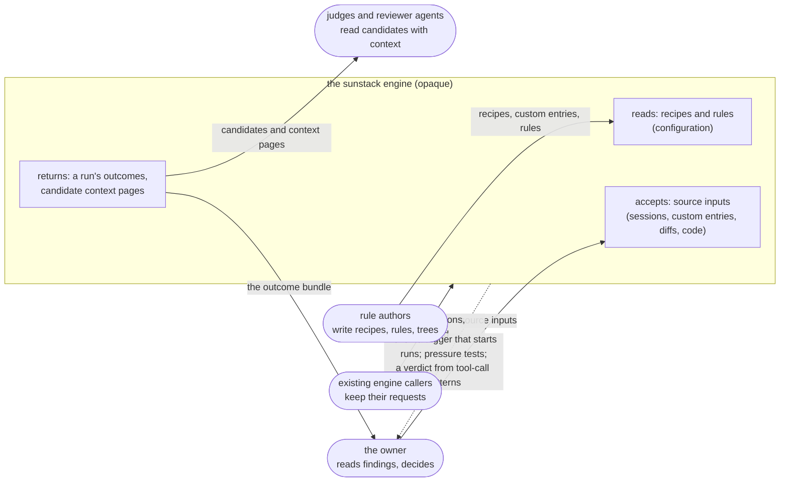
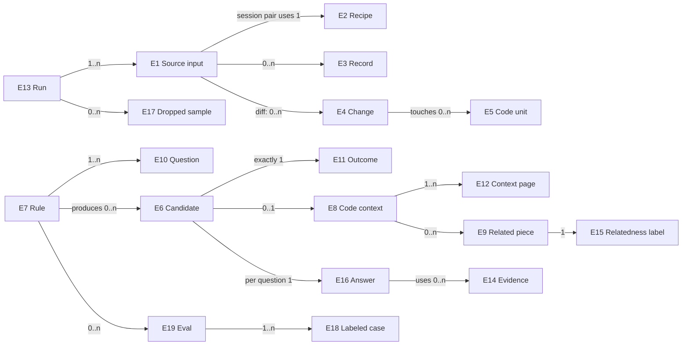

# Session ingestion and decision trees: what must hold

Draft 1, by the 🦁 Lead, 2026-10-27. Part two of Project 2's design set: [requirements](requirements.md), specification, [program design](program-design.md), [verification design](verification-design.md). Every obligation traces to a `U` row in the Requirements. The engine is one opaque system here: nothing below names a crate, type, schema field or store, which are the Program Design's.

## The system and who touches it

## Capabilities and their obligations

The six capabilities the owner confirmed (their names and purposes live in the Requirements, *Capabilities*), with the obligations each owns:

| Key | Home obligations | Also serves |
| --- | --- | --- |
| `inputs` | R1 to R7 | |
| `filtering` | R8 to R11 | |
| `judging` | R12 to R16 | |
| `outcomes` | R17 to R19 | |
| `code-context` | R20 to R27 | R25 also serves `judging`; R26 also serves reviewer agents reading `outcomes` |
| `evals` | R28 to R30 | |
| (cross-cutting, from the Requirements' *Boundaries*) | R31 to R33 | every capability |

## Entities

Every obligation is written over these nouns. The table is their normative home; the map after it shows only their relationships.

| ID | Term | Identity rule | Relationships | Invariants | Observable states | Basis |
| --- | --- | --- | --- | --- | --- | --- |
| E1 | **Source input** | one entry in a run's input: a session pair is the same input when its provider and session are the same; a custom entry when its location and schema definition are the same; a diff when its repository and revision range (or commit) are the same; code when its repository, revision and paths are the same | belongs to one Run (E13); a session pair uses exactly one Recipe (E2); a custom entry carries its own schema definition | checked against the input schema before anything runs | accepted; refused (names the failing field); located; unlocatable (missing or ambiguous, reported as such) | U1, U2, U5 |
| E2 | **Recipe** | one per built-in provider (Codex, Claude Code, Cursor), identified by the provider's name | used by many session pairs | says where the provider's logs live, how to read them, and which fields map; decides nothing about what counts as evidence | (none observable beyond present or absent) | U3 |
| E3 | **Record** | one message, tool call, tool result or custom-source record, identified by its source input and its exact position in the source (file and position within it); a tool call and its result are two records, each with its own position, even where they are read together | belongs to one Source input; may belong to many Candidates (E6) | keeps who wrote it, its position and its source; never silently dropped | mapped; unfit (didn't match its schema: counted and reported); private (left out by default: thinking, encrypted reasoning, credential-looking content) | U4 |
| E4 | **Change** | one hunk of a diff, identified by its repository, revision range, file and its before and after ranges | belongs to one diff Source input; touches zero or more Code units (E5) | before and after kept apart | (none beyond present) | U5, U13 |
| E5 | **Code unit** | a function, method, class or Markdown section, identified by its repository, revision, side (before or after) and range; a frontmatter field, identified by its file and field name, whose content is present, absent or unavailable | may be touched by many Changes; may be a Related piece (E9) of another unit | read at the revision its candidate names, never at a different one | whole; truncated with omitted range (O1, settled) | U13 |
| E6 | **Candidate** | what a rule's mechanical pass kept for judgment, identified by the rule (E7) and the exact source occurrence it came from: a record or neighbouring records, a match's exact span in a diff's context (the change, a touched unit, or related code), or one code-rule match's exact span. Two matches in one function are two candidates; one match is one candidate however many units enclose it; two rules matching the same occurrence make two candidates | belongs to one Run and one Rule; has exactly one Outcome (E11); may have one Code context (E8) | carries its source occurrence, so a finding points back to its line | kept (mechanical pass); narrowed out (optional Jev pass, recorded); judged; not processed | U6, U7, U9, U12, U16 |
| E7 | **Rule** | as the engine defines it today (a RuleSet entry), now with a mechanical pass, an optional narrowing pass, and a decision tree | has many Questions (E10); produces many Candidates | its tree is configuration, not code | (as today) | U6, U7, U9 |
| E8 | **Code context** | the context of one Candidate from a diff or a code rule, identified by that Candidate and the revision it was built at | belongs to one Candidate; holds the Changes, the whole touched Code units, and Related pieces; is split into Context pages (E12) | the same context for Jev and for reviewer agents; nothing in it is dropped without being recorded | complete; partial (with its gaps named) | U13, U15 |
| E9 | **Related piece** | a connection from a candidate's code through the AST graph, identified by the seed unit, the kind of connection (caller, callee, import) and its target: the Code unit the graph found, or, when it found none, the target's name as written at the call or import | belongs to one Code context; a resolved piece is a Code unit (E5) | carries a Relatedness label (E15) and its basis; a possible syntax connection, never a traced runtime path; an unresolved piece never carries source text, because none is known | resolved (its target's source is in the context); unresolved (target unknown: the name as written and the reason are kept) | U13, U14 |
| E10 | **Question** | a step of a rule's tree (a router, a gate, a verdict), identified by its rule and its place in the tree | belongs to one Rule; names the Evidence (E14) it needs | answered per candidate | (as answered, see E16) | U9, U10 |
| E11 | **Outcome** | exactly one per Candidate, identified by that Candidate | belongs to one Candidate and one Run | carries the answers and evidence that led to it | finding; dropped (a clear answer ended it, with that answer); uncertain (an answer below its confidence floor); unresolved (a question's evidence wasn't available); not processed (refused, left out for privacy, over budget, or the run stopped) | U12 |
| E12 | **Context page** | one request's share of a Code context, identified by its context and its number | belongs to one Code context | at most 20,000 characters of context, counting everything rendered for the request; names its source revision, its place among the pages, and what the other pages hold | (none beyond its number) | U15 |
| E13 | **Run** | one invocation of the engine over its source inputs and rules | has many Source inputs, Candidates and Outcomes | its bundle accounts for every candidate | complete; partial (stopped, over budget or refused: named) | U12 |
| E14 | **Evidence** | a fact a question needs beyond the candidate's own text, identified by its kind (the repository at a revision, the owner's decisions, a run's own output) and its source | used by many Answers | never inferred from absence | available; missing (makes the answer unknown) | U10 |
| E15 | **Relatedness label** | one per Related piece | belongs to one Related piece | names its basis (the graph's own facts, or an explicit judgment for one rule); never a measured probability unless a model reported it as one | related (in the input itself, or judged relevant for the rule); probably related (a resolved syntax connection with no qualification); uncertain (ambiguous, unresolved, recovered, weak); unrelated (only by an explicit judgment for that rule) | U14 |
| E16 | **Answer** | one per Candidate and Question | belongs to one Candidate and one Question | keeps the model's probability or confidence as reported | yes; no; a choice; uncertain; unknown | U10, U11 |
| E17 | **Dropped sample** | an item a pass dropped and kept for measurement, identified by its rule, its pass and its source occurrence | belongs to one Run | sampled, not all | (none) | U8 |
| E18 | **Labeled case** | frozen evidence with a label set before scoring, identified by its source anchor and the rule question it labels; its split group is derived from its source and anchor (session pair: provider and session; code input: repository and document path; diff: repository and revision range; custom entry: location). A case does not name its group | belongs to one Eval (E19) | its label never enters the judge's input | in the development set; held out | U17 |
| E19 | **Eval** | one scoring of one rule, identified by the rule's frozen version and its frozen case set | has many Labeled cases | labels frozen before scoring; the held-out set was never tuned on | (a report) | U17 |

## Problems, outcomes and obligations

| ID | Problem today | Outcome |
| --- | --- | --- |
| P1 | A session's selected records are judged together as one unit: each record keeps its position, but no record is judged on its own, so a finding can't be pinned to the one record it came from | O1: every candidate is its own unit and points to its source occurrence |
| P2 | Adding an agent needs code; Cursor isn't read | O2: a new agent is a recipe; custom sources are configuration |
| P3 | A pattern can only say whether a whole source contains a match, not where; there is no pattern on a named field; and nothing measures what a filter misses (an earlier pilot let a word match stand for the meaning) | O3: a mechanical pass keeps for recall, Jev decides, misses are measured |
| P4 | A clean run can be mostly uncertain and still look like "nothing found" | O4: every candidate has one outcome; uncertainty is never hidden |
| P5 | Related code arrives with its graph facts and some limits, but the limit counts only code excerpts (one candidate's metadata alone measured 76,772 characters), context isn't paged, a pattern on a change can only scan whole files rather than the change and the code around it, and nothing says how likely a related piece is related | O5: bounded, paged context, the same for judges and reviewers, related code labeled |
| P6 | No rule's accuracy is known | O6: rules are scored on held-out evidence |

### inputs

- **R1** (U1; E1) When a run's input is given, the engine checks it against the input schema before anything runs. If it doesn't match, then the engine refuses the run and names the failing field; it never guesses. *C1. V1.*
- **R2** (U1; E1) The input accepts one or more session pairs, each a provider and a session. *C1. V2.*
- **R3** (U2, U3; E1, E2) A session pair is located and read by its provider's recipe; Codex, Claude Code and Cursor have built-in recipes. If a session can't be found, or matches more than one log, then that input is reported as unlocatable, never as empty. *C1, C2. V3.* Recipe `map.fields` pointers also read each raw record (A16).
- **R4** (U2; E1) Where a custom entry gives a location and a schema definition, its records are read by that definition and reach the same filter, tree and outcomes as a built-in provider's. A custom entry covers sources stored as JSON or JSONL. *C1, C2. V4.* A custom schema is `{ format: json | jsonl, record_schema: <JSON Schema>, fields: { output_name: <JSON Pointer> } }`. A JSON array yields one record per item, a JSON object one record, and JSONL one per line. Pointers read each raw record; a schema mismatch or missing required mapping marks that record unfit at its actual position while the rest continues (A16). Whole JSON documents are captured without requiring a final newline; a truncated or syntactically incomplete document is reported as an incomplete capture, never as a complete empty source or per-record schema mismatch (A17).
- **R5** (U4; E3) Every record keeps who wrote it, its exact position, its source input, and what's missing or unreadable. If a record doesn't match its schema, then it is counted and reported, never silently dropped. *C3. V5.*
- **R6** (U4; E3) Private blocks (thinking, encrypted reasoning, credential-looking content) are left out by default and counted as left out. *C3. V6.*
- **R7** (U5, U13; E1, E4, E5, E8) A diff input (a repository and a revision range or commit) and a code input (a repository, revision and paths) each produce candidates that reach the same filter, tree and outcomes with no session involved, keeping before and after apart. A diff is where context starts, not a limit on where a rule looks: a rule's mechanical pass over a diff reads the change and its context (the whole touched units and their related code), and each match records which of these it fell in. A rule may limit its pass to some of them; the changed lines are never an implicit limit. *C1, C3, C4. V7.* A code input names its revision with `RevisionHead` (`commit` or `worktree`) and its paths with `Vec<QueryPath>` (A19). By default a diff pass takes after-side matches plus matches on removed before-side lines; unchanged code is matched once from the after side, with before kept as context. An explicit `SourceSides` override selects before or both. Each occurrence names its side; an out-of-unit match retains its exact source span with no invented unit (A20).

### filtering

- **R8** (U6; E6, E7) A rule's mechanical pass applies its patterns (regex over named fields, and ast-grep where structure helps, after decoding) and keeps each match as a candidate with its source occurrence. It keeps for recall; it never decides a verdict. *C4. V8.* The predicate supports `ast { language, pattern }` for `rust`, `typescript` and `tsx`; another language is invalid at admission before any request. Existing named-field predicate JSON is unchanged; optional `context_parts` defaults to all parts (A19).
- **R9** (U7; E6, E7) Where a rule declares a narrowing pass, Jev decides which kept candidates go on to the tree; each candidate it narrows out is recorded with its answer, and none disappears. Where a rule declares none, every kept candidate goes on. *C4, C5. V9.*
- **R10** (U8; E17) Each pass samples what it dropped, and the samples are returned with the run. *C5. V10.*
- **R11** (U6; E6) No pass passes or fails a candidate on which tools were called or their names alone. *C4. V11.*

### judging

- **R12** (U9; E6, E7, E10) Each candidate runs its rule's tree on its own: a router, then gates, then a verdict, each answered by Jev for that candidate alone, so a request carries one occurrence's material and never another occurrence's. Candidates of different rules on the same occurrence may share a request and the router's answer about that occurrence; each still gets its own outcome. *C4. V12.*
- **R13** (U10; E10, E14, E16) Each question names the evidence it needs. When a question needs a fact outside the candidate's text, the engine joins that fact's evidence (the repository at the revision the agent worked on, the owner's messages and decision records, a run's own output). The caller names each outside fact a run's questions may need, for the whole run or for one source input, or marks it unavailable. If the evidence isn't available (marked unavailable, not supplied, or not capturable), then the answer is unknown and the candidate is kept as unresolved; it never becomes "no", and other questions and candidates still run. *C1, C4. V13.* An unavailable frontmatter block makes the candidate `unresolved` (A22).
- **R14** (U11; E16) Every answer keeps the model's probability or confidence as reported, and an answer below its question's confidence floor is uncertain, not yes or no. *C5. V14.*
- **R15** (U9, U10; E16) The same text in two different evidence contexts gets the answer its evidence supports, or unknown. *C4. V15.*
- **R16** (U9; E7, E10) A tree is a rule's configuration: a new tree needs no engine change. *C4. V16.*

### outcomes

- **R17** (U12; E6, E11, E13) Every candidate that entered the tree gets exactly one outcome (finding, dropped, uncertain, unresolved, not processed), with the answers and evidence that led to it. *C5. V17.*
- **R18** (U12; E13) If any candidate is uncertain, unresolved or not processed, or the run stopped partway, then the run's result says so and never reads as "all clear". A run where every candidate was dropped by clear answers reads as "nothing found". *C5. V18.*
- **R19** (U12; E11, E13) The run's outcomes are returned together as one bundle a bigger judge can read, each outcome pointing back to its source occurrence. *C5. V19.* A code occurrence's identity is prefixed by its stable `SourceInputId`; distinct inputs overlapping one span give separate candidates with their own bindings (A21). Inside that namespace, identity excludes the capture-instance snapshot: repository, revision and side, path, optional unit and match range, plus source content identity for a worktree. Full provenance remains on the occurrence (A20).

### code-context

- **R20** (U13; E4, E5, E8) For a candidate from a diff, the context holds the change, both sides, and the whole code units the change touches. *C6. V20.*
- **R21** (U13; E5, E8, E9) The context adds the code related to the touched units through the AST graph (callers, callees, imports), each as a related piece. *C6. V21.*
- **R22** (U14; E9, E15) Each related piece carries a relatedness label (related, probably related, uncertain, unrelated) and the basis for it. A connection whose target the graph couldn't find is kept as an unresolved piece, with the name as written and the reason, labeled uncertain; it is never given invented source and never dropped as unrelated. A resolved piece whose connection is ambiguous or weak is also labeled uncertain, with its source. "Unrelated" is given only by an explicit judgment for one rule, and is recorded. *C6. V22.*
- **R23** (U15; E12) Every request carries at most 20,000 characters of context, counting everything rendered for it: code, the diff, labels, relationship summaries and anchors. *C6. V23.* Count is defined by the actual serialized request minus the same request with an empty page; escapes count, constant empty-value quotes do not. Native machine identities and coverage remain structured beside the readable page in the bundle (Lead clarification, 28 October).
- **R24** (U15; E8, E12) When a context is larger than one request, it is split into numbered pages that keep code units whole. A code unit larger than one page is sent once, truncated: its signature, first lines, one marked gap stating how many lines were left out (`… N lines truncated …`), and last lines, together within the page budget. The head/tail split is configuration. Context coverage names the truncated unit and omitted line range; each page names its source revision, its place among the pages, and what the other pages hold, and the context's coverage says, for each piece, the page it is placed on, or that it was truncated there, excluded or never found; which pages a judge actually received is recorded by the candidate's answers. *C6. V24.*
- **R25** (U13, U15; E8, E16) When a question's answer depends on several pages, answers are combined per question by how the question says it reads a context: an answer that one page can show (yes on any page settles yes; no needs every page), one that must hold on every page (no on any page settles no; yes needs every page), or one that needs the whole context at once (a context larger than one request leaves it unresolved). Conflicts the question's reading doesn't settle, and missing pages, stay uncertain or unresolved; pages never vote, and their confidences are never averaged. *C4, C5, C6. V25.*
- **R26** (U13; E8) Jev and a reviewer agent receive the same pages for the same candidate. *C6. V26.*
- **R27** (U16; E6, E8) Given a code rule, its mechanical matches are the candidates, each followed by its related code as context. With a repository input, every match is a candidate; with a diff input, only matches inside code the change touches, directly or through code it calls. Each candidate carries its callees, callers and imports as context. *C4, C6. V27.*

### evals

- **R28** (U17; E18, E19) A rule's eval freezes its questions and labels before scoring, draws cases from real sessions and from the samples its passes dropped, and keeps a held-out set split by session or project that nothing was tuned on. *C7. V28.*
- **R29** (U17; E19) An eval reports, once per frozen version, the filter's misses, each tree step's wrong calls, unknowns, the end result, cost and speed, and never scores an unknown label as negative. *C7. V29.*
- **R30** (U17; E18) A label never enters the judge's input. *C7. V30.*

### cross-cutting

- **R31** (Boundaries; existing callers) Existing `sunstack exec` operations keep their meaning; a change to the protocol is explicit, with clear rejection of what it no longer supports, never a reinterpretation of an old value. *C1. V31.*
- **R32** (U4; privacy) No private block or credential-looking content leaves the engine in a candidate, a context page or a bundle unless a rule explicitly asks for it, and that request is visible in the run. *C3, C5. V32.* A recipe mapping preserves each raw source field's native privacy classification and readability: opaque bytes are never materialized, even with a grant, and are always counted as left out; readable private summaries follow the normal grant policy (A18a). denied mapped fields are absent, public or granted fields remain, and mapping never changes record identity. An empty mapping keeps the native body. A pure custom source has no native classifier; its owner-supplied mapped fields are ordinary public data, still subject to credential projection (A18).
- **R33** (U12, and the engine's existing contract to keep observed usage and cost; cost) A run's model work is bounded by its declared request and attempt limits, and the bundle reports the requests, tokens and cost it used. *C5. V33.*

### Skill standards as decision models

- **R34** (U18; E5, E6) A rule whose target selects Markdown units or a frontmatter field, read from a code input, has exactly the units its target selects as candidates, each with its exact span (or, for an absent field, its file and field name). Its optional mechanical pass only filters those units by their visible text; an incompatible pass is refused at admission. *C4. V34.*
- **R35** (U18; E7, E10) A judged rule can target a frontmatter field; its finding points at the field. *C4. V35.*
- **R36** (U18, U9; E7) A marked standard carries its mechanical pass, narrowing, gates and verdict, and its marked sentence is the verdict question; a candidate narrowing rejects ends there with its own answer. *C4. V36.*
- **R37** (U9; E7) Checking rules reads definitions only: no target file, binding or credential is needed, every selector, marker and router error is still refused, and the old bound request is refused by name. *C4. V37.*
- **R38** (U17; E18, E19) A case's group is derived from its source; held-out leakage is refused per group (and per project); a complete repository input scores a missed positive as missed. *C7. V38.*
- **R39** (U18, U12; E7, E11, E19) A rule declares what its verdict's pass means. A marked standard's pass means the unit conforms: it ends `Finding` when the unit fails the standard and `Dropped` at the verdict when it conforms; a mechanical check's result maps the same way, recorded as a local answer; a full definition without the declaration keeps its existing meaning. Eval truth, for filter recall and for the end result, is read through the same declaration, which the frozen case set derives from its frozen definitions. *C4, C5, C7. V40.*

## Observable contracts

- **C1, a run's input.** One JSON document, checked against a published schema: source inputs (session pairs, custom entries, diffs, code); the tree to run, either rules or a router that routes to rules; and the outside facts its questions may need, each named, for the run or for one source input, or marked unavailable. A failing field is named in a refusal; nothing runs. Existing operations' requests keep their meaning (R31).
- **C2, recipes and custom entries.** Configuration a rule author edits: a recipe says where a provider's logs live, how to read them and which fields map; a custom entry gives a location and a schema definition. Neither decides what counts as evidence.
- **C3, records.** Each record shows its author, position, source input and gaps; unfit and private records are counted.
- **C4, rules.** A rule declares its mechanical pass (and, over a diff, which parts of the context it reads, all of them unless it says otherwise), an optional narrowing pass, its tree (a router may route to it), and its questions, each with the evidence it needs, its confidence floor, and how it reads a context split across pages. A rule that needs private content (R32) declares it.
- **C5, the bundle.** One per run: every candidate's outcome with its source occurrence, answers, evidence and probabilities; the narrowed-out and dropped samples; whether the run is complete; its model usage and cost.
- **C6, code context.** Per candidate: pages of at most 20,000 characters, each naming its revision, number and what the others hold; related pieces with their labels and bases; coverage of what was sent, excluded and never found.
- **C7, an eval report.** Per rule version: the frozen case set, the held-out split, and the scores R29 names.

**Undefined, on purpose:** the order of candidates within a bundle; how pages are numbered beyond being ordered; which model judges, beyond Jev today; the wording of a label's basis.

## Proof obligations

| ID | What decides pass or fail | Reference |
| --- | --- | --- |
| V1 | a malformed input is refused with the failing field named, and nothing runs | the input schema (C1) |
| V2 | an input of several session pairs yields records from each | the logs named |
| V3 | a missing or ambiguous session is reported unlocatable, never empty, for each built-in provider | real Codex, Claude Code and Cursor logs |
| V4 | a source described only by a custom entry reaches the tree | a custom JSONL source |
| V5 | every record carries author, position and source; an unfit record is counted | the source log's own lines |
| V6 | private blocks are absent from records and counted | a log holding thinking and encrypted reasoning |
| V7 | a diff input and a code input each produce attributed candidates that reach the outcomes with no session; over a diff, a match in a touched unit outside the changed lines is a candidate unless the rule limited its pass to the change | a real commit; a real file |
| V8 | a planted match is kept; a non-match is not | labeled filter cases |
| V9 | a narrowed-out candidate appears with its answer; none vanishes | a rule with and without a narrowing pass |
| V10 | each pass returns samples of what it dropped | the run's dropped set |
| V11 | no verdict changes when only tool names change | paired cases differing only in tool names |
| V12 | each candidate gets its own answers | a multi-candidate session |
| V13 | missing evidence gives unknown and unresolved, never no, and other candidates still run | cases with the evidence marked unavailable or not supplied |
| V14 | probabilities are kept; below the floor is uncertain | the model's reported answers |
| V15 | the same excerpt in two contexts gets each its evidence-supported answer, or unknown | paired cases (repository uses it / doesn't; owner decided / didn't) |
| V16 | a new tree runs with no engine change | a new rule's configuration |
| V17 | every candidate has exactly one outcome | the run's candidate count |
| V18 | all-uncertain, all-dropped and mixed runs read differently; a partial run never reads all clear | three replayed runs and a stopped one |
| V19 | the bundle's outcomes point to their occurrences | the bundle against its sources |
| V20 | a diff's context holds both sides and whole touched units | a real commit |
| V21 | related pieces appear with their kind of connection | the AST graph of a real repository |
| V22 | an unresolved connection is kept with its name and reason, labeled uncertain, with no source; an ambiguous resolved one keeps its source, labeled uncertain; unrelated appears only with an explicit judgment | a graph with a call to a name defined nowhere and an ambiguous edge |
| V23 | no request carries more than 20,000 characters of context | every request of an oversized context |
| V24 | an oversized context is paged with whole units; an oversized unit keeps its signature, head, marked gap and tail within the cap, and coverage names every page, piece and omitted range | a context larger than one request |
| V25 | a counterexample on one page isn't voted away; each declared reading settles as R25 says, including a decisive page that arrives last and a page that never completes | a planted conflicting page; a question of each reading |
| V26 | Jev and a reviewer get identical pages | the two requests |
| V27 | a repository input yields every match; a diff input yields only touched or call-reachable matches, each with callees, callers and imports | a code rule over a real repository |
| V28 | labels frozen before scoring; a held-out set never tuned on | the eval's frozen record |
| V29 | the report carries each named score once per version | the eval report |
| V30 | no label in any judge input | the judge requests |
| V31 | existing operations' requests and responses are unchanged | the current protocol's requests |
| V32 | no private content in candidates, pages or bundles by default | a log with private blocks |
| V33 | model work stays within declared limits and is reported | the run's limits and usage |

### Skill standards observations

| V | Passing condition | Builds that fail it |
| --- | --- | --- |
| V34 | One Markdown file with frontmatter, three sections, paragraphs and list-contained call sites (CRLF and non-ASCII text included): the unchanged real entries `reference.teaching-depth` and `branch.condition` give exactly their selectors' units and call sites as candidates, each with one subject, one expansion, and raw and visible text and byte and line spans equal to the frozen source. An explicit-pass paragraph entry keeps only the paragraphs whose visible text matches. An `ast` pass on a document target is refused at admission by name. | one whole-file candidate for a no-pass entry; units taken from the pass instead of the target; a unit expanded twice; a section that runs past a peer heading; a span off by a byte; an incompatible pass admitted |
| V35 | A judged rule targeting `description` is admitted; its finding's anchor is the field's span; a quoted and a block scalar keep their decoded values; absent and malformed blocks reach the tree as distinct states, malformed settling `unresolved`. The mechanical rule with a model question is still refused. | a refusal; a finding anchored at the title; absent collapsed into empty text; malformed treated as pass |
| V36 | A real marked standard with a mechanical pass, a narrowing pass and two gates: the assembled rule and the recorded requests carry all of them, and the verdict question is the marked sentence. In one file: a unit that narrowing rejects, though its gates would allow it, ends `Dropped { at: narrowing }` with its own `AnswerRecord`; any gate or verdict answers carried in the same request are discarded, never projected into its outcome or path, and no separate gate or verdict request is sent for it. A unit that passes narrowing and a gate gets its verdict outcome; a unit a gate rejects ends `Dropped` at that gate, with any carried verdict answer discarded. A rule with no narrowing is the control. Every candidate kind (records, code, documents) follows the same planner behavior. | narrowing's answer ignored (the narrowing-rejected unit reaches a verdict outcome); a discarded answer projected into an outcome or path; gates dropped in assembly; one document-level gate for all units; content from one unit in another's request; documents planned differently from records and code |
| V37 | The three real skill RuleSets check with no target, binding or key and return their assembled rules; an invalid pattern, an empty field name, an orphan marker and a broken router reference are each still refused by name; the old bound request is refused by name. The same new-shape, old-shape and bad-selector cases pass through `sunstack-lint`'s config validation, the published schemas and the process entry point. | a required binding; a dropped selector check; an old request silently accepted; lint still building a bound check; a schema that refuses the tree fields Rust admits |
| V38 | In S5: a skill eval freezes cases whose groups are derived from their document anchors; two anchors in one document can't be split across development and held-out; a genuine cross-split group is refused; a case file carrying `session` or `group` is refused; a complete repository run's missed positive scores missed while an incomplete capture stays unknown. A whole `score_eval` binary run belongs to P8b. | a supplied group accepted; a forged session on a code case accepted; one document split across sets; a repository miss scored unknown |
| V39 | Identity: rerunning identical frozen inputs keeps every occurrence identity; two fields with equal values stay distinct; two rules on one unit stay two candidates. | identity from content alone; rules merged on one unit |
| V40 | Polarity, paired: a section that meets `reference.teaching-depth` (scripted verdict pass) ends `Dropped { at: verdict }` and one that fails it ends `Finding`; a description within 300 characters ends `Dropped` with a local answer and one over it ends `Finding` at `error`; an existing finding-oriented candidate tree, unchanged, still maps pass to `Finding` (the control); an uncertain verdict stays `uncertain` for both. In S5, a conformance rule's `no`-labeled case scores as a true finding and its `yes`-labeled case as a correct negative, while the finding-oriented control scores as before. Also in S5, a conformance `no`-labeled defect that the mechanical pass drops (no candidate entry at all) counts in the filter's positive cases: as missed when capture is complete and the rule's discovery completed, and as unknown when either isn't; the finding-oriented `yes` control and unknown-label protection score as before. A case set whose manifest names a rule missing from its frozen definitions refuses to freeze and to load. | pass mapped to finding for a marked standard; every tree flipped; `Checked` reported refused; labels scored without the rule's meaning; a filtered-out conformance defect absent from recall; meaning read from a candidate entry or live definitions |

## Requirement coverage

| Capability | U | E | R | C | V |
| --- | --- | --- | --- | --- | --- |
| inputs | U1 to U5 | E1 to E5 | R1 to R7 | C1 to C3 | V1 to V7 |
| filtering | U6 to U8 | E6, E7, E17 | R8 to R11 | C4, C5 | V8 to V11 |
| judging | U9 to U11 | E10, E14, E16 | R12 to R16 | C4, C5 | V12 to V16 |
| outcomes | U12 | E11, E13 | R17 to R19 | C5 | V17 to V19 |
| code-context | U13 to U16 | E4, E5, E8, E9, E12, E15 | R20 to R27 | C4 to C6 | V20 to V27 |
| evals | U17 | E18, E19 | R28 to R30 | C7 | V28 to V30 |
| judging, evals | U18, U9, U12, U17 | E5, E6, E7, E10, E11, E18, E19 | R34 to R39 | C4, C5, C7 | V34 to V40 |
| cross-cutting | Boundaries, U4, U12 | (all) | R31 to R33 | C1, C3, C5 | V31 to V33 |

**Gaps:** O1 and O2 are settled in R24 and R27. A historical code graph for unchanged files at a change's revision is not yet available (Requirements, *Not verified*); R20 and R21 hold at the revision the engine can capture until Program Design closes it.
