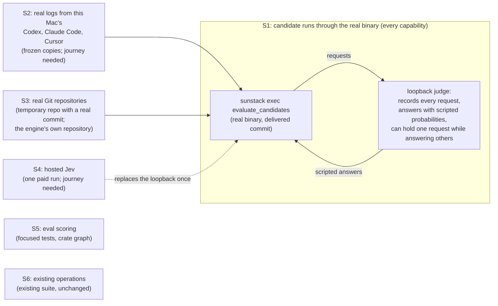

# Session ingestion and decision trees: how we'll know it works

Draft 2, by the 🦁 Lead, 2026-10-27. Part four of Project 2's design set: [requirements](requirements.md), [specification](specification.md), [program design](program-design.md), verification design. It plans, for each requirement, the observation that tells a correct build from a wrong one, where that observation happens, and what it leaves open. **It is a plan: nothing below has been run or observed.** Each "passes when" names a build that would fail it. Draft 2 follows the corrected Specification and Program Design (review findings D1 to D8).

The owner's view is each row's first three cells and its last: the requirement, how it will be proven, and what stays unverified. Review, the plan and the 🔬 Verifier read every cell.

## Where the proof happens

The loopback judge is the one stand-in. It keeps everything real except the model, so S1 decides what the engine does with an answer, never whether an answer is right. Answer quality is what evals measure (U17).

## Shared observations

Each is described once; rows name it and say what they read in it.

- **S1, a candidate run through the real binary.** The `sunstack` binary built from the delivered commit on this Mac (macOS on Apple Silicon, the repository's debug build through its signing runner), driven as `sunstack exec` with an `evaluate_candidates` request on stdin through the existing process-test support (`crates/sunstack/tests/support`: it runs the real binary and reads the response envelope and exit code). The backend endpoint is the existing loopback server (`crates/sunstack-rules/tests/support/controlled_http.rs` and the decisions crate's test server), which records every request body and answers each question with a probability the test scripts, and can hold one request open while answering others, so a test controls the order answers arrive. Inputs are committed fixtures: logs in each built-in provider's format (shapes copied from real logs, contents synthetic and public-safe), RuleSet and router files written for the test, outside-evidence documents and payloads, and temporary Git repositories the test creates with real commits (S3). It reads the envelope, the whole serialized bundle and every recorded request. Real: the binary, decoder, admission, locator, readers, positioned records, privacy projection, code context, matcher, planner, page planner, scheduler, materialization, pager, settlement, outcome mapper, projector and HTTP transport. Replaced: the model. These are product tests the plan adds; no journey.
- **S2, real logs from this Mac's agents.** `needed:` a `verify-sunstack-rule` route, "candidate runs on real logs". The Verifier copies one recent finished session each from the installed Codex, Claude Code and Cursor on this Mac into the run's system-temp evidence folder (frozen, never copied while being written, never committed), points each built-in recipe at the copy through the run's recipe override, and runs the real binary twice: with mechanical-only rules (no model) and with the loopback judge. A script reads each frozen file on its own and compares every record's author and positions with the file's own lines. Lifetime: **lasting**, because providers change their log formats without notice.
- **S3, real repositories for code context.** Inside S1: a temporary repository the test builds and commits, holding a function changed in its middle with a second planted match elsewhere in the same function (outside the changed lines), its caller in another file, an import, a call to a name defined nowhere (unresolved), a call to one of two same-named functions (ambiguous), a credential-shaped string in the touched function, and, after the commit, an uncommitted edit to the caller in the worktree. Plus one run over the engine's own repository at a pinned commit, large enough to reproduce the 76,772-character metadata case the Requirements cite. It reads each recorded request's page text and the bundle's contexts, pieces, pages, coverage and privacy report.
- **S4, one hosted Jev run.** `needed:` a hosted route for `evaluate_candidates` in `verify-sunstack-rule`, shaped like its existing hosted routes: one run over S2's frozen Codex session with a two-question tree (a gate with an uncertainty band, then a verdict) against hosted Jev through the real binary, with `OPENROUTER_API_KEY` supplied from the owner's secret store for that one command, never stored. It saves the backend's raw response bodies beside the bundle. Lifetime: **lasting**, because the hosted model and its response format can change.
- **S5, eval scoring.** Focused tests in the new evals crate over a frozen case file and frozen bundles; a pure rule, so no app launch. Plus a structural check of the crate graph (`cargo tree -p sunstack-rules -e normal`), and one S1 run of an eval whose recorded judge requests are scanned for planted label text.
- **S6, existing operations unchanged.** Reuse of the existing workspace suite at the delivered commit (`cargo nextest run --workspace`, as `verify-sunstack-rule`'s `library-gates.md` runs it), with every pre-existing test file unmodified in the delivery's diff except A22's three explicit cutover cases (see S6 edit boundary below): the process tests under `crates/sunstack/tests/process_*.rs` (which drive the real binary, for example `process_protocol.rs`'s unknown-field refusal at the process boundary), the rules library tests (including the binding admission that refuses an unbound input), `crates/sunstack-evidence/tests/conversation_capture.rs` (the old merged records and their cursors) and `crates/sunstack-rules/tests/contract_schemas.rs` (generated schemas against the reviewed examples).

## The rows

### inputs

| Requirement | Proven by | Reference | Target and journey | Passes when | Reuses | Unverified |
| --- | --- | --- | --- | --- | --- | --- |
| **U1** sessions named by provider and session, strictly checked. R1 (seam: the operation's strict decoder), R2 (seam: the session locator, per input) | Send a malformed input and see it refused with the bad field named before anything runs; send two sessions and see records from both. | C1's published input schema; V1, V2 | S1, no journey | A misspelt top-level field (`sourcse`) and an unknown provider value each return `invalid` naming that field's path, exit 2, with zero requests recorded and no bundle. Two session entries over two fixture logs give candidates whose occurrences name each entry. Fails: a decoder that ignores unknown fields; a run that reads only the first entry. Passes too: a refusal listing several diagnostics, if the failing field is among them. | none: `process_protocol.rs` shows the same refusal for existing operations only | Linux and release builds; the npm launch channel |
| **U2** Codex, Claude Code and Cursor built in; anything else a custom entry. R3 (seam: recipes and the locator), R4 (seam: the schema-mapped reader) | Run a rule over a real session from each of Codex, Claude Code and Cursor, named only by provider and session, and over a custom JSONL source described by its own schema, and see each reach outcomes; ask for a session that doesn't exist and see "unlocatable", not "nothing found". | V3 real logs; V4 a custom JSONL source | S2 (lasting) for the three providers; S1 for the custom entry and the unlocatable cases | Each provider's frozen session gives candidates whose occurrences resolve to lines in that provider's file; the custom source gives outcomes whose occurrences resolve to its lines. A missing session reports the input `unlocatable` with `missing`, and a session id present in two files with `ambiguous`; either makes the run `partial`, never `nothing_found`. Fails: a recipe that returns zero records for a missing session; a Cursor recipe that reads nothing and reports success. | none | other machines' install locations; Cursor's database while Cursor is writing; archived and split sessions (Requirements, *Not verified*) |

| **U3** adding an agent is a recipe, not code. R3 (seam: recipes as data) | Add a made-up provider with only a recipe in the run's input, using an existing log format, and see its session located and read with no engine change. | C2; V3 | S1, no journey | A recipe for a provider named `codex-copy`, using the Codex format and a root pointing at a copied fixture folder, locates and reads the session there, with records attributed to `codex-copy`. Fails: a locator with built-in paths that ignores the recipe's roots; a provider list fixed in code that refuses the new name. | none | a genuinely new storage format, which U3 allows to need one adapter |
| **U4** records attributed and never silently dropped; private content left out. R5 (seam: positioned records), R6 and R32 (seam: the privacy projection on every new-path route) | Read logs where a tool call and its result sit on different lines and a message streams over several, and see each record point to its own lines; plant private content in a log, a changed function, an outside document and a dropped item, and see none of it leave unless a rule asked for it. | V5 the source log's own lines; V6 a log with thinking and encrypted reasoning; V32 | S2 (lasting) for real positions and real encrypted reasoning; S1 for planted content | A match in a tool call on line 10 whose result is on line 20 gives an occurrence at line 10, and the result is its own record at line 20; a message streamed over lines 30 to 33 is one record listing all four positions; every record's author matches its line's role; a malformed line is listed as unfit with its position. Planted sentinels (a thinking block, a reasoning item, a credential-shaped string in a log, in the S3 touched function, in an outside document and in a record the pass drops) appear in no recorded request, no page, no sample excerpt and nowhere else in the bundle; the privacy report counts each by route and kind; a code page marks the redacted piece `redacted`. Two otherwise identical Codex assistant messages, one on the analysis channel and one final, give the first counted as `analysis_channel` and left out and the second kept; a message mixing visible text and a thinking block keeps the visible text and leaves out only the thinking; a standalone reasoning item is counted as `encrypted_reasoning` and appears nowhere (Program Design amendment A3). A rule that declares `private_access` for thinking receives it for its own candidates only, and `privacy.granted` lists it: with rules A (granted) and B (not) matching the same message, A's recorded requests carry the planted thinking and none of B's requests, router question included, do. An external adapter registered only for the old path makes its input `unlocatable` (`unreadable`) on this operation. Fails: the result's line reported as the call's (today's merge); a reader that skips a malformed line silently; a projection that covers records but sends code or outside text unprojected; one rule's grant reaching another rule's request. | partly: `conversation_capture.rs` decides positions and gaps for the existing merged records (and, unchanged, that the refactored readers still merge as before); the new projection needs S1 | plain-text thinking in real logs (Claude's is empty today, Codex's is encrypted), so the plaintext case is planted only; credential detection beyond the patterns the projection knows |
| **U5** a diff or code as input, no session; a diff starts context, never limits it. R7 (seam: the code context index and `context_parts`) | Give the engine a real commit and a real file, with no session, and see candidates from each reach outcomes; see a match elsewhere in a changed function kept, unless the rule asked for changed lines only. | V7 a real commit; a real file | S1 with S3 | A diff input gives a candidate for the planted match in the changed lines (part `change`) and one for the second match elsewhere in the same function (part `touched_unit`), each with the hunk's before and after spans as `git diff` shows them; the same rule with `context_parts: [change]` keeps only the first. A code input gives candidates at the matched spans. No session input is present. Fails: the second match dropped by default (changed lines as an implicit limit); a hunk with only its after side. | none: the existing change tests decide capture, not candidates | renames and binary files in a diff |

A16 custom-entry control (R4, S1): for JSONL and JSON, supply one valid mapped record, one JSON Schema mismatch and one missing required raw-record pointer. Only the first reaches judgment; both unfit records retain their actual positions, and subsequent valid records continue. The schema is `{ format: json | jsonl, record_schema: <JSON Schema>, fields: { output_name: <JSON Pointer> } }`; recipe mappings use the same raw-record pointer basis.

A17 framing control (R4/R5, S1): capture a complete JSON object/array without a final newline and retain its records. A truncated document reports capture incomplete, never complete empty or record-schema mismatch. Existing JSONL commitment and old format/cursor cases remain unchanged.

A18 mapped-privacy control (R32, S1): map both thinking and public fields from the same native record. Without a grant, thinking is absent and the public field remains; the grant permits thinking only for that rule. The record identity stays fixed. A pure custom source's mapped field appears as ordinary data. A mapping of `encrypted_content` never shows its bytes even with an `EncryptedReasoning` grant, counts it left out and keeps a public sibling (A18a).

A19 code-pass contract control (R7/R8, S1): an `ast { language, pattern }` predicate matches through the engine's supported Rust/TypeScript/TSX path; an unsupported language is refused invalid before any model request. Existing named-field predicate files parse unchanged, and omitted `context_parts` reads all parts. Code revisions/paths use `RevisionHead`/`QueryPath`; located repository input attribution is explicit.

A20 occurrence controls (R7/R19, S1 with S3): the planted literal yields exactly the changed after-side match and one unchanged match in the touched function; a deleted literal is reported from the before side. An AST const/item match outside every extracted unit retains its exact span with unit absent. Two identical captures/runs yield identical occurrence identities despite fresh capture-instance snapshots; full provenance is retained. Explicit `SourceSides` before/both overrides are checked separately. A21 checks stable SourceInputId across identical runs, and two distinct overlapping code inputs produce separate candidates retaining each entry's own bindings.

### filtering

| Requirement | Proven by | Reference | Target and journey | Passes when | Reuses | Unverified |
| --- | --- | --- | --- | --- | --- | --- |
| **U6** a mechanical first pass that keeps, never decides. R8 (seam: `CandidateSource::discover`), R11 (seam: definition admission) | Run a rule's first pass over planted cases and see each planted match kept at its exact record, and each non-match dropped; swap only tool names and see nothing change. | V8 labeled filter cases; V11 paired cases | S1, no journey | Each planted match, including one inside a JSON-encoded tool argument, becomes a candidate at its record; each non-match doesn't. On `evaluate_candidates`, a rule whose verdict is a mechanical test over record fields is refused at admission. Two sessions identical except for tool names, given the same scripted answers, give identical outcomes. Fails: a pass that reports only that a source contains a match; a pattern run on the raw JSON line, missing the decoded argument; any outcome that changes with tool names. | none | the filter's real recall, which only evals measure (U17) |
| **U7** an optional Jev narrowing pass. R9 (seam: the narrowing gate) | Run the same rule with and without a narrowing pass and see every candidate the narrowing dropped listed with its answer. | V9 | S1, no journey | With narrowing over five candidates, where the loopback answers "no" for two, the bundle has five entries: those two `dropped` at the narrowing question with their answers, three judged. Without narrowing, all five are judged and no narrowing request is recorded. Fails: the two narrowed-out candidates missing from the bundle. | none | none beyond S1's stand-in model |
| **U8** each pass samples what it drops. R10 (seam: `rejected_sample`, deterministic) | Run a rule that drops many items and see a sample of them returned, the same sample on a second run. | V10 the run's dropped set | S1, no journey | Over a fixture with 50 non-matching records, the bundle carries 20 mechanical samples (the default), each a record that pass really dropped and none a kept one; a second run over the same input returns the same 20. Fails: no samples; samples that include kept candidates; a different sample on each run. | none | whether 20 per pass is enough for evals, settled when evals run (U17) |

### judging

| Requirement | Proven by | Reference | Target and journey | Passes when | Reuses | Unverified |
| --- | --- | --- | --- | --- | --- | --- |
| **U9** each candidate runs its rule's tree on its own; trees are configuration. R12 (seam: one group per candidate, its rule switched on), R15 (seam: per-entry evidence), R16 (seam: `definitions`, router or rule sets) | Run a session with several candidates, a scripted different answer for each, and see each outcome follow its own answers; run a new router and its rules, written only as configuration, and see routed, not routed and uncertain candidates each end as they should. | V12 a multi-candidate session; V15 paired contexts; V16 a new tree's configuration | S1, no journey | Every recorded request carries exactly one candidate's material and no other candidate's text, and each candidate's outcome follows the answers scripted for it; two rules matching one occurrence give two entries, asked in separate requests (router questions included), each with its own outcome. With a new router (never seen by the engine's tests) whose routes name two RuleSets: a candidate routed to its RuleSet runs its gates and verdict; a candidate whose RuleSet the chosen route doesn't name ends `dropped` at the router with its answer; a router answer below its confidence floor ends `uncertain`. Two source entries with the same excerpt but different `evidence` (a repository file that uses the library, and one that doesn't) get requests carrying each entry's own evidence. A router whose input mapping is ambiguous is refused `invalid` before any request. Fails: one request holding every occurrence (today's one-target judgment); one entry's evidence in another's request; an unrouted candidate missing from the bundle. | the rules crate's `tests/binding_groups.rs` shows separate groups already get separate requests and occurrences, and `tests/router_execution.rs` decides routing for `evaluate_rules`; neither drives `evaluate_candidates` | the judge's real behavior (S4 runs one hosted tree) |
| **U10** each question names its evidence; missing evidence is unknown, never no. R13 (seam: new-path admission and the outcome mapper), R15 | Mark a question's outside fact unavailable, leave it out, or make its capture fail, and see that candidate end unresolved, naming the fact, while the rest of the run goes on. | V13 cases with the evidence unavailable or not supplied | S1, no journey | With an owner-decision payload supplied against its schema in `payload_schemas`, the candidate whose verdict reads it is judged and its request carries the payload; with a run-output document bound, the same (the control); with the decision marked `unavailable`, the candidate ends `unresolved` (`evidence_unavailable`, naming the input), no request is recorded for that question, and the other candidates in the run are judged; with the binding left out, the same; with a repository revision that doesn't exist, `evidence_not_captured`. A payload whose schema isn't in the catalog, or whose value doesn't match it, refuses the run `invalid` naming the field, before any request. The same input with a missing binding on `evaluate_rules` is still refused `UnboundInput` (S6). Fails: a valid payload fact reported unavailable (no catalog route); a bad payload treated as unavailable or judged anyway; the run refused for one fact marked unavailable; a missing fact treated as a failed gate, ending `dropped`. | none | evidence kinds beyond repository, owner decisions and run output |
| **U11** Jev's certainty carries through. R14 (seam: the uncertainty band; settlement can be uncertain) | Give answers just inside and outside a question's confidence floor and see the inside one come back uncertain, its probability exactly as reported; run one real hosted tree and see the same. | V14 the model's reported answers | S1, no journey; S4 (lasting) for the hosted model | With a gate's threshold at 0.5 and its floor at 0.7, a scripted 0.55 ends `uncertain` with 0.55 in its `AnswerRecord`, 0.9 passes, and 0.1 ends `dropped`. In S4, each `AnswerRecord.answer` equals the matching answer in the saved hosted response. Fails: a binary gate that passes 0.55; a rounded or recomputed probability. | `router_execution.rs` decides uncertain router intent for `evaluate_rules`, not the new outcome | other hosted models |

### outcomes

| Requirement | Proven by | Reference | Target and journey | Passes when | Reuses | Unverified |
| --- | --- | --- | --- | --- | --- | --- |
| **U12** exactly one outcome each; a partial run never reads all clear. R17, R18, R19 (seam: outcome mapper and bundle projector), R33 (seam: scheduler bounds, summed usage) | Replay runs that end all dropped, all uncertain, mixed and stopped partway, and see each headline say what really happened; read the saved bundle alone and open every candidate at its line, with the answers and evidence that led there; see model use stay within its limit and be reported. | V17 the run's candidate count; V18 three replayed runs and a stopped one; V19 the bundle against its sources; V33 the run's limits and usage | S1, no journey | Entry count equals candidate count in every run, including one where the loopback fails a request (that candidate `not_processed`, `evaluation_failed`). Headlines: all dropped is `nothing_found`; all uncertain is `inconclusive`; findings with uncertain ones is `findings` with its inconclusive count; one unlocatable input makes it `partial`; a run with `max_requests` 2 over five candidates records at most two requests, ends `partial`, and lists the rest `not_processed`, `run_stopped`. A script given only the serialized bundle and the source files resolves, for one entry of each outcome kind, its occurrence to the exact line or span, every `AnswerId` its outcome names to an `AnswerRecord` in the same entry, and every evidence use to its binding or `unavailable`. The bundle's usage equals the sum of the scripted usage. Fails: `nothing_found` while any candidate is uncertain (today's report counts uncertain intent as complete); an outcome whose answer reference doesn't resolve in the bundle; a third request sent; usage missing. | none | cost reported by the real provider (S4 reads it once) |

### code-context

| Requirement | Proven by | Reference | Target and journey | Passes when | Reuses | Unverified |
| --- | --- | --- | --- | --- | --- | --- |
| **U13** a diff, its whole touched functions and related code, the same for Jev and reviewers. R20, R21 (seam: code context builder), R25 (seam: paged settlement), R26 (seam: pages carried whole in the bundle) | Change the middle of a function in a real commit and see the change, both sides of the whole function, and its callers, callees and imports, as they were at that commit, reach Jev; see a reviewer get the same pages from the bundle; split a context over pages and see each kind of question settle by how it reads pages, whatever order the pages answer in. | V20 a real commit; V21 a real repository's AST graph; V25 a planted conflicting page and a question of each reading; V26 the two requests | S1 with S3, no journey | The pages hold the hunk, the whole changed function on both sides, and the caller, callee and import, each with its kind. The caller's text is the committed one, and the uncommitted worktree edit appears nowhere. Each bundle page's text is byte-identical to the page text in its recorded request. Over a three-page context: an `any_page` question answered no, no, then (held, arriving last) yes ends passed; an `every_page` question answered yes, yes, then no arriving last ends did not pass; an `every_page` question whose third page is never answered (failed) ends `unresolved` (`page_missing`); a `whole_context` question sends no request and ends `unresolved` (`needs_whole_context`); with `max_requests` reached mid-pages, the question settles by its reading with the rest `not_sent`. No answer is a majority or an average. Fails: only the changed lines; worktree text in the commit's context; a question settled by the first page to arrive when its reading needs every page; a settlement of 0.67 from three pages. | `crates/sunstack-evidence/tests/relationship_discovery.rs` decides graph facts on real files; it doesn't decide pages, settlement or revision | historical graphs for languages the engine doesn't parse |
| **U14** each related piece says how likely it is related. R22 (seam: the related-piece projection and its labels) | Include a call to a name defined nowhere and a call the graph can't tell apart, and see both kept and labeled uncertain: the first by its name and reason with no code, the second with its code. | V22 a graph with a call to a name defined nowhere and an ambiguous edge | S1 with S3, no journey | The call to a name defined nowhere appears as an `unresolved` piece with the name as written, its call site and the reason, labeled `uncertain`, and no source text anywhere in the pages; the ambiguous call appears `resolved` with its source, labeled `uncertain` with its reason; the resolved caller is `probably_related` with its graph fact; the changed function is `related`. No piece is `unrelated` unless the rule's narrowing judgment said so, and then it carries that answer. Fails: unresolved edges dropped; invented source for a missing target; `unrelated` given without a judgment. | none | whether the labels are accurate, measured by evals (U17) |
| **U15** at most 20,000 characters of context per request, larger context paged. R23, R24 (seam: the pager, one page per page request), R25 | Build a context far over the limit and see every request carry one page of at most 20,000 characters, counted the way the request renders it, in pages that keep functions whole and say what the other pages hold. | V23 every request of an oversized context; V24 a context larger than one request | S1 with S3, no journey | For each recorded request, the characters beyond the same request built with an empty context (recorded first, as the baseline) number at most 20,000 and equal its page's own count, including over the engine's own repository, where metadata alone exceeds the limit today. No function's text is split across pages; each page names its revision, "page k of n" and what the others hold; coverage lists every piece as sent, excluded, redacted or never found. A function larger than one page renders its signature, a head, one `… N lines truncated …` gap marker with the correct omitted count, and a tail, together within the cap; its coverage says `truncated` and names the omitted range. The configured head/tail split can change. Fails also: a dropped signature; exceeding the cap; silently sending the head only; coverage claiming the whole unit. Fails: a limit counting only code excerpts, so metadata pushes a request over; two pages in one request; a function cut between pages. | none | none |
| **U16** a code rule's matches with their related code. R27 (seam: per-match code occurrences) | Run a code rule that matches twice in one function and see two candidates, each with that function's related code. | V27 a code rule over a real repository | S1 with S3, no journey | Two matches in one function give two candidates, each at its own span, each with the function's callers as context; one match inside nested functions gives one candidate. Fails: one candidate per function. A repository input yields every match; a diff input yields only touched or call-reachable matches. Every candidate carries callees, callers and imports. Fails also: ignoring diff scope, dropping related context or turning a whole file into one candidate. | none | none |

### evals

| Requirement | Proven by | Reference | Target and journey | Passes when | Reuses | Unverified |
| --- | --- | --- | --- | --- | --- | --- |
| **U17** each rule scored on real, labeled, held-out evidence. R28, R29 (seam: eval store, `EvalReport`), R30 (seam: no dependency from rules to evals) | Score a rule on a frozen labeled set and see its misses, wrong calls, unknowns, cost and speed reported, with a changed label refused after freezing and no label ever reaching the judge; then score one real rule once on real sessions. | V28 the eval's frozen record; V29 the eval report; V30 the judge requests | S5, no journey, for scoring and the boundary; `needed:` a temporary eval journey for the real run | On a frozen set built for the test, every field of the `EvalReport` matches a hand-worked table: the rule version and case-set identity, the split, the filter's misses (by case), each step's correct, wrong and unknown answers (by case), the end result, `unknown_labels` counted and never scored as negative, cost and speed. Changing one label after freezing makes scoring refuse. No session appears in both the development and held-out sets. Through `score_eval` on the real binary (S1, Program Design amendment A1), a case whose verdict reads an owner-decision document gets that frozen binding in its recorded request and is scored on its answer; the same case frozen with the binding `unavailable` sends no request for that question, ends `unresolved`, and is scored unknown, never as a wrong call. `cargo tree -p sunstack-rules -e normal` lists no `sunstack-evals`, and no recorded judge request in an eval run contains the planted label text. The temporary journey: the Lead freezes 20 labeled cases from S2's logs for one session rule, then the Verifier runs one hosted eval and reads its report. Fails: an unknown label scored as a miss; a report field missing; a label rendered into a judge's prompt; an eval whose evidence-dependent question is always unresolved because the eval entry dropped the case's frozen facts. | none | the quality of the labels in the one real run, and any rule's real accuracy, which that first real eval begins to show; Project 1 may change the scoring method (Requirements, *Boundaries*) |

### cross-cutting

| Requirement | Proven by | Reference | Target and journey | Passes when | Reuses | Unverified |
| --- | --- | --- | --- | --- | --- | --- |
| **Existing callers** (Requirements, *Boundaries*). R31 (seam: the protocol boundary's one new arm; `admit_group` and the normalizer unchanged) | Run the engine's whole existing test suite, untouched, against the new build and see it pass; send an old operation a log with thinking in it and an unbound input, and see the same answers as before. | V31 the current protocol's requests | S6 (reused); S1 for the thinking case | The workspace suite passes at the delivered commit with no pre-existing test file edited outside A22's three explicit cutover cases (see S6 edit boundary below), including the old merged-record and cursor tests and the unbound-input refusal; an `evaluate_rules` conversation run over a log with a thinking block selects that block as it did at `1e986a9e`; and two otherwise identical Claude lines differing only in `origin.kind` (`hook`, `user`), plus one with no origin, normalize to known injected, not injected and unknown, and the old selection with hook text excluded drops only the first, as at `1e986a9e`. Fails: an existing test edited to match new behavior; the privacy projection or the new admission applied to the old operation; the old normalizer changed to split calls and results; the refactored reader folding a hook's line and a user's identical line into the same injection. | S6: the existing process, rules, capture and schema suites, real binary and real evidence, applicable while they run at the delivered commit with their files unchanged | callers outside this repository, such as hosts that monitor agents |

U4's row carries R32, and U12's row carries R33.

## Journeys still needed

| Journey | In | Entry it drives | What it reads | Lifetime |
| --- | --- | --- | --- | --- |
| candidate runs on real logs (S2) | `verify-sunstack-rule` | `sunstack exec evaluate_candidates` over frozen copies of this Mac's Codex, Claude Code and Cursor sessions, recipes pointed at the copies | located or unlocatable per input; every record's author and positions against the frozen file; unfit and private counts; sentinel scans | lasting |
| hosted candidate run (S4) | `verify-sunstack-rule` | the same, against hosted Jev, credential for one command | `AnswerRecord`s against the saved responses; usage and cost | lasting |
| first real eval (U17) | the task's scratch | one hosted eval of one session rule over 20 frozen, labeled cases from S2 | the eval report against its frozen cases | temporary |

Both lasting journeys are built, by the Verifier's maintenance owner, before any observation that depends on them.

## What stays open

- **O1 and O2 are settled** (A14/A15, 28 October). U15 tests oversized-function truncation with signature, head, marked gap, tail and honest coverage; U16 tests input-dependent match scope and related context.
- **The model.** Everything except S4 and the first real eval uses a scripted judge; whether Jev answers well is what evals measure, beginning with that one run.
- **Platforms.** One Mac, Apple Silicon. Linux, release artifacts and the npm channel are unverified for this project.
- **Real logs** cover one recent session per agent on this Mac; plain-text thinking is planted, because real logs don't carry it today.

## Skill standards as decision models (A22)

Each row runs in the existing harnesses (S1's loopback judge for structure; S5 for the evals crate; real Jev only in P9 and the first skill eval). Each names the wrong build it must fail.

| V | Passing condition | Builds that fail it |
| --- | --- | --- |
| V34 | One Markdown file with frontmatter, three sections, paragraphs and list-contained call sites (CRLF and non-ASCII text included): the unchanged real entries `reference.teaching-depth` and `branch.condition` give exactly their selectors' units and call sites as candidates, each with one subject, one expansion, and raw and visible text and byte and line spans equal to the frozen source. An explicit-pass paragraph entry keeps only the paragraphs whose visible text matches. An `ast` pass on a document target is refused at admission by name. | one whole-file candidate for a no-pass entry; units taken from the pass instead of the target; a unit expanded twice; a section that runs past a peer heading; a span off by a byte; an incompatible pass admitted |
| V35 | A judged rule targeting `description` is admitted; its finding's anchor is the field's span; a quoted and a block scalar keep their decoded values; absent and malformed blocks reach the tree as distinct states, malformed settling `unresolved`. The mechanical rule with a model question is still refused. | a refusal; a finding anchored at the title; absent collapsed into empty text; malformed treated as pass |
| V36 | A real marked standard with a mechanical pass, a narrowing pass and two gates: the assembled rule and the recorded requests carry all of them, and the verdict question is the marked sentence. In one file: a unit that narrowing rejects, though its gates would allow it, ends dropped at narrowing with its own `AnswerRecord` and no gate or verdict requests; a unit that passes narrowing and a gate gets its verdict; a unit a gate rejects gets no verdict request. A rule with no narrowing is the control. | narrowing asked but its answer ignored; gates dropped in assembly; one document-level gate for all units; an inapplicable unit judged anyway; content from one unit in another's request |
| V37 | The three real skill RuleSets check with no target, binding or key and return their assembled rules; an invalid pattern, an empty field name, an orphan marker and a broken router reference are each still refused by name; the old bound request is refused by name. The same new-shape, old-shape and bad-selector cases pass through `sunstack-lint`'s config validation, the published schemas and the process entry point. | a required binding; a dropped selector check; an old request silently accepted; lint still building a bound check; a schema that refuses the tree fields Rust admits |
| V38 | In S5: a skill eval freezes cases whose groups are derived from their document anchors; two anchors in one document can't be split across development and held-out; a genuine cross-split group is refused; a case file carrying `session` or `group` is refused; a complete repository run's missed positive scores missed while an incomplete capture stays unknown. A whole `score_eval` binary run belongs to P8b. | a supplied group accepted; a forged session on a code case accepted; one document split across sets; a repository miss scored unknown |
| V39 | Identity: rerunning identical frozen inputs keeps every occurrence identity; two fields with equal values stay distinct; two rules on one unit stay two candidates. | identity from content alone; rules merged on one unit |
| V40 | Polarity, paired: a section that meets `reference.teaching-depth` (scripted verdict pass) ends `Dropped { at: verdict }` and one that fails it ends `Finding`; a description within 300 characters ends `Dropped` with a local answer and one over it ends `Finding` at `error`; an existing finding-oriented candidate tree, unchanged, still maps pass to `Finding` (the control); an uncertain verdict stays `uncertain` for both. In S5, a conformance rule's `no`-labeled case scores as a true finding and its `yes`-labeled case as a correct negative, while the finding-oriented control scores as before. Also in S5, a conformance `no`-labeled defect that the mechanical pass drops (no candidate entry at all) counts in the filter's positive cases: as missed when capture is complete and the rule's discovery completed, and as unknown when either isn't; the finding-oriented `yes` control and unknown-label protection score as before. A case set whose manifest names a rule missing from its frozen definitions refuses to freeze and to load. | pass mapped to finding for a marked standard; every tree flipped; `Checked` reported refused; labels scored without the rule's meaning; a filtered-out conformance defect absent from recall; meaning read from a candidate entry or live definitions |

End-to-end (proved in Project 1, not here): the released engine, called by the skill rule runner over every plugin with Jev on, evaluates a marked decision model and catches a planted defect. A22 lands only through a tagged release.

### S6 edit boundary for the explicit cutover

**Edit boundary.** The plan's rule that no pre-existing test changes (plan line 49, Verification Design S6) is superseded for exactly three things:
- tests that assert acceptance of the retired bound `check_rules` request shape;
- the judged-frontmatter refusal test;
- the eval fixtures that construct `LabeledCase` with `session` (`crates/sunstack-evals/tests/support/mod.rs:19` and its callers), which move to derived groups.

Every selector, marker, unknown-field, mechanical-question, outcome, scoring, freezing, unknown-label and split-leakage assertion they hold is kept under the new valid shapes. Two refusal controls are added: the old bound check request, and an old case file carrying `session`. Any other pre-existing test change is a stop.
