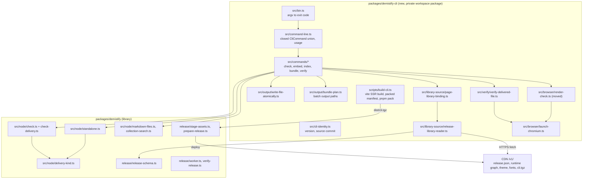
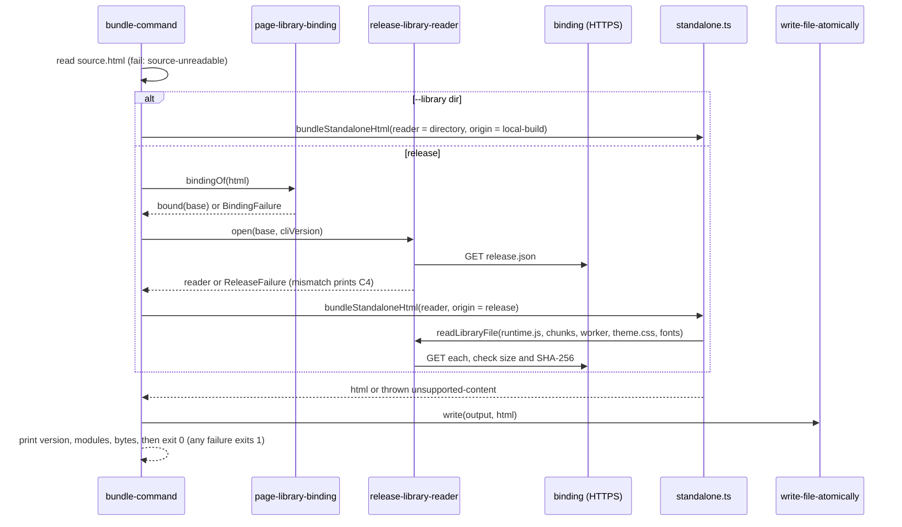

# Demistify standalone delivery: program design

This realizes the [Specification](specification.md) in this repository, read at `origin/main` 6551247. The library keeps every rule about documents: checking, embedding, indexing and the bundle transform. A new workspace package owns the command line, release resolution and browsers. The dependency runs one way, and only at build time: the CLI compiles library node code into its archive. The library never imports the CLI.

## Components



| Component | Job | Reason to change |
| --- | --- | --- |
| `demistify-cli/src/bin.ts` | Turn `process.argv` into one `CliCommand`, run it, and set the exit code | process contract |
| `command-line.ts` | Parse arguments into a closed union `CliCommand` (`check`, `check-hook`, `embed`, `index`, `bundle`, `verify`, `version`, `help`, `usage-error`), and own the usage text. `check-hook` keeps today's Claude Code hook contract: read the event from stdin, stay silent on clean files, exit 2 with findings on stderr. | C1 changes |
| `commands/*-command.ts` | One command each: read inputs, call the library, print, return an exit code. `check`, `embed` and `index` move unchanged from `packages/demistify/bin/demistify.ts`. | one command's behavior |
| `cli-identity.ts` | Expose `cliVersion` and `cliSourceCommit`. The version is imported from `@sunstack/demistify/package.json`, which Vite inlines at build. The commit is the define `__DEMISTIFY_CLI_SOURCE_COMMIT__`, which `build-cli.ts` sets from `git rev-parse HEAD`, as `prepare-release.ts` does for the release. From source, where the define is absent, it reads `source checkout`. | release identity |
| `page-library-binding.ts` | Find the theme link and runtime script and derive one `LibraryBinding` from their shared base URL | binding rules (R9) |
| `release-library-reader.ts` | Fetch `<binding>release.json`, parse it with `releaseManifestSchema`, apply the version guard, and expose `readLibraryFile(path)`, which verifies size and SHA-256 | release contract (R5, R6) |
| `launch-chromium.ts` | Launch headless Chromium from `playwright-core`: the `chrome` channel first, then Playwright's Chromium. It returns a launched browser or `browser-unavailable` with each attempt's error. | browser discovery |
| `render-check.ts` | Moved from the library unchanged, except that it launches through `launch-chromium.ts` | `check --render` |
| `verify-delivered-file.ts` | Open one file from a `file:` URL, block network on request, drive the page, and return one `VerificationResult` | R14–R16 |
| `write-file-atomically.ts` | Write to a sibling temporary file, then rename. On failure, remove the temporary file. For a batch, write every temporary file first, then rename each; on failure, remove the temporary files not yet renamed, and report which outputs were renamed. | R10, R23 |
| `bundle-plan.ts` | Turn a batch's sources and `--out-dir` into output paths: find the sources' nearest common directory and keep each relative path. Reject, as `output-collides-with-source`, an output that resolves to the same file as any source, a source given twice (by real path), or two sources mapping to one output (names compared case-insensitively when the output directory's file system is case-insensitive) | R22, R23 |
| `scripts/build-cli.ts` | Compile `src/bin.ts` to `dist/package/bin/demistify.js`, write the packed `package.json`, and run `pnpm pack` to produce `dist/cli.tgz` | archive shape (R3, C2) |
| library `delivery-kind.ts` (new) | Read bundle metadata from a parsed document: `{ kind: 'bundle', metadata }` or `{ kind: 'linked' }` | C3 |
| library `check-delivery.ts` (new) | Delivery findings under one rule name, `delivery`: misnamed standalone (R12) and a bundle that still loads remotely (R13) | R12, R13 |
| library `standalone.ts` | The bundle transform, reading the library through a supplied reader and writing metadata | R7, R8 |

`check.ts` is already 852 lines. Delivery rules go in `check-delivery.ts`, so `check.ts` gains only a call and a skip.

## Obligation bindings

| R | Realized at | How |
| --- | --- | --- |
| R1 | `build-cli.ts`, `stage-assets.ts`, `prepare-release.ts`, `worker.ts` | The packed manifest declares `bin: { demistify: "bin/demistify.js" }`, compiled JavaScript (not TypeScript; pnpm `dlx` refuses `.ts` under `node_modules`), and `engines.node >=26`. `prepare-release.ts` passes `cliArchivePath: packages/demistify-cli/dist/cli.tgz`, and staging places it at `v1/cli.tgz`. |
| R2 | `command-line.ts`, `cli-identity.ts` | `--version` prints `demistify <version> (<source commit>)`. `--help` prints C1's usage lines. |
| R3 | `build-cli.ts`, `stage-assets.ts` | The packed `files` list is `["bin"]`. The build fails if `dist/package` contains any path that is not `bin/demistify.js` or `package.json`. `stageRelease` takes `cliArchivePath` and adds exactly `cli.tgz`. |
| R4 | `build-cli.ts` | Packed `dependencies` come from bare imports Vite left external. The `@sunstack/demistify` code is inlined, never a dependency. The build fails if a kept external has no declared version in the library or CLI workspace manifest. |
| R5 | `release-library-reader.ts` | It compares `manifest.version` with `cliVersion` and returns `release-mismatch`, carrying both versions and the C4 rerun command. |
| R6 | `release-library-reader.ts` | `readLibraryFile(path)` requires `path` in `manifest.files`, fetches `<binding><path>` through `fetchReleaseBytes` (which already sets `redirect: 'error'`, `no-store` and a 20-second timeout), and compares the byte length and `hashBytes`. Results are memoized per path. |
| R7 | `standalone.ts`, `bundle-command.ts` | The transform is unchanged except for its reader. The command supplies local Markdown and Explorer resolvers relative to the page source. The Markdown resolver rejects a reference with a scheme or a leading `//` (the same test `embed` applies today) as `unsupported-content` naming it. A missing file is `local-source-missing` naming its path. |
| R8 | `standalone.ts` | It writes `<meta name="demistify-bundle" content="version=<v> source-commit=<sha>">` (or `version=<v> source=local-build`) into `<head>`. It marks the inlined theme `<style data-demistify-theme>`. |
| R9 | `page-library-binding.ts`, `standalone.ts` | The binding rules cover a missing link, split bases, and a base that is not HTTPS (loopback HTTP is allowed for local proof, as `publicOrigin` already allows). The existing transform errors cover ``, an unprepared `src` and remote Explorers. The resolvers in R7 cover URL Markdown and missing local files. |
| R10 | `write-file-atomically.ts` | The command writes only after the transform returns. |
| R11 | `check.ts`, `delivery-kind.ts` | When `delivery-kind` says `bundle`, `check` treats the offline modules script as loading the runtime and `<style data-demistify-theme>` as loading the theme. It exempts only that style element from `styling`. |
| R12, R13 | `check-delivery.ts` | `CheckOptions` gains `pageFileName`. A name ending in `.standalone.html` with `kind: 'linked'` is an error. A bundle with a theme link, a runtime script, or an `ex-markdown`, `ex-explorer` or unprepared `ex-mermaid` with `src` is an error. |
| R14–R16 | `verify-delivered-file.ts`, `verify-command.ts` | See the verify call path below. |
| R17 | `packages/demistify/skill/references/delivery.md` (new), `SKILL.md`, command references | It publishes with the release under `authoring/`. Every command example becomes `pnpm --package=https://demistify.getagentstudio.dev/v1/cli.tgz dlx demistify …`. |
| R18 | `ai-tools` `plugins/sunstack-dev/skills/presentation-html/` | The SKILL and `references/demistify.md` route by the reader's opening method to the guide's delivery reference, require `verify --no-network`, and drop "exists only as the source API". |
| R19 | `.agents/skills/verify-demistify/references/journeys.md` | A standalone journey: build, run `bundle --library packages/demistify/dist` on a PoC fixture, `check`, then `verify --no-network`. |
| R20, R21 | worktrees and branches | See delivery slices. |
| R22 | `command-line.ts`, `bundle-plan.ts`, `bundle-command.ts` | `CliCommand` `bundle` carries `target: { kind: 'single'; source; output } \| { kind: 'batch'; sources; outputDirectory }`. Without `--library`, a batch derives each page's binding and requires them all equal, otherwise `bindings-differ`. With `--library`, every page uses the one directory reader. Writing creates `outputDirectory` and each output's parent folders with `mkdir({ recursive: true })`. It opens one release reader for the batch; its per-path memo fetches and hash-checks each library file once, however many pages use it. |
| R23 | `bundle-command.ts`, `write-file-atomically.ts` | The command bundles every page in memory and collects each page's failure, so one bad page doesn't hide another. It writes only when no page failed. `bundle-plan.ts` rejects a source collision as `output-collides-with-source` before any page is read. |

`--library <directory>` is the one flag beyond R7. It reads a complete local build through a directory reader, records `source=local-build`, and skips the binding and version guard. R19 needs it to prove a bundle before a release exists. The guide documents it as a maintainer route.

## Interfaces

Library, replacing `libraryDirectory`:

```ts
export type LibraryFileReader = (path: string) => Promise<Buffer>;
export type BundleOrigin =
	| { readonly kind: 'release'; readonly version: string; readonly sourceCommit: string }
	| { readonly kind: 'local-build'; readonly version: string };
export interface StandaloneHtmlOptions {
	readonly sourceHtml: string;
	readonly readLibraryFile: LibraryFileReader;
	readonly origin: BundleOrigin;
	readonly resolveMarkdownSource?: (sourcePath: string) => Promise<string>;
	readonly resolveExplorerSource?: (sourcePath: string) => Promise<string>;
}
export function libraryDirectoryReader(directory: string): LibraryFileReader;
```

Paths are POSIX paths relative to the library root (`runtime.js`, `chunks/x-abc12345.js`, `fonts/y.woff2`). The four PoC call sites change to `readLibraryFile: libraryDirectoryReader(dist)` with `origin: { kind: 'local-build', version }` in the same PR, as a hard cutover.

CLI results, each with a closed `kind`:

```ts
type LibraryBinding = { readonly kind: 'bound'; readonly base: URL };
type BindingFailure =
	| { readonly kind: 'binding-missing'; readonly missing: 'theme' | 'runtime' | 'both' }
	| { readonly kind: 'binding-split'; readonly themeBase: string; readonly runtimeBase: string }
	| { readonly kind: 'binding-not-https'; readonly base: string };
type ReleaseFailure =
	| { readonly kind: 'release-unavailable'; readonly url: string; readonly reason: string }
	| { readonly kind: 'release-invalid'; readonly url: string; readonly reason: string }
	| { readonly kind: 'release-mismatch'; readonly cliVersion: string; readonly releaseVersion: string; readonly rerun: string }
	| { readonly kind: 'library-file-missing'; readonly path: string }
	| { readonly kind: 'library-file-integrity'; readonly path: string; readonly expected: string; readonly actual: string };
type BatchFailure =
	| { readonly kind: 'bindings-differ'; readonly firstPage: string; readonly firstBase: string; readonly page: string; readonly base: string }
	| { readonly kind: 'output-collides-with-source'; readonly source: string; readonly output: string }
	| { readonly kind: 'pages-failed'; readonly failures: readonly { readonly page: string; readonly reason: string }[] };

type VerificationFailure =
	| { readonly kind: 'library-not-loaded' }
	| { readonly kind: 'markdown-not-rendered'; readonly element: string }
	| { readonly kind: 'diagram-not-rendered'; readonly element: string }
	| { readonly kind: 'explorer-not-rendered'; readonly element: string }
	| { readonly kind: 'runtime-issue'; readonly message: string }
	| { readonly kind: 'page-error'; readonly message: string }
	| { readonly kind: 'request-blocked'; readonly url: string }
	| { readonly kind: 'timeout' };
type VerificationResult =
	| { readonly kind: 'passed'; readonly file: string; readonly screenshot: string }
	| { readonly kind: 'failed'; readonly file: string; readonly screenshot: string; readonly failures: readonly VerificationFailure[] };
type BrowserLaunch =
	| { readonly kind: 'launched'; readonly browser: Browser }
	| { readonly kind: 'browser-unavailable'; readonly attempts: readonly string[] };
```

`element` is `ex-markdown#id` when the island has an id, and otherwise `ex-markdown[n]` by document order. The structural `Browser` and `Page` interfaces in `render-check.ts` grow `route`, `screenshot` and `waitForFunction`. They stay structural, so neither the library nor the CLI source imports Playwright's types.

## Bundle call path



The transform and resolver errors keep their messages. The command reports them as `unsupported-content` or `local-source-missing`.

A batch runs the same path once per page, sharing one reader. The bindings are checked before the release is opened, and the outputs are written together at the end.

## Verify call path

For each file, using one browser across all files:

1. Launch through `launch-chromium.ts`. On `browser-unavailable`, print the attempts and how to provide a browser, and exit 2.
2. Open a page at 1400×900. With `--no-network`, install `page.route('**/*')`: it continues `file:`, `data:` and `blob:` and aborts everything else, recording each aborted URL. Record `[demistify]` console messages, console errors and `pageerror`.
3. Go to `pathToFileURL(file)` and wait for `load`.
4. In the page, check that `customElements.get('ex-markdown')` is defined; otherwise record `library-not-loaded`. Then scroll each `ex-markdown`, `ex-mermaid` and `ex-explorer` into view, and click each `[role="tab"]`. Wait until all of these hold, or until 20 seconds pass:
   - every `ex-markdown` has `prepared` (set in `islands/markdown.ts` after rendering);
   - every `ex-mermaid` has `prepared` and a direct `svg` child (`islands/mermaid.ts`);
   - every `ex-explorer` has `data-ready` (`explorer/explorer-controller.ts`).
5. Record `markdown-not-rendered` for each `ex-markdown` without `prepared`, or with `role="alert"`. Record `diagram-not-rendered` for each `ex-mermaid` without a direct `svg`, and `explorer-not-rendered` for each `ex-explorer` without `data-ready`. Record `timeout` if the wait expired. Record any value in `document.documentElement.dataset.exIssues` and each `[demistify]` message as `runtime-issue`.
6. Screenshot the full page to `<screenshots>/<file stem>.png`, by default a fresh `mkdtemp` directory printed in the report. Print one line per file and one indented line per failure.

The file is only read. Desktop width alone is enough here; the phone width stays in `check --render`.

## Packaging and release

The CLI workspace manifest is `private`, named `@sunstack/demistify-cli`. It has `@sunstack/demistify: "workspace:*"` as a dev dependency and `playwright-core` pinned to the PoC's Playwright version (`1.64.0`) as a dependency. Changesets ignores it (`.changeset/config.json`), because its published version is the library's version.

- Root `build` runs the library build, then `pnpm --filter @sunstack/demistify-cli build`, then the PoC. The deploy job's build step becomes the library build plus the CLI build.
- `stageRelease` gains `cliArchivePath`. Its required list adds `cli.tgz`. The existing "same version, different assets" refusal now covers the archive. `pnpm pack` writes fixed modes and mtimes (two packs of a probe archive, one after touching its files, gave the same SHA-256 on 28 October 2026). Deploys stage only on CI Linux, so the gzip header's operating-system byte stays constant.
- `worker.ts` and `verify-release.ts` map `.tgz` to `application/gzip`. `asset-policy.ts` is unchanged, so `cli.tgz` revalidates.
- `check-release-intent.ts` treats `packages/demistify-cli/(src|scripts)/` like library source: a change needs a `@sunstack/demistify` Changeset. The workflow's path filters add `packages/demistify-cli/**`.
- `tsconfig.json` `include`, root `lint` and root `fmt` add `packages/demistify-cli`. The PoC Vitest `include` adds `../../packages/demistify-cli/src/**/*.test.ts`, the same convention the library's tests use.
- The library drops its `bin` and its `check-page` script. Its `exports` add `./markdown-files`, `./collection-search`, `./release-schema` and `./package.json`.

Maintainers run the CLI from source with `node packages/demistify-cli/src/bin.ts <command>`. The workspace link resolves to the library's real path, outside `node_modules`, so Node strips the types. Verification checks that assumption. Historical receipts under `apps/demistify-poc/experiments/` keep the old path, because they record past runs.

## Delivery slices

Each slice is one worktree and one pull request, stacked with `gh stack` in this repository:

1. **Design** (`docs/demistify-standalone-delivery-design`): these four documents.
2. **CLI and bundle** (`feat/demistify-cli-bundle`):
   - the CLI package, with the moved `check`, `embed`, `index` and render check;
   - `bundle` for one page or a batch (`--out-dir`), and the reader interface;
   - the delivery kind and delivery rules in `check`;
   - the release archive, worker and verify MIME, release intent and workflow;
   - the PoC call sites;
   - a `@sunstack/demistify` minor Changeset.
3. **Verify** (`feat/demistify-cli-verify`): `verify` and `launch-chromium.ts`, with its own Changeset.
4. **Skills** (`docs/demistify-delivery-skills`): the guide's `delivery.md`, the command references switched to `dlx`, the README, the `verify-demistify` journey, and a Changeset for the guide.
5. **`presentation-html`** (`ai-tools`, from `origin/main` 39957959 or later): opened after slice 4's release is live, so its instructions name a command that exists. It goes through `skill-creation` and `skill-review`.

Slice 2 ships `bundle` before `verify`. Agents could bundle without the offline check during that gap. The guide is the only route to the commands, and it changes in slice 4, so the gap is invisible to agents that follow the skills.

## Trace

| R | U | E | Component | Interface or home | Failure shape | V |
| --- | --- | --- | --- | --- | --- | --- |
| R1, R2 | U1 | E3, E4 | `build-cli.ts`, `command-line.ts`, `cli-identity.ts`, `prepare-release.ts` | packed manifest, `CliCommand` | `usage-error` exits 1 | V1 |
| R3, R4 | U2 | E3, E4 | `build-cli.ts`, `stage-assets.ts` | `files: ["bin"]`, `cliArchivePath` | the build or staging throws | V2 |
| R5, R6 | U3 | E2–E4 | `release-library-reader.ts` | `ReleaseFailure`, `LibraryFileReader` | `release-mismatch`, `library-file-*` | V3, V4 |
| R7, R8 | U3, U4 | E1, E3, E5 | `standalone.ts`, `bundle-command.ts` | `StandaloneHtmlOptions`, `BundleOrigin`, bundle meta | `unsupported-content`, `local-source-missing` | V5 |
| R9 | U4 | E1 | `page-library-binding.ts`, `standalone.ts`, resolvers | `BindingFailure` | `binding-*`, `unsupported-content` | V6 |
| R10 | U4 | E5 | `write-file-atomically.ts` | sibling temporary file, then rename | temporary file removed, output untouched | V4 |
| R11–R13 | U5 | E5, E6 | `delivery-kind.ts`, `check-delivery.ts`, `check.ts` | `CheckOptions.pageFileName`, rule `delivery` | findings | V7 |
| R14–R16 | U6 | E6, E8 | `verify-delivered-file.ts`, `launch-chromium.ts`, `verify-command.ts` | `VerificationResult`, `BrowserLaunch` | exit 1 or 2 | V8 |
| R17, R18 | U7 | E5, E7 | guide `delivery.md`, `presentation-html` | published guide text | — | V9 |
| R19 | U6, U7 | E5, E8 | `verify-demistify` journey | journey steps | — | V10 |
| R20, R21 | U8, U9 | — | worktrees, `gh stack` | PRs | — | V11 |
| R22, R23 | U10 | E1, E3, E5 | `bundle-plan.ts`, `bundle-command.ts`, `write-file-atomically.ts` | `CliCommand.bundle.target`, `BatchFailure` | `bindings-differ`, `output-collides-with-source`, `pages-failed`, `usage-error` for a mixed form | V12 |
