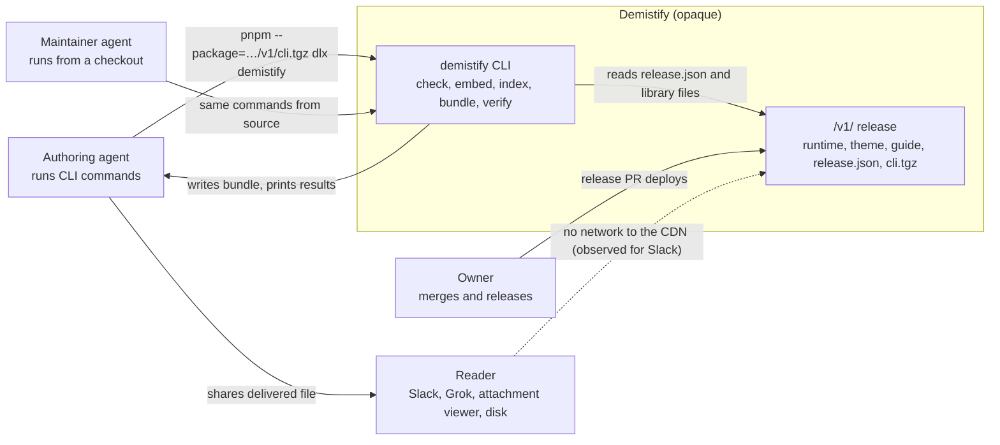
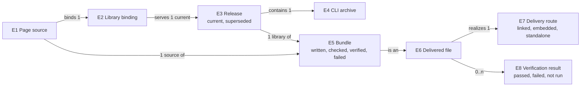

# Demistify standalone delivery: specification

This states what must be observably true for the needs in [Requirements](requirements.md). Demistify stays one opaque system here: its consumers see a CDN release, a CLI archive, the files the CLI writes, its terminal output and the published guides. The [Program Design](program-design.md) decides how.

## Context

The reader never runs a command. A chat viewer that blocks other origins is the reason a bundle exists. Readers who open a CDN-linked page in a normal browser keep working as today.

## Entities

| E | Term | Identity rule | Relationships | Invariants | Observable states | Canonicalizes | Basis |
| --- | --- | --- | --- | --- | --- | --- | --- |
| E1 | Page source | One authored HTML file at one path. Editing it keeps it the same page source. | binds exactly one E2; references 0..n local Markdown and Explorer JSON files | links the library with one theme stylesheet and one runtime script | — | "source page", "live source", `guide.source.html`; excludes a bundle | U4 |
| E2 | Library binding | The base URL shared by a page's theme and runtime links, such as `https://demistify.getagentstudio.dev/v1/`. Two pages bind the same binding when their base URLs are equal. | serves one current E3 at a time | a page's theme and runtime share one binding | — | "binding", "/v1/ path" | U3, U4 |
| E3 | Release | One published Demistify version at one binding, identified by (binding, version) and described by that binding's `release.json`: version, source commit, and each file's path, byte size and SHA-256. | belongs to one E2; contains the runtime files, the guide and exactly one E4 | every listed file is served with exactly its recorded bytes | current at its binding → superseded by a later version | "release", "release.json", "version" | U1, U3 |
| E4 | CLI archive | The installable CLI of exactly one release, identified by that release's version. | belongs to exactly one E3 | its version equals its release's version; it contains no runtime file and no guide | — | "cli.tgz", "the CLI package" | U1, U2 |
| E5 | Bundle | One HTML file made from one E1 and the library of one E3, or of a local build in a checkout, identified by its path and contents. A rebuilt file is a new bundle. | made from exactly one E1 and one E3 or local build | needs no network to render; records its E3's version and source commit, or that it came from a local build | written → checked → verified offline, or failed at any step | "standalone", "standalone bundle", "single-file", `.standalone.html` | U4, U5 |
| E6 | Delivered file | An HTML file handed to a reader, identified by its path and contents. | realizes exactly one E7 | — | — | "reader file", "delivered copy" | U6 |
| E7 | Delivery route | How a delivered file gets its library and content: `linked` (library and Markdown from URLs, needs HTTP or network), `embedded` (Markdown inside, library from the CDN), or `standalone` (everything inside, an E5). | chosen per E6 from how its reader opens it | a reader who opens files where other origins are blocked needs `standalone` | — | "delivery target", "delivery method" | U7 |
| E8 | Verification result | The outcome of one `verify` run for one E6 under one network mode. | belongs to one E6 | it is about the exact file contents that were opened | passed, failed (with reasons), or not run (no usable browser) | "verify result", "render proof" | U6 |

## Problem and outcome

P1: an agent cannot produce a file a chat viewer renders without improvising, and cannot tell beforehand whether a file will render there. O1: one supported command makes the file, another proves it renders with network blocked, and the skills route agents to both.

## Obligations

### `cli`: run the tools for the page's release

- **R1** (U1; E3, E4) When an agent runs `pnpm --package=<binding>cli.tgz dlx demistify <command> [arguments]` with Node 26 or later and pnpm 11 or later on macOS or Linux, the CLI archive of the release current at that binding installs and runs `<command>`. No repository checkout, login or other install step is needed.
- **R2** (U1; E4) `demistify --version` prints the CLI's release version and source commit. `demistify --help` lists `check`, `embed`, `index`, `bundle` and `verify`, each with its usage line.
- **R3** (U2; E3, E4) The CLI archive contains no runtime file (runtime script, stylesheet, chunks, fonts, icons or diagram worker) and no guide. Publishing it adds exactly one file, `cli.tgz`, to its release's file list. No other listed file's bytes change; `release.json` necessarily gains the new entry.
- **R4** (U2; E3, E4) The CLI archive declares no dependency on a Demistify package, so installing it downloads no runtime file. Because R3 leaves runtime bytes unchanged, loading a page's runtime cannot reach the CLI.
- **R5** (U3; E2, E3, E4) If `bundle` finds that the release current at the page's binding has a different version from the CLI, it writes nothing and exits 1. The message names both versions and gives a rerun command that bypasses pnpm's `dlx` cache.
- **R6** (U3; E3, E5) Every library file placed in a bundle has exactly the byte size and SHA-256 its release's `release.json` records. If a needed file is missing from `release.json`, cannot be fetched, or differs, `bundle` writes nothing and exits 1 naming the file.

### `bundle`: one file that renders with no network

- **R7** (U4; E1, E3, E5) `demistify bundle <source.html> <output.html>` writes one file. Opened from disk with all network blocked, it shows what the page source shows when served with network: every Markdown island (inline or from a local file), every Mermaid island written inline or already prepared, every Explorer (inline or from a local JSON file), the theme and its fonts.
- **R8** (U3, U4; E3, E5) The bundle records its release's version and source commit as metadata in its document head, readable without running the page. `bundle --library <directory>` reads a complete local build instead of a release, skips R5, and records that it came from a local build. It is the maintainer's route to proof before a release exists (R19).
- **R9** (U4; E1) If the page source cannot be bundled, `bundle` exits 1 naming the element or path, and writes nothing. That covers:
  - a missing theme link or runtime script;
  - a theme and runtime on different bindings;
  - a binding that is neither HTTPS nor loopback HTTP (loopback is for local proof);
  - an ``;
  - a Mermaid island with an unprepared `src`;
  - a Markdown or Explorer `src` that is a URL or a missing local file.
- **R10** (U4; E5) A failed `bundle` leaves the output path exactly as it was. An existing file there is unchanged, and no partial file appears.
- **R22** (U10; E1, E3, E5) `demistify bundle --out-dir <directory> <source.html …>` bundles each page source into its own bundle, as R7 and R8 describe. Each output keeps the page's path relative to the nearest directory containing all the sources, under `<directory>`. File names are kept, so links between those pages keep working when the output directory is opened from disk; a chat viewer still opens each file alone. All the page sources must bind one binding; otherwise the command exits 1 naming two pages and their bases. `--library` applies to every page.
- **R23** (U10; E5) If any page fails under R5, R6 or R9, the batch writes nothing for any page and names each failing page. An output path that is the same file as any page source fails the batch before anything is written.
- **R11** (U5; E5) `demistify check` reports 0 errors and 0 warnings on a bundle produced under R7 from a page source that itself checks with 0 errors and 0 warnings.
- **R12** (U5; E5, E6) `check` reports an error for any file whose name ends in `.standalone.html` and that is not a bundle.
- **R13** (U5; E5) `check` reports an error for a file that records bundle metadata but still loads the library from a URL, or any Markdown or Explorer source from a URL or a path, or an unprepared Mermaid `src`. A prepared Mermaid island may keep its `src`; `check` does not treat that leftover as remote loading.

### `verify`: proof before sharing

- **R14** (U6; E6, E8) `demistify verify [--no-network] <file.html …>` opens each file from disk through a `file:` URL in headless Chromium. It scrolls through the page, opens each tab, and waits for rendering to settle or for 20 seconds, whichever is first. It passes the file only when:
  - Demistify's elements are defined;
  - every Markdown island shows rendered content;
  - every Mermaid island shows a drawn diagram;
  - every Explorer shows its graph;
  - the runtime reported no authoring issue;
  - the page raised no error.
- **R15** (U6; E8) With `--no-network`, every request other than the file itself, `data:` and `blob:` is blocked. Any blocked request fails the file and is listed by URL.
- **R16** (U6; E8) For each file, `verify` prints its result, each failed check with the element id or URL it concerns, and a screenshot path. It exits 0 when every file passed and 1 when any failed. It exits 2, with a message naming how to provide a browser (an installed Google Chrome or a Playwright Chromium), when no usable browser exists. It never installs a browser and never modifies the file.

### `skills`: route agents to the right delivery

- **R17** (U7; E7) The guide published with a release documents:
  - the three delivery routes, chosen by how the reader opens the file;
  - the `pnpm --package=… dlx demistify` command for every CLI operation;
  - the bundle's limits;
  - `verify --no-network` as the completion check for the standalone route;
  - the version-mismatch remedy.

  It documents only commands its release's CLI provides.
- **R18** (U7; E5, E7) `presentation-html` handles a reader who opens the page in Slack, Grok, another chat or attachment viewer, or offline:
  - it selects the standalone route through the guide;
  - it requires a passing `verify --no-network` on the delivered file before claiming delivery;
  - it forbids naming a file that is not a bundle `.standalone.html`;
  - it no longer says the bundle exists only as a source API.
- **R19** (U6, U7; E5, E8) `verify-demistify` includes a journey that bundles a PoC fixture from the complete built library and verifies it with network blocked.
- **R20** (U8) The `presentation-html` change starts from `ai-tools` `origin/main` at or after commit `39957959`.

### Delivery constraint

- **R21** (U9) The work arrives as five pull requests, which agents open but do not merge, tag, deploy or release:
  1. this design;
  2. the CLI package with bundling, bundle-aware checking and the release archive;
  3. `verify`;
  4. the Sunstack tools skill changes (the guide and `verify-demistify`);
  5. the `ai-tools` `presentation-html` change.

## Contracts

**C1 CLI command surface** (R1, R2, R5, R9, R16).

| Command | Arguments | Success | Failure |
| --- | --- | --- | --- |
| `check` | `[--fix] [--render] [--no-diagrams] <page.html …>`, `--hook` | today's behavior plus R11–R13 | today's: exit 1 when errors remain |
| `embed` | `<input.html> <output.html>` | today's | today's |
| `index` | `<page.html …>` | today's | today's |
| `bundle` | `[--library <directory>] <source.html> <output.html>`, or `[--library <directory>] --out-dir <directory> <source.html …>` | exit 0; prints version, module count, and each output with its bytes | exit 1 naming each cause, per R5, R6, R9, R22, R23; outputs untouched per R10 and R23 |
| `verify` | `[--no-network] [--screenshots <directory>] <file.html …>` | exit 0; one result line per file | exit 1 when any file failed; exit 2 when there is no usable browser |
| `--version`, `--help` | none | exit 0 | — |

Negative space: no merging of several pages into one file, no link rewriting, no picture inlining, no browser download, no automatic fix of a bundle, and no Windows promise.

**C2 Release archive** (R1, R3). `cli.tgz` sits at the binding's root, is listed in `release.json` with its size and SHA-256 like every other file, and is served with a gzip archive content type. Its stable name revalidates on each request. The `release.json` schema keeps its current shape.

**C3 Bundle metadata** (R8, R11–R13). A bundle's head carries metadata naming the bundle's release version and source commit. `check` decides "is a bundle" from that metadata alone.

**C4 Version mismatch** (R5). The message has this shape: `This CLI is <cli version>; <binding> serves <release version>. Rerun: pnpm --config.dlx-cache-max-age=0 --package=<binding>cli.tgz dlx demistify bundle <arguments>`.

## Failure and boundary behavior

- A fetch that times out (20 seconds per request) or returns a non-2xx status fails `bundle` naming the URL. No retry loop runs.
- A release that changes while `bundle` reads it shows up as a hash mismatch under R6 and fails without output. Rerunning is the remedy.
- A batch writes only after every page has bundled. If the disk fails partway through writing, the pages already written stay written, and the command names which pages were written and which were not.
- `verify` reports each file independently. One failing file does not stop the others.
- Pages opened in a normal browser keep their current behavior. R3 and the protected boundary keep runtime bytes unchanged.

## Cross-cutting obligations

- **Security.** `bundle` fetches only from the page's HTTPS (or loopback) binding and places only bytes matching `release.json` hashes. It uses no credentials. A bundle runs the library code of the release it names. `verify --no-network` lets nothing leave the machine.
- **Privacy.** Bundles and screenshots stay on local disk. No command uploads anything.
- **Compatibility.** Existing pages, `check`, `embed` and `index` behave as today except R11–R13. Running the CLI from a checkout keeps working for maintainers; its path may change.
- **Performance.** No threshold. The CLI archive's size is recorded in `release.json`.
- **Platform.** macOS and Linux with Node 26 or later and pnpm 11 or later. Windows is undefined.

## Proof obligations

| V | Decides | Reference | Wrong build it must fail |
| --- | --- | --- | --- |
| V1 | R1, R2 | The archive served from a staged release, installed by real `pnpm --package=<url> dlx`, prints the staged version | an archive with a TypeScript `bin`, which fails with `ERR_UNSUPPORTED_NODE_MODULES_TYPE_STRIPPING` (observed 28 October 2026) |
| V2 | R3, R4 | The archive's file list, and a staged release's runtime file bytes compared with and without the CLI | an archive carrying `runtime.js` or chunks; a staged runtime whose bytes changed |
| V3 | R5 | A staged release whose version differs from the CLI's | a CLI that bundles anyway, or exits without the C4 rerun command |
| V4 | R6, R10 | A staged release with one file's bytes changed after `release.json` was written | a bundle that trusts the download, or leaves a partial file |
| V5 | R7, R8 | A page source with inline and file Markdown, an inline Mermaid island and an Explorer from local JSON, bundled and then opened with all network blocked | a bundle still linking the CDN; a bundle missing file Markdown or the Explorer data |
| V6 | R9 | Each listed unbundleable input | a command that writes a bundle with a hole in it |
| V7 | R11–R13 | A V5 bundle; a CDN-linked file named `x.standalone.html`; a bundle with a runtime script added back | today's checker (1 error, 121 warnings on a correct bundle) |
| V8 | R14–R16 | The 28 October CDN-linked page shape with `--no-network` (fails, listing `runtime.js` and `theme.css`); a V5 bundle (passes); a page with a Markdown island or an Explorer that never renders (fails naming it); no browser (exit 2) | a verify that checks only the load event or exit status |
| V9 | R17, R18 | A fresh agent asked to prepare a page for a Slack reader, with the new guide and `presentation-html` | today's skills, under which agents produce a CDN-linked file named standalone |
| V10 | R19 | The journey's own bundle and verify run | a journey that serves over HTTP, or never blocks the network |
| V11 | R20, R21 | PR heads, bases and states | a combined PR, a merged PR, or a skill change based on the older `ai-tools` branch |
| V12 | R22, R23 | A two-page collection in nested folders whose pages link to each other and carry a search index, bundled with `--out-dir`; the same batch with an `` added to one page; an output directory equal to the sources' directory | outputs that lose the folder layout or file names; a batch that writes the good page when the other fails; a batch that overwrites its sources |

## Coverage

| Capability | U | E | R | C | V |
| --- | --- | --- | --- | --- | --- |
| `cli` | U1 | E3, E4 | R1, R2 | C1, C2 | V1 |
| `cli` | U2 | E3, E4 | R3, R4 | C2 | V2 |
| `cli` | U3 | E2, E3, E4, E5 | R5, R6, R8 | C3, C4 | V3, V4, V5 |
| `bundle` | U4 | E1, E3, E5 | R7, R9, R10 | C1, C3 | V4, V5, V6 |
| `bundle` | U5 | E5, E6 | R11, R12, R13 | C3 | V7 |
| `verify` | U6 | E6, E8 | R14, R15, R16, R19 | C1 | V8, V10 |
| `skills` | U7 | E5, E7 | R17, R18 (R19 also serves) | — | V9 |
| `skills` | U8 | none: a source constraint | R20 | — | V11 |
| `skills` | U9 | none: a delivery constraint | R21 | — | V11 |
| `bundle` | U10 | E1, E3, E5 | R22, R23 | C1 | V12 |
