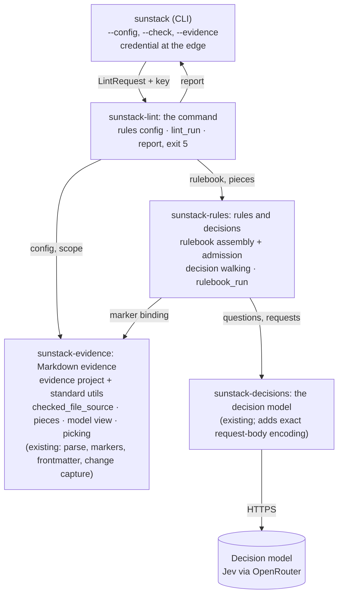
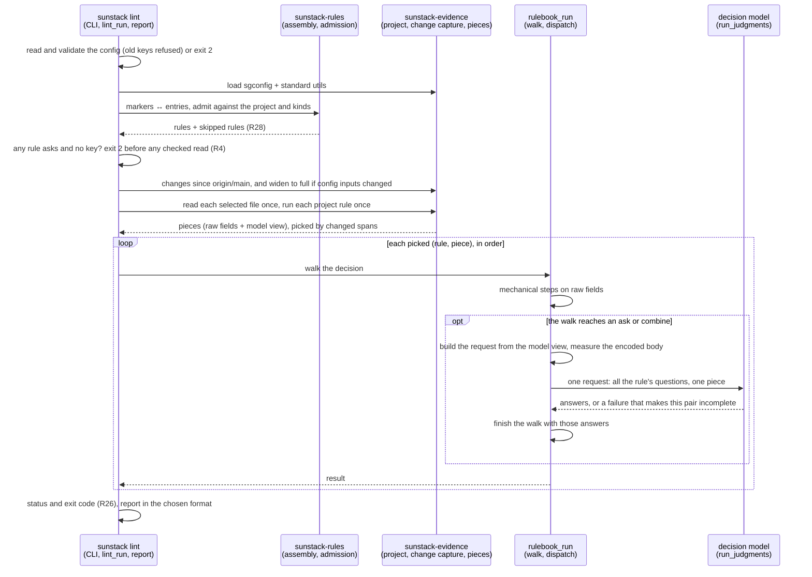

# Skill rules on evidence and decisions: program design

How the engine realizes [Specification](specification.md) R1–R28 and R44 for [Requirements](requirements.md) U1–U12 and U18. The current-system map behind it is the 29 Oct engine map (crate paths below are at `origin/main` 010da0f). The 31 Oct amendment (R11 `next`/`previous`, R18 `uncertain` route, R44) is in [its own section](#amendment-31-oct-2026), with paths at `origin/main` 7870513 after the module reorganization.

## What changes, in one picture

`sunstack lint --config` gets a new pipeline: load the config, load the evidence project with the standard util library, assemble and admit the rulebook, build evidence pieces, pick them, walk each rule's decision, ask the decision model only when a walk needs answers, and report. It sits beside the existing `exec` pipeline for JSONL RuleSets and conversation rules, which stays as it is. It reuses what already works: the Markdown parse and marker binding, the frontmatter YAML reader, git change capture, the decision model contract and its HTTP backend, credential resolution, and lint's scopes, formats and exit codes. The decision crate gains two public functions: the exact request body its backend would send, so the request cap (R21) measures what is really sent, and question-map validation (`validate_questions`, which `validate_request` now delegates to), so the check (R24) validates questions without a stand-in state.

Inside each crate, the modules and their jobs are in [Components, owners and edges](#components-owners-and-edges).

## Structure decision

**The crux:** the confirmed design's rule (one evidence kind, a decision graph, named structured questions, results including uncertain) doesn't fit the current `RuleDefinition` (evidence declarations bound by binding groups, one verdict, per-occurrence applicability) or its request planner (one carrier per RuleSet group, budget splitting across occurrences).

| Option | What it means | Gain | Cost | Verdict |
| --- | --- | --- | --- | --- |
| A. Extend `RuleDefinition` | add an evidence-kind selector and a `DecisionGraph` verdict variant; keep binding groups and the request graph | one rule type | binding groups stay (the stand-in the runner needs today); the request graph must learn per-piece lazy asks, uncertain terminals, routes and cut evidence; every existing admission path grows a second meaning | rejected: it keeps the workaround the owner asked to remove and doubles the meaning of a shared type |
| B. A rulebook pipeline beside it, in the existing crates (selected) | new modules for evidence pieces, rule entries, decision walking and a bounded request runner; reuse parse, markers, frontmatter, change capture, decisions | each piece has one job; nothing needs binding groups; the decision model contract is reused unchanged | two rule pipelines exist side by side: `exec` JSONL rules (conversations, Router) and lint's rulebook rules; a small dispatcher that overlaps the request scheduler's limits | selected |
| C. A new crate | same as B in its own crate | clear separation | a new crate boundary that splits Markdown evidence from its parser and rules from their checker for no consumer that needs it | rejected: the existing crates already own these concerns |

Falsifiers that would reopen it: a second consumer needs rulebook rules through `exec` (then the run entry moves behind the protocol), or conversation rules need evidence pieces (then the two pipelines should merge).

The Markdown-marker route through RuleSets (`rule_sources`) is deleted, not kept beside the new one: it is the same job done the old way (R3).

## Entity binding

| E | Semantic owner | Home | Type home and shape | Kind | Convention |
| --- | --- | --- | --- | --- | --- |
| E1 Rules config | sunstack-lint | modified: `config_contracts`, `config_decoding`, `config_validation`, `config` (discovery unchanged) | `RulesConfig { schema?, rulebook: Vec<RulebookPair { markdown, rules }>, marker_prefix: MarkerPrefix, max_question_words: NonZeroU32, check: CheckedFiles { files: Vec<GlobPattern>, ignore }, evidence: EvidenceSettings { ast_grep: PathBuf, kinds: BTreeMap<EvidenceKindName, EvidenceKindDefinition> }, decision_model: DecisionModelSettings { model: ModelName, endpoint: Option<Url> }, limits: Option<LintLimits> }`, `deny_unknown_fields`; replaces `LintConfig` | derived from the file | strict Serde, field-path errors (`config_decoding`) |
| E2 Rulebook sentence | sunstack-rules (assembly), via sunstack-evidence's marker binding | existing: `MarkdownDocument::bind_markers`, `MarkdownMarker` | `RulebookSentence { marker: MarkerId, rulebook: PathBuf, line: u32, standard: String }` | derived | existing marker contracts |
| E3 Rule entry | sunstack-rules | new: `rulebook_entry_wire`, `rulebook_assembly`, `rulebook_admission`; replaces `rule_source_entry_wire` | wire `RuleEntryWire { name, evidence, questions: NamedQuestionMap, decision: DecisionGraphWire, severity: Option<Severity> }`; admitted `RulebookRule { name: RuleId, sentence: RulebookSentence, kind: EvidenceKindName, questions: NamedQuestionMap, decision: DecisionGraph, severity: Severity }` | derived | `RuleId`, `Severity` (existing, `definition_contracts`); `NamedQuestionMap` (existing, sunstack-decisions) |
| E4 Evidence project | sunstack-evidence | new: `evidence_project_loading` | `EvidenceProject { globals: GlobalRules, rules: RuleCollection<SupportLang>, rule_ids: BTreeSet<EvidenceRuleId> }` from ast-grep-config 0.51 | derived | vendor types, mirrored from ast-grep's CLI loader |
| E5 Evidence kind | sunstack-evidence | new: `evidence_kind_contracts` | `EvidenceKindDefinition { rule: EvidenceRuleId, fields: BTreeMap<FieldName, FieldSource>, max_chars: Option<NonZeroU32> }`; `FieldSource` closed enum: `FirstLine`, `Capture { regex }`, `Inside { rule }`, `Enclosing { rule }`, `SameFile { rule }`, `Yaml { key }`, `Remainder`, `Target { regex, resolve: TargetResolution, opening_chars, as_kind: Option<EvidenceKindName> }`; `TargetResolution`: `Path`, `Skill`, `PathOrSkill` | derived | Serde tag `from`, snake_case |
| E6 Evidence piece | sunstack-evidence | new: `evidence_piece_building`, `evidence_model_view` | `EvidencePiece { kind, where: PieceLocation { file, first_line, last_line, span: SourceSpan }, text, fields: BTreeMap<FieldName, FieldValue>, model_view: ModelView }` where `fields` is the immutable raw view mechanical tools read and `ModelView` is `Bounded { fields: BTreeMap<FieldName, ModelFieldValue>, cut: Vec<FieldName> }` or `TooLarge { chars, limit }`; plus `FileMatchIndex { by_rule: BTreeMap<EvidenceRuleId, Vec<SourceSpan>> }` per file | derived per run | `SourceSpan` (existing, `evidence_contracts`) |
| E7 Field | sunstack-evidence | same as E6 | `FieldValue` closed enum: `Text { value, spans }`, `Texts { values, spans }`, `Targets(Vec<LoadTarget>)`, `Absent`, `Unavailable { reason: FieldUnavailable }`; `FieldUnavailable`: `FrontmatterMalformed`, `NotAString`, `Unreadable`; `LoadTarget { name, path, exists, candidates: Vec<PathBuf>, opening: Option<String>, fields: Option<BTreeMap<FieldName, FieldValue>> }` (nested `fields` never hold `Targets`, by admission); `ModelFieldValue` is the same shape with cut strings and list tails. The YAML states map from the existing `markdown_frontmatter` Present / Absent / BlockUnavailable | derived | existing frontmatter states |
| E8 Question | sunstack-decisions | existing: `JudgmentQuestion`, `NamedQuestionMap` | unchanged | authored | existing |
| E9 Decision step | sunstack-rules | new: `decision_graph_contracts` | `DecisionGraph { start: StepName, steps: BTreeMap<StepName, DecisionStep> }`; `DecisionStep` closed enum: `MechanicalCheck { tool: MechanicalTool, yes: Route, no: Route }`, `AskNoul { question, yes_at_or_above, no_at_or_below, yes, no }`, `AskChoice { question, min_probability, routes: BTreeMap<ChoiceLabel, Route> }`, `AskScore { … like noul }`, `Combine { weights: BTreeMap<QuestionName, Weight>, yes_at_or_above, no_at_or_below, yes, no }`; `MechanicalTool`: `AstGrep { rule }`, `Regex { field, pattern }`, `Contains { field, text }`, `MaxChars { field, max }`, `FileExists { field }`; `Route`: `Step(StepName)`, `Pass`, `NotApplicable`, `Uncertain`, `Finding { message, severity: Option<Severity>, at: Option<FieldName> }` | authored | the wire's step keys (`mechanical_check`, `ask`, `combine`) select the variant |
| E10 Result | sunstack-rules (produced), sunstack-lint (reported) | new: `decision_walking`, `rulebook_run`; modified: lint `report_contracts` | `RuleResult` closed enum: `Pass`, `Finding { severity, message, line, path_taken, answers?, value? }`, `NotApplicable`, `Uncertain { step, state, answers }`, `Incomplete { reason: IncompleteReason }`; lint adds `LintStatus::Uncertain` (exit 5), `IncompleteReason::RequestTooLarge` | derived per run | lint's existing enums |
| E11 Run | sunstack-lint | modified: `lint_run`, `outcome`, `targets`, `invocation` (replaced by the pipeline) | `LintRequest` unchanged in shape (config path, paths, scope, max_warnings) plus `evidence_listing: Option<Option<EvidenceKindName>>` | per invocation | existing |
| E12 Standard util library | sunstack-evidence | new: `standard_markdown_utils` and data `crates/sunstack-evidence/ast-grep-utils/markdown/*.yml` | embedded `&'static str` YAML per util, parsed with `ast_grep_config::from_str` into `SerializableGlobalRule` | shipped in the binary | `include_str!` |

## Components, owners and edges

| Component | One job | Reason to change | Consumers |
| --- | --- | --- | --- |
| `standard_markdown_utils` | hold the shipped utils and their reserved IDs | a new common Markdown shape | `evidence_project_loading` |
| `evidence_project_loading` | turn an `sgconfig.yml` plus the standard utils into globals and a rule collection, Markdown only, reserved IDs enforced | ast-grep's project format | lint check and run |
| `checked_file_source` | the one place the evidence pipeline gets checked-file and target bytes: for a file in the captured change set it serves the change capture's frozen after text (no second read, so spans, hunks and parse share the same bytes); any other file it reads from the filesystem, bounded and inside the repository root; tests pass a recording source. `usage.checked_files_acquired` counts the distinct checked or target files whose content the run acquired (capture's after side plus this source's filesystem reads); capture's snapshot-verification rereads are not counted. Change capture keeps owning Git snapshot reads and runs only after the credential gate, never under `--check` | how files are acquired | piece building (checked files, target openings) |
| `evidence_piece_building` | parse each checked file once, run every project rule that applies to its path once, build pieces and raw fields per kind, resolve targets through `checked_file_source` | the field-source vocabulary | lint run, `--evidence` |
| `evidence_model_view` | project raw fields into the bounded model view by R12's reduction order, or `TooLarge` | the size rule | piece building |
| sunstack-decisions request-body encoding (one public function over the backend's existing encoding) | return the exact body `dispatch` would send for a request and model | the provider wire | `rulebook_run` (R21) |
| sunstack-decisions `validate_questions` (extracted from `validate_request`, which delegates to it unchanged) | validate a named question map on its own | the question schema | `rulebook_admission` (R19, R24) |
| `evidence_piece_picking` | select pieces under a scope from `CapturedChange` spans and target changes | the picking rule | lint run |
| `rulebook_assembly` | pair markers and entries both ways and produce admitted-or-skipped rules | the rule file wire | check and run |
| `rulebook_admission` | every R24 refusal, against the evidence project and kinds: graph shape, threshold domains, tool/field shape compatibility (each field source has one shape), `as_kind` defined and target-free | the decision vocabulary | check and run |
| `decision_walking` | walk one rule on one piece against its raw fields: settle, or stop at the first ask needing answers, then finish with answers; an unavailable field it reads settles `Incomplete { evidence_unavailable }` | decision semantics | `rulebook_run` |
| `rulebook_run` | for each picked pair, walk, build the request from the model view, measure the encoded body against `request_max_chars`, dispatch with bounded concurrency and request count, collect results in order | dispatch policy | lint run |
| lint `rules_config` modules | decode, validate and resolve the config, refusing old keys by name | the config contract | CLI |
| lint `lint_run` | order the pipeline and map scope, skips and results into the outcome | the command's flow | CLI |
| lint report modules | statuses, exit codes, uncertain, findings, evidence listing, formats | the report contract | CLI, the #171 runner |

Allowed edges: `sunstack` → `sunstack-lint` → (`sunstack-rules`, `sunstack-evidence`, `sunstack-decisions`); `sunstack-rules` → (`sunstack-evidence`, `sunstack-decisions`). Forbidden: `sunstack-evidence` → `sunstack-rules` (evidence never knows about decisions); `decision_walking` → any I/O (it is pure, given a piece, its file's match index and answers); `rulebook_run` → the filesystem (it receives pieces). Violations show up as a Cargo dependency cycle or an import in review.

## The representative path: `sunstack lint --config <cfg> --since origin/main`

`--check` runs the first three steps only and lists rules (R24). `--evidence [kind]` skips the credential gate, runs through picking and prints pieces with their raw fields and model views, with no request (R13). Every checked-file and target read in all three paths goes through `checked_file_source`, and the report's usage counts them (`checked_files_acquired`), so "no read before the gate" is observed where acquisition happens.

The current path for comparison: lint builds a native RuleSet invocation with a stand-in binding, calls `sunstack_rules` `evaluate`, which plans requests per RuleSet group and occurrence (`request_graph.rs:157`), and projects verdicts into the lint report (`lint_run.rs:142`). Added edges: config → evidence project; assembly → admission against evidence kinds; pieces → picking by span; run → `run_judgments` per pair. Removed edges: lint → native invocation with bindings; marker sources → `RuleDefinition` lowering. Preserved: credential resolution at the CLI edge; `run_judgments` with its attempt controller, retries and receipts; lint's scope mapping, widening on config change and formats.

## State

Nothing persists. Per run: the config, project, rules and pieces are immutable once built; the dispatcher owns the only mutable state (in-flight requests, request count). A walk's state is the current step and the answers once fetched.

| From | Event | To |
| --- | --- | --- |
| walk at a mechanical step | tool says yes/no | the routed step or terminal |
| walk at the first ask or combine | no answers yet | `NeedsAnswers` (dispatcher sends one request) |
| `NeedsAnswers` | answers arrive | walk continues from that step with those answers |
| `NeedsAnswers` | request too large, provider failure, malformed answer, cancel, request limit | `Incomplete { reason }` |
| any step | a terminal | `Pass`, `Finding`, `NotApplicable` or `Uncertain` |

Illegal states are unrepresentable or refused at the trusted entry: a route to a missing step, a cycle, an unrouted choice option, an ask naming an undefined question, weights not summing to 1, a threshold outside 0 to 1, a yes threshold not strictly above the no threshold, a tool given a field of the wrong shape, and an `as_kind` that is undefined or has its own `target` field are refused by `rulebook_admission`, so the walk and the builder never meet them. Every field name a step uses exists on its kind, but its value can still be `Absent` or `Unavailable` at run time; R17 settles both.

## Failure and recovery

| Failure | Detected by | Contained to | Result |
| --- | --- | --- | --- |
| bad config, unreadable rulebook or rule file, bad project | config decoding, assembly, project loading | the whole run | `invalid` (2), nothing read or asked (R28) |
| one bad marker or entry | assembly, admission | that rule | skipped with diagnostics; `incomplete: coverage_partial` (R28) |
| missing credential with asking rules | lint run, before reading files | the whole run | `invalid` naming the credential (R4) |
| a checked file over lint's file limits or unreadable | piece building | that file's pieces | `incomplete` with the existing selection reason |
| a field a step reads is `Unavailable` (malformed frontmatter, non-string value, unreadable) | `decision_walking` | that pair | `Incomplete { evidence_unavailable, field }` (R17) |
| a piece's model view can't fit `max_chars` after R12's reduction | `evidence_model_view` | every rule on that piece | `Incomplete { evidence_too_large }` (R12); mechanical-only paths still settle from raw fields |
| a skill name matches several checked skills | piece building | that target | `exists: false` with `candidates` (R11) |
| request over `request_max_chars` (measured on the exact encoded body) | `rulebook_run` with the decision crate's body encoding | that pair | `Incomplete { request_too_large }` (R21) |
| provider error, timeout, refused connection | `run_judgments` (existing attempt controller) | that pair | `Incomplete { provider_failure, failure_class, http_status? }` (R44, amended 31 Oct); retries are the existing controller's |
| answer fails admission, or lacks a question the walk reads | `run_judgments` validation; `decision_walking` | that pair | `Incomplete { invalid_response }` (R44) |
| request refused before sending | `run_judgments` request validation | that pair | `Incomplete { invalid_request }` (R44) |
| request limit reached | dispatcher | remaining pairs | `Incomplete { request_limit_reached }` |
| cancellation (signal) | existing cancellation token | the run | `cancelled` (4); finished results kept |
| a target outside the repository root | piece building | that target | `exists: false`, never read (R11) |

## Concurrency

Only model requests overlap. The dispatcher uses one `JoinSet` with a semaphore of `max_concurrent_requests` and a counter for `max_model_requests`, all under the run's cancellation token. Each task owns its request and returns `(pair index, outcome)`. Results go into a vector by pair index, so order is deterministic (R27) regardless of completion order. Parsing and matching run in `spawn_blocking` per file, as document selection does today.

## Cutover

Hard cutover in one change:

- lint's config contract becomes `RulesConfig`; `rule_sets`, `rules`, `overrides`, `ignore_patterns` and `backend` are refused by name with their replacement (R3); `lint --init` writes the new skeleton and the exported schema is the new shape;
- RuleSets lose `rule_sources`, `marker_prefix` and `max_question_words`; `rule_source_assembly`'s lowering to `RuleDefinition`, `rule_source_entry_wire` and the marker printing in `check_rules` are deleted; marker scanning and binding in `markdown_document` stay;
- lint's native-invocation builder (`invocation.rs`) and its stand-in check binding (`config_validation.rs:173–256`) are deleted;
- the four release fixtures under `scripts/verify/sunstack-rule/release-fixtures/` move to the new config shape;
- sunstack PR #171's runner moves from `exec` with RuleSets to `sunstack lint --config` (consumer work, outside this change).

No migration of stored data: nothing is stored.

## Trust and privacy

The decision model receives the standard, the piece's location and its bounded model view (never `text` or the cut-out parts of a field), which is repository text the consumer chose to check; that is the existing contract with OpenRouter. The credential path is unchanged and never enters state, reports or diagnostics. Evidence reads stay inside the repository root (R11). The evidence project is consumer-authored YAML parsed by ast-grep's own deserializer; regexes compile with the `regex` crate (linear time).

## Cross-cutting

- **Performance:** each checked file is read and parsed once, and every applicable project rule runs on it once; kinds, `inside`, `enclosing`, `same_file` and the `ast_grep` tool all read the per-file match index instead of re-matching.
- **Determinism (R27):** directory walks are sorted; pieces are ordered by kind name, file and byte start; results by rule order, file and byte start.
- **Observability:** the report's usage summary (requests, tokens, cost) is filled from the existing receipts, plus `checked_files_acquired` from `checked_file_source`.

## Proof seams

| Seam | Real | Faked | Observes |
| --- | --- | --- | --- |
| evidence project + pieces on fixture files | ast-grep-config, the standard utils, the builder | nothing | pieces, raw fields and their states, model views, spans, cut lists; equality with `ast-grep scan` 0.51.0 output |
| `checked_file_source` | the lint pipeline | a recording source in library tests | every attempted checked-file and target read, in order; zero before the credential gate and in `--check` |
| `decision_walking` | the walk | answers supplied directly | results, lines, paths taken, which steps asked |
| `rulebook_run` with a loopback decision backend | dispatch, request building, limits | the HTTP endpoint (existing loopback pattern in `sunstack-decisions/tests/http_adapter.rs`) | requests sent (questions byte-equal, one piece), incomplete reasons, order |
| `sunstack lint` binary on fixture repositories | everything | the decision endpoint via `decision_model.endpoint` | exit codes, JSON report, `--check`, `--evidence` |
| hosted run | everything, real OpenRouter | nothing | schema-valid answers, a complete report |

## Amendment, 31 Oct 2026

Three small changes, each inside an existing owner, with no new module and no new dependency. Paths are at `origin/main` 7870513.

**`next` and `previous` (R11).** The owner stays `evidence_piece_building`.
- `FieldSource` in `sunstack-evidence/src/evidence_planning/evidence_kind_contracts.rs` gains `Next { #[serde(flatten)] of: MatchSource }` and `Previous { … }`, as the `from` values `next` and `previous`. They take the same `rule` as `inside`, `enclosing` and `same_file`, so `--check` validates the rule ID through the existing path.
- `local_fields` in `field_composition.rs` evaluates them over the same `source_ranges(of, file, pieces)` candidates and ranges the other match sources use. A candidate qualifies when it doesn't overlap the piece and only whitespace lies between them (for `next`, the text from the piece's end to the candidate's start; for `previous`, from the candidate's end to the piece's start). It must also start at the piece's start column, the same column `source_span` already computes. Among qualifying candidates the outermost (the longest range) wins, and ties keep source order.
- The value is `FieldValue::Text` with the candidate's whole text and its one span; `Absent` when none qualifies. It never joins `taken`, because it lies outside the piece, so `remainder` is unchanged.
- No syntax-tree access is added: the field is defined over match ranges, like every other source.

**`uncertain` route (R18).** The owner stays `rulebook_planning`.
- `AskBinaryWire`, `AskChoiceWire` and `CombineStepWire` in `decision_graph_contracts.rs` gain `#[serde(default, skip_serializing_if = "Option::is_none")] uncertain: Option<RouteWire>`.
- The planned `BinaryRoutes` gains `uncertain: DecisionRoute`, and `DecisionStep::AskChoice` gains `uncertain: DecisionRoute`. Both default to `DecisionRoute::Uncertain` when the wire omits the route, so an existing graph plans to exactly today's behavior.
- `DecisionStep::routes()` returns the `uncertain` route too, so the existing reachability and cycle checks in `--check` cover it without new code.
- In `decision_walking.rs`, the two places that end `uncertain` on an in-band answer (`binary_route` returning `None`, and a choice under `min_probability`) follow the step's `uncertain` route instead. The walk records the step as the last in-band step. When the route is the `uncertain` terminal, or the walk later ends there, `uncertain(...)` reports that recorded step (R23).
- All of a rule's questions travel in one request (R20), so following the route never sends another request.

**Incomplete reasons (R44).** The owners stay `rulebook_planning` (produced), `evidence_selection` (produced) and `lint_reporting` (reported).
- `RulebookIncompleteReason` in `decision_walking.rs` changes from the bare `ProviderFailure` to `ProviderFailure { failure_class: ProviderFailureClass, http_status: Option<u16> }`, plus new `InvalidRequest` and `InvalidResponse` variants. `ProviderFailureClass` is the decision crate's existing enum (`decision_protocol/decision_contracts.rs:263`), reused unchanged.
- `rulebook_run.rs` maps each finished request's `DecisionRunOutcome` one to one: `ProviderFailure { failure_class, http_status, .. }` carries both fields, `InvalidRequest` becomes `InvalidRequest`, `InvalidResponse` becomes `InvalidResponse`, and `Cancelled` stays `Cancelled`. `DispatchRefusal::InvalidRequest` becomes `InvalidRequest`.
- The walk's missing-or-malformed-answer returns in `decision_walking.rs` (today `ProviderFailure`) become `InvalidResponse`, and so does a completed outcome whose answers still leave the walk needing answers.
- The pair's initial placeholder result in `rulebook_run` stays an internal value that every path overwrites; it is never reported.
- `SelectionIncompleteReason` in `evidence_selection/selection_contracts.rs` changes the same way, mapped in `selection_run.rs`.
- In `sunstack-lint/src/lint_reporting/`, `report_contracts.rs` `IncompleteReason` mirrors the three shapes with serde tag `kind`, plus `failure_class` and `http_status` (`http_status` omitted when none); `outcome.rs` maps them through; `formats.rs` prints `provider failure (<class>[, HTTP <status>])`.
- This is a hard cutover of the JSON report's incomplete reason. sunstack's `tests/skills` report schema is the known consumer and updates in the same release's pin bump.

| Seam (added) | Real | Faked | Observes |
| --- | --- | --- | --- |
| `field_composition` on copied sunstack files | the builder, the standard utils | nothing | `next`/`previous` values and spans for the V22 cases |
| `decision_walking` with supplied answers | the walk | answers | routes followed from in-band answers, the reported step, and zero added requests |
| `rulebook_run` and `selection_run` with the loopback backend | dispatch, the attempt controller | the HTTP endpoint (429, 503, refused, stalled, schema-invalid, missing question) | each incomplete reason with its class and status |
| `sunstack lint` binary on a fixture with `decision_model.endpoint` at a closed port | everything | the endpoint | the JSON reason `connection` and the default line |

## Trace

| U | R | E | Owner | Interface | Shape and home | State | Failure | Proof |
| --- | --- | --- | --- | --- | --- | --- | --- | --- |
| U4 | R1 config shape | E1 | lint rules_config | `load_rules_config(path) -> Result<RulesConfig, LintInvalid>` | `RulesConfig`, `config_contracts` | none | invalid | fixture configs through `--check` |
| U4 | R2 path bases | E1 | lint rules_config | path resolution in validation | `ConfigLocation` (existing) + repository root | none | invalid on missing paths | fixture with config in a subfolder |
| U4 | R3 cutover refusals | E1, E3 | lint rules_config; rules definition loading | decoder refusals | `LintInvalidCode` (existing) | none | invalid | old-shape configs and RuleSets |
| U7 | R4 credential, no switch | E11 | lint_run (gate), CLI (resolution) | `Option<ApiKey>` into the run; gate before any `checked_file_source` read | existing credential path; `usage.checked_files_acquired` | none | invalid before reads | recording source (zero reads) and binary report count; source has no off switch |
| U4 | R5 markers both ways | E2, E3 | rulebook_assembly | `assemble_rulebook(config) -> RulebookAssembly { rules, skipped }` | `RulebookSentence`, `RulebookRule` | none | skip or invalid | crafted rulebooks |
| U1–U3 | R6 evidence section | E5 | lint rules_config → evidence | `EvidenceSettings` | `evidence_kind_contracts` | none | invalid | `--check` fixtures |
| U4–U6 | R7 rule file shape | E3 | rulebook_entry_wire | strict Serde | `RuleEntryWire` | none | skip | crafted entries |
| U1, U3 | R8 evidence project | E4 | evidence_project_loading | `load_evidence_project(sgconfig) -> Result<EvidenceProject, ProjectRefusal>` | `EvidenceProject` | none | invalid | equality with `ast-grep scan` |
| U3 | R9 standard library | E12 | standard_markdown_utils | `standard_utils() -> &[(UtilId, &str)]` | embedded YAML | none | reserved-ID refusal | each util on fixtures; reuse refusal |
| U2 | R10 pieces | E6 | evidence_piece_building | `build_pieces(project, kinds, files) -> EvidenceCatalog` | `EvidencePiece`, `FileMatchIndex` | none | per-file incomplete | step 3 fixture bytes |
| U2 | R11 field sources | E7 | evidence_piece_building | `FieldSource` evaluation through `checked_file_source` | `FieldValue` with `Absent` and `Unavailable` states; `LoadTarget` with `candidates` | none | absent, unavailable, `exists: false`, candidates | each source and state on fixtures; outside-root target; duplicate skill names |
| U2 | R12 size cut | E6 | evidence_model_view | `project_model_view(fields, max_chars) -> ModelView` | `ModelView::Bounded` / `TooLarge`; raw `fields` untouched | raw → bounded or too large | `evidence_too_large` per piece | scalar, list, multi-target and nested fixtures; middle-token regex on raw fields |
| U2, U10 | R13 `--evidence` | E6, E11 | lint_run + report | flag → evidence listing | `EvidenceListing` in report modules | none | invalid as config | binary run, no key set |
| U10 | R14 one run per piece | E6, E10 | rulebook_run | pair enumeration | `(RuleId, piece index)` | none | none | counts on fixtures |
| U10 | R15 picking | E6, E11 | evidence_piece_picking | `pick_pieces(catalog, scope, changes) -> Picked` | `CapturedChange.after_spans` (existing) | none | full scope when the before side is unknown, as today | temp Git repo fixtures |
| U5 | R16 decision shape | E9 | decision_graph_contracts | Serde | `DecisionGraph`, `Route` | none | skip | crafted graphs |
| U5 | R17 mechanical tools | E9 | decision_walking | `walk_decision(rule, piece, index, answers) -> WalkOutcome` over raw fields | `MechanicalTool` with accepted field shapes | step → step | `evidence_unavailable` for an unavailable field | walk tests per tool × value state |
| U5, U6 | R18 ask and combine | E9 | decision_walking | same | `DecisionStep` | step → step / terminal | uncertain bands | walk tests with supplied answers just below, at and just above each threshold; combine without rounding |
| U6 | R19 question schema | E8 | rulebook_admission via `judgment_validation` | validation call | `JudgmentQuestion` (existing) | none | skip | crafted questions |
| U6, U7 | R20 one request, lazy | E8, E10 | rulebook_run | `build_piece_request(rule, piece) -> StructuredJudgmentRequest` | existing request type; state object `{standard, where, <model view fields>}` | `NeedsAnswers` → settled | incomplete | loopback request capture |
| U2 | R21 request limits, failures | E10 | rulebook_run | dispatcher; the decision crate's exact body encoding | `IncompleteReason` | `NeedsAnswers` → incomplete | contained to pair | loopback: escape-heavy and long-question bodies measured on the recorded body; error contained |
| U5 | R22 finding location | E10 | decision_walking | `Route::Finding.at` → the field's first span line, else the piece's first line with the field still named | `RuleResult::Finding { line, field: Option<FieldName> }` | terminal | none | worked examples; location table for present-empty, absent YAML, absent capture and empty match list |
| U8 | R23 uncertain | E10 | decision_walking; lint report | `RuleResult::Uncertain` | report `uncertain` list | terminal | none | worked examples |
| U9 | R24 check | E1–E5, E8, E9 | rulebook_admission + lint check | `check(config) -> CheckResult` | `CheckResult` (existing, new listing) | none | refusals listed | refusal matrix incl. threshold domains, tool/field shapes, `as_kind`; recording source shows zero checked reads |
| U5, U8, U10 | R25 run and report | E10, E11 | lint_run + report modules | `run(request, key) -> LintReport` | `LintReport` + `uncertain` | none | per R26 | binary JSON report |
| U8 | R26 status and exit | E11 | lint outcome | `LintStatus::exit_code` | `LintStatus::Uncertain` = 5 | precedence table | none | binary exit codes |
| U2, U10 | R27 determinism | E6, E10 | piece building, dispatcher | ordering rules | ordered vectors | none | none | repeat runs, shuffled completion |
| U12 | R28 skips | E3, E11 | rulebook_assembly + lint outcome | `RulebookAssembly.skipped` | `SkippedRule` (existing shape) | none | incomplete: coverage_partial | crafted bad entry |
| U2 | R11 `next`/`previous` (31 Oct) | E7 | evidence_piece_building | `FieldSource::{Next, Previous}` evaluated in `local_fields` | `FieldValue::Text` / `Absent`, `field_composition.rs` | none | absent when no neighbour qualifies | V22 cases on copied files |
| U5 | R18 `uncertain` route (31 Oct) | E9 | decision_graph_contracts, decision_walking | optional wire `uncertain`; `BinaryRoutes.uncertain`, `AskChoice.uncertain` | `DecisionRoute`, default `Uncertain` | in-band answer → routed step | refused by `--check` when undefined or cyclic | walk tests with supplied answers; existing fixtures unchanged |
| U18 | R44 incomplete reasons (31 Oct) | E10 | rulebook_run, selection_run; lint report | `DecisionRunOutcome` → reason, one to one | `RulebookIncompleteReason`, `SelectionIncompleteReason`, lint `IncompleteReason` with `failure_class`, `http_status?` | none | each class distinct | loopback failures; binary at a closed port |

Deviations and unresolved decisions: none. `decision_model.endpoint` exists for tests and alternative gateways, as lint's `backend.endpoint` does today.
