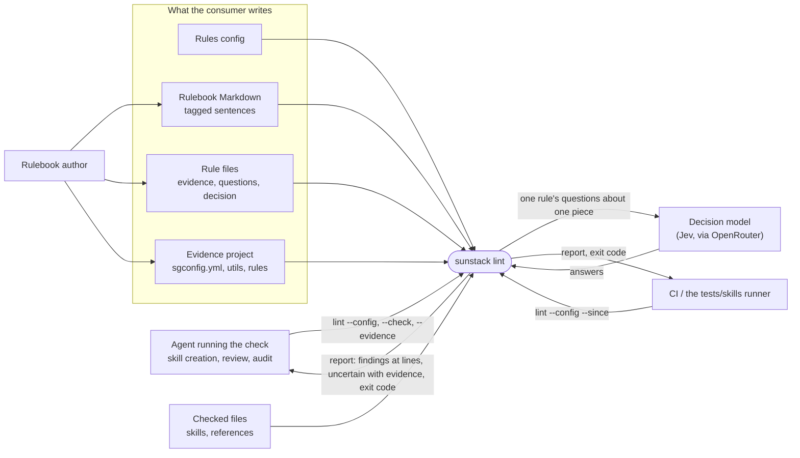
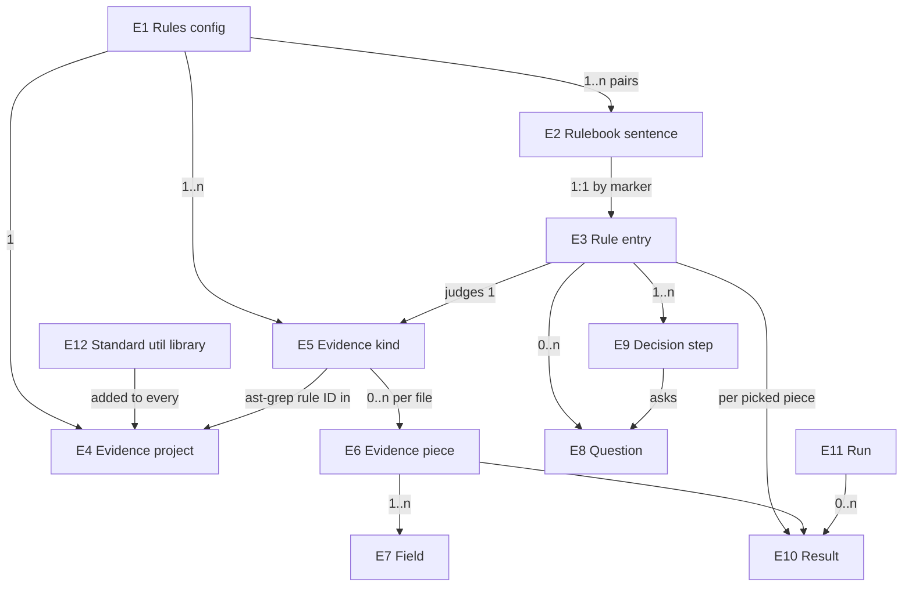

# Skill rules on evidence and decisions: specification

The observable contract for [Requirements](requirements.md) U1–U12. It replaces the Markdown-marker route of the [2026-10-17 specification](../2026-10-17-markdown-skill-rules/specification.md) (its R9–R17) and changes `sunstack lint`'s config and report from the [2026-10-18 runner design](../2026-10-18-sunstack-runner/specification.md). Marker form, hosts and visible text (2026-10-17 R1–R8) keep their meaning; only where their settings live moves.

## The system from outside

Outside this contract: the session pipeline, HTML evidence, eval scoring, and the consumer's own rule content.

## Entities

| E | Term | Identity | Relationships | Invariants and states |
| --- | --- | --- | --- | --- |
| E1 | Rules config | its file path | names many rulebook pairs, one evidence project, many evidence kinds | read whole before anything runs; valid or invalid |
| E2 | Rulebook sentence | (rulebook file, marker ID) | tagged by exactly one marker; has exactly one rule entry | its *standard* is the bound text as a reader sees it (2026-10-17 R1–R8) |
| E3 | Rule entry | (rule file, marker ID); its `name` is unique across the config and is the rule's name in reports | judges exactly one evidence kind; owns its questions and its decision | admitted by the check, or refused with file:line |
| E4 | Evidence project | the `sgconfig.yml` path the config names | holds the consumer's ast-grep rules and utils; every run adds the standard util library (E12) | Markdown rules only in this step |
| E5 | Evidence kind | (config, kind name) | defined by one ast-grep rule ID in the evidence project plus field sources | its pieces carry the same field names |
| E6 | Evidence piece | (kind, file, byte range of the match) | belongs to one kind and one checked file; may contain other pieces' matches | never a whole file unless the match is; at most `max_chars`; states: whole or cut |
| E7 | Field | (piece, field name) | belongs to one piece; may reference a target file or skill | text, a list of texts, or a list of targets; carries the source span(s) it came from |
| E8 | Question | (rule entry, question name) | belongs to one rule entry | exactly the decision model's question schema (noul, choice, score) |
| E9 | Decision step | (rule entry, step name) | belongs to one rule entry; routes to another step or a terminal | every path from `start` ends at a terminal; no cycles |
| E10 | Result | (rule entry, piece) within one run | one per picked pair | pass, finding, not applicable, uncertain, or incomplete |
| E11 | Run | one `sunstack lint` invocation | one config, one scope | clean, nothing selected, findings, uncertain, incomplete, invalid, or cancelled |
| E12 | Standard util library | (CLI release, util ID) | shipped with the CLI; used by evidence projects | read-only to consumers; its IDs are reserved |

## The config

| R | Serves | Obligation |
| --- | --- | --- |
| R1 | U4 | `sunstack lint --config <path>` reads a rules config: one JSON object with `rulebook` (a non-empty list of `{ "markdown": <path>, "rules": <path> }`), `marker_prefix` (one uppercase letter), optional `max_question_words` (default 400), `check` (`files`: non-empty glob list; optional `ignore`: glob list), `evidence` (R6), `decision_model` (`model`: the model ID; optional `endpoint`, default OpenRouter's), and optional `limits` (`evidence_max_chars` default 6000, `request_max_chars` default 20000, plus lint's existing limits: `max_files`, `max_file_bytes`, `max_total_bytes`, `max_matches`, `max_model_requests`, `max_input_tokens_per_request`, `attempt_timeout_seconds`, `max_concurrent_requests`). Unknown keys, duplicate keys and missing required keys are refusals. With no `--config`, lint finds `sunstack.lint.json` in the working directory or its ancestors, as today, and reads it with this same shape. |
| R2 | U4 | Paths in the config resolve against the config file's folder. `check.files` and `check.ignore` resolve against the repository root: the Git work tree that contains the config, or the config's folder outside Git. Reports name files relative to that root. |
| R3 | U4 | Lint config `rule_sets` (now `rulebook`), `rules` and `overrides` (severity now lives in the rule file), `ignore_patterns` (now `check.ignore`) and `backend` (now `decision_model`) are refusals that name the replacement. RuleSet files given to `sunstack exec` refuse `rule_sources`, `marker_prefix` and `max_question_words`. JSONL `rule_paths` RuleSets through `exec` keep their meaning. |
| R4 | U7 | The decision model is called with the credential the CLI resolves today (`OPENROUTER_API_KEY`, else the OS credential store). No flag, config key or environment variable turns model calls off. When any admitted rule has questions and no credential resolves, the run asks nothing, reads no checked file and ends `invalid` naming the missing credential. A config whose rules are all mechanical needs no credential. |

## Rulebook and rule files

| R | Serves | Obligation |
| --- | --- | --- |
| R5 | U4 | A marker's form, allowed hosts, binding and visible text are 2026-10-17 R1–R8, with `marker_prefix` and `max_question_words` read from the config. Consistency runs both ways: a marker without a rule entry, and an entry without a marker, are refusals. Marker IDs are unique per rulebook file; `name` is unique across the config. |
| R6 | U1, U2, U3 | `evidence` has `ast_grep` (the path of the consumer's `sgconfig.yml`) and `kinds`: a map from kind name to `{ "rule": <ast-grep rule ID>, "fields": { <field name>: <field source> }, "max_chars"?: <n> }`. Field names are lowercase words joined by `_`; `text`, `where` and `standard` are reserved. |
| R7 | U4, U5, U6 | A rule file is one JSON object keyed by marker ID. Each entry has `name`, `evidence` (a kind name), optional `questions` (a map from question name to a question in the decision model's schema, R19), `decision` (`start` plus `steps`, R20–R24), and optional `severity` (`error` or `warn`, default `warn`) used by findings that don't set their own. Unknown keys are refusals. |

## Evidence

| R | Serves | Obligation |
| --- | --- | --- |
| R8 | U1, U3 | The evidence project is an ast-grep project: `sgconfig.yml` with `ruleDirs` and `utilDirs`, rule files that may hold several rules separated by `---`, and ast-grep's own rule language (`kind`, `pattern`, `regex`, `inside`, `has`, `follows`, `precedes`, `stopBy`, `all`, `any`, `not`, `matches`, `files`). Every run, check included, adds the standard util library (R9) to the project's utils, so the project names no machine path for it. A rule matches exactly what `ast-grep scan` 0.51 matches with the same project and the library on its util path. Rules are Markdown-language only; any other language is a refusal. |
| R9 | U3 | The standard util library ships inside each CLI release, and its YAML files are readable in the sunstack-tools source at that release's tag. It holds at least: `numbered-heading-section` (a section whose heading reads `### 3. Title` or `### 3) Title`), `step-heading-section` (`### Step 3: Title`), `bold-numbered-item` (a list item starting `3. **Title**`), `numbered-item` (any list item starting `3.` or `3)`), `quoted` (a block quote), and `frontmatter` (the document's YAML frontmatter block). A project util or rule that reuses one of these IDs is a refusal. |
| R10 | U2 | Each match of a kind's rule in a picked file is one evidence piece. Every piece has `text` (the match's source text) and `where` (file, first and last line, byte range). `text` serves the builder and mechanical checks and is never sent to the decision model. A file outside `check.files`, or inside `check.ignore`, yields no pieces. |
| R11 | U2 | A field source is exactly one of the following, and each has one value shape. **`first_line`** (text): the match's first line. **`capture`** with `regex` (text): the first non-empty capture group of the regex's first match in `text`; *absent* when the regex doesn't match. **`inside`** with `rule` (list): the texts of that rule's matches whose byte range lies within this piece's, in order; an empty list is a valid value. **`enclosing`** with `rule` (list): the first lines of that rule's matches that contain this piece, outermost first. **`same_file`** with `rule` (list): the first lines of every match of that rule in the piece's file, in order. **`yaml`** with `key` (text): the string value of that key, decoded by a YAML 1.2 decoder from a match that is a YAML frontmatter block (folded and quoted strings decode to their real value); *absent* when the key is missing; *unavailable* with its reason when the block is malformed or the value isn't a string. **`remainder`** (text): `text` minus the spans taken by this piece's `first_line`, `capture` (the regex's whole match) and `inside` fields. **`target`** with `regex` and `resolve` (`path`, `skill` or `path_or_skill`) (targets): one target per regex match, each with `name`, `path` and `exists`, plus `opening` (the first `opening_chars` characters of the file, default 3000) for a path, or the fields of the first piece of kind `as_kind` in that file for a skill (none when the file has no such piece). A path resolves against the piece's file's folder. A skill name resolves to `<name>/SKILL.md` among the checked files; when several checked files match, the target has `exists: false` and lists the candidates. `path_or_skill` treats a name ending in `.md` as a path and any other name as a skill. A target that resolves outside the repository root, or to a non-file, is `exists: false` and is never read. A target that resolves to a file that then can't be read makes the whole `target` field *unavailable* (reason `unreadable`). `as_kind` must name a kind that has no `target` field, so composition is one level deep. |
| R12 | U2 | A piece keeps its fields whole, and mechanical checks read them whole. What the decision model sees is the piece's *model view*: its fields, with each text value, each list item, and each target's `name`, `path`, `opening` and fields counted in Unicode characters (JSON punctuation is not counted here; R21 bounds the whole request). When the model view is over the kind's `max_chars` (default `evidence_max_chars`; at least 1000), it is reduced deterministically: first, the longest string (earliest in field order on a tie) is cut to its start, `[cut]` and its end, to the length that removes the excess but never below 200 characters, repeatedly; then, while still over, the longest list loses its last items, replaced by one item `[cut: N more]`; if it still doesn't fit, a rule whose walk reaches an ask or combine on that piece is `incomplete` with reason `evidence_too_large`, while mechanical steps still read the raw fields. The piece lists every cut field. |
| R13 | U2, U10 | `sunstack lint --config <path> --evidence [<kind>]` prints, as JSON, every piece the same scope would pick (all kinds, or one): kind, `where`, every field with its value state and source span(s), the model view, and the cut list. It reads checked files, asks the model nothing and needs no credential, even when the config has asking rules. |

## Picking

| R | Serves | Obligation |
| --- | --- | --- |
| R14 | U10 | A rule runs once on every picked piece of the kind it names. |
| R15 | U10 | Lint's scopes keep their meaning: `--all` or positional paths is full; `--since <rev>` is the changes since `<rev>` including worktree edits; no flag is the uncommitted changes (staged, unstaged, untracked). Under full scope every piece of every selected file is picked. Under a change scope a piece is picked when a changed hunk of its file (including a zero-line insertion or deletion point) touches the piece's byte range, or when any of its `target` files changed; an added or untracked file is wholly changed. When the config, a rulebook file, a rule file, or a file of the evidence project changed, the run widens to full and the report says so, as lint does today. A piece outside the change scope is counted, not judged. |

## Decisions

| R | Serves | Obligation |
| --- | --- | --- |
| R16 | U5 | A decision is `start` (a step name) and `steps` (a map from step name to step). A route is a step name or a terminal: `"pass"`, `"not_applicable"`, `"uncertain"`, or `{ "finding": <message>, "severity"?: "error" \| "warn", "at"?: <field name> }`. Steps are taken from `start` until a terminal. |
| R17 | U5 | A **mechanical check** step is `{ "mechanical_check": { "tool": ..., ... }, "yes": <route>, "no": <route> }` and asks nothing. Tools and the field shapes they accept: `ast_grep` (`rule`, no field): yes when that rule has a match whose byte range lies within the piece's; `regex` (`field`, `pattern`; text or list): yes when the field, or any item of a list, matches; `contains` (`field`, `text`; text or list): yes when it, or any item, contains the text; `max_chars` (`field`, `max`; text): yes when the whole field is at most `max` characters; `file_exists` (`field`; targets): yes when there is at least one target and every target exists. An absent field reads as no match for `regex` and `contains` and as 0 characters for `max_chars`. A field that is *unavailable* makes that rule's result on that piece `incomplete` with reason `evidence_unavailable`, naming the field, whenever a step reads it: a mechanical step's `field`, or, at the first ask or combine, any field named by the `check`, `against` or `context` instructions of the rule's questions (then nothing is sent). Unavailable fields no question names are left out of the request state and block nothing. |
| R18 | U5, U6 | An **ask** step is `{ "ask": <question name>, ... }`. For a noul question: `yes_at_or_above`, `no_at_or_below`, `yes`, `no`; an answer at or above the yes threshold routes yes, at or below the no threshold routes no, and in between is `uncertain`. Both thresholds are finite numbers from 0 to 1, and the yes threshold is strictly greater than the no threshold. For a choice question: `min_probability` (greater than 0, at most 1) and `routes` (one route per option); when the selected option's probability is under `min_probability` the result is `uncertain`. For a score question: the score is normalized as score ÷ (levels − 1) and read like a noul answer. A **combine** step is `{ "combine": { <question name>: <weight> }, "yes_at_or_above", "no_at_or_below", "yes", "no" }` over noul and score questions only; weights are positive and add to 1 (within 1e-9); the weighted total, computed without rounding, is read like a noul answer. |
| R19 | U6 | Questions are exactly the decision model's `JudgmentQuestion` (noul, choice, score, with their native instructions and criteria shapes), unchanged, and the check validates them with the same validation the model call uses. In `instructions`, the keys `check`, `against` and `context` name fields of the rule's evidence kind (a name or a list of names); every other key is free text. |
| R20 | U6, U7 | Mechanical steps cost nothing. When a path first reaches an ask or combine step, one request goes to the decision model carrying all of the rule's questions, unchanged, and a state of `standard` (E2's visible text), `where`, and the piece's model view (R12). A request never carries more than one piece. Later steps on the same path read the same answers. A path that never reaches an ask or combine step sends no request. |
| R21 | U2 | `request_max_chars` counts the Unicode characters of the exact request body the backend would send (model, questions and state). A request over it is not sent; that result is `incomplete` with reason `request_too_large`, and every other result still runs. A provider failure or a malformed answer is `incomplete` for that pair only, with its reason. |
| R22 | U5 | A finding is reported at the first line of the field `at` names. When `at` is not given, or the field it names has no source span (absent, an empty list, unavailable), the finding is reported at the piece's first line and still names that field. It carries its message, severity (the finding's, else the entry's), the rule's `name` and marker, and, when the path asked, the answers and any combined value. |
| R23 | U8 | An `uncertain` result is reported with the rule's `name` and marker, `where`, the step that could not decide, the state that was sent, and the answers. It is never turned into a pass or a finding, and the run never waits for input. |

## Check

| R | Serves | Obligation |
| --- | --- | --- |
| R24 | U9 | `sunstack lint --config <path> --check` reads the config, the rulebook files, the rule files and the evidence project, and nothing else: no checked file, no model request, no credential, no stand-in input. It refuses, each with file, line and column where one exists: every R1, R3, R5–R9 refusal; an ast-grep rule or util that ast-grep's own parser rejects; a kind whose `rule` isn't in the project; a field source naming an unknown rule ID or an invalid regex; an entry naming an undefined kind; a question the decision model's schema rejects; an `instructions` field reference the kind doesn't define; a choice with fewer than two options; a score with fewer than two levels; an ask or combine naming an undefined question; a combine over a choice question; a choice step leaving an option unrouted or routing an unknown option; weights that aren't positive or don't add to 1; a threshold outside 0 to 1 or not finite; a yes threshold not strictly above its no threshold; a `min_probability` outside (0, 1]; a step name that doesn't exist; a cycle; a path that can end without a terminal; a mechanical check naming an unknown tool, a field the kind doesn't define, or a field whose shape the tool doesn't accept (R17); an `at` naming an undefined field; an `as_kind` naming an undefined kind or a kind that has a `target` field; a kind `max_chars` or `evidence_max_chars` under 1000. It exits 2 listing every refusal, or 0 and lists each rule (name, marker, rulebook location, evidence kind, mechanical or asking, severity, and its standard text). |

## The run and its report

| R | Serves | Obligation |
| --- | --- | --- |
| R25 | U5, U8, U10 | `sunstack lint --config <path>` with lint's existing scope flags (`--all`, `--since <rev>`, positional paths) and formats (`default`, `json`, `github`, `sarif`) runs every rule on its picked pieces. The JSON report keeps lint's fields (version, config, scope with widening, findings, counts, exclusions, incomplete parts, usage, limits, diagnostics) and adds `uncertain` (R23); findings carry R22's fields; exclusions count `not_applicable` and `outside_change_scope`. |
| R26 | U8 | Run status and exit code: `invalid` 2, `cancelled` 4, `incomplete` 3, `findings` 1 (an `error` finding, or `warn` findings over `--max-warnings`), `uncertain` 5 (no findings that fail the run, one or more uncertain results), `clean` or `nothing_selected` 0. The first that applies, in that order, is the status. |
| R27 | U2, U10 | The same inputs and the same answers give the same pieces, fields, requests and results, in the same order. |
| R28 | U12 | In a run, a refusal tied to one marker or one rule entry skips that rule; the report lists it under skipped rules with its diagnostics, every other rule runs, and the run is `incomplete` with reason `coverage_partial` (or `coverage_none` when no rule is left). A refusal of the config, a rulebook or rule file as a whole, or the evidence project ends the run `invalid` before any checked file is read. |

## Worked examples

Both come from the confirmed page and use `plugins/sunstack-dev/skills/verification-design/SKILL.md` at sunstack `565d763f`.

**K002 and K003 on the description.** The Skill kind is the `frontmatter` match with fields `description` (`yaml`, key `description`) and `steps` (`same_file`, the consumer's step rule). The description decodes to 450 characters. K002's `under_300` step (`max_chars`, 300) says no, so the result is an `error` finding "Over 300 characters." at line 3 (`"at": "description"`) and no request is sent. K003 asks `names_trigger` (noul); with a yes probability of 0.91 against `yes_at_or_above` 0.8, the result is pass.

**K001 on step 3.** The Step kind's piece is lines 49–60, bytes 6114–7909: `heading` (`capture`) is `3. Choose each observation`, `completion` (`inside`, the completion rule) holds line 59, `body` (`remainder`) is lines 51–57. `has_completion` (`ast_grep`, completion) says yes without asking. The path reaches `kind`, so one request carries `kind`, `covers` and `checkable` with that one piece. With answers outcome 0.86, covers 0.30 and checkable level 2 of 0–2, `kind` routes to `quality`, whose total is 0.30 × 0.6 + 1.00 × 0.4 = 0.58, at or below 0.6: a `warn` finding at line 59 (`"at": "completion"`). With a total of 0.65 the result is uncertain; with the top choice at 0.55 under a 0.6 minimum it is uncertain at `kind`; with no completion match it is a finding at line 49 and no request is sent.

## Proof obligations

| V | Decides pass and fail for | Reference |
| --- | --- | --- |
| V1 | R1–R7, R24: every refusal kind listed fires on a crafted input and names file:line; a clean config exits 0 with its rule listing; check attempts no checked-file read (observed where checked files are acquired, not inferred from the exit), sends no request and needs no credential | the R24 list |
| V2 | R8–R10: the engine's matches for a project equal `ast-grep scan`'s matches, rule by rule, byte range by byte range, on the same files with the standard library on the util path | `ast-grep scan` 0.51.0 |
| V3 | R11, R13: on verification-design `SKILL.md`, the Step piece for step 3 is bytes 6114–7909 with heading, completion (line 59) and body (lines 51–57) as above, and the Load piece for line 51 targets `references/choosing-the-observation.md` with `exists: true`; a load naming a skill gets that skill's fields; a load naming a missing file gets `exists: false` | the confirmed page's grouping example (real bytes) |
| V4 | R11 `yaml` and field states: verification-design's description decodes to 450 characters; a folded `>` description decodes as YAML defines; a present empty string, an absent key, a malformed block and a mapping value give text "", absent, unavailable and unavailable, distinctly; an unavailable field makes its rule `incomplete: evidence_unavailable` while other rules on other pieces complete; `as_kind` composition is one level and duplicate skill names list candidates | a standard YAML decoder; R11, R17 |
| V5 | R12: a long scalar, an 80-item list, several target openings and a nested skill target each end within `max_chars` or as `evidence_too_large`, deterministically; a `regex` and a `contains` for a token in the cut-out middle still say yes; the request carries the cut text, never the cut-out middle | R12 |
| V6 | R14–R15: with lines 55–56 changed, only step 3 is picked among verification-design's six steps; a changed loaded file picks its load; a changed rule file widens to all | R15 |
| V7 | R16–R18, R22–R23, R26: the worked examples' results, lines and severities, including the 0.65 and 0.55 uncertain cases and the no-completion finding with zero requests; answers just below, exactly at and just above each threshold give one result each | the worked examples' arithmetic; R18 |
| V8 | R19–R21: K001's request carries all three questions byte-equal to the rule file and one piece's model view; the decision model accepts it and returns schema-valid answers; a request whose evidence is quote-, backslash- and newline-heavy, or whose questions are long, is measured on the exact body and is `incomplete: request_too_large` when over, while other results complete | the decision model's question schema, the backend's encoded body, and the model's live response |
| V9 | R4: no option disables model calls; with no credential and an asking rule, the run is `invalid` with zero attempted checked-file reads, observed where checked files are acquired; an all-mechanical run needs none | U7 |
| V10 | R3, R25: lint configs with `rule_sets` and RuleSets with `rule_sources` are refused naming the replacement; existing `exec` JSONL rule tests still pass; the JSON report validates with its new fields | the existing engine test suite and the report schema |
| V11 | U-level outcome, observed by the consumer after this change: a local build of this branch runs sunstack #171's admitted asking rules over every skill-authoring creation skill with the decision model on and returns a report with no `incomplete` parts | the decision model's live responses on real skills |
| V12 | R28: with one entry naming an undefined kind, the run lists that rule as skipped with its diagnostic, every other rule's results are unchanged, and the status is `incomplete: coverage_partial`; a malformed config ends `invalid` with no checked file read | R28 |

## Coverage

| U | E | R | V |
| --- | --- | --- | --- |
| U1 | E4, E5 | R6, R8 | V2 |
| U2 | E6, E7 | R6, R10–R13, R21, R27 | V3–V5, V8 |
| U3 | E4, E12 | R6, R8, R9 | V2 |
| U4 | E1–E3 | R1–R3, R5–R7 | V1, V10 |
| U5 | E9, E10 | R7, R16–R18, R22, R25 | V7 |
| U6 | E8 | R7, R18–R20 | V7, V8 |
| U7 | E11 | R4, R20 | V8, V9, V11 |
| U8 | E10 | R23, R25, R26 | V7 |
| U9 | E1–E5, E8, E9 | R24 | V1 |
| U10 | E6, E11 | R13–R15, R25, R27 | V6 |
| U11 | all | the consumer writes every rule, kind and threshold; the engine ships only R9's library | V1, V2 |
| U12 | E3, E11 | R28 | V12 |
