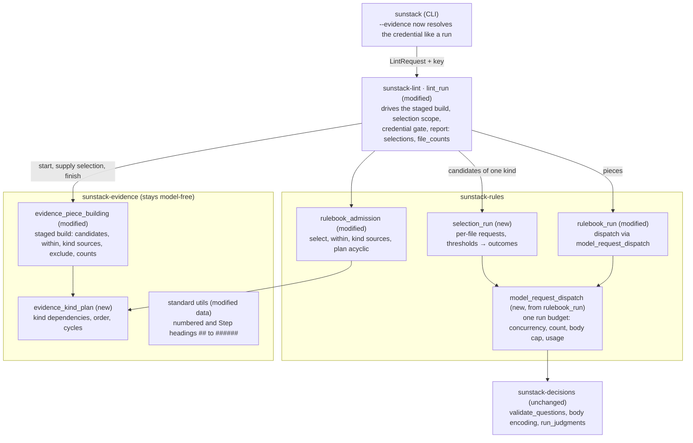
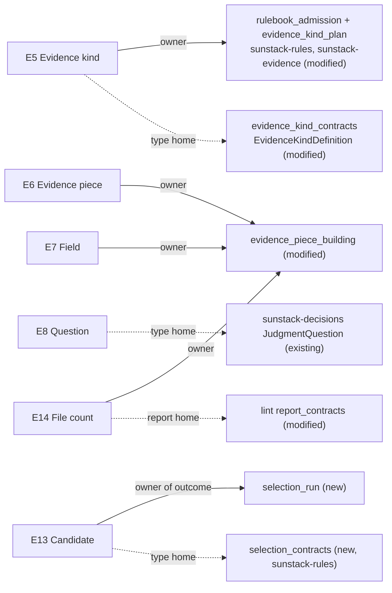

# Evidence selection: program design

How the engine realizes [Specification](specification.md) R29–R43 for [Requirements](requirements.md) U13–U17. It amends the [2026-10-29 program design](../2026-10-29-skill-rules-evidence-and-decisions/program-design.md), whose components, edges, failure table and trace stay in force except where a row below changes them. Current-system anchors are at sunstack-tools `edba61b` (0.2.0).

## What changes, in one picture

Evidence building stops being one synchronous pass. It becomes a staged build that lint drives kind by kind in dependency order. When the next kind is selected, the build hands its candidates back; lint asks the decision model through the same request dispatcher the rules use; the build then continues with the chosen candidates as pieces. Contained kinds and kind-based fields are built after the kinds they depend on, so they only ever see final pieces. Rules then run exactly as on 0.2.0. The report gains each candidate's outcome and per-file counts.



## Structure decision

**The crux:** a model decision now sits inside evidence building, but evidence building is synchronous and model-free (`crates/sunstack-evidence/src/evidence_piece_building.rs:75`), it builds kinds in name order with no dependency order (`:127`, `:143`), and the only request budget lives inside `run_rulebook` (`crates/sunstack-rules/src/rulebook_run.rs:63`, `:120`).

| Option | What it means | Gain | Cost | Verdict |
| --- | --- | --- | --- | --- |
| A. Staged build driven by lint (selected) | evidence exposes a build that pauses at each selected kind and resumes with the chosen candidates; `selection_run` in sunstack-rules asks; one `model_request_dispatch` serves selection and rules | evidence stays model-free (the 2026-10-29 forbidden edge `sunstack-evidence → sunstack-rules` holds); selection reuses question validation, body encoding and the attempt controller; one budget for the whole run | the builder gains a stage API and a dependency plan; lint gains a loop; dispatch logic moves out of `rulebook_run` | selected |
| B. Gate finished pieces | build every kind as today, then drop unselected pieces before rules | smallest change | contained kinds and kind-based fields would still be built from raw candidates, so steps would include rule lists and `same_file` would list unchosen sections; fails R30, R31, R35 (engine walk Q1) | rejected |
| C. Give evidence a model callback | `build_pieces` takes an async decision backend and asks inside the build | one call from lint | evidence gains async model I/O and policy (thresholds, budgets), breaking its one job and the forbidden edge; build is today run inside `spawn_blocking` | rejected |

Falsifiers that would reopen it: a second consumer needs selection outside lint (then the build loop moves to a library function both call), or selection needs answers about pieces of several files at once (then the per-file request shape changes).

The run budget moves to its own component because two stages now spend it: keeping a second budget in `selection_run` would let selection plus rules exceed `max_model_requests` and `max_concurrent_requests` (R43).

## Entity binding



| E | Semantic owner | Package or module home | Schema/type home and shape at each boundary | Disposition | Convention |
| --- | --- | --- | --- | --- | --- |
| E5 Evidence kind (amended) | `rulebook_admission` admits it; `evidence_kind_plan` orders it | sunstack-evidence `evidence_kind_contracts`, `evidence_kind_plan` (new); sunstack-rules `rulebook_admission` (modified), `selection_contracts` (new) | wire, in sunstack-evidence: `EvidenceKindDefinition { rule, fields, max_chars?, select: Option<SelectionWire>, within: Option<EvidenceKindName> }`; `SelectionWire { question: serde_json::Value, yes_at_or_above: f64, no_at_or_below: f64, shared: Vec<FieldName> }` (`shared` defaults empty). The question stays opaque JSON on the evidence side, so sunstack-evidence never imports a decision type. Admitted, in sunstack-rules `selection_contracts`: `AdmittedSelection { kind: EvidenceKindName, question: JudgmentQuestion, yes_at_or_above: f64, no_at_or_below: f64, shared: Vec<FieldName> }`, built by `rulebook_admission` from the wire with `validate_questions` (thresholds `f64`, validated as decision steps' are in `decision_graph_contracts`). Evidence reads only `select.is_some()` and `shared`. Plan `EvidenceKindPlan { order: Vec<EvidenceKindName>, depends_on: BTreeMap<EvidenceKindName, BTreeSet<EvidenceKindName>> }` | derived from the config | strict Serde, `deny_unknown_fields` (existing) |
| E6 Evidence piece (amended) | `evidence_piece_building` | sunstack-evidence (modified) | `EvidencePiece` unchanged in shape; a selected kind's piece is built from a `SelectionCandidate` the lint loop supplied as chosen | derived per run | existing |
| E7 Field (amended) | `evidence_piece_building` | sunstack-evidence `evidence_kind_contracts` (modified) | `FieldSource::Inside { of: MatchSource }`, `Enclosing { of }`, `SameFile { of }`, `Remainder { exclude: Option<MatchSource> }` (excludes matches or pieces strictly inside the piece: a range equal to the piece's own is never excluded, unlike `match_within`'s inclusive test used by `within`); `MatchSource` closed enum `Rule(EvidenceRuleId) \| Kind(EvidenceKindName)`, decoded from exactly one of the wire keys `rule` / `kind` (both or neither is a decode refusal naming the field); `FieldValue` unchanged | derived | Serde tag `from`, snake_case (existing) |
| E8 Question (amended) | `rulebook_admission` (validates), `selection_run` (asks) | sunstack-decisions `JudgmentQuestion` (existing), reached only from sunstack-rules | a selection question is a `JudgmentQuestion` whose type is noul and whose `check`/`against`/`context` name no `target` field, refused otherwise at admission; on the wire to the model it is one question per candidate, named by `CandidateKey`, with `check`/`against`/`context` field names rewritten to `candidates.<key>.<field>` or `shared.<field>` | authored | existing |
| E13 Candidate | `evidence_piece_building` builds it; `selection_run` owns its outcome | sunstack-evidence (candidate), sunstack-rules `selection_contracts` (new, outcome) | `SelectionCandidate { id: CandidateId { kind, file, span: SourceSpan }, key: CandidateKey, location: PieceLocation, first_line: String, fields: BTreeMap<FieldName, FieldValue> (raw, for the unavailable-field guard), selection_view: ModelView (no `shared`, no `target` fields) }`; per file and kind `SharedView { file, kind, fields: BTreeMap<FieldName, FieldValue>, view: ModelView }`, computed once; `SelectionOutcome` closed enum `Selected { yes: f64 } \| NotSelected { yes: f64 } \| Uncertain { yes: f64 } \| Incomplete { reason: SelectionIncompleteReason }` (`yes` is the noul answer's probability); `SelectionIncompleteReason` = `EvidenceUnavailable { field: FieldName } \| EvidenceTooLarge \| RequestTooLarge { limit: RequestLimit } \| InvalidRequest \| ProviderFailure \| MalformedAnswer \| RequestLimitReached \| Cancelled`; `RequestLimit` = `RequestMaxChars \| QuestionsPerRequest \| RequestBytes \| InputTokens`; back to evidence as `ChosenCandidates(BTreeSet<CandidateId>)`; to the report as `SelectionEntry { kind, where: PieceLocation, first_line, outcome }` | per run | closed enums, snake_case Serde tags (existing report style) |
| E14 File count | `evidence_piece_building` (matches, pieces, limited) + `lint_run` (picked, selection counts) | sunstack-evidence `EvidenceCatalog` (modified); lint `report_contracts` (modified) | `FileCount { file, kinds: BTreeMap<EvidenceKindName, KindCount> }`; `KindCount { matches, pieces, picked, limited: bool, selection: Option<SelectionCount> }`; `SelectionCount { candidates, asked, selected, not_selected, uncertain, incomplete }` (`selection` is `None` exactly for kinds without `select`) | per run | report types derive the JSON schema (existing) |
| E12 Standard util library (U17) | `standard_markdown_utils` | sunstack-evidence data `ast-grep-utils/markdown/` (modified) | `numbered-heading-section` regex `^#{2,6}\s+[0-9]+[.)]\s+`, `step-heading-section` `^#{2,6}\s+Step\s+[0-9]+:\s+` | shipped | `include_str!` (existing) |

`CandidateKey` (`c1`, `c2`, …, file order) and `CandidateId` serve E13's identity; `BuildStep` and `ChosenCandidates` serve R35; `model_request_dispatch`'s state serves R43. No other design-only concept is introduced.

## Components, owners and edges

| Component | One job | Reason to change | Consumers |
| --- | --- | --- | --- |
| `evidence_kind_plan` (new, sunstack-evidence) | derive each kind's dependencies (`within`, kind-based field sources, `exclude.kind`, and a `target` field's `as_kind`) and a deterministic build order (dependencies first, then kind name), or the cycle | the set of ways a kind can depend on another | `rulebook_admission` (refuse cycles), `evidence_piece_building` (order) |
| `evidence_piece_building` (modified) | scan every file once into the match index; build kinds in plan order, each kind's target-free fields first and its `target` fields after its `as_kind` kind is final (today's prepass, now per kind in plan order); for a contained kind keep matches within the named kind's pieces; for a selected kind produce candidates with their selection views and one shared view per file, and wait for the chosen set; compute kind-based fields, `exclude`, model views and counts from final pieces; return the catalog in kind-name, file, byte-start order whatever the build order was | the build vocabulary | `lint_run` |
| `evidence_model_view` (modified) | as today, plus the selection view (a candidate's fields without `shared` and `target` fields) and the shared view (the `shared` fields alone), each reduced by R12's rules to the kind's `max_chars` | the size rule | piece building |
| `model_request_dispatch` (new, extracted from `rulebook_run`) | own the run's single request budget: measure the exact encoded body against `request_max_chars`, count against `max_model_requests`, bound concurrency with one semaphore under the run's cancellation token, keep receipts for usage | dispatch policy | `selection_run`, `rulebook_run` |
| `selection_run` (new, sunstack-rules) | for one selected kind: settle candidates whose question names an unavailable field (or whose file's shared field is unavailable) as `EvidenceUnavailable` with no request, using the same referenced-field check `decision_walking` uses today (extracted, not copied); pack the rest of each file into the fewest consecutive groups whose encoded body passes `request_max_chars` and the decision layer's own admission (`encode_judgment_body` and `assess_request_budget`, existing: question count, bytes, input tokens), a single candidate that can't pass alone settling `RequestTooLarge { limit }` or `InvalidRequest`; send groups through the dispatcher; map each answer through the thresholds to a `SelectionOutcome` | the selection request shape and outcome rule | `lint_run` |
| `selection_contracts` (new, sunstack-rules) | `AdmittedSelection` and the outcome types | the selection vocabulary | `rulebook_admission`, `selection_run`, lint report |
| `rulebook_admission` (modified) | everything it admits today, plus R40's refusals; asks `evidence_kind_plan` for cycles; turns each `SelectionWire` into an `AdmittedSelection`, validating its question with `validate_questions`, the noul constraint and the no-`target`-field constraint | the decision and kind vocabulary | check and run |
| `rulebook_run` (modified) | as today, dispatching through `model_request_dispatch`; R20 unchanged | dispatch policy (now shared) | `lint_run` |
| `lint_run` (modified) | order the pipeline; drive the staged build and selection; compute the selection file set under a change scope; gate the credential on asking rules or any selected kind; assemble `selections` and `file_counts` | the command's flow | CLI |
| lint report modules (modified) | `selections`, `file_counts`, the default format's selection lines, status precedence with selection | the report contract | CLI, the tests/skills runner |
| CLI `lint_command` (modified) | resolve the credential for `--evidence` exactly as for a run | the credential edge | users |

Allowed edges are the 2026-10-29 ones. `sunstack-evidence` still never depends on `sunstack-rules` or `sunstack-decisions`: it receives the chosen set as data. `selection_run` never reads files: it receives candidates. Violations show up as a Cargo dependency cycle or an import in review.

## The representative path: `sunstack lint --config <kit> --all`

```mermaid
sequenceDiagram
  participant Lint as lint_run
  participant Adm as rulebook_admission + plan
  participant Ev as evidence_piece_building
  participant Sel as selection_run
  participant Disp as model_request_dispatch
  participant Jev as decision model
  participant Run as rulebook_run
  Lint->>Adm: admit rules and kinds; plan order, refuse cycles (R40)
  Adm-->>Lint: rules, EvidenceKindPlan
  Lint->>Lint: asking rule or selected kind and no key? invalid before reads (R4, R38)
  Lint->>Ev: start(project, kinds, plan, files) in spawn_blocking: scan once
  loop kinds in plan order
    Ev-->>Lint: NeedsSelection(workflow_section, candidates by file)
    Lint->>Sel: select(kind, candidates, selection file set)
    loop each file, concurrently under the shared budget
      Sel->>Disp: one request: one noul per candidate, shared once (R33)
      Disp->>Jev: exact body, measured and counted
      Jev-->>Disp: answers or failure
      Disp-->>Sel: answers / Incomplete reason
    end
    Sel-->>Lint: SelectionOutcome per candidate (R34)
    Lint->>Ev: supply ChosenCandidates; continue: step within workflow_section, load.step from step
  end
  Ev-->>Lint: EvidenceCatalog (pieces, FileCount matches/pieces/limited)
  Lint->>Lint: pick pieces (R15); fill picked and selection counts
  Lint->>Run: rules on picked pieces, same dispatcher (R35, R20 unchanged)
  Run-->>Lint: results
  Lint->>Lint: status with selection (R37); report: results, selections, file_counts (R36)
```

What crosses each boundary:

| Edge | Shape (home) | New or existing |
| --- | --- | --- |
| build → lint at a pause | `BuildStep::NeedsSelection { kind: EvidenceKindName, candidates: Vec<SelectionCandidate>, shared: Vec<SharedView> }` or `BuildStep::Done(EvidenceCatalog)` (sunstack-evidence) | new |
| lint → `selection_run` | `SelectionInput { selection: AdmittedSelection, candidates: Vec<SelectionCandidate>, shared: Vec<SharedView>, files: BTreeSet<PathBuf> }` (sunstack-rules) | new |
| `selection_run` → dispatcher → model | `StructuredJudgmentRequest { questions: NamedQuestionMap (keys c1…), state: { where: { file }, candidates: { c1: <selection view>, … }, shared: <shared view> } }` (sunstack-decisions, existing type); no `target` field or opening is ever in it | existing type, new state shape |
| `selection_run` → lint | `BTreeMap<CandidateId, SelectionOutcome>` (`selection_contracts`) | new |
| lint → build on resume | `ChosenCandidates(BTreeSet<CandidateId>)` (sunstack-evidence) | new |
| lint → report | `LintReport.selections: Vec<SelectionEntry>`, `LintReport.file_counts: Vec<FileCount>` (lint `report_contracts`) | new fields |

Current path for comparison (`lint_run.rs:281–348`): one `spawn_blocking(build_pieces)` returns the catalog; `pick_pieces`; `run_rulebook` with its own semaphore and counter; report. Edge delta:

| Edge | Status | Consequence |
| --- | --- | --- |
| lint → `build_pieces` (one call) | changed: lint → staged build, paused at each selected kind | dependent kinds see final pieces (R35) |
| build: kinds in name order | changed: plan order (dependencies first, then name) | contained kinds and kind-based fields are deterministic (R41) |
| field sources `inside` / `enclosing` / `same_file` → raw rule matches | intentionally unchanged for `rule`; added: → pieces for `kind` | 0.2.0 configs keep their fields (R42) |
| lint → `selection_run` → dispatcher → decision model | added | selection (R33–R34) |
| `rulebook_run` → its own semaphore and counter | removed; `rulebook_run` → `model_request_dispatch` added | one budget (R43) |
| credential gate on asking rules only | changed: asking rules or any selected kind; CLI resolves for `--evidence` too | R38; a config without selection still needs no credential |
| report: results, findings, uncertain, incomplete, usage | intentionally unchanged; added `selections`, `file_counts`, default-format lines | R36, R42 |
| `run_judgments` attempt controller, retries, receipts | intentionally unchanged | provider behavior is the existing one |

`--check` runs admission and the plan only (R40). `--evidence [kind]` runs the staged build with selection, picking and the listing, and no rule request (R38).

## State

Nothing persists across runs (R41). Per run, a candidate moves through one lifecycle owned by `selection_run`:

| From | Event | To |
| --- | --- | --- |
| built (`not_asked`) | its file is in the selection file set | asked (in a request) |
| built (`not_asked`) | its file isn't in the set (change scope) | stays `not_asked`; counted in `candidates`, not in `asked` |
| built | its question names an unavailable field, or its file's shared field is unavailable | `Incomplete { evidence_unavailable, field }`, never sent |
| built | its selection view or its file's shared view is `TooLarge` | `Incomplete { evidence_too_large }`, never sent |
| built | alone its request fails `request_max_chars` or the decision layer's admission | `Incomplete { request_too_large, limit }` or `Incomplete { invalid_request }`, never sent |
| asked | answer ≥ yes threshold / ≤ no threshold / between | `Selected` / `NotSelected` / `Uncertain` |
| asked | provider failure, malformed answer, limit reached, cancellation | `Incomplete { reason }` for every candidate in that request |

Only `Selected` reaches the build, as membership in `ChosenCandidates`. The build's own state is the plan position: kinds before it are final and immutable; the kind at the pause has candidates and no pieces; kinds after it don't exist yet. A kind is never built twice. Because the plan puts every `as_kind` kind before the kinds that target it, a kind's `target` fields always read final fields: `as_kind` can't name a selected kind or a kind depending on one, so target composition never waits on a pause.

Illegal states kept out at the trusted entry (`rulebook_admission`, decode): a selection question that isn't a noul; thresholds outside 0–1, not finite, or yes ≤ no; `shared` naming a non-`same_file` or undefined field; a field source with both or neither of `rule`/`kind`; a `within`, `kind` or `exclude.kind` naming an undefined kind; any dependency cycle; `as_kind` naming a selected kind or a kind that depends on one. Unrepresentable: a selected kind's piece without a candidate (pieces of a selected kind are only built from `ChosenCandidates`); a `selection` count on a kind without `select` (`Option` is set only from a `KindSelection`).

## Failure and recovery

Rows added to the 2026-10-29 table; every existing row holds.

| Failure | Detected by | Contained to | Result |
| --- | --- | --- | --- |
| a selection config refusal (R40) | decode, `rulebook_admission`, `evidence_kind_plan` | the whole config | `invalid` (2) under `--check` and before any checked read in a run |
| a candidate's selection view, or its file's shared view, `TooLarge` | `evidence_model_view` | that candidate (or every candidate of that file and kind, for the shared view) | `Incomplete { evidence_too_large }`; run `incomplete: selection_incomplete` |
| the question names a field that is unavailable for a candidate, or a `shared` field is unavailable | `selection_run`, with the referenced-field check extracted from `decision_walking` | that candidate (or that file and kind) | `Incomplete { evidence_unavailable, field }`, no request; peers still asked; unreferenced unavailable fields are left out of the view |
| one candidate fails `request_max_chars`, the question count, bytes or input tokens by itself, or the decision layer refuses it for another reason | `selection_run`, with the encoded body and `assess_request_budget` (existing) | that candidate | `Incomplete { request_too_large, limit }` or `Incomplete { invalid_request }`; others in its file still asked |
| provider error, timeout, malformed answer | `run_judgments` (existing), `selection_run` | the candidates of that request | `Incomplete { provider_failure \| malformed_answer }`; other files' outcomes stand; dependent kinds in that file have no pieces from those candidates |
| `max_model_requests` reached during selection | `model_request_dispatch` | every request not yet admitted | their candidates `Incomplete { request_limit_reached }`; rule requests after that are `request_limit_reached` as on 0.2.0 |
| cancellation during selection | the run's cancellation token | the run | `cancelled` (4); outcomes so far reported |
| a file over lint's limits or unreadable | the build (existing) | that file | no candidates there; existing `incomplete` reason; its `FileCount` shows `limited` where the match cap stopped it |

Uncertain selection is not a failure: it stops the candidate becoming a piece and makes the run `uncertain` when nothing earlier in R26's order applies (R37). There are no retries beyond the attempt controller's, and no fallback that treats an unanswered candidate as chosen.

## Concurrency

Only model requests overlap. `model_request_dispatch` holds one `JoinSet`, one semaphore of `max_concurrent_requests` and one remaining-count for `max_model_requests`, under the run's cancellation token, for the whole run. A selected kind is a barrier: all of its files' requests finish before the build resumes, because a dependent kind may span files through targets and fields. Outcomes are stored by `CandidateId` and reported in file then kind order, so completion order never shows (R41). The build runs in `spawn_blocking` between awaits, as today; it owns no lock across an await.

## Change scope

Under `--since` or the default scope (R39), lint needs the selection file set before the first pause. The scan stage already computes, from the match index, every match's target paths (targets can't depend on a selected kind: `as_kind` is refused there). The set is every checked file with a changed hunk plus every file holding a match whose target changed. Candidates elsewhere stay `not_asked`. Picking then applies R15 unchanged to the final pieces. Widening to full when config inputs change is unchanged.

## Compatibility and cutover

No coexistence phase: nothing is stored, and the new keys are additive. A config with no `select`, `within`, `kind` source or `exclude` takes the same build path with a plan equal to name order, the same field sources and the same requests (R42); its report adds `file_counts` and an empty `selections`. The two widened standard utils (R32) change matches for configs that rely on numbered or Step headings at levels other than `###`; the release notes list them. sunstack's kit adopts selection in its own change.

## Trust and privacy

A selection request carries the candidates' bounded selection views and one bounded shared view of one file, never `text`, never another file, never a `target` field, a target's opening or a target file's fields (R33): `evidence_model_view` builds the selection view without `target` fields, and admission refuses a selection question that names one. Target fields are still composed for the selected pieces that rules later judge, as on 0.2.0. It goes to the same decision model under the same credential path as rule requests; the credential never enters state, reports or diagnostics. `--evidence` now resolves the credential like a run, and lint requires it only when a selected kind exists.

## Cross-cutting

- **Performance:** files are still read and parsed once; selection adds one request per file per selected kind (or a few when split). Under a change scope only changed files are asked.
- **Determinism (R41):** plan order, file order, candidate keys and storage by `CandidateId`.
- **Observability:** `selections` and `file_counts` are the coverage view; usage includes selection requests.

## Proof seams

| Seam | Real | Faked | Observes |
| --- | --- | --- | --- |
| `evidence_kind_plan` | the plan | nothing | orders and cycles for crafted kind graphs |
| staged build on fixture files | ast-grep, standard utils, builder | the chosen set, supplied directly | candidates, `within` pieces, kind-based fields, `exclude`, counts, the two widened utils incl. `spec-program-review`'s nine `##` stages |
| `selection_run` with a loopback decision backend | request building, splitting, thresholds, dispatcher | the HTTP endpoint (existing loopback pattern) | request bodies (question per candidate, qualified fields, shared once), outcomes at, below and above thresholds, split groups, contained failures |
| `model_request_dispatch` | the budget | requests from both stages | one count and one semaphore across selection and rules; limit and cancellation |
| `sunstack lint` binary on fixture repositories | everything | the decision endpoint via `decision_model.endpoint` | `selections`, `file_counts`, default-format lines, statuses and exit codes, `--evidence` with and without a selected kind, `--since` selection file set |
| compatibility | the 0.2.0 release binary and this build | the endpoint, with the same answers for both | identical pieces, rule requests and results on sunstack's 0.2.0 kit config, apart from listed R32 matches |
| hosted run | everything, real decision model | nothing | every candidate has an outcome, no incomplete part, the 13 step-silent skills' outcomes |

## Trace

| U | R | E | Owner | Interface | Shape and home | State | Failure | Proof |
| --- | --- | --- | --- | --- | --- | --- | --- | --- |
| U13, U16 | R29 `select` on a kind | E5, E8 | `rulebook_admission` | decode `SelectionWire`, admit `AdmittedSelection` | `SelectionWire` in `evidence_kind_contracts`; `AdmittedSelection` in `selection_contracts` | none | refusal (R40), including a question naming a `target` field | `--check` fixtures |
| U14 | R30 `within` | E5, E6 | `evidence_piece_building` with `evidence_kind_plan` | staged build keeps matches within the named kind's pieces (`match_within`, existing) | `EvidenceKindDefinition.within` | plan position | refusal for undefined kind or cycle | staged-build fixtures |
| U14 | R31 kind-based sources, `exclude`, `as_kind` limit | E7 | `evidence_piece_building` with `evidence_kind_plan` | `FieldSource` evaluation over final pieces; `target` fields composed after the `as_kind` kind is final | `MatchSource`, `FieldSource::Remainder { exclude }` (strictly inside) | plan position | refusal for both/neither key, undefined kind, cycle, `as_kind` on a selected kind | staged-build fixtures, including a forward-named `as_kind` |
| U17 | R32 heading levels | E12 | `standard_markdown_utils` | embedded util YAML | the two regexes above | none | none | util fixtures; `spec-program-review` stages |
| U13, U16 | R33 selection requests | E13, E8 | `selection_run` | `select(SelectionInput, &Dispatcher) -> BTreeMap<CandidateId, SelectionOutcome>` | `StructuredJudgmentRequest` with the selection state (selection views, one shared view); `SharedView`, `selection_contracts` | built → asked | groups packed against `request_max_chars` and `assess_request_budget`; too-large or inadmissible candidates | loopback request capture |
| U13, U16 | R34 outcomes | E13 | `selection_run` | referenced-field guard, then threshold mapping | `SelectionOutcome`, `SelectionIncompleteReason`, `RequestLimit` | built → incomplete before sending, or asked → outcome | per candidate before sending, per request after | loopback answers around thresholds; unavailable and inadmissible fixtures |
| U14 | R35 order of decisions | E5, E6, E7 | `lint_run` + `evidence_piece_building` | `BuildStep` loop; rules after `Done` | `BuildStep`, `ChosenCandidates` | plan position | none | staged-build and binary ordering checks |
| U15 | R36 report | E13, E14 | lint report modules | `LintReport.selections`, `.file_counts`, default format | `SelectionEntry`, `FileCount`, `KindCount`, `SelectionCount`, lint `report_contracts` | none | none | binary JSON and default output |
| U16 | R37 status | E11, E13 | lint `outcome` | status precedence | `LintStatus` (existing), `IncompleteReason::SelectionIncomplete` (new) | none | incomplete / uncertain | binary exit codes |
| U13, U15 | R38 `--evidence` | E13, E14 | `lint_run`, CLI `lint_command` | credential gate on a selected kind; listing adds `selections`, `file_counts` | `EvidenceListing` (modified) | none | invalid with no key and a selected kind | binary, with and without a selected kind, no key set |
| U13, U15 | R39 change scope | E13 | `lint_run` | selection file set from hunks and changed targets | `BTreeSet<PathBuf>` into `SelectionInput.files` | `not_asked` elsewhere | none | temp Git repo fixtures |
| U16 | R40 check | E5, E7, E8 | `rulebook_admission`, `evidence_kind_plan` | `check(config) -> CheckResult` with the listing additions | `CheckResult` (existing, new listing rows) | none | refusals listed | refusal matrix; zero checked reads |
| U13, U15 | R41 sameness | E13, E14 | build, `selection_run`, dispatcher | ordering rules | ordered vectors keyed by `CandidateId` | none | none | repeat runs, reversed completion |
| U13 | R42 compatibility | E5–E7 | `evidence_piece_building` | the same path with a name-order plan | unchanged types for 0.2.0 configs | none | none | 0.2.0 binary vs this build on sunstack's kit config, same answers |
| U16 | R43 shared budget | E13 | `model_request_dispatch` | one dispatcher for selection and rules | dispatcher state (semaphore, remaining count, receipts) | none | `request_limit_reached` | budget tests across both stages |

Deviations and unresolved decisions:

- Sending several rules' questions about one piece in one request is not built here (Requirements non-goal). The engine walk (Q3) names what it would need: collision-free question names mapped back to each rule, a state carrying several standards, and a per-rule failure boundary inside one request. Its answer-stability experiment on the labelled rule cases comes first.
- The kit decides whether candidates are sections or top-level numbered lists; both are expressible (R31's `exclude` covers sections).
