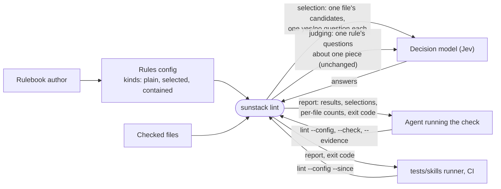
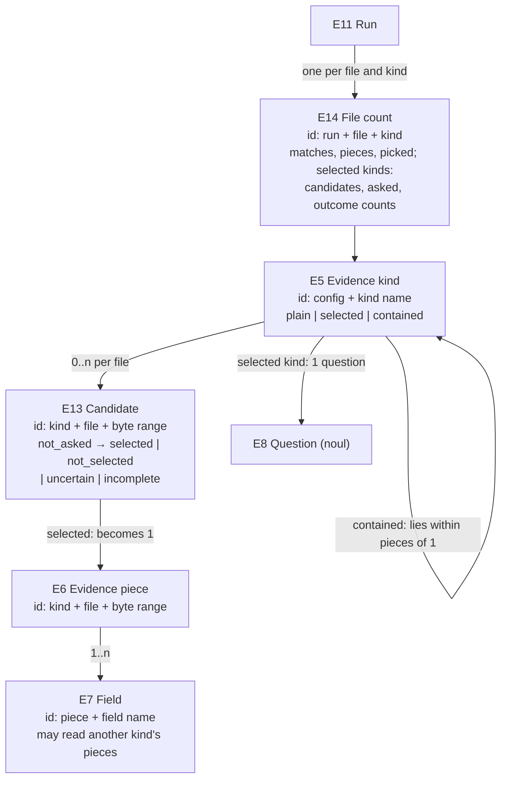

# Evidence selection: specification

The observable contract for [Requirements](requirements.md) U13–U17. It amends the [2026-10-29 specification](../2026-10-29-skill-rules-evidence-and-decisions/specification.md): its R6, R9, R11, R13, R15, R24, R25, R26 and R27 gain the obligations below, and every other obligation there (R1–R28) holds unchanged, including R20's one request per rule per piece. Identifiers continue that set's numbering.

## The system from outside

What changes for a consumer: a kind can now be chosen by the decision model from mechanical candidates, or kept only inside another kind's pieces, and the report says what was chosen and how much evidence each file yielded. Outside this contract: what the kit chooses, its question wording and its rules; sending several rules' questions in one request; choice or score questions for selection.

## Entities

New and amended entities. E1–E4 and E9–E12 keep their 2026-10-29 meaning.

| E | Term | Identity | Relationships | Invariants and states |
| --- | --- | --- | --- | --- |
| E5 (amended) | Evidence kind | (config, kind name) | defined by one ast-grep rule in the evidence project plus field sources; may be *selected* (has a selection question) and may be *contained* (names one kind it must lie within) | a plain kind's pieces are its rule's matches; a contained kind's pieces are its matches inside a piece of the named kind; a selected kind's pieces are its candidates chosen by the model; the kinds' dependencies (containment, kind-based fields) form no cycle |
| E6 (amended) | Evidence piece | (kind, file, byte range of the match) | belongs to one kind and one checked file | of a selected kind: exists only for a candidate whose outcome is `selected`; of a contained kind: exists only inside a piece of the named kind; otherwise as 2026-10-29 |
| E7 (amended) | Field | (piece, field name) | as 2026-10-29; a field may now draw on another kind's pieces in the same file | its value shapes are unchanged; it never reads a kind that depends on its own kind |
| E8 (amended) | Question | (rule entry, question name), or (selected kind) for a selection question | a selection question belongs to exactly one selected kind | a selection question is a noul in the decision model's schema |
| E13 | Candidate | (selected kind, file, byte range of the match) | a match of a selected kind's rule (inside a piece of its named kind when it is also contained); belongs to one selected kind and one checked file; asked about in exactly one selection request per run | states: `not_asked` (outside the run's scope, or the run never reached it) → `selected` \| `not_selected` \| `uncertain` \| `incomplete` (with reason); a candidate is a piece exactly when `selected` |
| E14 | File count | (run, checked file, kind) | one per checked file the run built evidence for and kind the config defines | `matches` (the kind's rule matches in the file), `pieces`, `picked`, `limited` when the file's scan stopped at `max_matches`, and for a selected kind only: `candidates`, `asked` (candidates selection ran on), and `selected`, `not_selected`, `uncertain`, `incomplete` (which add up to `asked`); `matches` ≥ `pieces`, and the difference for a contained kind is what containment left out; for a selected kind, `pieces` equals `selected`; `candidates` − `asked` are `not_asked` |

## Selected and contained kinds in the config

| R | Serves | Obligation |
| --- | --- | --- |
| R29 | U13, U16 | A kind may add `select`: `{ "question": <noul question>, "yes_at_or_above": <n>, "no_at_or_below": <n>, "shared"?: [<field name>] }`. Its rule's matches are then candidates (E13), and only candidates the model chooses become pieces. The question is exactly the decision model's noul `JudgmentQuestion`, validated as R19 validates questions; in its `instructions`, `check`, `against` and `context` name fields of this kind. Both thresholds are finite numbers from 0 to 1 and the yes threshold is strictly greater than the no threshold. `shared` names fields whose source is `same_file`, which by construction have the same value for every candidate in a file. |
| R30 | U14 | A kind may add `"within": <kind name>`. A match of its rule then counts only when its byte range lies inside or equals the byte range of a piece of the named kind in the same file. The named kind may be plain, selected or itself contained. A kind with both `within` and `select` first keeps its matches inside the named kind's pieces, and only those are candidates. |
| R31 | U14 | The field sources `inside`, `enclosing` and `same_file` (2026-10-29 R11) accept `"kind": <kind name>` in place of `"rule"`. They then read that kind's pieces, after selection and containment, with the same value shapes: `inside` the texts of the pieces whose byte range lies within this piece's; `enclosing` the first lines of the pieces that contain this piece, outermost first; `same_file` the first lines of every piece in this piece's file, in order. `remainder` accepts an optional `exclude` (`{ "rule": <id> }` or `{ "kind": <name> }`): the text of those matches or pieces lying within this piece is also removed from the remainder, so a section can be judged on its own content without its subsections. `as_kind` (R11 targets) may not name a selected kind or a kind that depends on one, so reading a target never asks the model. |
| R32 | U17 | The standard util library's `numbered-heading-section` matches a section whose ATX heading, at any level from `##` to `######`, reads `<n>. Title` or `<n>) Title`; `step-heading-section` matches one whose heading, at any level from `##` to `######`, reads `Step <n>: Title`. A document's `#` title is not matched by either. |

## Choosing the evidence

| R | Serves | Obligation |
| --- | --- | --- |
| R33 | U13, U16 | For each checked file selection runs on (R39) and each selected kind with candidates in it, the decision model is asked about every one of those candidates: one question per candidate, named by the candidate's key (its position in file order, `c1`, `c2`, …). Each question is the kind's selection question, unchanged except that the field names in its `check`, `against` and `context` are qualified with that candidate's key. The request state is `where` (the file), `candidates` (each candidate's key mapped to its model view, R12, bounded by the kind's `max_chars`, without the `shared` fields) and `shared` (the `shared` fields' values, once). All of a file's candidates for one kind go in one request when that request's body is within `request_max_chars`; otherwise in the fewest requests that each fit, each holding consecutive candidates in file order and repeating `shared`. A request never mixes files or kinds and never carries text outside its candidates' model views and `shared`. |
| R34 | U13, U16 | A candidate's answer at or above `yes_at_or_above` makes it `selected`; at or below `no_at_or_below`, `not_selected`; between them, `uncertain`. A candidate whose request is over `request_max_chars` on its own, whose model view is `evidence_too_large` (R12), whose request the provider fails or answers malformed, or whose request `max_model_requests` stops, is `incomplete` with that reason. Only `selected` candidates become pieces. An `uncertain` or `incomplete` candidate is never treated as selected or not selected, and every other candidate's outcome still stands. |
| R35 | U14 | Selection and containment are decided before any rule runs on a kind, any contained kind is cut, or any field reads a kind, so rules, contained kinds and kind-based fields only ever see the final pieces. Rules then run on pieces exactly as 2026-10-29 R14–R23 say; R20's one request per rule per piece is unchanged. |
| R39 | U13, U15 | Under full scope, selection runs on every checked file that has candidates. Under a change scope (2026-10-29 R15) it runs on every checked file that holds a changed hunk or a piece picked because a target changed, over all of that file's candidates, so what is chosen is decided on the whole file; pieces are then picked as R15 says. A file selection doesn't run on asks nothing, and its candidates stay `not_asked`. When the config, a rule file or an evidence project file changed, the run widens to full as R15 says. |
| R43 | U16 | Selection requests count toward `max_model_requests`, `max_concurrent_requests`, `max_input_tokens_per_request` and the report's usage exactly as rule requests do. A selected kind's candidates are asked before any rule request that depends on them. |

## Report, status and the evidence listing

| R | Serves | Obligation |
| --- | --- | --- |
| R36 | U15 | The JSON report adds `selections`: one entry per candidate selection ran on, in file order then kind order, with the kind, its `where` (file, first and last line, byte range, which together tell apart candidates that share a line), the candidate's first line, its outcome (`selected`, `not_selected`, `uncertain` or `incomplete`), the yes probability when answered, and the reason when incomplete. It adds `file_counts`: one entry per checked file the run built evidence for, in file order, with an E14 count for every kind the config defines (the selection counts only for selected kinds), so a file whose candidates were never asked under a change scope shows `asked: 0`, not `selected: 0` alone. The `default` format adds, after the findings, one line per selected kind with its outcome counts, and one line per file where a selected kind had candidates but none `selected`, naming how many were `not_selected`, `uncertain` and `incomplete`. The `github` and `sarif` formats are unchanged. |
| R37 | U16 | Run status (2026-10-29 R26) counts selection: an `incomplete` candidate makes the run `incomplete` with reason `selection_incomplete`; otherwise an `uncertain` candidate makes it `uncertain` (exit 5) unless a status earlier in R26's order applies. Rules still run on every piece that exists. |
| R38 | U13, U15 | `sunstack lint --config <path> --evidence [<kind>]` on a config with selected kinds runs selection (R33, R34, R39) and asks the model nothing else; it then needs the credential as R4 says, and without one ends `invalid` naming it before reading any checked file. It prints the pieces as R13 does plus `selections` and `file_counts`. On a config with no selected kind it stays exactly as R13 says: no credential, no request. |

## Check, sameness and compatibility

| R | Serves | Obligation |
| --- | --- | --- |
| R40 | U16 | `--check` (2026-10-29 R24) also refuses, with file, line and column where one exists: a `select` question that isn't a noul or that the decision model's schema rejects; a selection threshold outside 0 to 1, not finite, or a yes threshold not strictly above the no threshold; `shared` naming an undefined field or a field whose source isn't `same_file`; a selection question naming a field the kind doesn't define; `within` or a field source's `kind` or `exclude.kind` naming an undefined kind; any cycle among kinds through `within`, kind-based field sources and `exclude.kind` (a kind that reads or lies within itself included); `as_kind` naming a selected kind or a kind that depends on one. Its listing adds each selected kind with its question and thresholds and each contained kind with the kind it lies within. It still reads no checked file, sends nothing and needs no credential. |
| R41 | U13, U15 | The same inputs and the same answers give the same candidates, the same selection requests (grouping, order and bodies), the same outcomes, pieces, fields, rule requests and results, and the same `selections` and `file_counts`, in the same order. No selection outcome is reused from an earlier run. |
| R42 | U13 | A config that uses no `select`, no `within`, no kind-based field source and no `exclude` gives the same pieces, rule requests and results, in the same order, as 0.2.0 on the same inputs and answers, except for matches of `numbered-heading-section` and `step-heading-section` at heading levels other than `###` (R32). Its report adds `file_counts` and an empty `selections`, and its run status never comes from selection. |

## Worked examples

All lines are from sunstack main `690dc5a7`.

**Choosing the workflow section, then its steps.** A kit defines a selected kind `workflow_section` over sections that directly hold a numbered list or are numbered headings, with fields `heading` (`first_line`), `body` (`remainder` excluding child sections) and `outline` (`same_file`, the section-heading rule) and `"shared": ["outline"]`, and a contained kind `step` whose rule matches numbered items and numbered or "Step" heading sections, `"within": "workflow_section"`. In `plugins/sunstack-dev/skills/practices-research/SKILL.md`, `## Ordered Workflow` (lines 19–30) is a candidate. One request asks about it with the file's outline once. With a yes probability of 0.93 against `yes_at_or_above` 0.7 it is `selected`, and `step` has six pieces, the items at lines 21, 22, 24, 25, 26 and 27. With 0.12 against `no_at_or_below` 0.3 it is `not_selected`, `step` has no pieces in that file, and the default format prints that file as having one candidate and none selected. With 0.5 it is `uncertain`, `step` has no pieces in that file, and the run is `uncertain` unless something earlier in R26's order applies.

**A numbered list of rules.** In `plugins/sunstack-dev/skills/presentation-tui/SKILL.md`, `## Core rules` (line 12, twelve items) is a candidate. Answered `not_selected`, none of its items is a step, and its entry in `selections` names line 12 and its first line, so a reader sees which list was judged not to be a workflow.

**Too much for one request.** A file has five candidates whose request would be 26,000 characters against `request_max_chars` 20,000. The candidates go in two requests, `c1`–`c3` and `c4`–`c5`, each with `shared` once, and both count toward `max_model_requests`. If `c4` alone is over the limit, `c4` is `incomplete` (`request_too_large`), the rest are asked, and the run is `incomplete: selection_incomplete`.

## Proof obligations

| V | Decides pass and fail for | Reference |
| --- | --- | --- |
| V13 | R29–R31, R40: every refusal R40 lists fires on a crafted config and names file:line; a valid config with a selected kind, a contained kind, kind-based fields and `remainder.exclude` passes and its listing names them; check attempts no checked-file read, sends no request and needs no credential | the R40 list |
| V14 | R30–R31: on fixed answers, a contained kind's pieces are exactly its matches inside or equal to a piece of the named kind; `inside`, `enclosing` and `same_file` with `kind` return exactly those pieces' texts and first lines in R31's order; `remainder` with `exclude` drops exactly the excluded spans; `as_kind` never reaches a selected kind | R30–R31 and the practices-research example's line numbers |
| V15 | R32: the two utils match numbered and "Step" sections at `##`, `###` and `####` and not the `#` title, on fixtures and on `spec-program-review`'s nine numbered `##` stages | R32; `spec-program-review/SKILL.md` at `690dc5a7` |
| V16 | R33–R34: the selection request for practices-research carries one question per candidate, byte-equal to the kind's question but for the qualified field names, the candidates' model views and `shared` once; answers just below, at and just above each threshold give `not_selected`, `uncertain` and `selected` as R34 says; the split example's two requests and its `request_too_large` candidate happen as stated; a provider failure on one file's request leaves other files' outcomes standing | R33–R34 and the worked examples' arithmetic |
| V17 | R35, R43: no rule request, contained piece or kind-based field is produced before the selection it depends on is decided; selection requests appear in usage and stop at `max_model_requests` as R43 says | R35, R43 |
| V18 | R36–R38: the JSON report's `selections` and `file_counts` hold exactly one entry per asked candidate and per file in scope, with the outcomes above; the default format prints the per-kind counts and each file with candidates but none selected; `github` and `sarif` output is byte-identical to 0.2.0's for the same results; statuses and exit codes follow R37; `--evidence` with a selected kind and no credential is `invalid` with zero checked-file reads, and with no selected kind needs no credential | R36–R38, 2026-10-29 R26 |
| V19 | R39: under `--since` with one changed hunk in practices-research, selection runs on that file only, over all its candidates, and other files' candidates are absent from `selections` | R39 |
| V20 | R41–R42: two runs with the same answers give byte-equal reports; sunstack's 0.2.0 kit config on `690dc5a7` gives the same pieces, rule requests and results as 0.2.0, except R32's added heading matches, which are listed | the 0.2.0 release on the same inputs and answers |
| V21 | U-level outcome on the decision model's live answers: a local build runs a kit config with a selected workflow kind and a contained step kind over every skill on sunstack main; every candidate has an outcome in `selections`, no part is `incomplete`, and each of the 13 skills that had no step on 0.2.0 has either step pieces or every one of its candidates reported `not_selected` or `uncertain` | the decision model's live responses; the 30 Oct coverage measurement's list of 13 skills |

## Coverage

| U | E | R | V |
| --- | --- | --- | --- |
| U13 | E5, E6, E8, E13 | R29, R33, R34, R38, R39, R41, R42 | V13, V16, V18–V21 |
| U14 | E5, E6, E7 | R30, R31, R35 | V13, V14, V17 |
| U15 | E13, E14 | R36, R38, R39, R41 | V18, V19, V21 |
| U16 | E8, E13 | R29, R33, R34, R37, R40, R43 | V13, V16–V18 |
| U17 | E4, E12 | R32 | V15 |

## Nearby behavior this does not promise

- Selection asks yes/no questions only, one per candidate; there is no "pick the single best section" question, and a file may have several selected candidates or none.
- A candidate's outcome is not cached or carried between runs, and nothing in the report says a file's selection matches an earlier run's.
- Selection never reads a file outside `check.files`, and a selected kind's candidates never include text from another file, so a target's opening (R11) is never part of a selection request.
- A file with no candidates at all is counted (`candidates: 0`) and nothing more: whether a skill must have a workflow is the kit's rule to decide, not the engine's.
- Under a change scope, a piece that exists only because selection chose a section is picked by R15's rule like any other piece: when a changed hunk touches its own lines. Changing just a section's heading can change what is selected without picking that section's steps; a full run judges them.
