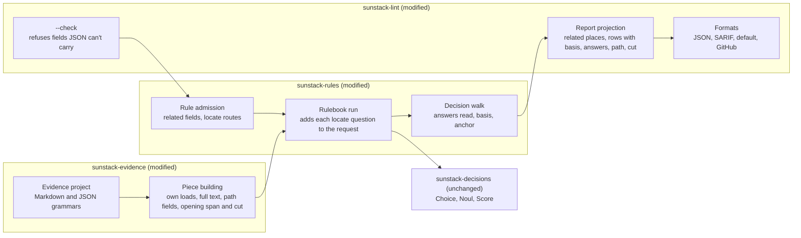
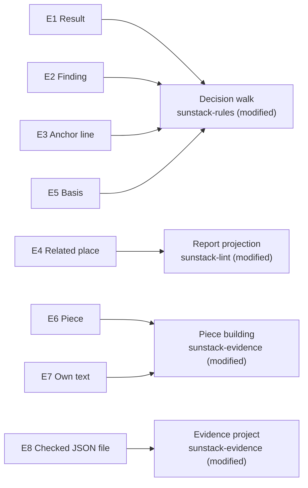
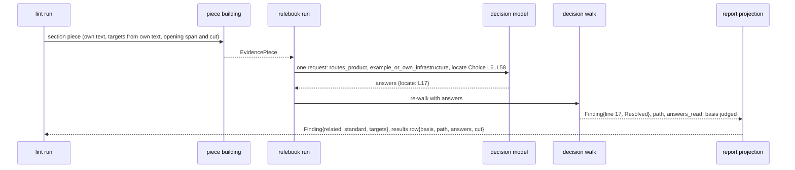

# Program Design: the lint report as a nudge

31 Oct 2026. Author: 🦁 Lead. Realizes [specification.md](specification.md) (E1-E8, R1-R10) for [requirements.md](requirements.md). Draft, not yet reviewed. Current behaviour cites the evidence pack (`engine-evidence/evidence-pack.md`, pinned `e8c6a13`; section numbers in brackets).

## What changes, in one picture



The model stays where it is: the decision walk owns what a result is and how it was reached; piece building owns what evidence a piece holds; the report projection owns what readers see. Every change is an addition to one of those three owners, plus the rule admission that validates the new authored options. `sunstack-decisions` doesn't change: the locator is an ordinary Choice built per piece.

## The structure decision

| Choice | Selected | Credible alternative | Why selected | Reopen if |
| --- | --- | --- | --- | --- |
| Where answers-read and basis come from (R3, R4) | The decision walk records the answers each step actually read, on every result variant; basis is `judged` when that set is non-empty | Derive both at report projection from `path_taken` plus the graph | One owner for "what this walk read". Projection would have to re-read the graph and would conflate obtained answers with read ones [8] | a second caller needs basis without walking |
| How a finding reaches line 17 (R2) | A route's `locate` names a locate question; at request time code numbers the field's lines and adds a Choice over them; the walk checks the chosen line lies in the field | A regex locator over the field; or per-load units | A regex picks the first load in the section, not AgentStudio's (line 14's generic load comes first). Per-load units are a non-goal. Code enumerates and validates; the model only chooses (`domain-decision-models`) | locate answers prove unreliable on labelled cases; then per-load units return as a design question |
| JSON in lint (R8) | Lint's evidence project parses each file with its rules' grammar (Markdown or JSON); field sources stay byte-range based | Route lint through native `prepare_evidence` | Native and lint are separate pipelines; lint's piece building and field sources are byte-range based and work on JSON spans already [7]. The native path would rewrite lint's piece building | a JSON need appears that byte ranges can't express (for example, a property value without its quotes) |
| Own loads (R6) | A target field gets its own `exclude`, applied by one helper used by both target scans | Reuse a remainder field's exclusions | Exclusions are field-local and two remainder fields can disagree [5]; the target field must say its own | a kind wants loads excluded differently per consumer |

Debt accepted: the locate question costs tokens per located finding route (the payer is each keyed run, capped by the line limit below); JSON field sources are limited to byte-range sources.

## Entity bindings



Type conventions found: Serde-derived Rust structs and closed enums with `#[serde(tag = ..., rename_all = "snake_case")]`; authored config and rule entries use `deny_unknown_fields`; report types derive `JsonSchema` and generate the report schema (`report_schema()`) [11]; `domain-rust`: closed enums, no string states.

| E | Semantic owner | Package or module home | Schema/type home | Shape at each boundary | Disposition | Convention |
| --- | --- | --- | --- | --- | --- | --- |
| E1 Result | Decision walk | `sunstack-rules` `rulebook_planning/decision_walking.rs` (modified; `RulebookResult`) | native: `RulebookResult` (modified); public: `sunstack-lint` `report_contracts.rs` `RulePieceResult` (modified) | native → lint: every variant gains `answers_read: NamedAnswerMap` (empty when none); lint JSON row gains `basis` (absent on incomplete), `path: [StepName]`, `answers` (absent when empty), `cut` (absent when empty) | derived per run | closed enum, Serde |
| E2 Finding | Decision walk (outcome, severity, anchor); report projection (related, public shape) | `sunstack-rules` and `sunstack-lint` (modified) | `RulebookResult::Finding` (modified); `Finding` in `report_contracts.rs` (modified) | lint `Finding` gains `anchor: Anchor`, `basis: Basis`, `related: [RelatedPlace]` | derived per run | Serde struct |
| E3 Anchor line | Decision walk | `sunstack-rules` (modified) | `FindingRoute.locate: Option<QuestionName>` in `decision_graph_contracts.rs` (new field); `Anchor` enum in `report_contracts.rs` (new) | rule entry: `"locate": "<question>"` on a finding route; native finding carries `line` and `anchor: resolved \| default`; JSON `anchor: "resolved" \| "default"` | derived | closed enum |
| E4 Related place | Report projection | `sunstack-lint` `lint_reporting` (modified) | `RelatedPlace { label, file, first_line, last_line }` in `report_contracts.rs` (new); rule entry `related: [FieldName]` in `rulebook_entry_wire.rs` (new field); SARIF `relatedLocations` in `sarif_format.rs` (new) | JSON list; SARIF location with `message.text = label`; default/GitHub one line each | derived | Serde struct; SARIF 2.1.0 schema |
| E5 Basis | Decision walk | `sunstack-rules` (modified) | `Basis` enum (`mechanical \| judged`) beside `RulebookResult` (new) | JSON `basis` string on rows and findings | derived | closed enum |
| E6 Piece | Piece building | `sunstack-evidence` (modified; `EvidencePiece`, `ModelView`, `LoadTarget`) | `evidence_kind_contracts.rs` (modified) | sent piece state gains `cut: [FieldName]`; `LoadTarget` gains `opening_cut: bool` and `opening_last_line` | derived per run | Serde struct |
| E7 Own text | Piece building | `sunstack-evidence` `evidence_piece_building` (modified) | `FieldSource::Target` gains `exclude: Option<ExcludeRule>` (same shape as the remainder's) in `evidence_kind_contracts.rs` (modified) | config: target field `exclude: { rule \| kind }` | derived | `deny_unknown_fields` wire |
| E8 Checked JSON file | Evidence project | `sunstack-evidence` `evidence_planning/evidence_project_loading.rs` (modified) | `EvidenceLanguage` enum (`markdown \| json`) (new) | evidence rule `language: Json` admitted; file parsed per its applicable rules' language | derived | closed enum |

Design-only concepts: the per-piece locate Choice (serves R2, E3); the own-text helper (R6, E7); the language enum (R8, E8). Each serves the row named.

## Components and interfaces

**Rule admission** (`sunstack-rules` `rulebook_admission.rs`, `rulebook_entry_wire.rs`). Owns validating authored rule entries. Changes when the rule-entry language changes.
- `related: [FieldName]` on an entry: each must be a field of the entry's kind; refused otherwise with the field named.
- A finding route's `locate: QuestionName`: must name a question of `type: "locate"` whose instructions name the route's `at` field; refused otherwise. A `locate` question is never reachable by `ask` steps.
- For a kind whose evidence rule is JSON, a `yaml` field source is refused, naming the field (R8).

**Rulebook run** (`rulebook_run.rs`). Owns building the one request per piece. Changes when request construction changes.
- For each locate question the rule declares, it numbers the lines of the piece's `at` field from that field's spans and adds a Choice named after the locate question: labels `L<line>` for each line, criteria the line's text. A field with more lines than the configured `limits.max_locate_lines` (default 80) gets no locate Choice; its finding falls back to the default anchor.
- Everything else as today: all questions in the first request, one re-walk with the answers [3].

**Decision walk** (`decision_walking.rs`). Owns the result, its path, the answers it read, its basis and its anchor. Changes when walk semantics change.
- Result contract (native, closed):

```rust
pub enum RulebookResult {
    Pass { path_taken: Vec<StepName>, answers_read: NamedAnswerMap },
    NotApplicable { path_taken: Vec<StepName>, answers_read: NamedAnswerMap },
    Finding { finding: FindingResult, path_taken: Vec<StepName>, answers_read: NamedAnswerMap },
    Uncertain { /* today's fields */ answers_read: NamedAnswerMap },
    Incomplete { /* today's fields, unchanged */ },
}
pub struct FindingResult { pub message: String, pub severity: Severity, pub field: Option<FieldName>, pub line: u32, pub anchor: Anchor }
pub enum Anchor { Resolved, Default }
pub enum Basis { Mechanical, Judged } // judged iff answers_read is non-empty
```

- An ask or combine step inserts each answer it reads into `answers_read`; a mechanical step inserts nothing. Answers obtained but not read stay out [8].
- On a finding route with `locate`: when the locate Choice's selected label is `L<n>` and line `n` lies within the `at` field's spans, `line = n`, `anchor = Resolved`; otherwise the first span's line, `anchor = Default`. The locate answer is recorded in `answers_read`.
- `piece_state` adds `cut: [FieldName]` from the piece's model view when non-empty [4].

**Piece building** (`sunstack-evidence` `evidence_piece_building`). Owns what a piece holds. Changes when field sources change.
- One helper `own_text_ranges(piece, exclude)` returns the piece's text ranges minus the excluded ranges; `finalize` and `target_paths` both scan only those ranges for a target field that declares `exclude` [5]. Without `exclude`, today's whole-text scan.
- `enclosing` and `same_file` accept `text: "full"`, returning the whole matched range's text and spans (default `first_line`) [6].
- A path target with `as_kind` fills `fields` from the first piece of that kind in the resolved file, as the skill branch does today [6].
- A path target records `opening_last_line` (the last line its opening covers) and `opening_cut` (true when the file was longer than `opening_chars`).

**Evidence project** (`evidence_project_loading.rs`). Owns parsing checked files. Changes when a grammar is added.
- Admits evidence rules and utils whose language is Markdown or JSON; other languages stay refused.
- `match_file` parses a file once per distinct language among the rules that apply to its path, and indexes each rule's matches from the tree of its own language [7].

**Report projection** (`sunstack-lint` `outcome.rs`, `report_contracts.rs`). Owns the public report. Changes when report fields change.
- For each finding: `related` = the standard (`RulebookSentence.rulebook`, `.line`) then, for each related field in the entry's order, one place per span (text fields) or per resolved target (`file`, line 1 to `opening_last_line`); `anchor`, `basis` from the native result; `line` from the native anchor line, with the public span narrowed to that line when resolved.
- For each result row: `basis` (absent on incomplete), `path`, `answers` (absent when empty), `cut` (absent when empty).
- Status and exit: unchanged order and codes [9].

**Formats** (`formats.rs`, `sarif_format.rs`). Own rendering. SARIF `result.relatedLocations[]`: `{ id: i, physicalLocation: {artifactLocation, region{startLine,endLine}}, message: {text: label} }`. Default and GitHub output print each related place under its finding as `  label: file:line`.

## The main path, line 17



Call-path delta against today [1-4, 8]:

| Edge | Today | Proposed | Status |
| --- | --- | --- | --- |
| run → model request | all authored questions | plus one locate Choice per located route, built from the field's lines | added |
| walk → result | `path_taken`; answers only on finding and uncertain | `answers_read` on every variant; `Anchor`; `Basis` derived | changed |
| walk → finding line | first span of `at`, else piece first line | the locate Choice's line when valid, else as today | changed |
| `piece_state` | model fields only | plus `cut` | changed |
| finalize, target_paths → targets | regex over the whole piece text | over own text when `exclude` is declared | changed |
| projection → finding | file, line, span, severity, message, judgment | plus `related`, `anchor`, `basis` | changed |
| projection → result row | seven fields | plus `basis`, `path`, `answers`, `cut` | changed |
| status and exit reduction | as today | unchanged | intentionally unchanged |
| severity resolution | route's authored severity, else rule's | unchanged | intentionally unchanged |

## Failure, partial results and compatibility

- **Locate answer invalid or absent** (label outside the field's lines, Choice below its probability floor, field over the line limit): the finding keeps the default anchor; never an error. Owner: decision walk.
- **JSON file that fails to parse:** today's acquisition-failure path; the file is a catalog failure reported as incomplete for its kinds. Owner: evidence project.
- **Refused definitions** (`related` naming an unknown field, `locate` naming a non-locate question, `yaml` on a JSON kind): `--check` refuses with the file, entry path and field, exit 2, as other definition refusals [9].
- **Request budget:** the locate Choice counts toward the request's question and token limits; when it would exceed them, it's dropped for that piece and the finding falls back to the default anchor.
- **Compatibility:** every report change is an added field; existing fields keep names and meaning. The `ai-tools` runner's `pieceDecisionSchema` strips unknown row fields [11], so the skills pull request (work plan step 5) widens it with the pin to 0.6.0. Rule entries with none of the new options behave as today. No coexistence phase: the engine releases as 0.6.0 and the one known consumer moves in the next pull request.
- **Concurrency:** none added; requests keep today's concurrency and accounting.
- **Security and privacy:** no new reads outside the checked repository root; JSON files are read through the same checked-file source. No credential surface changes.

## Illegal states, kept out

| Invalid state | Decision | Enforcement |
| --- | --- | --- |
| a `basis` on an incomplete result | unrepresentable: `Incomplete` carries no `answers_read`, and the row's `basis` is `Option`, set only from completed variants | type |
| a related place the run didn't read | unrepresentable: built only from the standard and collected spans and targets | type and projection code |
| an anchor line outside the field | rejected at the walk: an out-of-range locate label gives `Default` | runtime guard |
| a `locate` question asked by an `ask` step | rejected at admission | schema and admission |
| a `yaml` field on a JSON kind | rejected at admission | admission |

## Trace

| U | R | E | Owner | Interface | Shape and home | State | Failure | Proof |
| --- | --- | --- | --- | --- | --- | --- | --- | --- |
| U1 | R1 finding carries `related` (standard first, then named fields' spans and targets) | E2, E4 | Report projection | `project_outcome` builds `related` from the entry's `related` and the piece | `RelatedPlace` in `report_contracts.rs`; entry `related` in `rulebook_entry_wire.rs`; SARIF `relatedLocations` | derived per run | unknown field refused at `--check` | lint process seam: JSON and SARIF on a fixture rule with `related` |
| U2 | R2 anchor line inside the field via a locate question | E3 | Decision walk (with rulebook run) | locate Choice built per piece; walk resolves the line | `FindingRoute.locate`, `Anchor` | derived per run | invalid or absent answer gives `Default` | walk unit seam with a fake answer; keyed check on the line-17 fixture |
| U3 | R3 rows carry the answers read, gate drops included | E1 | Decision walk | `answers_read` on every completed variant | `RulebookResult` (modified); row `answers` | derived per run | none: mechanical paths read none | walk unit seam; lint process seam with a fake backend |
| U4 | R4 rows and findings carry `basis` | E5 | Decision walk | `Basis` from `answers_read` | `Basis` enum; row and finding `basis` | derived per run | none on incomplete (unrepresentable) | walk unit seam; lint process seam |
| U5 | R5 `cut` in sent state and rows; `opening_cut` on targets | E6 | Piece building and decision walk | `piece_state` adds `cut`; finalize records the opening cut | `ModelView` (existing), `LoadTarget` (modified) | derived per run | none: a cut is reported, never an error | evidence unit seam; request-state assertion through the fake backend |
| U6 | R6 a target field's own text excludes declared ranges, in both scans | E7 | Piece building | `own_text_ranges` used by `finalize` and `target_paths` | `FieldSource::Target.exclude` in `evidence_kind_contracts.rs` | derived per run | none: without `exclude`, today's scan | evidence unit seam on the H1/parent/child fixture; change-scope seam |
| U7 | R7 `text: "full"` on enclosing and same_file; path target `as_kind` fields | E6 | Piece building | field composition and finalize path branch | `FieldSource` (modified), `LoadTarget.fields` (existing field, newly filled) | derived per run | none: defaults keep today's values | evidence unit seam |
| U8 | R8 lint checks JSON with JSON evidence rules | E8 | Evidence project | `match_file` per language; admission | `EvidenceLanguage` in `evidence_project_loading.rs` | derived per run | parse failure is a catalog failure; `yaml` on JSON refused | evidence unit seam with a JSON fixture; lint process seam on a mixed config |
| U9 | R9 severity, status and exits unchanged | E2 | Decision walk (severity), report projection (status) | unchanged | unchanged | none: unchanged | unchanged | existing warning-limit test plus a judged-gate-then-mechanical-error case |
| U10 | R10 generic; additive report | none: a whole-change property | Report projection and rule admission | labels from authored field names; additive fields | `report_contracts.rs`; `report_schema()` | none: no state | none: no new failure | schema seam: the 0.5.0 fixture's fields unchanged in 0.6.0; a diff check for skill-specific terms |

Deviations and unresolved decisions: none. Requirements → Specification → Program Design → [Verification Design](verification-design.md).
