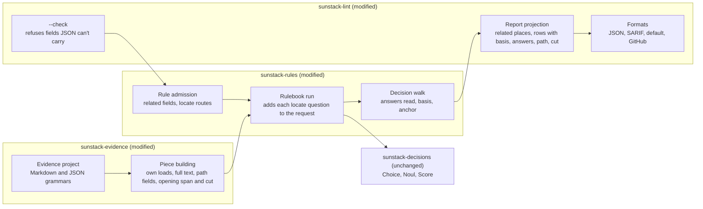
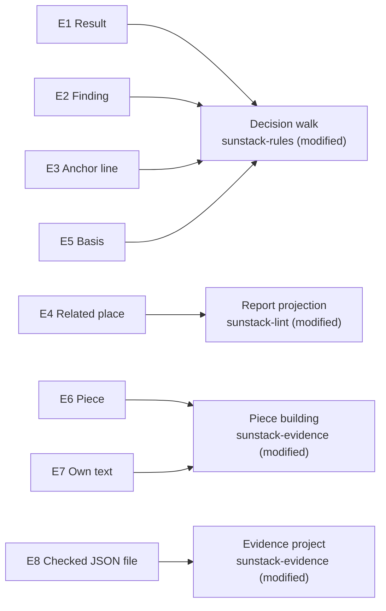
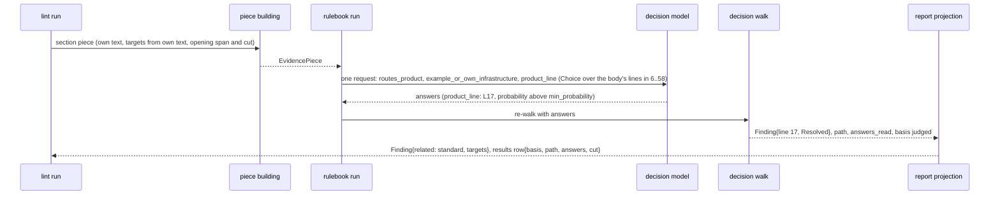

# Program Design: the lint report as a nudge

31 Oct 2026. Author: 🦁 Lead. Realizes [specification.md](specification.md) (E1-E8, R1-R10) for [requirements.md](requirements.md). Draft, not yet reviewed. Current behaviour cites the evidence pack (`engine-evidence/evidence-pack.md`, pinned `e8c6a13`; section numbers in brackets).

## What changes, in one picture



The model stays where it is: the decision walk owns what a result is and how it was reached; piece building owns what evidence a piece holds; the report projection owns what readers see. Every change is an addition to one of those three owners, plus the rule admission that validates the new authored options. `sunstack-decisions` doesn't change: the locator is an ordinary Choice built per piece.

## The structure decision

| Choice | Selected | Credible alternative | Why selected | Reopen if |
| --- | --- | --- | --- | --- |
| Where answers-read and basis come from (R3, R4) | The decision walk records the answers each step actually read, on every result variant; basis is `judged` when that set is non-empty | Derive both at report projection from `path_taken` plus the graph | One owner for "what this walk read". Projection would have to re-read the graph and would conflate obtained answers with read ones [8] | a second caller needs basis without walking |
| How a finding reaches line 17 (R2) | A finding route carries a `locate` object (name, task, `min_probability`). When a piece's request is sent, the run turns each of the rule's locators into an ordinary Choice over the `at` field's lines inside the piece and adds it to that one request; the walk reads the answer when it reaches the route. No native decision type changes | A regex locator over the field; per-load units; a new `locate` question type in the native protocol | A regex picks the first load in the section, not AgentStudio's (line 14's generic load comes first). Per-load units are a non-goal. A native question type would change the protected protocol for one rules-side use. Code enumerates the lines and the native validator admits the answer; the model only chooses (`domain-decision-models`) | locate answers prove unreliable on labelled cases; then per-load units return as a design question |
| JSON in lint (R8) | Lint's evidence project parses each file with its rules' grammar (Markdown or JSON); field sources stay byte-range based | Route lint through native `prepare_evidence` | Native and lint are separate pipelines; lint's piece building and field sources are byte-range based and work on JSON spans already [7]. The native path would rewrite lint's piece building | a JSON need appears that byte ranges can't express (for example, a property value without its quotes) |
| Own loads (R6) | A target field gets its own `exclude`, applied by one helper used by both target scans | Reuse a remainder field's exclusions | Exclusions are field-local and two remainder fields can disagree [5]; the target field must say its own | a kind wants loads excluded differently per consumer |

Debt accepted: each locator costs tokens in every request its rule sends (the payer is each keyed run, capped by the line limit below); a locator rides only on requests the walk already needs, so an all-mechanical finding keeps the default anchor; a malformed locator answer makes the piece `incomplete` like any malformed answer, so a bad locator can cost a nudge (it shows as a gap, never as a pass); JSON uses the existing byte-range field sources only.

## Entity bindings



Type conventions found: Serde-derived Rust structs and closed enums with `#[serde(tag = ..., rename_all = "snake_case")]`; authored config and rule entries use `deny_unknown_fields`; report types derive `JsonSchema` and generate the report schema (`report_schema()`) [11]; `domain-rust`: closed enums, no string states.

| E | Semantic owner | Package or module home | Schema/type home | Shape at each boundary | Disposition | Convention |
| --- | --- | --- | --- | --- | --- | --- |
| E1 Result | Decision walk | `sunstack-rules` `rulebook_planning/decision_walking.rs` (modified; `RulebookResult`) | native: `RulebookResult` (modified); public: `sunstack-lint` `report_contracts.rs` `RulePieceResult` (modified) | native → lint: every variant keeps today's fields and gains `answers_read: NamedAnswerMap` (empty when none); `Incomplete` also gains `path_taken` (empty when no walk ran); lint JSON row gains `basis` (absent on incomplete), `path: [StepName]` (always), `answers` (absent when empty), `cut` (absent when empty) | derived per run | closed enum, Serde |
| E2 Finding | Decision walk (outcome, severity, anchor); report projection (related, public shape) | `sunstack-rules` and `sunstack-lint` (modified) | `RulebookResult::Finding` (modified); `Finding` in `report_contracts.rs` (modified) | lint `Finding` gains `anchor: Anchor`, `basis: Basis`, `related: [RelatedPlace]` | derived per run | Serde struct |
| E3 Anchor line | Decision walk | `sunstack-rules` (modified) | `FindingRoute.locate: Option<Locator>` with `Locator { name: QuestionName, task: String, min_probability: f64 }` (`deny_unknown_fields`) in `decision_graph_contracts.rs` (new); `Anchor` enum in `sunstack-rules` and in `report_contracts.rs` (new) | rule entry: `"locate": {"name", "task", "min_probability"}` on a finding route with `at`; request: a `JudgmentQuestion::Choice` under `name` (unchanged native type); native finding carries `line` and `anchor`; JSON `anchor: "resolved" \| "default"` | derived | closed enum, `deny_unknown_fields` wire |
| E4 Related place | Report projection | `sunstack-lint` `lint_reporting` (modified) | `RelatedPlace { label, file, first_line, last_line }` in `report_contracts.rs` (new); rule entry `related: [FieldName]` in `rulebook_entry_wire.rs` (new field); SARIF `relatedLocations` in `sarif_format.rs` (new) | JSON list; SARIF location with `message.text = label`; default/GitHub one line each | derived | Serde struct; SARIF 2.1.0 schema |
| E5 Basis | Decision walk | `sunstack-rules` (modified) | `Basis` enum (`mechanical \| judged`) beside `RulebookResult` (new) | JSON `basis` string on rows and findings | derived | closed enum |
| E6 Piece | Piece building | `sunstack-evidence` (modified; `EvidencePiece`, `ModelView`, `LoadTarget`) | `evidence_kind_contracts.rs` (modified) | sent piece state gains the engine key `"cut-fields": [FieldName]` (a hyphenated key no `FieldName` can equal); `LoadTarget` gains `opening_cut: bool` (in the model state only when true) and `opening_last_line: Option<usize>` (native and evidence listing only; set for a non-empty path opening) | derived per run | Serde struct |
| E7 Own text | Piece building | `sunstack-evidence` `evidence_piece_building` (modified) | `FieldSource::Target` gains `exclude: Option<ExcludeRule>` (same shape as the remainder's) in `evidence_kind_contracts.rs` (modified) | config: target field `exclude: { rule \| kind }` | derived | `deny_unknown_fields` wire |
| E8 Checked JSON file | Evidence project | `sunstack-evidence` `evidence_planning/evidence_project_loading.rs` (modified) | `EvidenceLanguage` enum (`markdown \| json`) (new) | evidence rule `language: Json` admitted; a kind's language is its evidence rule's; file parsed per its applicable rules' language | derived | closed enum |

Design-only concepts: the per-piece locator Choice (serves R2, E3); the own-text helper (R6, E7); the language enum (R8, E8). Each serves the row named.

## Components and interfaces

**Rule admission** (`sunstack-rules` `rulebook_admission.rs`, `rulebook_entry_wire.rs`). Owns validating authored rule entries. Changes when the rule-entry language changes.
- `related: [FieldName]` on an entry: each must be a field of the entry's kind; refused otherwise with the field named.
- A finding route's `locate`: requires `at` on the same route; `name` must differ from every key of the entry's `questions` and every other locator's `name`, so no `ask` or `combine` step can name a locator; `min_probability` must lie in (0, 1]. Each refusal names the entry and the route's step.
- Evidence kinds by language (R8): for a JSON kind, `yaml` is refused; every evidence rule or kind named by `inside`, `enclosing`, `same_file`, `next`, `previous` or an `exclude` must have the field's kind's language; a target's `as_kind` may name either language. Each refusal names the kind and field.

**Rulebook run** (`rulebook_run.rs`). Owns building the one request per piece. Changes when request construction changes.
- The first pass is today's walk with no answers. A piece whose walk settles sends nothing; its located findings keep the default anchor.
- For a piece whose walk needs answers, the request holds all of the rule's questions, as today [3], plus one Choice per locator of the rule: name = the locator's `name`; instructions `{"check": <at>, "task": <task>}`; criteria = one entry per line of the `at` field's spans that lies inside the piece's line range, deduplicated and ascending, label `L<line>`, text the line's content. A locator with no such line, with more than `limits.max_locate_lines` (default 80) of them, or that would take the request past its question or size budget is left out (the rule's own questions are never dropped for it); the run records which locators it sent.
- The native validator then admits or refuses the whole response as today: a missing requested answer or a label not offered is `InvalidResponse`, and the piece is `incomplete` (`judgment_validation.rs` `validate_response`; `rulebook_run.rs` maps `InvalidResponse` to incomplete). One re-walk with the answers follows, as today.

**Decision walk** (`decision_walking.rs`). Owns the result, its path, the answers it read, its basis and its anchor. Changes when walk semantics change.
- Result contract (native, closed):

```rust
// Today's variants and fields are kept; additions are marked.
pub enum RulebookResult {
    Pass { path_taken: Vec<StepName>, answers_read: NamedAnswerMap /* new */ },
    Finding {
        severity: Severity, message: String, line: usize, field: Option<FieldName>,
        path_taken: Vec<StepName>, answers: Option<NamedAnswerMap>, value: Option<f64>,
        anchor: Anchor,               // new
        answers_read: NamedAnswerMap, // new
    },
    NotApplicable { path_taken: Vec<StepName>, answers_read: NamedAnswerMap /* new */ },
    Uncertain {
        step: StepName, state: SharedEvidenceState, answers: NamedAnswerMap, path_taken: Vec<StepName>,
        answers_read: NamedAnswerMap, // new
    },
    Incomplete {
        reason: RulebookIncompleteReason, field: Option<FieldName>, step: Option<StepName>,
        path_taken: Vec<StepName>,    // new: empty when no walk ran
        answers_read: NamedAnswerMap, // new: empty when none was read
    },
}
pub enum Anchor { Resolved, Default }
pub enum Basis { Mechanical, Judged }
impl RulebookResult {
    // Some for every completed variant: Judged iff a decision step read an answer; None for Incomplete.
    pub fn basis(&self) -> Option<Basis>;
}
```

- An ask or combine step inserts each answer it reads into `answers_read`; a mechanical step inserts nothing. Answers obtained but not read stay out [8].
- The walk's incomplete exits carry the path and answers read so far. The run's own incomplete results (cancelled, dispatch refused, provider failure, invalid response) carry the first pass's path and no answers; a failure before the first pass carries both empty.
- On reaching a finding route with `locate`: when the answers hold the locator's Choice and the selected label's probability is at least `min_probability`, `line` is that label's line and `anchor = Resolved`, and the answer goes into `answers_read`; when the answers hold it below `min_probability`, `anchor = Default` and the answer still goes into `answers_read`; when no answers were supplied or the run left the locator out, `anchor = Default`. `Default` is today's line: the first span of `at`, else the piece's first line [2]. Every offered label is an in-piece line of `at` and the validator admits no other label, so a resolved line always lies in both the field and the piece.
- A locator is only sent with a request the walk needed, so a path that reaches it has read a decision answer: basis is `Judged` on every located path. The locator's answer itself never decides an outcome.
- `piece_state` adds the key `"cut-fields"` from the piece's model view when any field was cut [4]. Authored field keys are unchanged; an authored field named `cut` keeps its key.

**Piece building** (`sunstack-evidence` `evidence_piece_building`). Owns what a piece holds. Changes when field sources change.
- One helper `own_text_ranges(piece, exclude)` returns the piece's text ranges minus the excluded ranges; `finalize` and `target_paths` both scan only those ranges for a target field that declares `exclude` [5]. Without `exclude`, today's whole-text scan.
- `enclosing` and `same_file` accept `text: "full"`, returning the whole matched range's text and spans (default `first_line`) [6].
- A path target with `as_kind` fills `fields` from the first piece of that kind in the resolved file, as the skill branch does today [6].
- A path target records `opening_cut` (true when the file was longer than `opening_chars`) and, when its opening is non-empty, `opening_last_line` (the last line the opening covers). A skill target resolved by its fields, a target with `opening_chars: 0` and an unresolved target have no `opening_last_line`.

**Evidence project** (`evidence_project_loading.rs`). Owns parsing checked files. Changes when a grammar is added.
- Admits evidence rules and utils whose language is Markdown or JSON; other languages stay refused.
- `match_file` parses a file once per distinct language among the rules that apply to its path, and indexes each rule's matches from the tree of its own language [7]. `next` and `previous` read siblings from that tree; the `block_continuation` skip only ever meets Markdown nodes.

**Report projection** (`sunstack-lint` `outcome.rs`, `report_contracts.rs`). Owns the public report. Changes when report fields change.
- For each finding: `related` = the standard (`RulebookSentence.rulebook`, `.line`) then, for each related field in the entry's order, one place per span (text fields) or one per target that has `opening_last_line` (`file`, line 1 to `opening_last_line`); a target without it contributes nothing. `anchor` and `basis` from the native result; `line` from the native line. `span` keeps today's value, the first span of the route's field.
- For each result row: `basis` (from `RulebookResult::basis`, absent on incomplete), `path` (always), `answers` (absent when empty), `cut` (absent when empty).
- Status and exit: unchanged order and codes [9].

**Formats** (`formats.rs`, `sarif_format.rs`). Own rendering. SARIF region of a finding: when `anchor` is `resolved`, `{startLine: line, endLine: line}`; when `default`, today's region from `span`. SARIF `result.relatedLocations[]`: `{ id: i, physicalLocation: {artifactLocation, region{startLine,endLine}}, message: {text: label} }`. Default and GitHub output print the finding at `line` and each related place under it as `  label: file:line`.

## The main path, line 17



Call-path delta against today [1-4, 8]:

| Edge | Today | Proposed | Status |
| --- | --- | --- | --- |
| run → model request | all authored questions, when the first walk needs answers | plus one Choice per locator that fits, built from the `at` field's in-piece lines; still no request when the first walk settles | added |
| walk → result | `path_taken` on completed variants; answers on finding and uncertain; incomplete keeps reason, field, step | `answers_read` on every variant; incomplete also keeps `path_taken`; `Anchor`; `basis()` | changed |
| walk → finding line | first span of `at`, else piece first line | the locator's line when its answer clears `min_probability`, else as today | changed |
| `piece_state` | `standard`, `where`, model fields | plus `"cut-fields"` | changed |
| finalize, target_paths → targets | regex over the whole piece text | over own text when `exclude` is declared | changed |
| projection → finding | file, line, field, span, severity, severity_origin, message, judgment | plus `related`, `anchor`, `basis`; `span` unchanged | changed |
| projection → result row | seven fields | plus `basis`, `path`, `answers`, `cut` | changed |
| SARIF region | from `span` | from `line` when resolved, else from `span` | changed |
| status and exit reduction | as today | unchanged | intentionally unchanged |
| severity resolution | route's authored severity, else rule's | unchanged | intentionally unchanged |

## Failure, partial results and compatibility

- **Locator not sent or not confident** (the first walk settled; no in-piece line; over the line limit; over the request budget; probability below `min_probability`): the finding keeps the default anchor; not an error. Owner: rulebook run (sending) and decision walk (reading).
- **Malformed response** (a requested locator answer missing, or a label not offered): the native validator refuses the response as for any question, and the piece is `incomplete` with `invalid_response`, carrying the first pass's path. Owner: unchanged native validation (`validate_response`).
- **JSON file that fails to parse:** today's acquisition-failure path; the file is a catalog failure reported as incomplete for its kinds. Owner: evidence project. Needs a negative fixture: an invalid JSON file beside a valid one.
- **Refused definitions** (`related` naming an unknown field; `locate` without `at`, with a colliding name or an out-of-range `min_probability`; `yaml` on a JSON kind; a field naming a rule or kind of another language): `--check` refuses with the file, entry or kind, and field, exit 2, as other definition refusals [9].
- **Compatibility:** every report change is an added field; existing fields keep name, type and meaning, including a finding's `span`; `version` reads `0.6.0`. Readers that ignore unknown fields keep working; the `ai-tools` runner's `pieceDecisionSchema` strips unknown row fields [11], so the skills pull request (work plan step 5) widens it with the pin to 0.6.0. The 0.6.0 schema requires the new finding fields and row `path`, so a 0.5.0 report doesn't validate against it; nothing needs that direction. Rule entries with none of the new options behave as today. No coexistence phase: the engine releases as 0.6.0 and the one known consumer moves in the next pull request.
- **Concurrency:** none added; requests keep today's concurrency and accounting.
- **Security and privacy:** no new reads outside the checked repository root; JSON files are read through the same checked-file source. No credential surface changes.

## Illegal states, kept out

| Invalid state | Decision | Enforcement |
| --- | --- | --- |
| a `basis` on an incomplete result | unrepresentable: `basis()` returns `None` for `Incomplete`, and the row's `basis` is set only from it | type |
| a related place the run didn't read, or read without a line range | unrepresentable: built only from the standard, collected spans and targets with `opening_last_line` | type and projection code |
| a resolved anchor outside the field or the piece | unrepresentable: the run offers only in-piece lines of `at`, and the native validator refuses any other label | construction plus native validation |
| an authored field overwritten by cut metadata | unrepresentable: `"cut-fields"` contains a hyphen, which `FieldName` refuses | `FieldName` grammar |
| a locator read by an `ask` or `combine` step | rejected at admission: locator names can't equal question names | admission |
| a `yaml` field on a JSON kind; a field naming a rule of another language | rejected at admission | admission |

## Trace

| U | R | E | Owner | Interface | Shape and home | State | Failure | Proof |
| --- | --- | --- | --- | --- | --- | --- | --- | --- |
| U1 | R1 finding carries `related` (standard first, then named fields' spans and targets) | E2, E4 | Report projection | `project_outcome` builds `related` from the entry's `related` and the piece | `RelatedPlace` in `report_contracts.rs`; entry `related` in `rulebook_entry_wire.rs`; SARIF `relatedLocations` | derived per run | unknown field refused at `--check` | lint process seam: JSON and SARIF on a fixture rule with `related` |
| U2 | R2 anchor line inside the field and the piece via a locator | E3 | Rulebook run (sends) and decision walk (reads) | locator Choice built per piece from in-piece lines of `at`; walk resolves the line | `FindingRoute.locate: Option<Locator>`, `Anchor` | derived per run | not sent or below `min_probability`: `Default`; malformed: `incomplete` `invalid_response` | admission seam; lint process seam through the controlled server (request contents and real validation); keyed check on the line-17 fixture |
| U3 | R3 rows carry the path and the answers read, gate drops and incomplete included | E1 | Decision walk (and rulebook run for its own incomplete results) | `answers_read` on every variant; `path_taken` on `Incomplete` | `RulebookResult` (modified); row `path`, `answers` | derived per run | none: mechanical paths read none | walk unit seam; lint process seam with a fake backend |
| U4 | R4 rows and findings carry `basis` | E5 | Decision walk | `Basis` from `answers_read` | `Basis` enum; row and finding `basis` | derived per run | none on incomplete (unrepresentable) | walk unit seam; lint process seam |
| U5 | R5 `"cut-fields"` in sent state, `cut` on rows; `opening_cut` on targets | E6 | Piece building and decision walk | `piece_state` adds `"cut-fields"`; finalize records the opening cut | `ModelView` (existing), `LoadTarget` (modified) | derived per run | none: a cut is reported, never an error | evidence unit seam; request-state assertion through the fake backend, with an authored `cut` field |
| U6 | R6 a target field's own text excludes declared ranges, in both scans | E7 | Piece building | `own_text_ranges` used by `finalize` and `target_paths` | `FieldSource::Target.exclude` in `evidence_kind_contracts.rs` | derived per run | none: without `exclude`, today's scan | evidence unit seam on the H1/parent/child fixture; change-scope seam |
| U7 | R7 `text: "full"` on enclosing and same_file; path target `as_kind` fields | E6 | Piece building | field composition and finalize path branch | `FieldSource` (modified), `LoadTarget.fields` (existing field, newly filled) | derived per run | none: defaults keep today's values | evidence unit seam |
| U8 | R8 lint checks JSON with JSON evidence rules; every source but `yaml` | E8 | Evidence project and rule admission | `match_file` per language; admission by source and language | `EvidenceLanguage` in `evidence_project_loading.rs` | derived per run | parse failure is a catalog failure; `yaml` on JSON and cross-language references refused | evidence unit seam with a JSON fixture per admitted source; lint process seam on a mixed config; check-refusal journey |
| U9 | R9 severity, status and exits unchanged | E2 | Decision walk (severity), report projection (status) | unchanged | unchanged | none: unchanged | unchanged | existing warning-limit test plus a judged-gate-then-mechanical-error case |
| U10 | R10 generic; additive report | none: a whole-change property | Report projection and rule admission | labels from authored field names; additive fields | `report_contracts.rs`; `report_schema()` | none: no state | none: no new failure | legacy projection of the 0.5.0 binary's report against the 0.6.0 report (all but `version`); 0.6.0 schema validation; a diff check for skill-specific terms |

Deviations and unresolved decisions: none. Requirements → Specification → Program Design → [Verification Design](verification-design.md).
