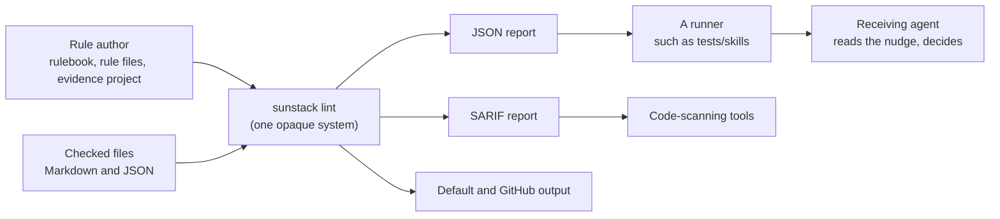
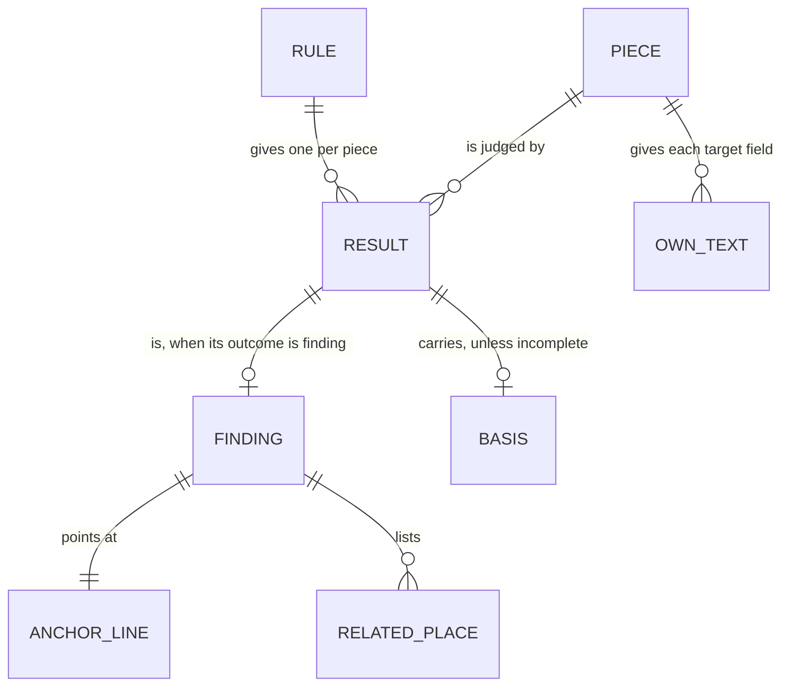

# Specification: the lint report as a nudge

31 Oct 2026. Author: 🦁 Lead. Answers to [requirements.md](requirements.md) (U1-U10). Accepted at Gate 1 (31 Oct) at `32a5883`, after independent review. Current-behaviour statements cite the evidence pack (`engine-evidence/evidence-pack.md` in the owner's memory-logs, pinned to `e8c6a13`), sections 1-11.

## The system and who reads it



The obligations below are about what those readers observe: report fields, exit codes, refusals. How lint produces them is Program Design's.

## Entities

| E | Term | Identity rule | Relationships | Invariants | Observable states | Basis |
| --- | --- | --- | --- | --- | --- | --- |
| E1 | Result | One rule's outcome for one piece in one run: the rule's name and marker plus the piece's file and line range. Two runs over the same text give two results. | belongs to one rule and one piece; a piece has one result per rule of its kind | exactly one outcome; every outcome keeps the steps its walk took and the answers it read, both empty when no walk ran | `pass`, `finding`, `not_applicable`, `uncertain`, `incomplete` | U3, U4 |
| E2 | Finding | A result whose outcome is `finding`; same identity as its result. | is one E1; has one E3 anchor line; has zero or more E4 related places | carries the rule's authored severity for the route that ended it | `warn` or `error` | U1, U2, U9 |
| E3 | Anchor line | The one line a finding points at. | belongs to one E2 | a resolved anchor lies inside both its field's spans and its piece's line range. A default anchor is today's line: the first line of the route's `at` field, or else the piece's first line; when `at` names a context field such as `enclosing`, it can lie outside the piece, as today (kept for compatibility) | resolved (the route's locator chose it) or default | U2 |
| E4 | Related place | A place the run read that relates to one finding: its label, file and line range. Two related places of one finding are the same when label, file and range match. | belongs to one E2; points at a span of a field the run collected, or at the rule's standard | only places the run read; never inferred | none | U1 |
| E5 | Basis | Whether a completed result rests only on mechanical checks or on a model's answer somewhere on its walked path. | belongs to one E1 | `judged` exactly when a step on the walked path read a model's answer; otherwise `mechanical` | `mechanical`, `judged`; absent for `incomplete` | U4 |
| E6 | Piece | The evidence one rule judges about one place: its kind, file, line range and fields, each field collected in full and shown to the model within a size cap. | belongs to one checked file; has many fields | a field's collected value is never changed by the cap | each field: whole, or cut for the model; each path target's opening: whole, or cut at its `opening_chars` | U5 |
| E7 | Own text | The part of a piece's text that a target field reads: the piece's text minus the ranges its kind declares to exclude for that field. | belongs to one E6 and one of its target fields | a load in an excluded range is never that field's target | none | U6 |
| E8 | Checked JSON file | A checked file the config's evidence project reads as JSON. | has pieces like any checked file | read with the JSON grammar; its pieces carry source spans | none | U8 |



## Outcomes

- **O1.** A receiving agent can act on a finding as a nudge: it knows what the rule saw, the line it's about, the standard, how the result was reached, and the places the run read that relate to it (U1, U2, U4).
- **O2.** A receiving agent can see why every judged piece passed or was dropped (U3).
- **O3.** A receiving agent can tell when the model saw less than was collected (U5).
- **O4.** A rule's evidence holds what its question needs: a section's own loads, fuller context where a rule asks, and JSON files (U6, U7, U8).
- **O5.** Severity, status and exits behave as today; the engine stays generic (U9, U10).

## Requirements, contracts and proof

Each row: the obligation (R), its observable contract (C), and what decides pass or fail (V). The reference for every V is this Specification's sample report below and the named fixtures; Verification Design chooses how each is shown.

### R1. Related places on a finding (U1; E2, E4)

- **R1.** Each finding in the JSON report carries a `related` list. Its first item is always the rule's standard: label `standard`, the rulebook file and the line its marker's host starts on. Then, for each field the rule entry names as related, one item per span of that field the piece collected, labelled with the field's name. A target field contributes one item per path target whose opening the run read and found non-empty: its file, from line 1 to the last line of that opening. A target resolved without an opening (a skill target, which carries fields instead), a target with `opening_chars: 0`, an unresolved target and a field with no span contribute nothing: no place the run didn't read, or read without a line range, ever appears.
- **C1.** `related` is an array of `{label, file, first_line, last_line}`. The SARIF result carries the same items as `relatedLocations`, each with its label as the message text. Default and GitHub output print each related place under its finding as `label: file:line`.
- **V1.** On a fixture rule naming `targets` and `heading` as related, a finding's `related` equals the standard's file and line, then each target with its opening's range, then the heading's span, in that order; the SARIF `relatedLocations` carry the same file, lines and labels. A finding whose rule names no related field carries exactly the standard. A skill target resolved by its fields, an unresolved target and a target with an empty opening add no item.

### R2. An anchor line inside the piece (U2; E3)

- **R2.** A finding route that names its field with `at` may carry a locator. A locator rides along with the piece's one request: when the walk needs answers for a piece, the request holds the rule's questions and, for each located route, a Choice over the lines of that route's `at` field that lie inside the piece. When the route is reached and the selected line's probability is at least the locator's `min_probability`, the finding's line is that line and its anchor is `resolved`. The anchor is `default` (today's line, E3) when the walk settled without a request (an all-mechanical path sends none, as today), when the field has no line inside the piece, when it has more such lines than `limits.max_locate_lines`, when adding the locator would take the request past its question or size limits (the locator is left out; the rule's own questions are never dropped for it), or when the probability is below `min_probability`. A response that leaves out a requested locator answer or selects a line it wasn't offered is an invalid response, as for any question today: the result is `incomplete` with reason `invalid_response`. Without a locator, behaviour is as today.
- **C2.** A finding route accepts `locate: { "name": <question name>, "task": <text>, "min_probability": <number in (0, 1]> }` (no other keys), only together with `at`. `name` differs from every question name of the entry and every other locator's name. `--check` refuses a locator without `at`, with a name that collides, or with an out-of-range `min_probability`, naming the entry and route. In the request, a locator is an ordinary Choice question under its `name`: instructions `{ "check": <at>, "task": <task> }`, one criterion per offered line, label `L<line>`, text that line's content. A finding carries `anchor: "resolved" | "default"` beside its `line`; the SARIF region and default output use that line. The locator's answer, when read, appears under its `name` in the row's `answers` (R3).
- **V2.** On the spike's frozen line-17 piece (the `ops-observability-stack` H1 introduction with its loaded files), a placement fixture rule whose finding route has a locator gives a finding at line 17 with `anchor: "resolved"` when the answer selects `L17` above `min_probability`; the same rule without a locator gives line 7 with `anchor: "default"`. With the locator: an answer below `min_probability` gives line 7 and `"default"`; a field with more in-piece lines than the limit sends no locator and gives `"default"`; an `at` field that is an `enclosing` section reaching beyond the piece is offered only its in-piece lines; an all-mechanical path to a located finding sends no request and gives `"default"`; a response selecting a line not offered gives `incomplete` with `invalid_response`.

### R3. Answers on every judged result (U3; E1)

- **R3.** Every result carries the steps its walk took and, when the walk read a model's answer, the answers it read, keyed by question, whatever its outcome, `incomplete` included: an incomplete result keeps what was walked and read before it stopped. A result whose walk read no answer carries no answers; a result that stopped before any walk carries an empty path. Answers obtained in the same request but not read on the walked path are not shown as read. A reached locator's answer counts as read.
- **C3.** Each `results[]` row gains `path` (the steps walked, in order; `[]` when no walk ran) and `answers` (an object, present only when the walk read an answer). A finding's `judgment` and an uncertain entry keep their current fields.
- **V3.** A fixture gate that drops a piece on a model's answer gives a `not_applicable` row with that gate's answer and `path`; a judged pass gives its answers; a mechanical pass and a mechanical drop give no `answers`; a two-question request whose walk reads only the gate shows only the gate's answer. A judged gate followed by a mechanical step on an unavailable field gives an `incomplete` row with the gate's answer, the path to that step and no `basis`; a dispatch refusal after the first walk gives the path walked so far and no `answers`; a failure before any walk gives `path: []`.

### R4. Basis on every completed result (U4; E5)

- **R4.** Every result except `incomplete` carries its basis: `judged` exactly when some step on its walked path read a model's answer, gate included; otherwise `mechanical`.
- **C4.** Each `results[]` row gains `basis: "mechanical" | "judged"`, absent on `incomplete`. A finding carries the same `basis`.
- **V4.** A path of a judged gate then a mechanical finding step gives `basis: "judged"`; an all-mechanical finding gives `"mechanical"`; an incomplete row has no `basis`.

### R5. Cuts are visible (U5; E6)

- **R5.** When a field shown to the model was cut by the size cap, the state sent to the model and the result say which fields were cut. A target's opening that the run shortened to its opening limit is marked as cut too.
- **C5.** The piece state sent in requests, and shown in `evidence_seen` and in uncertain entries' `state`, gains the engine key `"cut-fields": [field, ...]` when any field was cut. The key holds a hyphen, which no authored field name can (field names are lowercase words joined by `_`), so an authored field named `cut` keeps its key and value. Each `results[]` row gains `cut: [field, ...]` when non-empty. A path target in a field value carries `opening_cut: true` when its opening was shortened, and no `opening_cut` otherwise.
- **V5.** A fixture whose body exceeds its kind's cap gives `"cut-fields": ["body"]` in the sent state and `cut: ["body"]` on the result row; under the cap, neither. A kind with an authored text field named `cut` and an over-cap `body` sends both: `cut` with the authored text and `"cut-fields": ["body"]`. A target opening longer than `opening_chars` carries `opening_cut: true`.

### R6. A section's own loads (U6; E7)

- **R6.** A target field may declare ranges to exclude by naming an evidence rule, as a remainder field can. A load inside an excluded range is never a target of that field, and change-based selection uses the same own text. A target field can't exclude by kind: a kind's pieces are known only after selection, and change-based selection scans targets before it, so the two scans couldn't agree.
- **C6.** In a config, a target field accepts `exclude: { "rule": <evidence rule> }`. `--check` refuses `exclude: { "kind": ... }` on a target field, naming the kind and field, exit 2. The targets of a field with `exclude` come only from its own text, in the evidence listing, the sent state and change-based selection.
- **V6.** On a fixture of an H1, a parent section and a child section where only the child loads `child.md`, with the section kind's target field excluding the child-section rule: `child.md` is a target of the child only, not of the parent or the H1. Changing `child.md` selects the child's piece, not the parent's. `--check` refuses a target field with `exclude: { "kind": "section" }`, naming the field.

### R7. Fuller context fields (U7; E6)

- **R7.** An `enclosing` or `same_file` field may ask for the full text of the matched ranges instead of their first lines; a path target may fill the fields of an `as_kind`, as a skill target does today.
- **C7.** Those field sources accept `text: "full"` (default `"first_line"`, as today); a path target with `as_kind` carries `fields`.
- **V7.** A fixture `enclosing` field with `text: "full"` gives the enclosing section's whole text with its span; a path target with `as_kind` gives that kind's fields from the loaded file; omitting both gives today's values.

### R8. Lint checks JSON files (U8; E8)

- **R8.** An evidence project's rules may be written for JSON. Lint reads each checked file with the grammar its matching evidence rules name, builds pieces from JSON nodes with source spans, and runs rules over them as over Markdown. A JSON kind admits every existing field source except `yaml`: `first_line`, `capture`, `inside`, `enclosing`, `same_file`, `next`, `previous`, `remainder` and `target`. `next` and `previous` pick sibling nodes in the parsed JSON tree; the Markdown `block_continuation` nodes they skip never occur in JSON. `yaml` reads Markdown frontmatter and is refused for a JSON kind. Every evidence rule or kind a field names (`inside`, `enclosing`, `same_file`, `next`, `previous`, a remainder's or target's `exclude`) must be of the field's own kind's language. A target's `as_kind` may name a kind of either language: the loaded file is read with that kind's grammar. The existing refusal of other languages stays.
- **C8.** `--check` accepts a JSON evidence rule and a JSON kind using any admitted source; it refuses `yaml` on a JSON kind, and a field naming a rule or kind of another language, each naming the kind and field, exit 2. `--evidence` lists JSON pieces with spans; findings on JSON files carry file, line and span like Markdown findings. A config mixing Markdown and JSON kinds checks both in one run.
- **V8.** A fixture rules file with three entries, one question naming no field, gives a finding at that question's line on a JSON-kind rule. `--check` accepts a JSON kind with one field of each admitted source; it refuses a JSON kind with a `yaml` field, and a JSON kind whose `inside` field names a Markdown rule, each naming the field. A mixed run reports Markdown and JSON findings together.

### R9. Severity, status and exits unchanged (U9)

- **R9.** A finding's severity is the route's authored severity when present, else the rule's (default `warn`). Status and exit keep today's order: cancelled, incomplete, errors or warnings over `--max-warnings`, uncertain, nothing selected, clean. No new severity level exists.
- **C9.** Unchanged exit codes 0-5; `warn` findings alone exit 0 unless `--max-warnings` is exceeded.
- **V9.** Today's warning-limit test still passes; a judged path ending in an authored `error` exits 1 and reports `basis: "judged"`; a route overriding a rule's `warn` with `error` gives an `error` finding.

### R10. Generic, and compatible (U10)

- **R10.** No new report field, config option or behaviour refers to skills, plugins, products or placement. Labels in `related` come from the rule's own field names and the built-in `standard`. Every existing report field keeps its name, type and meaning; the new fields are additions; the report's `version` is the engine's, so it reads `0.6.0`.
- **C10.** Compatibility runs one way: a reader of 0.5.0 reports that ignores fields it doesn't know reads a 0.6.0 report the same way. The other way isn't promised: the 0.6.0 schema requires `related`, `anchor` and `basis` on findings and `path` on rows, so a 0.5.0 report doesn't validate against it.
- **V10.** The engine diff names no skill-specific term. For one fixture and the same scripted answers, the signed 0.5.0 binary's report and the 0.6.0 report agree on every field the 0.5.0 report has, at every position and in the same order, except `version`, which reads `0.6.0`; a changed legacy outcome, location or order fails, as does a wrong version. The 0.6.0 report validates against the 0.6.0 schema.

## Sample report

The contract the skill text cites. Values are illustrative; field names and shapes are normative, and every object below is a valid instance of its type. It is an excerpt: it shows every new field and every new shape, each present and absent case, and leaves out unchanged fields that don't bear on them (a finding's `span` and `severity_origin`, `where.span`, and the report's counts, usage, limits and diagnostics).

The located section is shortened to lines 14 to 19 so its locator answer can be shown whole: a Choice answer's `probabilities` name every offered line. On the real line-17 section the locator offers every line of the field inside lines 6 to 58.

```json
{
  "version": "0.6.0",
  "status": { "kind": "incomplete" },
  "findings": [
    {
      "rule": "placement.product-workflow",
      "marker": "K003",
      "file": "plugins/sunstack-dev/skills/ops-observability-stack/SKILL.md",
      "line": 17,
      "anchor": "resolved",
      "field": "body",
      "severity": "warn",
      "basis": "judged",
      "message": "This section routes into one product's own workflow; read the loaded file and decide where it belongs.",
      "related": [
        { "label": "standard", "file": "plugins/skill-authoring/skills/domain-skill-crafting/references/calls-and-placement.md", "first_line": 31, "last_line": 31 },
        { "label": "targets", "file": "plugins/sunstack-dev/skills/ops-observability-stack/references/agentstudio-loop.md", "first_line": 1, "last_line": 40 }
      ],
      "judgment": {
        "answers": {
          "routes_product": { "type": "noul", "yes_probability": 0.87 },
          "example_or_own_infrastructure": { "type": "noul", "yes_probability": 0.10 },
          "product_line": { "type": "choice", "selected_label": "L17", "confidence": 0.78, "probabilities": { "L15": 0.05, "L16": 0.08, "L17": 0.78, "L18": 0.05, "L19": 0.04 } }
        },
        "value": null,
        "path_taken": ["routes_product", "example_or_own_infrastructure"]
      }
    }
  ],
  "results": [
    { "name": "placement.product-workflow", "marker": "K003", "file": "plugins/sunstack-dev/skills/ops-observability-stack/SKILL.md", "first_line": 14, "last_line": 19, "outcome": "finding", "step": "example_or_own_infrastructure",
      "basis": "judged", "path": ["routes_product", "example_or_own_infrastructure"],
      "answers": {
        "routes_product": { "type": "noul", "yes_probability": 0.87 },
        "example_or_own_infrastructure": { "type": "noul", "yes_probability": 0.10 },
        "product_line": { "type": "choice", "selected_label": "L17", "confidence": 0.78, "probabilities": { "L15": 0.05, "L16": 0.08, "L17": 0.78, "L18": 0.05, "L19": 0.04 } }
      } },
    { "name": "placement.product-workflow", "marker": "K003", "file": "plugins/sunstack-dev/skills/domain-skill-crafting/references/platform.md", "first_line": 3, "last_line": 17, "outcome": "pass", "step": "routes_product",
      "basis": "judged", "path": ["routes_product"], "answers": { "routes_product": { "type": "noul", "yes_probability": 0.08 } } },
    { "name": "description.length", "marker": "K004", "file": "plugins/sunstack-dev/skills/ops-observability-stack/SKILL.md", "first_line": 3, "last_line": 3, "outcome": "pass", "step": "length",
      "basis": "mechanical", "path": ["length"] },
    { "name": "generalization.section", "marker": "K001", "file": "plugins/sunstack-dev/skills/practices-cleanup/SKILL.md", "first_line": 57, "last_line": 63, "outcome": "not_applicable", "step": "kind",
      "basis": "judged", "path": ["kind"], "answers": { "kind": { "type": "choice", "selected_label": "local", "confidence": 0.82, "probabilities": { "local": 0.82, "general": 0.18 } } }, "cut": ["body"] },
    { "name": "procedure.example", "marker": "K005", "file": "plugins/sunstack-dev/skills/practices-cleanup/SKILL.md", "first_line": 20, "last_line": 31, "outcome": "incomplete", "step": "has_example",
      "path": ["is_procedure", "has_example"], "answers": { "is_procedure": { "type": "noul", "yes_probability": 0.91 } } },
    { "name": "procedure.example", "marker": "K005", "file": "plugins/sunstack-dev/skills/practices-cleanup/SKILL.md", "first_line": 40, "last_line": 44, "outcome": "incomplete", "step": null,
      "path": [] }
  ],
  "evidence_seen": {
    "3": {
      "standard": "A generalization nudge: a section should hold only what applies wherever the skill is used.",
      "where": { "file": "plugins/sunstack-dev/skills/practices-cleanup/SKILL.md", "first_line": 57, "last_line": 63 },
      "body": "Prefer the project's own clean task when it has one: AgentStudio's ...",
      "cut": "an authored text field that happens to be named cut keeps its own key",
      "targets": [
        { "name": "references/cleanup-loop.md", "path": "plugins/sunstack-dev/skills/practices-cleanup/references/cleanup-loop.md", "exists": true, "opening": "# Cleanup loop\n...", "opening_cut": true }
      ],
      "cut-fields": ["body"]
    }
  }
}
```

The first `incomplete` row walked a judged gate and stopped at a mechanical step on an unavailable field; the second stopped before any walk. Neither carries `basis`, and their presence makes the run's status `incomplete` under R9's unchanged order. The `evidence_seen` entry shows the sent state: `"cut-fields"` beside an authored field named `cut`, and a path target whose opening was shortened.

## Non-goals and negative space

- No new severity level, claim field or skill-specific vocabulary (R9, R10).
- No per-rule coverage field: a runner joins the denominator, `file_counts` and `results` (requirements, non-goals).
- No skill description carried as context on every chunk; no per-load attribution with per-target anchors; no transitive loads; no reads outside the checked repository.
- The engine never names a place it didn't read in `related`; a direction to investigate belongs in the rule's message.
- Not promised: a locator that always finds the right line. When it can't, the finding says `anchor: "default"`; a malformed answer stays an invalid response, as for any question.
- No new field source for JSON (for example a property value without its quotes); other languages stay refused.
- No change to a finding's existing `span`: it stays the span of the route's field. Only `line`, the SARIF region and default output move to a resolved anchor.

## Coverage

| U | E | O | R | C | V |
| --- | --- | --- | --- | --- | --- |
| U1 | E2, E4 | O1 | R1 | C1 | V1 |
| U2 | E3 | O1 | R2 | C2 | V2 |
| U3 | E1 | O2 | R3 | C3 | V3 |
| U4 | E5 | O1 | R4 | C4 | V4 |
| U5 | E6 | O3 | R5 | C5 | V5 |
| U6 | E7 | O4 | R6 | C6 | V6 |
| U7 | E6 | O4 | R7 | C7 | V7 |
| U8 | E8 | O4 | R8 | C8 | V8 |
| U9 | E2 | O5 | R9 | C9 | V9 |
| U10 | all | O5 | R10 | C10 | V10 |

Requirements → Specification → [Program Design](program-design.md) → [Verification Design](verification-design.md).
