# Program Design: owner assessment

4 Nov 2026. Author: 🦁 Lead. Status: draft, not reviewed. Answers to [specification.md](specification.md). Base `4aa594a` (engine 0.6.0 plus #128). Current-system map: `tmp/design-workflows/2026-11-04-owner-assessment/current-system.md` (Researcher `codex-local/01a1a544`, 109 anchors; decisive ones reopened by the Lead and cited below).

## How it works

```mermaid
flowchart LR
  cfg["RulesConfig<br/>owners · assessments"] --> admit["admission<br/>load_checked_rulebook"]
  admit --> targets["select_targets<br/>checked files"]
  targets --> units["owner units (new)<br/>file → unit; describing files added as context"]
  units --> build["EvidenceBuild + selection<br/>over checked ∪ describing files"]
  build --> assess["assessment stage (new)<br/>one Choice per unit per assessment"]
  assess --> run["rulebook run<br/>gate before the first step (new)"]
  run --> project["project_outcome<br/>assessments[] · skips · reasons"]
```

The assessment stage sits where the map found the only clean boundary: after evidence and selection finish (`lint_run.rs:475`) and before `run_rulebook_with_dispatcher` (`lint_run.rs:561`). It uses the run's existing dispatcher and backend, so budget, cancellation and usage stay one system.

## The choice

| Option | Gains | Costs | Verdict |
| --- | --- | --- | --- |
| **A. An assessment stage plus a gate before a rule's first step** | one question per unit; mechanical and asking rules both gated; unsure and failed answers reported, never passes | new config sections, one new stage, a reason on `not_applicable`, report fields | **selected** |
| B. Extend `select` to choice questions | reuses selection | `select` keeps or drops pieces per file; it can't reach a reference's unit or give several rules one answer (map Q3, Q6) | rejected |
| C. The caller answers first and injects results | no engine change | a workaround the owner forbids; answers outside the run's budget, cancellation and report | rejected |

Debt accepted: per-assessment decision models wait (the run's one `decision_model` applies, because the dispatcher holds one backend, `model_request_dispatch.rs:24–47`); the existing skill-aware target resolver stays (out of scope, R7 covers only additions). Reopens: if units ever need nesting or files in several units of one kind.

## Where each entity lives

| E | Owner | Home | Shape at the boundary | Persisted? |
| --- | --- | --- | --- | --- |
| E1 Owner unit | `sunstack-lint` | config: `RulesConfig.owners` (modified `configuration_loading/config_contracts.rs`); resolution: `lint_execution/owner_units.rs` (new) | config: `{ "<unit>": { "root": "plugins/*/skills/{owner}", "members": ["SKILL.md", "references/**/*.md"], "describe": { "kind": "<evidence kind>", "field": "<field>" } } }`; runtime `OwnerUnit { unit: OwnerUnitName, folder: RelativePath, display: String, describing: Describing }`, `Describing = One(PieceId) \| None \| Ambiguous(Vec<PieceId>)` | config persisted; units derived per run |
| E2 Assessment | `sunstack-rules` (admission), `sunstack-lint` (config) | config: `RulesConfig.assessments` (modified); admitted: `owner_assessment/assessment_plan.rs` (new) | config `{ "<name>": { "owner": "<unit>", "question": <choice question, same wire as rule questions>, "min_probability": 0.7 } }`; admitted `AssessmentPlan { name, unit, question: AdmittedChoiceQuestion, options: BTreeSet<OptionLabel>, min_probability }` | persisted (config) |
| E3 Owner answer | `sunstack-rules` | `owner_assessment/assessment_run.rs` (new) | `OwnerAnswer { assessment, unit_folder, state: Judged { option, probability } \| Unsure { probabilities } \| Incomplete { reason: AssessmentIncomplete } }`; `AssessmentIncomplete = Undescribed \| Ambiguous \| Request(IncompleteReason)` | derived per run |
| E4 Gate | `sunstack-rules` | `rulebook_planning/rulebook_entry_wire.rs` (modified: optional `requires`); `RulebookRule.gate: Option<AssessmentGate>` | wire `{ "assessment": "<name>", "accept": ["<option>", …] }`; admitted `AssessmentGate { assessment, accept: BTreeSet<OptionLabel> }` | persisted (rulebook) |
| E5 Assessment skip | `sunstack-rules` (records), `sunstack-lint` (report) | `RulebookRun.skips` (modified `rulebook_run.rs`); report `assessment_skips` (modified `lint_reporting/report_contracts.rs`) | `AssessmentSkip { rule, file, assessment, unit_folder: Option<RelativePath>, why: Unsure \| Incomplete \| NoOwner, probabilities: Option<…> }` | derived per run |

`NotApplicable` gains a reason (modified `decision_walking.rs:29–114`): `NotApplicableReason = Route \| Assessment { assessment, option, probability }`. Every existing route sets `Route`. `basis()` returns judged for an `Assessment` reason, mechanical otherwise as today (the map's Q4 found the heuristic would call it mechanical).

## Interfaces

- **Admission.** `admit_rule_entry` gains the admitted assessment registry as an input (`rulebook_admission.rs:29`), so a gate's assessment and options are checked with the entry's other refusals; R6's refusals are `AdmissionRefusal { field_path, message }` like today's. Unit and assessment admission runs in `load_checked_rulebook` (`config_validation.rs:23–105`) before rulebook assembly. The strict decoder's safe-field list gains `requires`, `assessment`, `accept`, `owners`, `assessments` (`strict_decoding.rs:60–188`).
- **Units.** `resolve_owner_units(config, checked_files, repo_root) -> OwnerUnits` turns each root pattern into a matcher (`*` one segment, `**` any, `{owner}` one segment captured), finds each checked file's unit by its folder prefix and member globs, and returns the describing files to acquire. A file matching two folders of one unit kind is an admission-time impossibility for well-formed patterns and a run-time `Ambiguous` otherwise.
- **Build.** `EvidenceBuild` runs over checked files plus describing files; the rulebook runner pairs only pieces whose file is checked (describing-only files give no rule results). The describing file joins change dependencies, so a changed describing file picks its unit's members (`evidence_piece_picking.rs:10–75`).
- **Assessment stage.** `assess_owners(plans, units, pieces, dispatcher) -> OwnerAnswers` builds one Choice request per (assessment, unit) whose unit has a checked member read by a gated rule, with state `{ unit, description }`, submits through the shared dispatcher and drains. Selected option probability ≥ `min_probability` → `Judged`; else `Unsure`; a typed request failure → `Incomplete`.
- **Gate.** In `run_rulebook_with_dispatcher`'s pair loop (`rulebook_run.rs:77–108`), before the first `walk_decision(.., None)`: no gate → as today; gate → look up the file's answer; `Judged` in `accept` → walk; `Judged` outside → `NotApplicable { reason: Assessment }`; otherwise record an `AssessmentSkip` and create no result slot.
- **Report.** `LintReport` gains `assessments: Vec<AssessmentEntry>` and `assessment_skips: Vec<AssessmentSkipEntry>`; `RulePieceResult` gains `reason`. `project_outcome` (`outcome.rs:14–185`): an incomplete answer adds an `IncompletePart` with `AssessmentIncomplete`; an unsure answer joins rule and selection uncertainty in status priority. Human output lists answers and skips; SARIF is unchanged (skips are not results). `report_schema()` and `config_schema()` regenerate from the types.

## Trace

| U | R | E | Owner | Interface | Shape and home | State | Failure | Proof |
| --- | --- | --- | --- | --- | --- | --- | --- | --- |
| U1 | R1 | E1, E2, E3 | sunstack-rules assessment stage | `assess_owners` | `OwnerAnswer` | judged / unsure / incomplete | request failure → incomplete | V1 |
| U1 | R2 | E1 | sunstack-lint owner units | `resolve_owner_units`, build inputs | `OwnerUnit`, describing files | described / undescribed / ambiguous | undescribed or ambiguous → incomplete answer | V2 |
| U2 | R3 | E4, E3 | sunstack-rules rulebook run | gate before first walk | `AssessmentGate`, `NotApplicableReason` | — | — | V3 |
| U3 | R4 | E5 | sunstack-rules run + sunstack-lint projection | `RulebookRun.skips`, `assessment_skips`, status | `AssessmentSkip` | unsure / incomplete / no_owner | exit 5 / exit 3 | V4 |
| U2, U4 | R5 | none: unchanged path | sunstack-rules | no gate → existing walk | — | — | — | V5 |
| U1, U2 | R6 | E1, E2, E4 | admission | `load_checked_rulebook`, `admit_rule_entry` | `AdmissionRefusal` | — | refused entry skipped; `--check` invalid | V6 |
| U4 | R7 | none: code review | all changed crates | — | generic names only | — | — | V7 |

## Order of work

1. Config and admission (units, assessments, gate refusals), with unit tests beside each module.
2. Unit resolution and build inputs.
3. Assessment stage, gate, `NotApplicableReason`.
4. Report, status, schema; human output.
5. Integration journeys (library and process, keyless with `ControlledServer`), a `verify-sunstack-rule` case, CHANGELOG, release 0.7.0 (minor: additive config, report and result fields).
