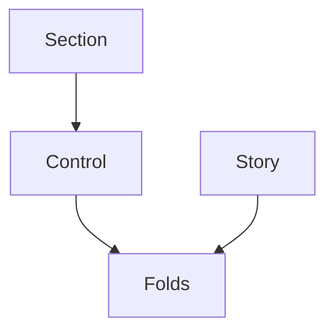
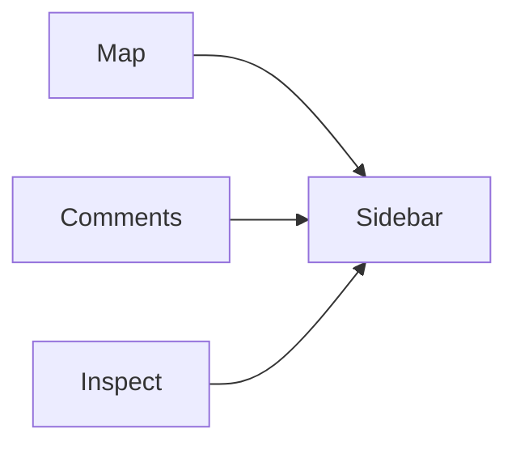
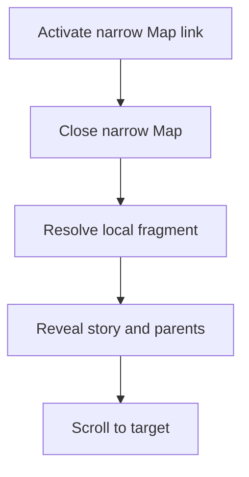

# Shared presentation over native story content

The author writes the story, its entries and the Map. Shared views arrange that content; native `details.open` remains the disclosure truth. Map uses the same sidebar session as Comments. There is no second story model, record reader or sidebar manager.

This realizes [R1–R12](specification.md#contract-and-proof-obligations) within [U1–U6](requirements.md#who-needs-this). The screen target is the corrected frozen page named in Requirements: compact story text, quiet content surfaces, category headers and the right Map. Its supplied desktop and narrow PNGs are the UI views; they describe the selected appearance, not the new runtime. Private record content stays private.

## Where each entity lives

All runtime homes are in `packages/demistify`; authored examples live in `apps/demistify-poc`. DOM input follows this package's custom-element vocabulary, native HTML and typed DOM guards. It does not acquire a parallel JSON schema. Interfaces use readonly fields and closed outcome unions. The root's explicit instruction to follow this codebase's conventions governs names, relative imports and existing check locations.

| E | Semantic owner | Home / code name | Schema or shape home | Boundary shape | Disposition / storage | Convention |
| --- | --- | --- | --- | --- | --- | --- |
| E1 Page | Page author; document runtime owns reader effects | Existing `DocumentIsland`, modified shared reader controls | Existing vocabulary and review-document capture | `ex-document[id]`, native content; zero or one `ex-map[for]` | Authored HTML file; existing filesystem, no new engine or migration; runtime DOM derived | Existing HTML vocabulary and typed DOM |
| E2 Section | Section view owns presentation and membership counts; Map reads the same membership | New `SectionIsland` and shared section-membership read | Vocabulary declares `ex-section`; native descendants supply membership | `id`, `title`, optional `icon`, `tone`, `series`; descendant `ex-story`, optional direct `details[slot=smaller]` | Authored DOM, header split and Map total derived; no runtime storage | Existing head/tone/category conventions |
| E3 Story | Story view owns presentation; author owns every claim | New `StoryIsland` | Vocabulary declares `ex-story` and its named children | Optional `subject`, `time`, `icon`, `tone`; exactly one direct native `details[id]` with `summary` and rich named body children | Authored DOM; native `open` is live state, no copied boolean | Preserve live nodes and original review source |
| E4 Record entry | Page author; native disclosure owns open state | Existing native `details[id]` inside the story record list | Native HTML; story child contract in vocabulary | `details[id] > summary` and arbitrary supported body content; repeated references use `a[href]` | Authored HTML once per ID; no runtime store | Native HTML and existing issue reporting |
| E5 Map | Map view owns its content/trigger and derived section totals; shared sidebar owns session | New `MapIsland`; existing `openDrawer` modified with an internal presentation kind | Vocabulary declares `ex-map`; existing tree source and drawer types | `ex-map[for=rootId]` contains exactly one `ex-tree`; each section branch links its section ID; internal live nodes move into a sidebar session | Authored tree; counts derived from section membership, branch DOM state; active session transient, no persistence | Existing take/restore and identity-guarded close |
| E6 Disclosure | Native `HTMLDetailsElement`; shared scope derives bulk action | New disclosure-scope helper, consumed by section and fold-toggle views | Native `open`; internal `DisclosureAction` union | Members are story root, direct More, record list, each direct entry, and section smaller fold | Live DOM only; membership/action derived, no synchronized store | Typed DOM, native toggle events |





The author supplies content to all three views. Section controls request changes to native folds; Map requests a session from the existing sidebar. The sidebar also serves Comments and inspection. The shared reader control row contains their existing buttons plus Map; none of these views owns Comments data.

## What an author writes

This is the target public markup; the matching released guide and vocabulary must implement the same shape. HTML remains responsible for page layout.

```html
<ex-document id="work">
  <h2>What it means for you <ex-fold-toggle for="work"></ex-fold-toggle></h2>
  <ex-section id="done-next" title="What's done / what's next" icon="clock" series="2">
    <ex-story subject="Renderer" time="Fri 08:31" icon="package" tone="done">
      <details id="story-renderer" open>
        <summary>The renderer is ready for review</summary>
        <p slot="headline">The shared rendering path now preserves the supplied content.</p>
        <div slot="happened">The author supplies this account.</div>
        <div slot="for-you">Review the resulting page.</div>
        <div slot="next">An independent check follows.</div>
        <div slot="showpiece"><table><!-- authored comparison --></table></div>
        <details slot="more"><summary>More</summary><p>Optional depth.</p></details>
        <details slot="record">
          <summary>The record: 1 entry</summary>
          <details id="entry-renderer"><summary>Recorded check</summary><p>Full supplied text.</p></details>
        </details>
      </details>
    </ex-story>
    <details slot="smaller"><summary>1 smaller</summary><!-- routine ex-story members --></details>
  </ex-section>
  <ex-map for="work">
    <ex-tree><script type="text/markdown">
- [Needs you](#for-you)
  - [Renderer review](#story-renderer)
- folded: Where the work is
  - done: [Renderer](#story-renderer)
- [What's done / what's next](#done-next)
  - [Renderer is ready](#story-renderer)
    </script></ex-tree>
  </ex-map>
</ex-document>
```

The complete example supplies four sections (including `id="for-you"`) and both authored decision columns using existing `ex-grid`. The shortened example shows the done/next section only; its Map's Needs-you branch refers to the complete example's For-you section. No example creates a summary, importance classification or entry text from another source.

The story root's native `open` attribute is explicit. Complete guide examples open stories and close More, record lists, entries and smaller folds. A carried closed story omits `open`; the renderer never overwrites it. Empty optional slots produce no panel. The three labelled rows, headline and record list are required once; showpiece and More are each at most one. The record summary carries the author's supplied entry count; the library does not infer what a link proves. Duplicate bodies/IDs are invalid. The renderer preserves every supported node rather than rebuilding content from `textContent` or serializing `innerHTML`.

Metadata on the story renders beside its summary, wrapping at narrow widths. Native summaries retain their authored inline content. The labelled rows get clock / user / circle-dashed icons and the visible labels Happened / For you / Next. Story and entry disclosure chevrons remain separate from those labels. The curated subject icon reader handles authored icons; fixed interface icons use the existing Phosphor factory. The bulk action uses the owner's exact pair: `caret-circle-double-down` expands and `caret-circle-double-up` collapses. Those two names and `arrow-bend-down-right` must be included in the existing `shippedIconNames` packaging subset, which produces the released font and CSS; their presence in the installed full icon font alone is insufficient.

## The parts and their contracts

| Owner | Consumers and reason to change | Interface and effect | Failure / lifetime |
| --- | --- | --- | --- |
| Story view | Authors need R1's repeatable hierarchy and compact spacing | Enhance one native story disclosure, arrange named children, decorate summaries/rows, preserve identity and `open`; synchronous/idempotent preparation | Structural issues use the existing issue reporter; content stays present. Disconnect releases listeners; reconnect does not wrap again. |
| Section view | Authors need R3's category header, count and sticky behavior | Existing head factory supplies title/icon/tone. A shared membership read counts all descendant stories whose closest section is this one, separating those inside its one smaller fold. Header reads split counts; Map reads their total. Render one bulk control over this scope. | Invalid/multiple smaller folds are diagnosed, not silently regrouped. Observe child-list changes for counts and disconnect the observer on removal. |
| Disclosure scope | Page/section controls need R4's exact shared membership | `readDisclosureAction(root)` returns `empty`, `expand` or `collapse`; `applyDisclosureAction(root, action)` sets every current member's native `open` synchronously | Empty scope disables control. No retained action state. Capture native toggle events and scoped content changes to refresh labels; recompute before every action. |
| Fold-toggle view | Authors place a page control without page script | `ex-fold-toggle[for=id]` renders the same caret-circle-double-down/up button used by section headers; label names its expand/collapse action and scope. Shared icon packaging ships both glyphs. | Missing/ambiguous root is diagnosed and disabled. No fallback to the whole document. |
| Map view | Authors need R5's one authored tree in the reader controls | Resolve `for`; register one map-trifold button. Open via `openDrawer('Map', take)`; take moves the same live tree into header/body and restore puts it back at its origin | Second Map or invalid root is diagnosed and inactive. Close/disconnect restores content and updates expanded state. Tree branch state survives close and resize. |
| Sidebar session | Existing Comments, inspection and new Map need one active rail | Internal `DrawerContent.presentation` has closed `standard` and `map` kind variants. Existing callers select standard. Map replaces prior sidebar; an identity-bound close cannot close its replacement | Existing close/focus/resize/restore lifecycle remains authoritative. Bottom `DrawerIsland` stack is independent. |
| Reader control row | Existing walkthrough/theme/search/Comments and Map need layout without another coordinate patch | An internal registration function owns one live host, stable order, measured row geometry and teardown; registrations return an unregister function | Move original buttons, never clone them. Preserve existing desktop bottom-left and phone top-toolbar placement. Include this host in existing bottom-workspace overlay handling. |
| Fragment navigation | Document links, Map and walkthrough targets need R6 | Shared same-document URL classification plus existing `resolveTarget` / `revealElement`; Map closes its narrow session before normal fragment navigation | Existing abort controller cancels obsolete async resolutions; invalid or missing target does not select a substitute. |
| Tree view | Existing trees and Map need R7–R8 | Existing Markdown path parses leading checklist, then plain `folded:`, then tone. Only a branch consumes `folded:`. Same-document links use arrow-bend-down-right, included in the shared packaging subset; others retain arrow-up-right | Inline-code markers and leaf text stay literal; no change to Markdown blockquote parsing. Fold and link remain separate native buttons/anchors. |

The disclosure set is structural, not all `details` indiscriminately: one direct story root; that root's authored `details[slot=more]` and `details[slot=record]`; each direct entry under that record list; and section `details[slot=smaller]`. The story view exposes a live membership read through its shared DOM helper, so generated body wrappers cannot hide these named children from the scope. A fold inside a showpiece, a nested record quotation, ordinary page notes and Map branches are excluded. Overlapping page/section controls read the same live elements. An author-supplied routine group stays at the end; the checker diagnoses placement rather than moving content to infer significance.

The section-membership helper is also the only source of Map section totals. Each section branch in the authored tree links to that section's stable ID and omits a count. Its label may differ from the section title: **Needs you is the For-you section's linked branch**, not an additional fifth group; it keeps the label Needs you and links `#for-you`. The approved top-level order remains Needs you, Where the work is, then the other three section branches. Map decorates each section branch with a derived total from the same primary/routine membership that supplies its header; it never parses a number from title text. The checker requires one linked branch per section and diagnoses authored totals on those labels. The Map view refreshes these derived spans after tree readiness and on source-root membership changes, without replacing labels or storing another count. The work-parts group is authored and does not target a section, so it has no section-total decoration.

Internal operation results have closed shapes:

```ts
type DisclosureAction =
  | { readonly kind: 'empty' }
  | { readonly kind: 'expand'; readonly members: readonly HTMLDetailsElement[] }
  | { readonly kind: 'collapse'; readonly members: readonly HTMLDetailsElement[] };

type DocumentLink =
  | { readonly kind: 'local'; readonly url: URL; readonly reference: string }
  | { readonly kind: 'other'; readonly url: URL }
  | { readonly kind: 'invalid'; readonly reason: 'url' | 'fragment' };
```

These shapes live with the scope and document-link helpers respectively. A local link has a nonempty decoded fragment and equal origin, pathname and search against the actual document URL. Relative and absolute forms share that decision. The authoring vocabulary remains the one authority for allowed elements, attributes, named child rules and diagnostics; runtime, checker and generated editor metadata consume it.

## How a Map link reaches an open story



This view shows the narrow case. The first edge is a synchronous Map capture handler, limited to an unmodified primary activation of a valid same-document link in its tree. Narrow is below the shared sidebar's existing 900px breakpoint; closing occurs before the ordinary link effect. At 900px and above the sidebar remains open and navigation starts at resolution. This reuses that breakpoint rather than adding the prototype's independent 760px mode.

Map is non-modal at every width. Its session uses the existing shared aside, including below 900px, with a session-specific full-width inset below the toolbar. It creates no backdrop, leaves the toolbar and pointer/scroll interaction available, and does not trap focus. Escape and Close use the shared session close/focus policy. Standard Comments/inspection sessions retain their current narrow modal dialog and backdrop. When Map is present and one of those standard phone sheets is open, the control-row owner temporarily moves the same live Map button into that sheet's header, before Close. This permits Comments→Map directly despite the standard toolbar being inert. Closing/replacing the sheet restores the button to its row; no cloned button or second Map state is created. Map→Comments uses the exposed toolbar. Pages and other toolbar controls remain usable while Map is open; while standard Comments is open their existing modal treatment is unchanged.

The sidebar owner calls the control-row owner synchronously with `setModalControlHost(header | undefined)` at each presentation transition. Before hiding/removing any old panel or calling its content restore, it calls with `undefined`, which returns the live Map trigger to its row. After showing a standard narrow modal, it calls with that modal's header; showing a Map or a desktop aside calls with `undefined`. Resize adaptation applies the same detach-before-remove, attach-after-show ordering. Opening, closing, replacement and crossing 900px therefore use one edge. Registration while a modal already exists reads the current host; unregister removes that registration only. Whenever no standard narrow modal is open, the trigger is in the row, never inside a detached/restored content header. This host reference is transient placement, not copied Map state.

Native anchors keep their href, modified-click, target/download and browser history behavior. Ordinary document navigation handles differing fragments through its existing hash-change route. Repeating the current fragment explicitly reuses that route, including relative/absolute same-document forms. Direct load and back/forward use the same resolver. No synthetic replacement ID or second history stack is introduced.

For a target inside the new story composition, shared reveal opens the target if it is itself a native disclosure, then its containing disclosures. For an ordinary existing target, reveal keeps the prior target-versus-parent rule. Unrelated entries are never enumerated for a reveal. Existing tab, layer, board, explorer and diagram preparation behavior stays on the same resolver path; it is not reimplemented in Map.

| Runtime group | Current path and source | Target delta and returned outcome |
| --- | --- | --- |
| Story rendering | `EvidenceTraceIsland.connectedCallback` enhances direct native details with shared head/icons; default trace uses larger ordered-step presentation | **Added:** story view enhances a distinct named story composition. **Unchanged:** live nodes, native disclosure state, icons, original review capture. The ordered trace default is not restyled. |
| Section / bulk | Card head is supplied by `CardIsland.connectedCallback`; prototype privately queries `.cot details.cot-step` and toggles native state | **Added:** section view plus one scope helper and fold-toggle view replace private CSS/selectors/scripts. **Unchanged:** native `open`; counts/actions are reads, never a mirrored boolean. No existing card header becomes sticky. |
| Map / Comments | `CommentsView.open` → `openDrawer` → singular `DrawerSession` → desktop aside or narrow dialog → restore/return focus | **Added:** Map is another caller of the same owner, selecting a non-modal aside at all widths; standard callers keep their dialog. **Changed:** shared control registration replaces existing fixed coordinates and temporarily rehomes the live Map button into a standard narrow sheet header. **Unchanged:** replace/restore/identity closure and independent bottom workspaces. |
| Fragment reveal | `installDocumentBehavior` → hash handler → abortable `resolveTarget` → `revealElement` → scroll; click path currently recognizes only raw leading hash and skips the target itself | **Changed:** shared resolved-URL classification includes same-document relative/absolute links; repeated fragment invokes existing resolver. **Added:** narrow Map close before effect and story-local target disclosure opening. **Unchanged:** cancellation, lazy target readiness, native history and unrelated reveal defaults. |
| Tree conversion | `TreeIsland.render` → existing Markdown renderer → `convertList` → open disclosure plus outbound icon | **Changed:** plain branch marker sets initial collapsed state; URL classification selects jump icon. **Unchanged:** unmarked open default, tone/checklist content, link/disclosure separation and Markdown trust behavior. |

These are source-backed paths at base `26b316c2`, not observations of the proposed runtime. The reusable components have no production predecessor beyond the private prototype; the prototype's custom UI code is removed from the migrated page once shared composition carries it.

## State, failure and teardown

| State owner | Transition and guard | Invariant / failure handling |
| --- | --- | --- |
| Native disclosure | Manual toggle; scoped expand/collapse; target reveal | `open` is authoritative. Mixed membership yields expand; every open yields collapse. Controls recompute before mutation, then refresh from actual DOM. No rollback or remote failure exists. |
| Sidebar session | Closed → Map or Comments; Map ↔ Comments through replacement; close/Escape/disconnect → closed | At most one active sidebar. Each transition first restores its predecessor. Old close handles cannot affect a new session. Focus returns to a connected visible trigger; on replacement it follows existing shared return-focus policy. |
| Map narrow presentation | Resize across 900px while open | Same non-modal aside changes geometry; no duplicate tree or reset branch state. Standard sessions retain existing dialog adaptation. Close uses the current session identity. |
| Tree branch | Initial marked/unmarked state; independent disclosure toggle | State lives in rendered branch attributes. Navigation never implicitly toggles a branch. Reconnect binds once and preserves prepared state. |
| Pending fragment | Direct load, hash change or same-fragment activation → resolution; later activation → abort previous | Only the newest live resolution scrolls. Existing resolver's bounded preparation wait remains; an unknown target stays unresolved with the actual issue, never another story. |
| Reader control registration | Connect / disconnect; optional controls appear or disappear; standard narrow sheet opens/closes | One host orders the original controls: walkthrough, theme, search, Comments, Map. The live Map button temporarily moves to a standard narrow sheet header, then returns. Layout reflows instead of arithmetic left offsets. Teardown removes only the caller's registration; no operation destroys another control. |

Structural parsing uses existing issue reporting. A malformed story keeps its supplied content visible rather than synthesizing claims. Duplicate IDs, multiple Map roots, missing targets and unsupported named children fail the authoring checker. Runtime guards do not repair identity or silently choose a root. There are no network retries, compensating writes, migrations, cross-process consistency rules or new credentials in this renderer.

Bulk writes and sidebar replacement are synchronous on the browser event loop. Native toggle notifications may coalesce; observers refresh by reading final native state rather than counting events. A pending fragment resolution is abortable. Closing a Map while its tree is rendering restores the same element, so preparation completes once on that element; removal releases view listeners/observers. A same-session viewport change preserves rather than reconstructs content.

## Styling, trust and existing readers

The shared theme gains `--surface-document-card`, scoped to these new reading surfaces: white in light mode, page mixed with 1% white in dark mode, following the approved reference. It does not replace `--surface-content`; buttons, left lists, code, drawers and existing cards keep their current surface. Section category bands reuse the existing six series colors, head factory, rule and spacing tokens. Sticky top and target scroll clearance use the shared `--ex-document-toolbar-height` token that sizes the toolbar, never a second hardcoded 44px. When no toolbar exists its clearance is zero.

Story summaries and body use the reference's body typography (`--text-md`, weight 500 summary, 600 headline, smaller quiet metadata), not a new font or the ordered trace's larger title. More and record entries use compact native disclosure styling. Table bodies use one page-like surface inside these parts, not alternating navy and neutral strips. Shared table, diagram and local overflow behavior continues to own rich attachments. Long text wraps; action columns reserve space for Comments rather than covering text. Touch gets existing visible comment affordances and usable control targets; no hover-only interaction is introduced.

The Map session uses existing drawer animation and reduced-motion handling. Its narrow presentation fills the usable width below the actual toolbar. Close/Escape and expanded/controlled relationships stay accessible. Default Comments source/fingerprint capture happens before any enhancement, and moving live content never recaptures a different source or clones target IDs.

The authoring trust boundary stays at existing HTML/Markdown/carrier parsing. Story bodies retain supported rich HTML; they are not instructions to fetch Router or run scripts. No source record is fetched, classified or sent over a new transport. Public examples use sanitized material; final private comparison carries the fixed supplied records without publishing them. Content status/tone remains an authored assertion, never library certification.

## Why this composition

Two credible approaches fit the rendering need. Extending the ordered trace with story-specific roles would reuse its renderer but couple ordered evidence steps to story summaries, labelled rows and records; every future trace change would carry those branches. Dedicated story and section views cost two small public elements, while reusing native disclosures and the existing icon/head/theme/issue infrastructure. That places story hierarchy changes in one owner and keeps trace defaults intact. The latter is selected. Revisit it if the two renderers acquire the same policy rather than merely similar HTML; extract that repeated policy then, without combining the public meanings.

A separate Map aside would retain the prototype's fewer integration edits, but make mutual exclusion, resize, focus and restore a second sidebar lifecycle. Using the existing sidebar costs an internal presentation kind and shared control layout integration; the library maintainer pays that integration once. The current singular owner is selected. A future requirement for simultaneous Map and Comments would invalidate that choice and require a new owner decision.

Native HTML plus three views and one placement control is enough. There is no schema-driven story engine, collection loader, application framework, persisted open-state store or generic overlay framework. The author pays explicit markup; the gain is understandable rich HTML and independently inspectable content, with no private interaction implementation to maintain.

## How each obligation reaches proof

| U | R | E | Owner | Interface | Shape and home | State | Failure | Proof seam |
| --- | --- | --- | --- | --- | --- | --- | --- | --- |
| U1, U5 | R1 / C1 hierarchy | E3, E4 | Story view | Named story children | Native story DOM; vocabulary + story view | Supplied content retained | Malformed child issue, no invented claim | Rendered same-content story and source/DOM readback, V1 |
| U1, U5 | R2 / C2 initial folds | E3, E4, E6 | Native disclosure | Authored `open` | `HTMLDetailsElement` | No default override | Missing required native root diagnosed | First-load and carried-state DOM, V2 |
| U2 | R3 / C3 sections | E1, E2, E3, E5, E6 | Section view; Map reads its membership | Count/header/Map-total membership | Section DOM; shared section-membership helper, vocabulary | Derived split header and total Map count, sticky geometry | Multiple/misplaced smaller, missing branch or authored total diagnosed | Four sections, columns, split/total counts and scroll geometry, V3 |
| U2 | R4 / C4 bulk | E2, E6 | Disclosure scope; icon packaging | Read/apply action, shipped pair | `DisclosureAction`; scope helper; existing `shippedIconNames` | Native state, mixed→expand | Empty scope disabled; missing glyph fails released view | Manual/cross-scope action, complete membership and actual double-down/up glyphs, V4 |
| U3 | R5 / C5 panel | E1, E5 | Sidebar session | Map take/restore | `DrawerContent`; existing drawer types | One current session | Identity-guarded close/restore | Map↔Comments, keyboard/resize and geometry, V5 |
| U3, U5 | R6 / C6 destinations | E3, E4, E5, E6 | Fragment navigation | Resolve/reveal current fragment | `DocumentLink`; document-link helper | Abort prior request, reveal native folds | Invalid/missing stays unresolved | Each stable destination, history/repeat/direct load, V6 |
| U4 | R7 / C7 link icon | E1, E5 | Tree view; icon packaging | Shared URL classification, shipped jump glyph | `DocumentLink`; document-link helper; existing `shippedIconNames` | Stateless icon choice | Invalid URL issue; missing glyph fails released view | Actual parsed links, preserved href and visible packaged jump/outbound icons, V7 |
| U4 | R8 / C8 branch marker | E5, E6 | Tree view | Plain-prefix parse | Existing Markdown DOM; tree conversion | Marked closed, unmarked open | Leaf/code marker literal | Real parsed marker/tone/checklist/link combinations, V8 |
| U5 | R9 / C9 author control | E1–E6 | Page author + vocabulary guard | HTML composition | Authored source; existing review capture | Identity and form retained | Duplicate identity/unsupported syntax diagnosed | Script/style absence plus fixed supplied-set readback, V9 |
| U2, U3, U5 | R10 / C10 existing readers | E1, E5, E6 | Shared reader integration | Control registration/sidebar/fragment routes | Live controls and existing session types | Original state owners retained | Teardown/abort, no clone or global restyle | Existing trace/cards/Comments/bottom workspaces plus changed flow, V10 |
| U5, U6 | R11 / C11 guidance | E1–E6 | Vocabulary and component guide | Matching source examples | Existing generated metadata plus packaged skill references | Matching binding | Unsupported syntax diagnosed | Guide-only complete author composition and checker, V11 |
| U6 | R12 / C12 verified use | E1–E6 | Published library composition | Matching runtime/theme/guide | Released artifacts over authored HTML | Same defined states | Missing asset or mismatch fails the observation | Independent evaluation of released-only private page, V12 |

All R1–R12 are structurally covered by these rows; V1–V12 name observation seams, not passing observations. E1–E6 are covered by the binding rows; U1–U6 trace through the table. Defaults, marker combinations, both decision columns, ordinary-note exclusion, repeated fragments, modified clicks, narrow resize and light/dark/reduced-motion constraints are covered by the named interface/state/style sections. None is superseded.

Material invalid states are rejected at trusted entries: malformed story/Map composition and duplicate IDs by vocabulary/checker/runtime guards; impossible simultaneous sidebars by the existing singular session owner; stale close by identity guard; stale fragment scroll by abort guard. The `DisclosureAction` union excludes an empty action carrying members. Native DOM remains externally mutable, so scope controls always re-read it rather than claiming type-level impossibility.

The DOM, parser, sidebar and navigation are in-process dependencies and must be real for interaction proof. Controlled sanitized content may replace private prose in public tests, but cannot establish private record fidelity. Hosted asset delivery is a true external boundary and must be observed separately after release. An injected or copied prototype cannot prove R12. No proof seam needs a new production flag or second rendering path.
