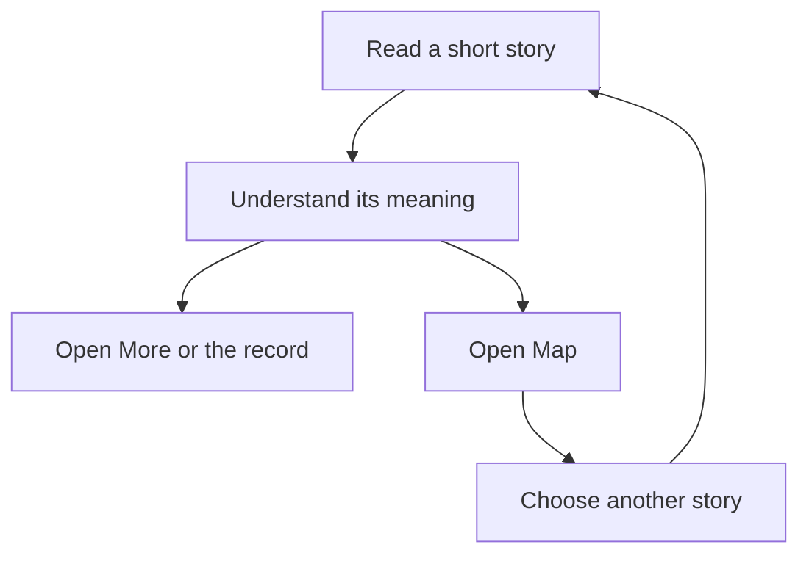

# Read the work through stories

The owner should be able to read what happened, what it means for him and what comes next, then open the supporting record or use the Map to reach another story. Agents should compose that same experience with Demistify, without carrying a private UI implementation into every page.

This is one coupled reader experience, released and checked as a whole. Story, section and Map needs remain rows in one document: none has a separate reader, authority or release boundary that earns a document split.

## The approved reference

The design-documents Lead's 7 November commission quotes the owner: “ok i think we good and this is the deisgn i wnat we can start getting it deploeyd with eh demsitfy lead and then make sure its veirfied so we can star tkusign it”. The frozen reference is `p1b-approved-2026-11-07.html`, SHA-256 `ece32b0cdb2a6fe432f0db763ebdd7e55b885f43114e9a36cc555584d7f676c4`. Its page appearance, native folds and Map are the target; its historical story claims are supplied content, not assertions about current work.

One later correction governs the frozen file: the panel title and accessible name are **Map**, replacing **Outline**. Basis: the owner's “its more a Map no nto otulien”, confirmed by the commissioning Lead in Router push `01a1b60d-e12c-7180-a6fe-8bbef31fca40`. The reference's executable file has not been edited.

The UI view is the approved desktop page with Map closed and the narrow page with Map open, supplied as inert PNGs `approved-1400-map-closed.png` and `approved-400-map-open.png`. They show the compact story title and metadata, headline, labelled rows, showpiece, closed record fold, category section header and right Map panel. The narrow capture has the old Outline header; the correction above takes precedence. Captures describe appearance, not new interaction observations.

## Who needs this

The direct reader is the owner, who has already selected this page. The author is an agent carrying story rows and their supporting log entries onto a local HTML page. The design-documents Lead owns the story content and group membership. Library maintainers own reusable rendering, public syntax and reader interaction; they do not interpret a log's meaning.

| Need | Authorized outcome and why | Basis | Priority |
| --- | --- | --- | --- |
| U1 | Read each story's headline and Happened / For you / Next rows, with a subject, time and icon; read its showpiece and open More and supporting records without losing the story. | Commission §1 and approved page | Required by owner |
| U2 | Scan four named sections while their headers remain visible below the toolbar; use accurate counts and page/section expand/collapse actions, with routine stories grouped under one smaller-stories fold. | Commission §2; page-wide action in frozen page | Required by owner |
| U3 | Reach a story from one Map tree, with part states, without fighting Comments or landing on a closed story covered by the phone panel. | Commission §3 and frozen interaction code | Required by owner |
| U4 | Recognize an in-page jump and start selected tree branches folded using documented Markdown, independently of following links. | Commission §4 and first tree request, Router push `01a1b602-57db-7092-97b9-b8cafa97138e` | Required by owner |
| U5 | Compose the approved page from shared components, retaining supplied rich content, IDs, groups and log entries, without custom CSS or interaction scripts. | Commission introduction/§5; boundary confirmed in push `01a1b605-b613-7561-bb94-a6ad976df4c0` | Required by owner |
| U6 | Start using a page only after the components, guide and actual released-only composition have been independently checked against the approved page. | Commission “Verified before use” and “Return” | Required by owner |

All six rows are authorized from the commission's quoted owner direction and frozen design. Source code is observational evidence about reuse and gaps, never authority to narrow these outcomes.

## What stays outside

There is no Router reader, story database, automatic summarizer, importance classifier or log-to-story builder in the library. Agents author the content and explicit membership. The library owns the repeated presentation and interaction. Existing bottom workspaces retain their separate behavior beside Comments; making the Map mutually exclusive does not remove that ability.

The work uses native HTML, Markdown and the existing shared theme. It introduces no application framework or backend. Private real entries remain in the owner's private page; public demos use representative sanitized material. A page's design fidelity does not certify the truth of historical text supplied to it.

The four sections remain: For you to decide; What's done / what's next; What changed and why; What was verified, and what was missed. The changed section retains the two decision columns. The existing prototype's shorter displayed “What was verified” label is understood as that same section; content meaning is preserved.

## What decides success

The reusable page must retain the frozen design's story hierarchy, states and navigation outcomes with the named Map correction, at 1280 and 420 CSS pixels. Shared-component checks also cover the repository's 390 CSS-pixel width and affected light/dark themes. Independent library review precedes Terra's evaluation of a page composed only from released Demistify parts. Source checks, a copied prototype or an HTTP response alone cannot establish that outcome.

Continue with the [observable contract](specification.md). Exact implementation owners belong to Program Design and the proof route to Verification Design; both are pending and listed in the [set entry](index.md).
