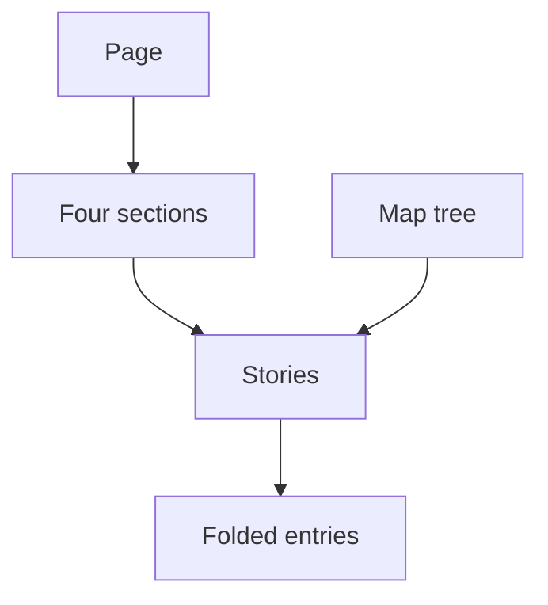

# Stories stay readable and reachable

The reader sees a story before its evidence. The Map takes them to another story, opening what is needed to read it. The page author supplies every meaning and identity; Demistify supplies shared presentation and interaction.

Authority and the accepted needs U1–U6 are in [Requirements](requirements.md). The problem is not missing story data: the approved page works through private styling and executable page code that other agents cannot reuse as a documented library contract. The desired outcome is the same experience through shared parts.

The Map reaches a story by its stable ID. Stories can be open or folded; their entries remain folded until chosen.

## The things the reader can name

| Entity | Identity and relationships | Invariants and observable states | Basis |
| --- | --- | --- | --- |
| E1 Page | One authored HTML document. Contains four E2 sections and zero or one commissioned E5 Map. | Content identities remain unique. Local, prepared and released bindings are distinguished; none implies content acceptance. | U2, U5, U6 |
| E2 Section | One explicitly named group on E1 with a stable authored identity; contains zero or more E3 stories and optionally a routine-stories group. | Membership is authored, not inferred from status or importance. Header count separates primary and routine membership; Map names the total. The changed section also contains two authored decision columns. | U2 |
| E3 Story | One authored account identified by its stable page ID; moving it or changing its text does not create a second identity. Belongs to one section and can link to one or more E4 entries. | Has a title, subject/time/icon, headline and three named rows; open or folded. Optional showpiece and More preserve supplied meaning. A state icon does not prove completion. | U1, U3, U5 |
| E4 Record entry | One supplied log entry identified by its supplied entry ID. It is referenced from stories; on the page its full content has one anchor. | Text is not summarized or reclassified by the renderer. It is folded initially and opens independently; navigation does not open unrelated entries. | U1, U5 |
| E5 Map | The page's explicitly authored hierarchy of parts, sections and story links. A branch remains the same branch when folded. Its destinations reference E3 identities. | Closed or open; branches open or folded; the right panel and Comments are never both open. Heading and accessible name are Map. | U3, U4 |
| E6 Disclosure | An authored fold containing a story, More, a record list, an individual record entry or routine stories; its identity is its authored element, not its title text. | Native open/closed state is authoritative. All five of these fold kinds participate in bulk actions within their declared scope. Other page notes and Map branches do not. Counts and action labels follow the live member state. | U1, U2, U3 |

## Contract and proof obligations

Each R row is an independent pass/fail obligation. Its C identifier names the observable contract in that row; its V identifier names the authoritative proof obligation, not a chosen test route.

| Obligation | Required observable behavior and failure case | Need / entities | Contract / proof obligation |
| --- | --- | --- | --- |
| R1 Story hierarchy | Each E3 shows its title, subject/time/icon and bold headline, followed by Happened, For you and Next with icons. It carries at most one showpiece, optional More, and “The record: N entries”. Rich supported body content retains its text, links and meaning. Missing optional content creates no empty decorative panel. | U1, U5; E3, E4 | C1; V1: same hierarchy and content against frozen reference at required widths/themes. |
| R2 Initial states | Newly composed stories start open; their More, record list and entry disclosures start closed. Explicit carried open/closed states retain their supplied meaning. A general composition default cannot silently change a carried state. | U1, U5; E3, E4, E6 | C2; V2: first-load states and carried-state control agree with supplied markup. |
| R3 Section scan | Each E2 has its named section header, primary count plus a separate routine count when present (for example “4 + 2 smaller”), and right-aligned icon-only bulk control. Its Map branch shows the total (6 in that example). The header stays below the actual page toolbar as stories scroll. One “N smaller” fold at the end of the section contains all authored routine members; the changed section also includes both authored decision columns. Long labels wrap without covering controls. | U2; E1, E2, E3, E6 | C3; V3: all four sections, split/total counts, end-position routine fold, columns and sticky behavior against reference; no viewport clipping or control overlap at 1280/420/390. |
| R4 Bulk state | Page and section controls expand/collapse every story, More, record list, individual record entry and smaller-stories fold in their declared scope. Ordinary page notes such as “Names used here” and “About this page” are excluded. Mixed state offers expansion; all-open state offers collapse. Manual changes and another bulk control immediately affect that action state. An action never changes an outside section or the Map's branch state. Double-down expands and double-up collapses. | U2; E2, E6 | C4; V4: action, icon and accessible name agree with every listed member's actual state, including the initial mixed state, manual and cross-scope sequences. |
| R5 Map presentation | The Map button sits in the shared reader control row; E5 opens at the right, with the same presentation/animation family as Comments. Opening either closes the other. On a narrow screen Map covers the page below the toolbar and has usable width; Escape/Close return focus. Existing bottom workspaces retain their established independent Comments behavior. | U3; E1, E5 | C5; V5: Map/Comments exclusion both orders, keyboard/focus, reduced motion and required viewport geometry. |
| R6 Map destinations | Following an E5 link reveals the target E3 and any closed containing E6 group before scrolling. On a narrow screen Map closes first. An already-current fragment can be activated again. Unrelated record entries remain closed. Browser history and ordinary modified-click navigation retain native expectations. Missing/invalid targets do not navigate to a different story or invent an ID. | U3, U5; E3, E4, E5, E6 | C6; V6: each supplied story destination, direct load, repeated activation and history reaches the intended readable target. |
| R7 Link meaning | A tree link whose resolved URL names the same document plus a nonempty fragment uses an in-page jump icon. Other-page or external links retain the current leave/go-to arrow. Folding a branch is a different action from following the link. A hash on another page is never treated as same-page. | U4; E1, E5 | C7; V7: fragment-only, same-document relative/absolute, other-page fragment and external controls retain destinations and distinct icons. |
| R8 Initial tree folding | An unformatted leading `folded:` marker starts a branch of E5 folded. It precedes any tone; an optional native checklist prefix comes before it. Unmarked branches keep the existing open default. A marker on a leaf or inside inline code remains literal text; Unicode chevrons are not consumed as state. | U4; E5, E6 | C8; V8: real parsed marked/unmarked branches and tone/checklist/link combinations have the declared initial state and intact labels. |
| R9 Author control | E1 can be composed with documented Demistify markup, native HTML and inert content carriers. No page-specific CSS or executable interaction script is needed. Supplied text, order, IDs, links, initial states, grouping and rich showpieces retain their meaning. The renderer neither reads Router nor decides story significance. | U5; E1–E6 | C9; V9: composed source contains no prototype presentation/interaction code, and content/identity readback matches the supplied story/entry set carried onto that page. The private comparison uses the frozen approved source identified in Requirements; any public check first fixes a separately sanitized representative story/entry set and never publishes the private records. |
| R10 Existing readers | The added page presentation does not change unrelated cards, traces, navigation, Comments, inspection or bottom-workspace defaults. Keyboard navigation and text selection remain usable. Controls have accessible names, visible focus, and layouts remain readable in affected themes and reduced motion. | U2, U3, U5; E1, E5, E6 | C10; V10: controls outside the new composition preserve current documented behavior; changed reader flow meets repository accessibility/responsive checks. |
| R11 Author guidance | The matching component guide teaches the complete story/section/Map composition and concrete tree marker, defaults, child content and limits. A capable agent can compose it without reading the private approved page source. Unsupported or malformed public syntax is diagnosed by the existing authoring checker rather than taught as supported. | U5, U6; E1–E6 | C11; V11: guide examples are complete and match released metadata/renderer/checker contracts; a composition from the guide has no private script or hidden source dependency. |
| R12 Verified use | A page composed only from the matching released parts retains the corrected frozen reference's hierarchy, states and navigation outcomes at 1280 and 420. Shared components also remain readable at 390 and in affected themes. | U6; E1–E6 | C12; V12: actual released-only composition and interaction results agree with the corrected frozen reference. Source merge, checker success and hosted fetch alone do not satisfy it. The independent review and owner-showing order remains the delivery gate defined by U6. |

## Boundaries and examples

Existing default tree behavior remains valid: `- risk: [Registry](#story_registry)` names a visible status and a separate navigation action. The new explicit marker is `- folded: risk: [Registry](#story_registry)` with indented children. A checklist form is `- [ ] folded: Branch` with children. Only the plain first-text prefix is metadata; backticked `folded:` stays content. A leading `>` retains its Markdown blockquote meaning, and `▸`/`›` remain literal. This is the target contract, not a claim that the existing released guide implements it.

Local link identity compares the actual document URL rather than the text's appearance: `other.html#story_registry` remains another page. Malformed URL/fragments and unknown IDs preserve the document and report the real issue through existing diagnostics; no fallback story is selected. Repeated action on the current valid fragment still reveals its story.

Each supplied E4 body occurs once. A repeated reference points to its one anchor instead of copying the body and duplicating IDs. A story can carry more than one reference without the renderer claiming that every referenced row proves every sentence.

No newly persisted data, network endpoint, external service or permission is required for the renderer. The authoring trust policy for sensitive content continues to apply. Private source records and the frozen page are not published as a consequence of releasing generic components.

Program Design must settle the exact new markup and owner/call/state contracts without changing R1–R12, including R8's public marker. Verification Design chooses the observations that can decide V1–V12; the supplied PNGs establish appearance reference only, and do not certify runtime behavior.
