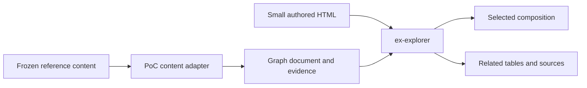

# Explorer reproduction and experiment acceptance

The owner chose full interaction parity for the skill composition explorer. The final test must preserve search, grouped browsing, selection/history, current/proposed composition, hover tracing, arrow-to-table selection, incoming consumers, proposal overview, changes, earlier ideas and source evidence. A smaller page that silently drops these is not the final test.

The reference input is frozen by SHA-256 `619a6b0af4c0d4e46c4ab491060a20849b25d7ba71f0ddecbf79d8a79fd3b961`, source revision `d9e717b677e2ba32ad5c38896b5e6802ee029ed6`. It contains 49 graph nodes, 329 declared edges, 21 proposed edges, nine proposal runs, six earlier proposals, 18 authored changes, six extraction ideas and two candidates. One node represents a proposed shared reference rather than a skill. Current source and proposed ownership must remain distinguishable. A declared link is not proof of a runtime load.

## Reusable boundary

A new lazy `ex-explorer` island owns a selected graph document. Its data supplies stable node/edge identities, ordered groups, which relationships expand the composition, source evidence and supplementary tables. The library owns search, ephemeral selection/history, graph layout and tracing, table synchronization, keyboard interaction and theme styling. There is no persisted user state or application backend.

The page remains ordinary HTML and may place this island beside Markdown, Mermaid or other content. Document-specific source extraction and skill terminology stay in the PoC input adapter. The library must contain neither skill IDs nor special-case explanations copied from this reference. The adapter preserves source text and maps it to the generic schema; it does not generate a bespoke application script.

The graph document owns content. The explorer owns only transient viewing state. Graph and tables derive from the same selection; they do not keep separate synchronized copies. Expansion edges and related links have different meanings, so the adapter declares that distinction explicitly. Cycles must terminate and an edge cannot disappear through a source/target-only identity collision.

This is an experimental library addition, not a released stable vocabulary. It pays one-time library code and schema complexity to avoid per-document JavaScript. Count that cost separately, while counting the complete referenced data and extraction/repair work in the experiment ledger. Referencing a file does not make its content free.

## Iteration loop

Keep each model attempt independently openable. Retain exact initial and final HTML, all supplied/read context, source references, checker feedback, repair count and screenshot captures. Run fresh Sol and Luna authors on the same input set for the controlled small task; repeat the final explorer after the reusable capability is ready. Correct the guide or component from observed failures, then run the next treatment. One run per model diagnoses failures; it cannot establish model reliability or a winner.

Validate three separate claims: static source validity, actual browser behavior/layout, and preservation of required content/relationships. Use valid controls and a small seeded negative set. Existing checks remain in place; no broad decorative test suite is needed.

## What to measure

- Context and output: exact file tokens, supplied task prompt, referenced prose/data, diagnostic feedback and repairs. Name excluded hidden/provider context; do not call file totals billed model tokens.
- Model DX: extra reads, invented APIs, initial acceptance, repairs, unexpected checker/runtime disagreement and operator work needed to finish.
- Human use: screenshots at matching viewports, readable grouping, diagram/table correspondence, useful navigation and explanatory layouts. Appearance is inspected separately from content correctness; comprehension is not inferred from a screenshot.
- Loading: cold-request and warm-request samples, transferred bytes, first contentful paint, content-ready time and lazy graph/diagram cost. Loopback is not deployed network performance.
- Responsiveness: interaction-to-next-paint or bounded frame timing, long tasks, layout shifts and scroll behavior on the full corpus. Report environment, sample count and measurement limits.

## Private delivery trial

Cloudflare credentials and account metadata never enter public Git or reports. Start with local Wrangler/workerd Static Assets and R2 variants using the same built artifact. No authentication is required for that trial. Exact-version consistency, old version retention, MIME/CORS, conditional requests, missing-file behavior and actual browser module/worker loading are independent gates. Local workerd does not prove edge cache propagation or production cost.

A hosted trial must enforce private access before content is uploaded. Public deployment is not authorized by local experimentation. Account authentication is a separate access grant; lack of it does not stop local experiments.
