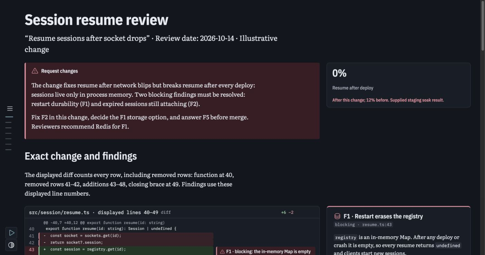
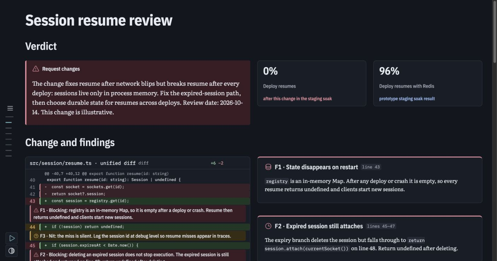
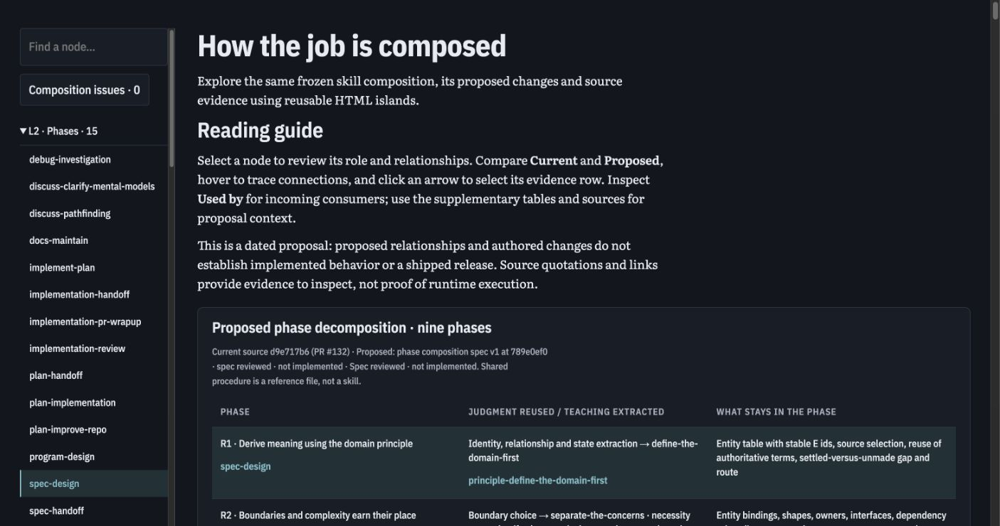
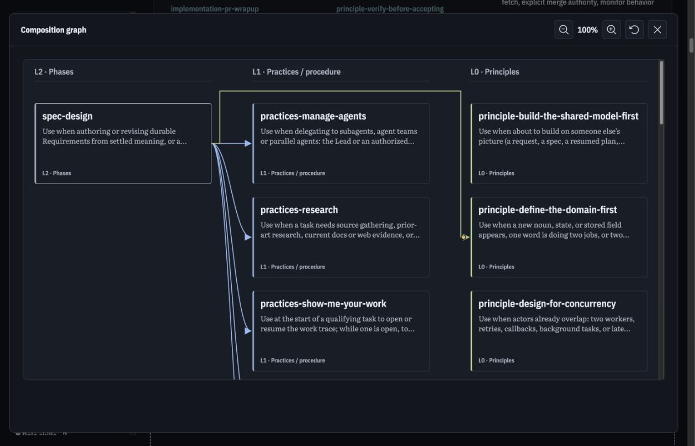
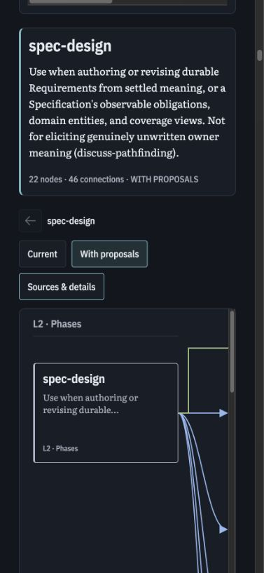
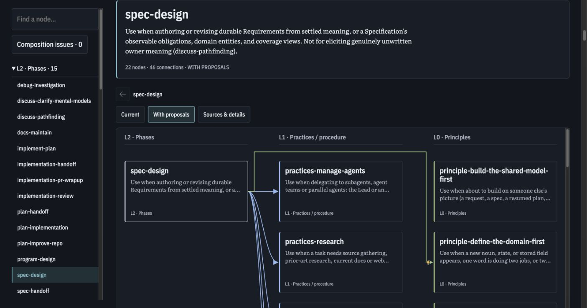
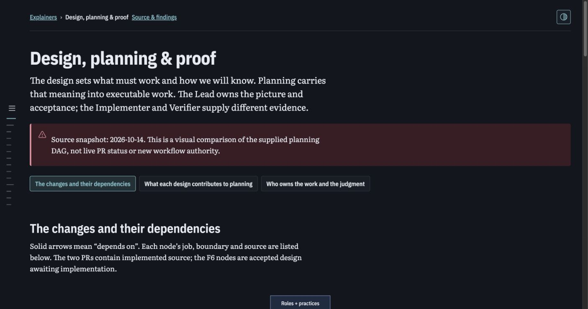

# Explorer, model authoring and local delivery results

Work branch: `feat/demistify-distribution-authoring-experiments`. These are local experiments on an unreleased library. The existing library was merged through PR #1; this branch's new work has not been merged or deployed. The owner chose full explorer parity as the final target. The model pair and local delivery probes establish specific behavior; they do not close all final acceptance criteria.

The earlier [distribution report](2026-10-15-distribution-authoring-experiments.md) records round 7 and an older reference freeze. Its historical numbers remain intact. The current source freeze and acceptance boundary are in [explorer parity](2026-10-15-explorer-parity.md).

## What is runnable

From the monorepo root:

```sh
pnpm install
pnpm build
pnpm --filter @sunstack/demistify-poc preview --port 4174
```

Open each page separately:

- `/experiments/agent-written/round-8-sol-luna/sol-iterated.html`
- `/experiments/agent-written/round-8-sol-luna/luna-iterated.html`
- `/experiments/agent-written/round-9-explorer/sol-iterated.html`
- `/experiments/agent-written/round-9-explorer/luna-iterated.html`
- `/experiments/agent-written/round-10-guide/sol-review.html` and `luna-review.html`
- `/experiments/agent-written/round-10-guide/sol-explorer.html` and `luna-explorer.html`
- `/experiments/agent-written/round-11-reference/index.html` (latest Lead-built reference conversion)

Rounds 8–10 preserve initial outputs, accepted outputs, exact input files and normalized receipts; rounds 8 and 9 also preserve a separate authored iteration. Round 11 preserves the latest Lead-built reference conversion. The build copies the complete library beside the usage. The new explorer data contains the supplied public skill-source citations, not account credentials or private deployment metadata. Generated multi-megabyte offline artifacts and raw authentication output stay outside Git.

## Model DX and content cost

| Task                             | Shared input-file tokens | Sol initial / iterated HTML | Luna initial / iterated HTML | First-run checker                    |
| -------------------------------- | -----------------------: | --------------------------: | ---------------------------: | ------------------------------------ |
| Code-review brief                |                    2,728 |               2,109 / 2,138 |                1,706 / 1,849 | Both: one call, 0 errors, 0 warnings |
| Full explorer with existing data |                    2,141 |                   222 / 223 |                    219 / 212 | Both: one call, 0 errors, 0 warnings |

Sol used gpt-6.1-sol medium; Luna used gpt-6-luna high. First runs were fresh sessions without parent history. Iterations reused their author sessions. Every iteration made one new successful check. This is one pair per task, not a reliability estimate or fair isolation of model and effort. There were no invented APIs in the accepted outputs. Source review found all supplied F1–F5 findings, options and evidence values in both code-review pages.

The current source HTML is **174,515 tokens / 792,811 bytes**. The initial normalization duplicated source URLs and grew to **228,920 tokens**. Centralizing the source base reduced the JSON to **173,548 tokens / 776,142 bytes**, with **97,429 gzip bytes**. The input adapter measured **3,759 tokens** at the captured revision. A 212-token wrapper therefore does not mean the full explanation costs 212 tokens. Initial migration, referenced prose/data, per-page usage, library development and generated delivery artifacts are separate costs. The initial migration does not demonstrate an overall token saving once the adapter and complete content are included.

A content-only comparison is more informative than comparing the tiny wrapper with the whole original application. The same frozen read contains **151,827 tokens / 709,189 bytes of embedded source JSON**, versus **173,548 tokens / 776,142 bytes** in the round 9 normalized graph. This conversion expands the referenced content by 21,721 tokens (about 14.3%). The remaining original HTML is 22,688 tokens and includes application implementation plus static help text; it is not all reusable library code. These source measurements are separate from model generation and actual consumed or billed context. See [the exact split](evidence/2026-10-15/reference-content-ledger.json).

Exact source/output sizes and hashes are in each round's `measurements.json`. Assignment prompts and full tool framing were not captured as exact complete ledgers in these rounds. Input-file totals are lower bounds on visible context; they are not provider token usage. The next controlled run must save the exact assignment and feedback before dispatch rather than reconstruct them afterward.

## Fresh guide treatment (round 10)

After prospective independent spec acceptance, a fresh Sol/Luna pair each authored both pages. Exact assignment and spawn text were saved before launch; each assignment is 466 tokens and its spawn wrapper 49 tokens in the private original. Public copies normalize machine paths. Sol's review/explorer measured **1,872 / 459 tokens**. Luna's first review measured **1,672**, repaired review **1,785**, and explorer **350**. The longer Sol explorer repeats source inventory/provenance already available in the component. Output length remains an authoring tradeoff even with reusable rendering.

Both reviews used four-column summaries with all children on one row and actual section headings. Real Chrome observed six/eight h2 sections and seven/nine outline links; no outer overflow or reported authoring issues at 1,419 × 747. Sol rendered a four-participant sequence diagram; Luna used a five-step numbered flow. Both retain the supplied facts and proof boundary. Both explorer introductions follow the page h1, with the expected 22 nodes and 46 connection rows.

Sol passed both pages' first checker calls. Luna's initial review had eight real errors: three missing route IDs and five note references to a filename absent from the supplied single-file diff. One repair cleared them. Its explorer passed first call. Luna also needed an input-path correction after file listing omitted a supplied graph symlink; the Lead verified it and replaced both private input symlinks with physical files. That assistance is recorded, not omitted from DX overhead.

These named examples show successful composition and a useful repair loop. They do not establish a causal improvement from guide wording. Complete native tool-action transcripts were unavailable to the parent, so actual reference retrieval, the exact loaded guide copy and consumed tool-payload totals remain unverified. Correct output and self-report cannot close that gap. Independent implementation review retained this as PF-1 and blocked guide ship advancement while finding no source defect in seven selected checks. The guide remains experimental. See [the round](../../../apps/demistify-poc/experiments/agent-written/round-10-guide/README.md).

## Visual iteration

The first Luna code-review page had no h2 section headings and an orphan final stat in a three-column summary. The iteration added section headings and a four-column summary. Sol already had working Markdown headings; changing them to literal HTML after ambiguous feedback offered no outline benefit. The guide proposal makes Markdown heading syntax and column arithmetic explicit, after prospective independent spec acceptance. Fresh behavior proof and implementation review remain separate; the later implementation review found no source defect but retained the missing reference-read proof gate.





Both screenshots use an effective 1,419 × 747 CSS viewport. The inspected pages had no outer horizontal overflow and no reported authoring issues. These observations establish layout/rendering facts; human comprehension and preference remain unmeasured.

For the full explorer, both authors initially put the reading guide outside the component. The library now preserves child islands after its own page title, and both iterations use that composition. The primary page needs no `ex-document` wrapper. The source graph and all evidence remain shared.





A real narrow check used a requested 430 × 932 viewport, with an effective 391 × 847 CSS viewport because browser zoom was retained. It found a source URL in the caption widening the document. Wrapping caption text fixed the measured outer overflow, including with the source panel open. Graph/table scrolling remains inside those visual surfaces. Temporary emulation was cleared afterward.



## Interaction and validation evidence

The graph document parser checks unique identities, node/group/edge/table references, valid source protocols, table cell counts and initial selection. The page checker reads the actual referenced JSON. Four focused tests cover current/proposed expansion, shared targets, cycle termination, tracing and valid/invalid page inputs. Reserved special-view node IDs and built-in details-tab IDs are rejected too; both collisions were demonstrated with targeted failing assertions before the parser repair. A deliberate current/proposed filter mutation failed two tests, then the original implementation was restored. This was a mutation sensitivity check after implementation, not a claimed pre-implementation RED.

An independent probe executes only the frozen reference's pure composition function. All 49 nodes plus the issue view in both modes matched the new model: **100 cases, 0 mismatches**. This proves node/edge-set parity, not browser or visual parity.

Actual Chrome observations on the new rendering:

- `spec-design`: Current 21 nodes / 45 connections; With proposals 22 / 46, with corresponding table rows.
- Search isolated the requested principle; selecting it produced one graph node and six incoming rows; Back restored the earlier selection.
- Hover tracing for `practices-research` lit the same 10 edges as the frozen reference calculation.
- Clicking a real SVG arrow selected its actual Connections row (`current-213`). Fullscreen moved/restored the real 22-node graph.
- ArrowRight moved tab selection and focus from Connections to Used by. Tabs now identify their panel; this is not a complete accessibility audit.
- Sources & details exposed 72 source links and 53 quotations for the observed selection. Sources link to pinned public revisions; source clauses are not runtime-execution proof.

Selection uses an `ex.<authored-id>` URL query key so ordinary heading fragments remain available. Missing IDs receive independent generated IDs; authors should give explicit IDs for stable links. Full composition with multiple navigators and exhaustive deep-link reload journeys remain to be exercised.

The generic checker still cannot establish domain truth or whether prose omitted a required fact. The validation strategy is: vocabulary plus referenced-schema checks; brief-specific content/relationship review; then real browser interaction/layout checks. Keep valid controls and seeded negatives. An empty explanation passing syntax is a documented limitation, not a trustworthy completion signal.

## Content preservation and latest reproduction

The [preservation probe](../../../apps/demistify-poc/scripts/probe-explorer-preservation.ts) parses the frozen embedded content without executing its application or opening a browser mirror. Against both the retained round 9 data and the latest round 11 data, it found all **1,870 long textual values**, **714 source-anchor occurrences** including nested via references, and **350 relationship identities with their own explanations and attached quotations/links**. Whitespace-normalized text coverage does not establish source truth or complete semantic equivalence. The source-link comparisons retain the exact source revision and line.

Two schema-valid negative controls failed as intended. Removing one complete URL/quotation identity produced one missing source occurrence even though long-text coverage passed. Moving two citations from one relationship to another retained all quotations globally, but failed the two relationship-specific associations. This demonstrates why validation needs both content coverage and ownership of evidence. See [positive results](evidence/2026-10-15/explorer-content-preservation-latest.json), [omission control](evidence/2026-10-15/prose-preservation-negative.json) and [wrong-association control](evidence/2026-10-15/edge-evidence-negative.json).

The latest independently openable page is **round 11**. It keeps the same frozen source and library, and restores caveats that were previously only in the original UI: a shared procedure is a reference file, its description comes from the proposal, roles describe responsibility rather than execution order, orchestrators are deferred, and authored source is not an installed or behavior-tested release. The older measured model inputs remain unchanged. Round 11 is a Lead-built conversion, not another model-author measurement.

```sh
node apps/demistify-poc/scripts/probe-explorer-preservation.ts SOURCE_HTML apps/demistify-poc/experiments/agent-written/round-11-reference/planning.json
```

`SOURCE_HTML` is the external frozen file identified by the round's source manifest. The original application is not included in public Git or served as a browser-policy workaround. The converted page runs independently; rerunning the source oracle requires that supplied input.

Chrome rendered the latest page at 1,419 × 747 with 22 proposed-view nodes, 46 connection rows, zero reported authoring issues and no outer width overflow (1,405 document pixels). A fresh native Luna observation pilot also rendered this graph, switched Current 21/45 to With proposals 22/46, selected the searched principle, and returned through Back. Reloading after selection restored that stable-ID selection once the real ready state appeared; history reset as expected for transient state. Its captured first check was 0 errors / 0 warnings. The pilot is unpaired and excluded from the matched author metrics.

The native observation attachment failed before returning any tool-action evidence. No Sol pilot was launched after that failure; the result does not close guide-read proof PF-1. The pilot's prose also overclaimed arrow-hover tracing: the renderer traces on node hover/focus and opens evidence on arrow click. Static validity did not catch that prose error. Its private initial output is retained for a later bounded author correction, without substituting a Lead edit as model success.



## Loading and interaction samples

The full corpus was loaded from loopback HTTP in an existing unthrottled Chrome process. Three unique URL roots forced real transfers of the same built bytes; each was paired with a same-URL reload. Effective CSS viewport: **1,272 × 818** (requested 1,400 × 900). No WAN, mobile CPU or field Core Web Vitals claim follows.

| Metric                     | Fresh URL samples   | Paired reload samples |
| -------------------------- | ------------------- | --------------------- |
| FCP (ms)                   | 128, 84, 92         | 80, 64, 72            |
| Explorer graph ready (ms)  | 91.9, 46.0, 46.2    | 40.8, 33.1, 36.1      |
| Transferred resource bytes | 1,040,759 each      | 0 each                |
| Layout shift sum           | 0.01047 each        | 0 each                |
| Observed long tasks        | none in these three | none in these three   |

The graph-ready mark covers the explorer UI, not every font or asynchronously rendered introductory island. An earlier separate sample recorded an 85 ms long task; it is retained and prevents a blanket "no long tasks" claim. A cache-disable series with zero resource transfers was rejected as cold-load evidence.

Four local selections measured synchronous work of **7.8, 8.2, 5.7 and 12.5 ms**; a two-requestAnimationFrame settlement measure was **27.7, 27.5, 15.0 and 26.5 ms**. This instrumentation is not standardized INP. The small sample does not establish tail latency. Raw fresh/reload samples are in [the evidence file](evidence/2026-10-15/explorer-fresh-performance.json).

## Local Cloudflare variants

A reproducible loopback-only harness runs Wrangler 4.151.0 / local workerd with Static Assets and with a local R2 binding:

```sh
node apps/demistify-poc/scripts/probe-cloudflare-local.ts PATH_TO_WRANGLER_JS 4193 --serve
```

Wrangler is an optional operator dependency, outside the browser consumer and outside this repository's dependency graph. This harness has no login or deployment path, binds only loopback, sets `remote: false`, and keeps raw output in a user-only temporary directory. It seeds all release objects before starting readers.

Both variants passed five protocol groups: complete exact-version bytes/CORS/immutable headers; MIME types; empty 304 with CORS/cache headers; missing file 404/no-store; and an alias 302 with CORS/no-store. Each variant checked 38 files across two roots. Those roots contain identical frozen build bytes, not two genuinely different released versions. The separate Node alias probe demonstrates alias mixing and resolve-once consistency; the workerd harness does not demonstrate live production alias updates.

Actual cross-origin browser diagrams loaded from both variants through a native Blob module worker. Each observed a ready message, an actual rendered SVG reply and four diagram nodes, with no reported authoring issue. A resource timing entry alone had misleadingly suggested main-thread fallback; the real Worker message probe disproved that diagnosis. With a separate `worker-src 'none'` control, a policy violation occurred and the real four-node diagram still rendered through fallback. Probe wrappers forwarded to the native constructor and were restored afterward.

Both backends pass this local protocol comparison. Static Assets avoids an object-storage publication path; R2 permits object retention independent of Worker deployment but adds publication/cache ownership. Production retention, alias propagation, private access, rollback and cost remain unverified, so this trial does not select a winner. Cloudflare login requires an additional explicit access-scope approval after automatic approval review rejected the requested write scopes. No OAuth grant, remote resource or hosted deployment was created.

## Minimum install and offline tradeoff

The browser consumer supports ordinary HTML plus a complete library folder over static HTTP, or tags pointing to one exact cross-origin version root with CORS. It needs no npm, Vite, application server or persistent backend. Author checking currently needs the source CLI/Node 26 environment; standalone checker distribution remains an experiment. A moving CSS alias and independently fetched script alias can select different versions, so atomic release selection must be solved before promising automatic upgrades.

Two bounded packaging scripts compare the same fixed module graph and supplied page usages:

| Offline approach         | Full explorer HTML | Full explorer gzip | Review HTML | Review gzip |
| ------------------------ | -----------------: | -----------------: | ----------: | ----------: |
| Recursive data URLs      |         10,492,149 |          3,130,084 |   9,721,929 |   3,034,685 |
| Flat Blob module catalog |          3,796,546 |            814,796 |   3,026,326 |     719,488 |

The flat catalog embeds each of nine module sources once. It rendered the full graph and the real four-node Mermaid diagram with **zero HTTP subresource requests**. A later bundle also preserved the revised reading guide: 3,797,223 bytes / 815,032 gzip, 22 graph nodes, zero HTTP subresource requests. The recursive data-URL baseline also rendered the same graph without HTTP subresources. The two snapshots have independently verified identical module sources, theme and embedded graph. Three alternating-order pairs measured data-URL FCP of 928, 900 and 892 ms, versus flat-catalog 180, 124 and 100 ms. Data URLs produced two long tasks per run (334–445 ms); the flat catalog produced one 55 ms task in the first run and none in the next two. Effective viewport was 1,419 × 747 in the same existing Chrome process. This favors the flat catalog for this fixed artifact, without establishing universal performance or file-protocol support. The generated payload is a delivery artifact, excluded from agent-authored usage counts.

The experiment caught two packaging failures: a filename literal mistaken for a real import, and JavaScript `$1` sequences interpreted as replacement-string syntax while embedding the module catalog. Both failed artifacts stayed private; functional replacement callbacks fixed the latter. This evidence is why an apparently self-contained file needs real browser proof.

```sh
node apps/demistify-poc/scripts/package-offline-probe.ts PAGE_HTML OUTPUT_HTML
node apps/demistify-poc/scripts/package-offline-dataurl-probe.ts PAGE_HTML OUTPUT_HTML
```

These scripts handle the fixed built ESM graph, embedded fonts, inline diagrams and local explorer JSON, including introductory child islands. They reject cyclic module graphs and unsupported image/diagram-file packaging. Direct `file://`, embedded WebViews, strict Blob CSP and arbitrary page assets remain unverified. Self-contained HTTP with no subresources is the proven boundary.

## Existing standalone export repaired

A real browser check found the older Prototype 5 standalone export showing six static diagrams while its runtime failed to register: inlined entry code still imported relative chunks from the page directory. A generated-artifact regression failed before repair. The proven flat catalog now lives at the existing library Node packaging boundary, and the PoC build calls it instead of inlining only the entry module. The CLI probe uses that same helper; authored HTML remains unchanged.

The repaired artifact is 3,088,926 bytes at the captured build, with nine embedded modules. Chrome now registers the real components, shows 14 outline links, retains all six prepared diagrams, and makes zero HTTP subresource requests. The actual theme button changed dark to light and was restored to dark. The suite passes **34 tests / 9 files** after this repair; lint, format, strict types and the full build also pass. These are current local checks, not hosted CI or release evidence.



## Remaining work

Complete the original-versus-new visual comparison through an allowed source view, the remaining required interaction/embedded-layout/accessibility acceptance, and actual guide/reference retrieval observation. The new source oracle closes the named text/relationship-preservation checks; it does not establish every semantic or visual claim. One stable-ID reload journey is now proven, while multiple independent navigators and heading-fragment coexistence still need focused coverage. Keep production delivery behind an explicit private-access design and authorization. No credentials, raw account metadata or public content hosting are needed for local experiments.
