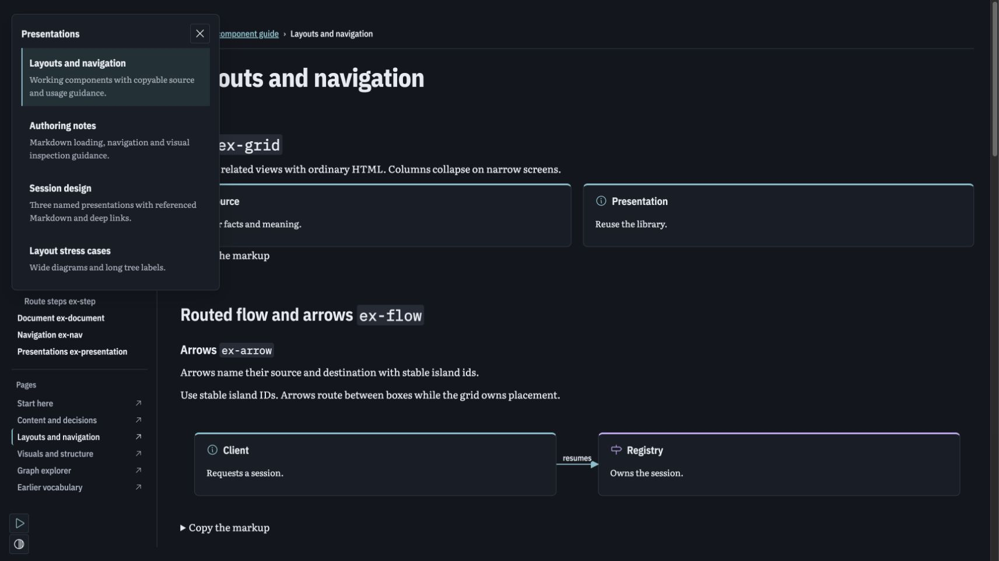
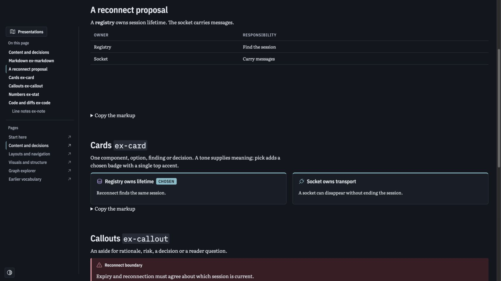
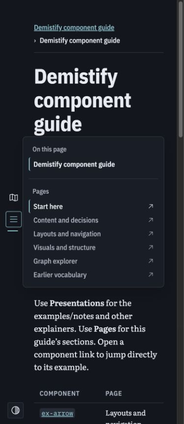

# Demistify fixes: proof and integration handoff

The owner split this work from deployment. This branch repairs document/diagram layout, adds Markdown references/source inspection and named presentations, and supplies useful browser regressions plus a component review gallery. It starts at `f7f3b7f79ec7703ab787ec716687dd2aab2e2ada` on `fix/demistify-mermaid-scroll`. This is a fixes branch above the existing distribution/authoring experiments; it is not based directly on main. Do not copy its entire ancestor history into an unrelated deployment PR without inspecting that history.

## Review locally

From the monorepo root:

```sh
pnpm install
pnpm build
pnpm --filter @sunstack/demistify-poc preview --port 4196
```

Start at `/experiments/agent-written/component-guide/index.html`. Six pages group content, layouts/navigation, visuals, graph exploration and earlier vocabulary. `coverage.json` maps all 28 registered components to examples. Descriptions and copyable markup appear beside the live composition. Every page has Pages navigation and named Examples/Authoring notes presentations; the latter loads a shared Markdown file. The page/presentation menu is an actual example of the API, not a separate gallery application.

Focused routes:

- `/experiments/agent-written/navigation-markdown-fix/index.html`: Architecture, Implementation plan and Review; external `notes.md`; exact-source sidebar; `#notes--recovery` and `#plan-diagram` cold-link targets.
- Sibling `details.html`: relative collection/page navigation.
- `/experiments/agent-written/layout-regression-fix/index.html`: wide comparison, long tree labels, actual picture and Mermaid gesture targets.

## What changed and why

- Native HTML still owns layout. CSS now contains grid min-size pressure and Mermaid local overflow; sticky controls stay reachable during horizontal scrolling. The pinned navigation gutter is reserved once. Tree labels own their inline content so wrapping does not move an icon onto a separate line.
- `ex-presentation id title description` defines a complete explainer. Selecting it hides other presentations. `ex-nav` accepts `nav slot="pages"` and `nav slot="presentations"`; headings remain a distinct outline. Presentation destinations can be local fragments or relative page links.
- `ex-markdown src` resolves against the HTML URL. Relative links/images resolve against the Markdown URL. Fences go through the existing real Mermaid renderer. Exact input and its reference are retained for source inspection and packaging. Named Markdown headings use `island-id--heading-slug`; Mermaid uses its authored component id.
- `demistify embed` reads local referenced Markdown and embeds safe source metadata. It retains shared runtime/theme links. Inline or embedded documents need no application server; live sibling-file fetches are subject to browser file restrictions. CDN-linked HTML still needs network access. Full standalone packaging remains a distinct operation with explicit resource resolvers.
- Modifier zoom/pan belongs to one inspection viewport. A real browser test found that copied Mermaid had an inner scroll owner while gestures controlled the outer viewport. The bounded repair leaves inspected Mermaid overflow to the outer viewport; main diagrams retain local scrolling.
- Picked cards keep their badge and top accent; the full selected ring is gone. Sidebar/source views retain rendered main content. Fullscreen restores content and focus.

## Current evidence

| Gate                                                                            | Actual result                                                                                                               |
| ------------------------------------------------------------------------------- | --------------------------------------------------------------------------------------------------------------------------- |
| `pnpm check`                                                                    | Exit 0: Oxlint, Oxfmt and TypeScript; 197 formatted source/config files at the follow-up check                              |
| Existing Node suite, including local Markdown embedding/preparation regressions | 36 tests in 10 files passed, exit 0                                                                                         |
| `PLAYWRIGHT_BROWSERS_PATH=<task-browser-cache> pnpm test:browser`               | 11 tests in 3 files passed, exit 0; 3.20 seconds on the final product build                                                 |
| Source checker: six component-gallery pages and three focused fixtures          | 0 errors, 0 warnings, exit 0                                                                                                |
| Actual CLI embed plus output checker                                            | Exit 0; 0 errors, 0 warnings                                                                                                |
| Standalone transformation                                                       | 9 embedded modules; 3,038,562-byte output; no external runtime/theme or Markdown source reference. Transformation only      |
| Gallery coverage/anchors                                                        | All 28 vocabulary entries mapped; no missing declared target anchors                                                        |
| Manual browser review                                                           | Representative content/card, visuals, layouts/menu and graph-explorer pages; one retained tab, no repeated browser launches |

The browser suite serves a frozen copy of the complete built library and real authored files in fresh same-origin frames. It does not import product TypeScript, mock Markdown fetching or mock diagram rendering. SVG outcomes establish actual rendering, not whether worker or fallback produced it. Its custom drag command stays inside the Vitest provider-owned headless browser. See [browser instructions and sensitivity limits](../../../apps/demistify-poc/tests/browser/README.md).

Original eight forbidden-behavior mutations each produced the expected failed assertion in private asset copies; no product source was changed. A separate handler-disabled copy caused both native visual cases to fail their zoom gate. These are post-fix sensitivity observations, not pre-fix TDD. The genuine native Mermaid pan regression was also preserved: at 201% the SVG grew from 419px to 843.75px, but dragging left its scroll offset at zero. The theme repair then passed both native cases, followed by the complete 10-case suite.

Initial committed build (952b2b7) asset SHA-256:

```text
runtime.js  7fdfeb4d9d0c7dbb95616bf86d3545feb7d03e99c5ecea8d1d1e4cd38b6a17bf
theme.css   d330d90d885318e1ef6fda9771f9a6fcae2763127fbd0f8d4c1be7891dd43389
```

## Independent verification and limits

The project verification recipe is `.agents/skills/verify-demistify/`, with a relative Claude skill symlink. The independent Verifier ran the real recipe on frozen commit `952b2b7`: 10/10 browser cases, 3 files, exit 0, 3.75 seconds; actual input/output CLI checks, embedding and exact-source readback passed. The complete served snapshot matched the asset manifest, inputs stayed frozen and the API port was closed after teardown. A sandbox startup denial was resolved by exact-command approval before tests loaded. This observation is bound to that initial commit/build. The paired Verifier has no product/test-authoring ownership. Different-provider verification was unavailable because the commissioned provider was logged out; the independent Codex Verifier is a separate session.

This establishes focused behavior in Chromium, not exhaustive compatibility, visual parity with the original private planning explorer, every component interaction, precise pointer-anchor stability or complete accessibility. The layout regression assigns scroll offsets rather than driving ordinary main-diagram scrolling; measured arrow/node alignment, strict fullscreen same-node/state restoration and drawer-resize transitions remain outside that suite's assertions. Loading/error code paths are present; transient loading timing is not observed. Embedded browser rendering ran over HTTP with no sibling Markdown available; full file-protocol/offline browser operation remains unverified. No context/token-efficiency benchmark or hosted performance claim follows from these fixes.

## Public integration boundary

The old public `c96a72e` assets do not support these additions. The deployment fork owns publishing a matching runtime/theme/guide and retaining historical major paths. This fork owns no Cloudflare credentials or deployment. No secrets/account details belong in the public handoff.

The Sunstack Skills Lead acknowledged the delta and keeps draft #137 pinned to `c96a72e` until a verified matching public version exists. [Authoring follow-up](2026-10-16-authoring-followup.md) specifies the required update to the existing `presentation-html` skill. Canonical syntax is [the library guide](../../../packages/demistify/skill/SKILL.md). Consumers can use a matching trusted local build now; public-agent instructions must wait for the matching deployment.

The practical merge risk is a regression in shared scrolling/navigation or packaged Markdown behavior; the worst outcome is an unreadable or wrongly selected explainer. Focused browser/Node tests constrain those risks. Browser engines beyond Chromium and the broad limits above remain outside this evidence.

## Representative screenshots





## Compact-navigation follow-up

A separate Lead-controlled 390px review found hover-open then pointer-click dismissing the heading menu; Enter opened it. The permanent regression failed on the original frozen runtime at the expected post-click visibility assertion (one failure, six unselected cases). The existing navigation owner now associates its button with the native popover and uses the show action. The first repaired test reached menu dismissal but its role locator excluded hidden elements; correcting that apparatus lookup produced the complete 11/11 pass above. The finalized oracle was then run against the original frozen build and still rejected the actual post-click failure. No timing sleeps or weakened visibility requirement were added.

The local app was rebuilt; the same retained browser tab confirmed the repaired pointer activation and a real relative page transition at 390px. Viewport override was then reset. This is additional Lead evidence, separate from the Verifier's initial ten-case observation. The Verifier subsequently inspected the bounded correction and independently exercised only the compact case at `fda39cbb1f55936301bfb29547487cb03c7450d2`: one selected test passed, zero failures, six unselected cases skipped, exit 0, 1.09 seconds. Its complete snapshot matched and inputs stayed unchanged; its API port was closed afterward. This is not an independent full eleven-case observation. The recipe now includes the focused command and exact coverage; ownership was released after handback. Final runtime SHA-256 is `907c4a246fd0913a405b2e0784036a4ae81f12e97f1a2ec57b57cc2acc269f97`; theme remains `d330d90d885318e1ef6fda9771f9a6fcae2763127fbd0f8d4c1be7891dd43389`.


