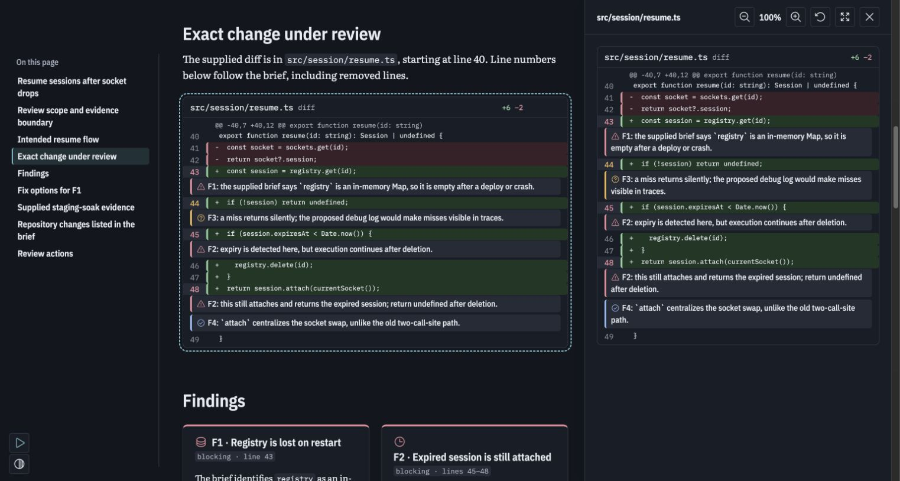
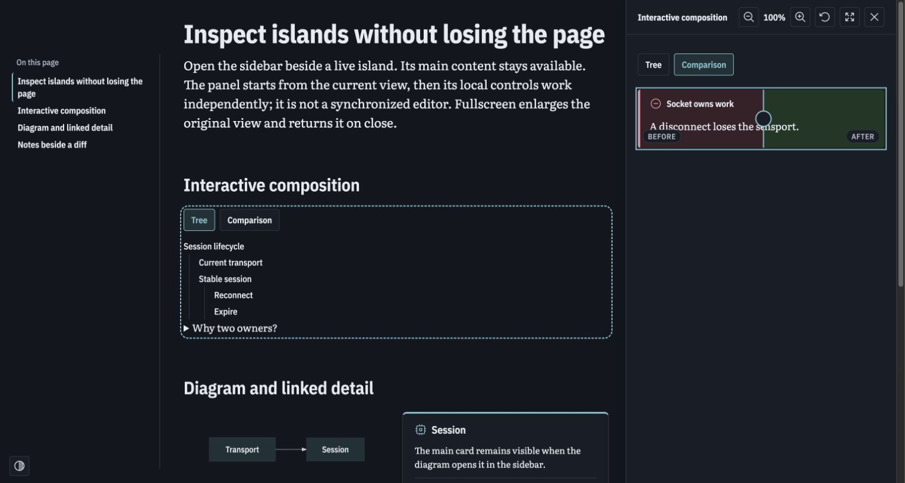
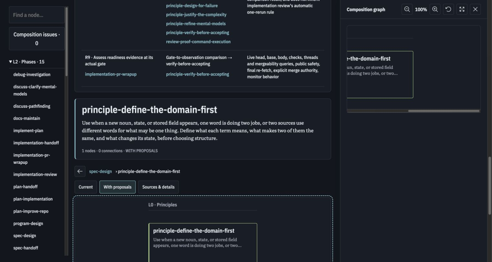

# Sidebar inspection and public authoring documentation

The shared inspector now keeps the original island in the page when opening a sidebar. Code comments use a neutral gray background with a severity accent, distinct from added/removed code. Corrected public examples and version-matched authoring documentation are deployed. Sunstack presentation-html is a separate skill-delivery task; track it and remaining experiments in [the owner checklist](2026-10-16-owner-todos.md).

## Open

- [Latest Sol/Luna examples](https://demistify-assets-cli-experiment.askluna.workers.dev/examples/2026-10-16-sol-luna-v3/index.html)
- [Luna review](https://demistify-assets-cli-experiment.askluna.workers.dev/examples/2026-10-16-sol-luna-v3/luna-review.html)
- [Interactive composition](https://demistify-assets-cli-experiment.askluna.workers.dev/examples/2026-10-16-sol-luna-v3/inspection.html)
- [Luna explorer](https://demistify-assets-cli-experiment.askluna.workers.dev/examples/2026-10-16-sol-luna-v3/luna-explorer.html)
- [Canonical component guide](https://demistify-assets-cli-experiment.askluna.workers.dev/demistify/experimental/c96a72e/authoring/SKILL.md)

Use `theme.css` and `runtime.js` from the same exact root:

`https://demistify-assets-cli-experiment.askluna.workers.dev/demistify/experimental/c96a72e/`

The optional guide and six references are under `authoring/` beside that root. The Sunstack skill can retrieve this canonical API rather than carry another component catalog. Public asset loading does not publish an explainer’s own content; a trusted complete local bundle remains appropriate for sensitive or offline content.

## Behavior and ownership

`islands/inspector.ts` chooses the inspection shell. Sidebar content is an independent rendered copy; the main DOM, IDs, handlers and disclosure state stay in place. `islands/inspection-copy.ts` namespaces copied IDs/references and preserves native control values. Components reconnect their own rendered controls. Explorer reconstruction stays in its controller, including graph node/edge handlers; there is no second graph data model. Fullscreen still temporarily enlarges the real content and restores it on close.

Tabs, trees and sliders start from the copied view and then have independent local UI state. This is inspection, not a synchronized editor. Explorer graph selection remains owned by its controller: choosing a node in the inspected graph updates both graphs and the corresponding details table. Native disclosure details are revealed in inspection without changing the main page’s saved state.

Code headers wrap safely and reserve button space only where buttons exist. Review-note backgrounds use the neutral theme token; the small severity border/icon keeps the finding’s meaning. Green/red remain code-change semantics. Circular sidebar/fullscreen icons continue to come from the library.

Navigation remains the shared left outline generated from headings. The review showed eight h2 sections and nine outline links, with the sidebar open and no outer overflow. Collections use ordinary relative page links and accessible breadcrumb markup; they do not require an app router.

## Proof

Observed the original public failure: main code had zero lines, sidebar had eleven, and the main view held an “open in the panel” placeholder. Notes used red, amber and blue backgrounds. The repaired hosted review had eleven lines in each view, zero placeholders, no duplicate IDs, and one neutral gray note background with distinct severity accents. A local light-theme check showed the corresponding light gray background; fullscreen had eleven lines/five notes and closing restored all eleven lines.

The hosted interactive composition retained Tree in the main view while its panel switched to Comparison; moving the panel slider changed it to 51 while the main slider stayed at 50. A copied tree branch collapsed without changing the main tree. Both Mermaid views held SVG and the copy retained its linked node. Actual issue-panel inspection reported none.

The final hosted explorer used the c96a72e runtime. Opening its graph gave 22 nodes in both main and sidebar; selecting principle-define-the-domain-first in the sidebar gave one node in each and one corresponding details row, with no authoring issue panel. This specifically checks the handler-loss regression of a raw DOM clone.

- Existing suite: 34 tests / 9 files passed, exit 0; no additional pedantic suite.
- `pnpm check`: type-aware lint, formatting and strict TypeScript passed.
- `pnpm build`: library and demo build passed.
- New example sets: each six HTML files checked with zero errors and warnings.
- Final public protocol: 95 files returned matching staged bytes and CORS; old immutable roots retained. [Protocol receipt](evidence/2026-10-16/interactive-public-protocol.json).
- Earlier v2 caching probe: empty 304 with CORS; missing asset 404/no-store. [Receipt](evidence/2026-10-16/inspection-public-protocol.json).
- [Browser observations and limits](evidence/2026-10-16/inspection-browser-observations.json).

## Delivery and continuation

Runtime source commits: 16ac23d (shared copy/note repair), c96a72e (explorer interaction correction). Final Cloudflare deployment: 46686e68-6b07-4173-8ec0-a53a9b4cd897. The v1 and v2 paths are retained unchanged; new pages use v3. These remain Lead derivatives of earlier Sol/Luna author outputs, not fresh author runs.

`apps/demistify-poc/scripts/prepare-cloudflare-public.ts` assembles the three explicitly named frozen releases, verifies source hashes and refuses changed frozen targets. Historical library files missing from the current build are retrieved from their exact public URL and checked against the stored SHA256 before publication. Sample graph content is reused through a repository-local symlink; published JSON is ordinary byte content. This bounded trial is not general archival storage or a production release service. Never put raw operator logs, auth material or account identifiers in the stage.

Unverified: the attempted responsive viewport override did not alter the target tab, so that probe does not establish the narrow-sheet path. It was reset. Native window/selected-tab developer inspection also failed independently of the page. No latency result is derived from those tool failures. Full original-explorer parity, field/cold-load measurements, production release strategy and standalone checker distribution remain separate checklist items.
