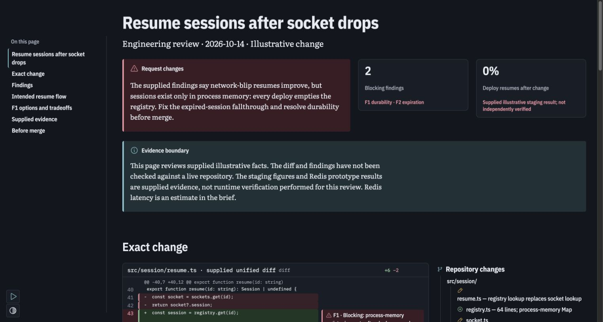
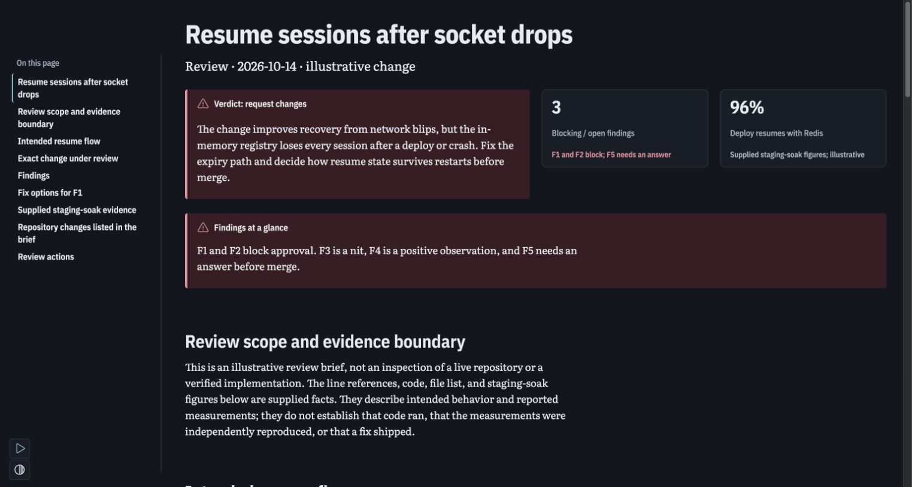
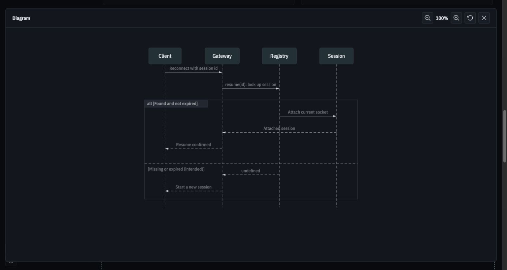
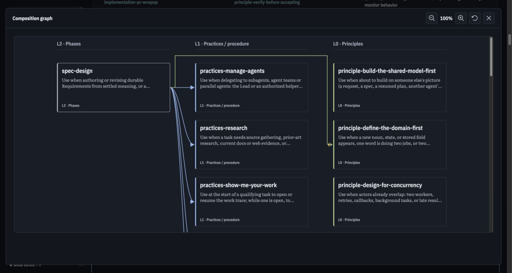

# Public Demistify library and Sol/Luna examples

Status: deployed and verified on 2026-10-16. The owner approved public library assets and samples, superseding the earlier private-hosting boundary for these artifacts. Credentials, authentication output and account metadata remain private. This is an experimental distribution, not an npm release or a stable guide acceptance claim.

## Open the pages

[All four examples](https://demistify-assets-cli-experiment.askluna.workers.dev/examples/2026-10-16-sol-luna-v1/index.html)

| Original author | Review                                                                                                                      | Full explorer                                                                                                                   |
| --------------- | --------------------------------------------------------------------------------------------------------------------------- | ------------------------------------------------------------------------------------------------------------------------------- |
| Sol             | [Open review](https://demistify-assets-cli-experiment.askluna.workers.dev/examples/2026-10-16-sol-luna-v1/sol-review.html)  | [Open explorer](https://demistify-assets-cli-experiment.askluna.workers.dev/examples/2026-10-16-sol-luna-v1/sol-explorer.html)  |
| Luna            | [Open review](https://demistify-assets-cli-experiment.askluna.workers.dev/examples/2026-10-16-sol-luna-v1/luna-review.html) | [Open explorer](https://demistify-assets-cli-experiment.askluna.workers.dev/examples/2026-10-16-sol-luna-v1/luna-explorer.html) |

The Lead prepared these public-delivery editions from the accepted round 10 model outputs; no new model runs occurred. Both review bodies are byte-identical to the originals after replacing the two library URLs. Both explorer guides now accurately describe node hover/focus tracing and arrow-click evidence. Sol's prose distinguishes skill-frontmatter claims from the proposed shared reference description. Both use the complete round 11 graph, including its source caveats. Original attempts, inputs and token ledgers remain unchanged.

## Use the shared library

These are working URLs, loaded by all four samples:

```html
<link
	rel="stylesheet"
	href="https://demistify-assets-cli-experiment.askluna.workers.dev/demistify/experimental/e3a92d2/theme.css"
/>
<script
	type="module"
	src="https://demistify-assets-cli-experiment.askluna.workers.dev/demistify/experimental/e3a92d2/runtime.js"
></script>
```

An agent writes ordinary HTML using the component guide. The browser loads the library. A consumer needs a static HTTP host, without a per-page application build, React or backend. A localhost page also rendered the hosted library and its real Mermaid sequence SVG. Cross-origin headers apply to scripts, CSS, fonts and lazy chunks. Referenced explorer JSON remains ordinary page content, served beside its HTML.

The pinned library folder has 19 files totaling 2,590,383 uncompressed bytes: runtime, worker, chunks, theme, fonts/icons and component metadata. The asset root is tied to the actual build at source commit e3a92d2aec1ac7604f05107dae7ac5bb8485d416. The final deployment uses the checked-in Worker/config, with deployment version 53a4b26e-567b-475b-8663-1bfac60365ba. Preview URLs are disabled. There is no custom-domain or moving-version-alias contract yet.

## Reproduce and deploy

Source homes:

- [Public sample sources and provenance](../../../apps/demistify-poc/experiments/agent-written/round-12-public-assets/README.md)
- [Wrangler config, Worker and frozen manifest](../../../apps/demistify-poc/experiments/cloudflare-public-assets/README.md)
- [Preparation command](../../../apps/demistify-poc/scripts/prepare-cloudflare-public.ts)

Run from the monorepo root with Node 26, pnpm and an authenticated Wrangler 4.151.0 operator CLI. The browser consumer needs none of those author/operator tools.

```sh
pnpm install
pnpm build
node apps/demistify-poc/scripts/prepare-cloudflare-public.ts
wrangler deploy --dry-run --autoconfig=false --config apps/demistify-poc/experiments/cloudflare-public-assets/wrangler.json
wrangler deploy --autoconfig=false --config apps/demistify-poc/experiments/cloudflare-public-assets/wrangler.json
```

The preparation command writes ignored tmp/demistify-cloudflare-public/public and does not log in or upload. It verifies the pinned library hashes and refuses changed files under the frozen library/sample paths. Later changes need a separately named release/sample root. Preserve every previously published release root in the staged directory when deploying again. A fresh stage containing only the newest release would drop old pinned paths; archival publication and retention automation remain unfinished. This is why the current trial does not select Static Assets over R2 for the final distribution.

The generic page checker still requires the source CLI/Node environment. A standalone checker package and the proposed Sunstack presentation-html skill integration are separate unfinished work. The skill-linkage discussion authorized no plugin changes, and none were made here.

## Verified evidence

The final unauthenticated hosted check verified all 27 files against their staged bytes: 19 library files, five HTML example pages, graph JSON, provenance JSON and a landing page. All body/hash, CORS and MIME checks passed. Pinned paths have immutable caching; a conditional request returned an empty 304 with CORS; a missing script returned 404/no-store; the landing page revalidates. See [the hosted protocol receipt](evidence/2026-10-16/cloudflare-hosted-protocol.json).

Chrome observations at a matching 1,538 × 822 CSS viewport:

| Page          | Observation                                                                                   |
| ------------- | --------------------------------------------------------------------------------------------- |
| Sol review    | 6 h2 sections, 7 outline links, 8 cards, no outer overflow or reported authoring issues       |
| Luna review   | 8 h2 sections, 9 outline links, 8 cards, no outer overflow or reported authoring issues       |
| Sol explorer  | 22 proposed-view nodes and 46 connection rows, no outer overflow or reported authoring issues |
| Luna explorer | Same 22/46 composition, no outer overflow or reported authoring issues                        |

The hosted Luna explorer switched to Current 21 nodes / 45 rows, selected the searched principle as a one-node graph, and restored spec-design through Back to 22/46. Expanding held 22 real nodes; closing restored them. Sol's sequence diagram rendered its Client, Gateway, Registry and Session participants, expanded into the centered inspector, then restored. A separate localhost page loaded the public runtime/theme and rendered the actual sequence SVG without reported authoring issues, at 1,398 × 747. See [browser observations](evidence/2026-10-16/public-browser-observations.json), [interaction proof](evidence/2026-10-16/public-interaction-proof.json) and [cross-origin proof](evidence/2026-10-16/cross-origin-browser-proof.json).

A developer observation recorded seven loaded font faces and real hosted module/worker resources. That single existing-browser navigation had FCP 192 ms with mixed cache hits and transfers; it is not a cold-load comparison, worker-execution-location proof or field performance result. A browser-tool inspection stalled independently of these resource timings; exclude that tool delay from app latency. No extra performance series was launched to disguise the uncontrolled cache state. The earlier controlled local worker probes remain separately scoped.

Static checker: five pages, zero errors and zero warnings. pnpm check passed type-aware lint, formatting and strict types. The retained suite passed 34 tests in 9 files, exit 0. The full build and a fresh preparation run passed; all deployed library hashes reproduced. No new decorative test suite was added. These are local regression checks plus actual hosted HTTP/Chrome proof, not hosted CI.









## Content and token accounting

| Public edition | HTML source tokens | Original accepted round 10 |
| -------------- | -----------------: | -------------------------: |
| Sol review     |              1,918 |                      1,872 |
| Luna review    |              1,831 |                      1,785 |
| Sol explorer   |                530 |                        459 |
| Luna explorer  |                396 |                        350 |

The complete shared graph is 776,437 bytes / 173,601 source tokens. It is not free because the wrapper references it. Public absolute URLs add markup tokens; library implementation remains excluded from per-page authored usage and recorded separately as delivery/development cost. These are o200k_base source counts, not consumed context, model generation or billing. See [the exact ledger](evidence/2026-10-16/public-usage-measurements.json).

## Remaining boundaries

This deployment closes the missing public-library URL and provides four independently hosted Sol/Luna-derived examples. It does not close original-reference visual parity, exhaustive accessibility/interaction coverage, actual author-guide read observation PF-1, a standalone checker release, multi-region edge propagation/cost or long-term immutable release retention. The illustrative review evidence and dated skill graph are not fresh runtime facts. Credentials, account identifiers and raw CLI/browser authentication output are excluded from the public artifacts.

Later correction: [sidebar inspection, neutral code notes and version-matched public guides](2026-10-16-inspection-fixes.md) provides new immutable pins and v3 examples. The earlier measurements above remain historical.
